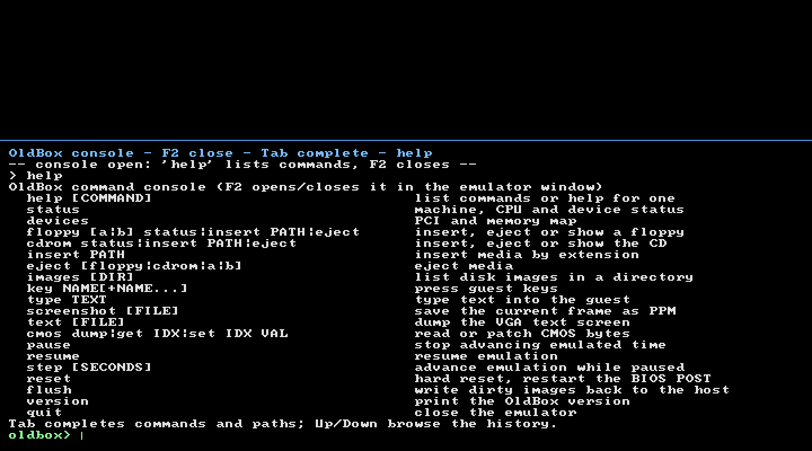

# Консоль команд (CLI)

В OldBox встроена консоль команд, которая работает **на ходу**: можно
вынуть/вставить дискету или CD, сделать скриншот, поставить машину на паузу,
отправить гостю клавиши и т.д. Консоль не перехватывает BIOS-сервисы — она
вызывает те же модели устройств, что и опции командной строки (`--floppy`,
`--cdrom`), поэтому гость видит обычную смену носителя (82077AA DSKCHG,
ATAPI «medium not present»).



## Как открыть

- **F2** в окне эмулятора открывает и закрывает панель консоли. Пока панель
  открыта, клавиатура принадлежит консоли, а не гостю: набранная команда не
  попадает в DOS. Эмуляция при этом продолжается (если не выполнена `pause`).
  **F3** независимо от консоли открывает панель счётчиков производительности
  ([docs/perf.md](perf.md)); при открытой консоли F3 тоже работает, а её
  нажатие не попадает в строку ввода.
- **Стандартный ввод терминала.** Если `oldbox` запущен из консоли
  (`run.bat`, cmd, PowerShell, bash), строки, набранные в окне терминала,
  тоже выполняются как команды. Это включается автоматически, когда stdin —
  терминал; `--console` включает чтение stdin принудительно (в том числе для
  pipe), `--no-console` выключает его.
- `F11` (полный экран) и `F12` (BMP-скриншот) работают и при открытой
  консоли. `Esc` закрывает панель.
- **F3** — панель счётчиков производительности; команда `perf` печатает тот
  же отчёт в консоль.

Пример терминального сценария:

```bat
run.bat
rem выбрать пункт, дождаться загрузки, затем в окне консоли:
floppy status
cdrom eject
insert C:\Isos\Windows95OSR2.iso
```

Консоль печатает свой вывод в stdout (в окно терминала) и одновременно
показывает его в панели F2.

## Клавиши в панели

| Клавиша | Действие |
|---|---|
| `Enter` | выполнить команду |
| `Tab` | дополнить имя команды или путь |
| `Up` / `Down` | история команд |
| `Left` / `Right` / `Home` / `End` | редактирование строки |
| `PgUp` / `PgDn` | прокрутка вывода |
| `Ctrl+L` | очистить вывод |
| `Ctrl+V` | вставить текст из буфера обмена |
| `Esc` | закрыть панель |

## Команды

Все имена команд и действий регистронезависимы, пути можно брать в двойные
кавычки (обратные слэши внутри кавычек и без них — обычные символы пути).

| Команда | Назначение |
|---|---|
| `help [КОМАНДА]` | список команд или справка по одной |
| `status` | состояние машины, CPU, памяти, видео, звука, дисков |
| `devices` | полная карта устройств, PCI и памяти |
| `floppy [a\|b] status` | что вставлено в A: или B: |
| `floppy [a\|b] insert PATH` | вставить образ дискеты |
| `floppy [a\|b] eject` | вынуть дискету |
| `cdrom status` | что вставлено в ATAPI-привод D: |
| `cdrom insert PATH` | вставить ISO (образ CD) |
| `cdrom eject` | вынуть CD |
| `insert PATH` | вставить по расширению: `.iso` → CD, `.img`/`.ima` → A: |
| `eject [floppy\|cdrom\|a\|b]` | вынуть носитель (по умолчанию A:) |
| `images [DIR]` | список образов в каталоге (по умолчанию текущий) |
| `key NAME[+NAME…]` | нажать клавиши гостя: `key enter`, `key ctrl+alt+del`, `key f1` |
| `type TEXT` | набрать текст в гостя (Enter добавляется автоматически) |
| `screenshot [FILE]` | сохранить текущий кадр в PPM (по умолчанию `oldbox-console.ppm`) |
| `text [FILE]` | вывести текстовый экран VGA (в консоль или в файл) |
| `cmos dump\|get IDX\|set IDX VAL` | чтение/запись CMOS; `set` пересчитывает контрольную сумму Award |
| `perf [report\|reset\|on\|off]` | счётчики производительности: отчёт по узлам, сброс, включение/выключение сбора |
| `pause` | остановить продвижение эмулируемого времени |
| `resume` | продолжить |
| `step [SECONDS]` | шаг эмуляции на время (по умолчанию 1/60 с), машина остаётся на паузе |
| `reset` | аппаратный сброс (POST Award начинается заново) |
| `flush` | сбросить «грязные» образы дисков/дискет на хост |
| `version` | версия OldBox |
| `quit` | закрыть эмулятор |

Псевдонимы: `?` = `help`, `mount` = `insert`, `unmount` = `eject`,
`reboot` = `reset`, `exit`/`stop` = `quit`, `ls` = `images`,
`press`/`keys` = `key`, `screen` = `text`, `continue` = `resume`,
`sync` = `flush`, `profile` = `perf`.

## Смена носителей: что видит гость

- **Дискета A:.** `eject` сначала сбрасывает изменённые сектора в образ
  (`writeback`), затем снимает носитель. Контроллер 82077AA при этом **не
  сбрасывается** — как на реальном приводе, взводится только линия смены
  диска (DIR, бит 7). Следующий SEEK/чтение её снимает. `insert` загружает
  образ и снова взводит DSKCHG; DOS/BIOS сам заметит смену носителя.
- **Дискета B:.** Моделируется отдельным носителем для INT 13h; команды
  `floppy b …` работают так же.
- **CD-ROM.** `eject` оставляет ATAPI-устройство на месте (IDENTIFY, INQUIRY,
  GET CONFIGURATION продолжают работать), но очищает носитель:
  `TEST UNIT READY`, `READ CAPACITY` и `READ(10/12)` возвращают
  `CHECK CONDITION`, sense `NOT READY (02) / ASC 3Ah` — «в лотке нет диска».
  `insert` монтирует ISO заново; при необходимости DOS-драйвер (MSCDEX)
  увидит смену носителя.
- Образы, доступные только на чтение, подключаются как write-protected
  (проверяются права и возможность открыть файл на запись).

## Примеры

```text
oldbox> floppy status
A: assets/floppy/freedos1440.img 1.44 MB 80/2/18 read-write
oldbox> floppy eject
A: disk ejected
oldbox> floppy b insert assets\floppy\Megafortress_3.5_Disk.IMA
B: inserted assets\floppy\Megafortress_3.5_Disk.IMA (720 KB, 80/2/9)
oldbox> cdrom insert C:\Isos\Windows95OSR2.iso
D: inserted C:\Isos\Windows95OSR2.iso (611 MB, 312502 sectors)
oldbox> key ctrl+alt+del
pressed ctrl+alt+del
oldbox> pause
emulation paused ('resume' continues, 'step' advances one slice)
oldbox> step 0.5
stepped 0.500 s (now 41.913 s emulated)
oldbox> screenshot
wrote oldbox-console.ppm (640x480)
```

## Реализация

- `include/oldbox/console.hpp`, `src/console.cpp` — разбор строки, таблица
  команд, вывод в журнал и stdout. Консоль не зависит от SDL и тестируется
  юнит-тестами (`tests/test_console.cpp`).
- `src/frontend/sdl3.cpp` — панель F2 (рендер через `SDL_RenderDebugText`,
  ввод через `SDL_EVENT_TEXT_INPUT`), панель F3 ([docs/perf.md](perf.md)),
  необязательный поток чтения stdin.
  Команды выполняются в главном потоке между кадрами, поэтому обращение к
  `Machine` не требует блокировок.
- `FloppyController::eject()/eject_b()` и `AtaController::eject_cdrom()` —
  модели смены носителя; `Machine::set1_key_event()` — инъекция set-1
  сканкодов для команды `key`.

В `--headless` режиме консоль не читает stdin: там нет интерактивного цикла
кадра. Используйте окно с F2 или терминальные команды в оконном режиме.
