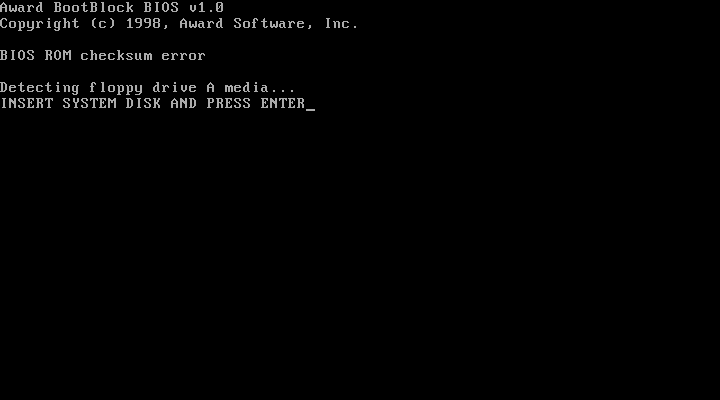

# Firmware и 256 KiB Award BIOS

## Почему 256 KiB

В 1998 году Award BIOS для i440BX уже не помещался в классические 128 KiB
(`E0000–FFFFF`). Плата EP-61BXA-M использует 2 Mbit (256 KiB) flash. В real
mode процессор видит только 64 KiB окно `F000:0000–FFFF`; остальные банки
доступны через banking/page switching чипсета, через protected/unreal mode
по верхнему адресу `FFFC0000–FFFFFFFF`, либо после копирования в shadow RAM.
После POST код распаковывается в RAM (`E0000–FFFFF` и выше), а flash-окно
освобождается/используется для runtime-сервисов.

`oldbox` реализует:

- полный 256 KiB образ, отображённый на `4 GiB - 256 KiB` (`FFFC0000`);
- 64 KiB shadow-копию последнего банка в `F0000–FFFFF`, куда CPU попадает
  после сброса через `F000:FFF0`;
- RAM в `C8000–EFFFF` под decompressed-модули и ESCD;
- S3 option ROM 32 KiB на `C0000`;
- VGA aperture `A0000–BFFFF` и RAM до 640 KiB.

Этого достаточно для reset-вектора и раннего кода, но **недостаточно для
полного Award POST**. Проверка по таблице POST-кодов из
`specs/mb/bxam-6292878438627290308580.pdf` показала:

- `C0` — turn off OEM cache/shadow;
- `C1` — auto-detection of onboard DRAM & cache;
- `41` — program the rest of the chipset values.

На экране при этом виден **Award BootBlock BIOS v1.0** и сообщение
`BIOS ROM checksum error`, затем `Detecting floppy drive A media...` и
`INSERT SYSTEM DISK AND PRESS ENTER`. То есть это не main POST Award:



работает **boot block** из последних 64 KiB образа.

Сами файлы `EP-ZXA.bin`, `BXC09716.BIN` и `old.bin` — это настоящие
256 KiB образы flash BIOS. Boot block из
верхних 64 KiB отрабатывает, проверяет образ, не получает ожидаемую
контрольную сумму main BIOS и уходит в recovery-режим с дискеты.

Причина незавершённого main POST сейчас локализована в эмуляции, а не в
формате файла:

- 256 KiB Award BIOS использует shadow RAM (`PAM`/`XBCS`) и банковое окно
  i440BX; плоское отображение верхних 256 KiB недостаточно;
- boot block выполняет relocation/передачу управления main BIOS через
  upper/lower bank; нужна точная модель выбора банка и shadow-копирования;
- после передачи управления трассировка иногда уходит в
  неинициализированную область — это признак неверного банка/relocation,
  а не отсутствия main BIOS в образе.

То есть `C0/C1` и DRAM/cache-тест уже проходятся, boot block читает
дискету, но **полный Award POST пока не доведён до экрана конфигурации**.
Сообщение `BIOS ROM checksum error` — следствие текущей модели
банков/shadow, а не сбой DRAM. Образ BIOS полный.

## Встроенный POST ROM

`src/bios/fallback_bios.S` — настоящий 16-битный x86 ROM (64 KiB):

- устанавливает IVT для INT 10h/11h/12h/13h/15h/16h/19h;
- рисует текст напрямую в VGA text buffer;
- печатает баннер, CPUID vendor, объём памяти из CMOS, список PCI-устройств;
- ищет ATA primary master, читает LBA0 через PIO и передаёт управление
  boot-сектору; при ошибке печатает сообщение и уходит в HLT.

Он собирается `as --32` и линкуется `ld --oformat binary`; CMake генерирует
`fallback_bios.inc`, который встраивается в `oldbox_core`.

## Загрузка образов

`tools/prepare_assets.py` извлекает:

- `assets/bios/EP-ZXA.bin` из `specs/mb/bxc09406.zip`;
- `assets/bios/BXC09716.BIN` из `specs/mb/bxc09716.exe`;
- `assets/vga/S3Trio64_1_14-04.bin` из `specs/`;
- пустую дискету `assets/floppy/blank1440.img`.

Порядок поиска: `--bios`, затем `assets/bios/bios.bin`, `BXC09716.BIN`,
`EP-ZXA.bin`, иначе встроенный ROM. S3 ROM: `--vga-bios`, `assets/vga/...`,
`specs/S3Trio64_1_14-04.bin`.

## POST-коды

`Bus` перехватывает записи в port 0x80 и хранит последние 4096 кодов.
`Machine::status_text()` печатает хвост. Для Award на текущей ревизии видны
`C0 C1`; это означает «turn off OEM cache/shadow» и «auto-detect DRAM &
cache», после чего BIOS уходит в beep-loop. Дальнейшая работа требует
банкового декодера Award и точной модели DRAM/SPD-инициализации i440BX.

## PIIX4 / 440BX: BIOS-окно и shadow

По даташитам в `specs/`:

- `82371AB.PDF`, раздел 8.1.3 «BIOS Memory»: PIIX4 поддерживает 1 MiB
  BIOS-пространства. Верхние 64 KiB (`F0000–FFFFF`, алиас
  `FFFF0000–FFFFFFFF`) всегда forwarding на ISA/BIOSCS#. Нижние 64 KiB
  (`E0000–EFFFF`, алиас `FFFE0000–FFFEFFFF`) включаются битом 6 регистра
  **XBCS** (offset `4E–4Fh`, reset value `0003h`). Extended BIOS:
  `FFF80000–FFFDFFFF` (бит 7), 1M extended `FFF00000–FFF7FFFF` (бит 9).
- `82443BX.PDF`, раздел 3.3.17: **PAM[6:0]** (offsets `59h–5Fh`, reset
  value `00h`) задают RE/WE для сегментов `C0000–FFFFF`. RE=0 — чтение
  уходит в PCI/ROM, RE=1 — в DRAM; WE=0 — запись уходит в PCI, WE=1 — в
  DRAM. Штатный shadow: сначала WE=1/RE=0 (запись в RAM), затем
  WE=1/RE=1.

Раньше эмулятор просто раскладывал ROM в RAM и игнорировал PAM/XBCS —
это было неверно. Теперь `PamWindow` (`src/chipset/i440bx.cpp`) обслуживает
`C8000–FFFFF`, читает PAM на каждом доступе и учитывает XBCS bit 6 для
нижнего BIOS. Для 256 KiB образа E0000 отдаёт **первый** 64 KiB банк, а
F0000 — последний (boot block), что соответствует логике PIIX4
lower/top BIOS. Добавлен regression-тест
`pam_shadow_window_read_write_attributes`.

После этого трассировка boot block изменилась (пропал POST `C3`,
появился `C5`), то есть PAM/shadow-путь теперь реально используется.
Остаётся корректно смоделировать выбор банка и передачу управления main
BIOS. Трассировка boot block показывает, что перед передачей управления
он выставляет `SS=0`, `SP=1000h` (код на `F000:E2EF`), а main BIOS
использует far-переходы в upper/lower bank. Это следующий проверяемый
участок.


## Checksum Award boot block

Контрольная сумма реального boot block находится в `F000:E8A8`:

- `DS = F600`, `SI = 0`, `CX = 0FFFh`;
- сумма байтов `F600:0000–0FFE` складывается в `AH`;
- `AH` сравнивается с байтом `F600:0FFF`.

В `old.bin`/`bxc00920.bin` этот блок даёт `SUM=0`, `BYTE=0` — то есть
**контрольная сумма проходит**. Сообщение `BIOS ROM checksum error`
печатается позже, из recovery-ветки boot block (`F000:F99D`, строка
`F000:FF00`), и не является результатом этого сравнения. Поэтому искать
ошибку нужно не в checksum-цикле, а в загрузке/передаче управления
main BIOS.

Отдельно исправлен 8042: бит 2 статуса (`system flag`) теперь
выставляется только после успешного self-test (команды `AAh`/`EBh`), а не
постоянно. Это убрало ложный отказ keyboard-теста в boot block.

## FreeDOS/Award floppy

Собран `assets/floppy/awardflash1440.img`: FreeDOS 1.2 boot sector,
`KERNEL.SYS`, `COMMAND.COM`, `AWDFLASH.EXE`, `BXC00920.BIN`,
`AUTOEXEC.BAT` с `AWDFLASH /PY /SN /R`. Генератор —
`tools/make_award_floppy.py`.

Добавлен `--press-enter`, чтобы отправить Enter после сообщения
`INSERT SYSTEM DISK AND PRESS ENTER`.

Для загрузки с floppy добавлен INT13 AH=02 path через
`FloppyController::read_chs` и INT13 AH=08 (геометрия 1.44M). Boot block
пишет:

```text
Drive media is : 1.44Mb
........................................
```

и читает секторы дискеты.

**FreeDOS 1.2 теперь доходит до промпта `A:\>`.** Сквозной путь:

1. Award boot block читает boot sector FreeDOS с дискеты;
2. boot sector загружает `KERNEL.SYS` в `0060:0000`;
3. UPX-распаковщик распаковывает ядро в `0058:0000` и прыгает на entry;
4. ядро инициализирует диск/память, запускает `COMMAND.COM` (FreeCom);
5. в VGA text buffer появляются `FreeDOS kernel ...`, `FreeCom version ...`
   и `A:\>`.

Ключевой баг был в CPU, а не в BIOS: `ADC`/`SBB` не учитывали перенос, если
`src+carry` переполнял разрядность. UPX-распаковщик собирает битовый поток
через `adc bh,bh`/`adc cx,cx`; при `src=0xFF`/`0xFFFF` и CF=1 поток
портился, ядро распаковывалось в мусор и CPU уходил в NOP-заливку. После
исправления (и добавления INT 1Ah AH=00/02/04 и корректных ошибок INT 13h
для отсутствующих дисков) загрузка стабильна.

```bash
./build/oldbox --bios assets/bios/EP-ZXA.bin \
  --floppy assets/floppy/freedos1440.img \
  --headless --seconds 2 --dump-text
```

При отладке загрузки дополнительно найдены и исправлены две ошибки PIT,
из-за которых время DOS не шло:

- запись `reload=0` трактовалась как «таймер выключен», тогда как на
  8253/8254 это **65536**; BIOS программирует channel 0 именно нулём;
- `cycles_to_pit_ticks()` не сбрасывал накопленные наносекунды после
  перевода в тики, поэтому возвращал **накопленное** число тиков, а
  `tick_counter()` добавлял его к счётчику каждый раз. В результате PIT
  генерировал ~568 тыс. прерываний в секунду вместо 18.2; BDA-счётчик
  `0040:006C` и время DOS уезжали вперёд. Теперь тики считаются как
  дельта, а `reload=0` обрабатывается как 65536.

Скриншоты: `docs/freedos-boot.png`, `docs/freedos-prompt.png`.
Тест: `freedos_boots_to_command_prompt_with_reference_bios` в
`tests/test_machine.cpp` (пропускается, если assets не извлечены).

## Обёртка для MEMTEST.IMG

`assets/floppy/MEMTEST_WRAPPER.IMG` — 1.44 MiB FAT12-дискета, которую
принимает Award boot block. Она собирается:

```bash
python3 tools/make_memtest_wrapper.py
```

Как устроена обёртка:

- boot sector берётся из `assets/floppy/freedos1440.img` — именно этот
  boot sector Award boot block уже умеет загружать;
- `KERNEL.SYS` — маленький загрузчик на `0x0060:0000`; FreeDOS boot sector
  загружает его как обычное ядро;
- в образ записан снимок `0x10000..0x9ffff`, снятый в момент входа в
  `Setup.S` MEMTEST (`CS:IP = 9020:0000`, ядро уже на `0x10000`);
- загрузчик читает снимок с дорожек 1..32 и передаёт управление на
  `9020:0000`, не трогая оригинальный `MEMTEST.IMG`.

Проверка:

```bash
./build/oldbox --bios assets/bios/EP-ZXA.bin \
  --floppy assets/floppy/MEMTEST_WRAPPER.IMG \
  --headless --seconds 2 --dump-ram /tmp/memtest-ram.bin
```

После запуска в дампе видны загрузчик по `0x600`, `Setup.S` по `0x90200`
и ядро MEMTEST по `0x10000`: обёртка проходит Award boot block и запускает
`Setup.S`. Дальше сам MEMTEST 5.00RC1 уходит в real-mode BIOS/сбой
инициализации — это отдельное ограничение CPU/BIOS-эмуляции, не загрузки
обёртки.

## Сброс: INIT, hard reset и «Save & Exit Setup»

На PIIX4 это три разных события (даташит `82371AB.PDF`, 4.2.7.4):

- **INIT (soft reset).** Ассертится по записи `1` в бит 0 порта `92h`
  (`FAST_INIT`) и по линии `RCIN#` от 8042 (команда `FEh` в порт `64h` или
  бит 0 выходного порта, записанный нулём). Процессор начинает с
  `F000:FFF0`, но DRAM, CMOS, PAM и конфигурация PCI сохраняются.
- **Hard reset.** Запись в `CF9h` значения с битом 2 (`RCPU`), переходящим
  из 0 в 1, при `SRST` (бит 1) = 1: PIIX4 ассертит `CPURST`, `PCIRST#` и
  `RSTDRV`. Сбрасываются CPU, PAM (в `00h`) и устройства, но **не** DRAM и
  **не** battery-backed CMOS.
- **Power-on.** `Machine::reset()`: обнуляет DRAM и инициализирует CMOS по
  умолчанию; вызывается конструктором и командой консоли `reset`.

`Machine::hard_reset()` и `Machine::init()` реализуют первые два случая;
`pending_reset_` в `Machine` хранит, какой именно сброс запросило
устройство. Порт `CF9h` лежит внутри блока mechanism #1
(`CF8h–CFFh`), поэтому `PciBus` владеет всем блоком, а байтовые доступы к
`CF9h` переадресует PIIX4 (`PciBus::set_reset_port`): 32-битные циклы
конфигурации не должны расщепляться на `CF9h`.

### Почему Save & Exit не перезагружался

Award Setup сохраняет CMOS и выполняет `mov dx,0CF9h / mov al,06h /
out dx,al` (жёсткий сброс). После сброса BIOS идёт по «тёплому» пути: он
ожидает, что RAM с распакованным POST-кодом и CMOS с только что
сохранёнными настройками живы, а reset vector читается по `FFFFFFF0h`.
В эмуляторе было две ошибки:

- обработчик `CF9h` был недоступен: `PciBus` отображал на себя
  `CF8h–CFFh` и перекрывал порт PIIX4. Байт `06h` попадал в регистр адреса
  конфигурации, сброса не происходило;
- S3 Trio64 отображал свой 32-килобайтный option ROM по значению
  `FFFF8000h` — это маска размера, записываемая Award при зондировании
  ROM BAR, с **нулевым** битом 0 (decode enable). Отображение снимало
  системный BIOS `FFFC0000–FFFFFFFF` вместе с reset vector; после сброса
  CPU читал по `FFFFFFF0h` байт `FFh`, получал `#UD` и уходил в мусор.

Теперь `S3Trio64` отображает option ROM только при `rom_enable_`
(бит 0 ROM BAR), а жёсткий сброс сохраняет DRAM/CMOS. Параметры primary
master Award держит в CMOS `26h–2Dh`; `Machine::reset()` заполняет их из
подключённого HDD, поэтому Setup видит C:, и после `Save & Exit` диск не
пропадает (подробнее — в [cmos.md](cmos.md#диск-c-и-save--exit-setup)). Проверка: войти в
Setup по `Del`, нажать `F10`, затем `Y` и `Enter` (Award использует
Y/N-поле, `Y` лишь меняет ответ, подтверждает `Enter`) — машина заново
проходит POST. Регрессии: `piix4_8042_reset_line_runs_init`,
`piix4_cf9_is_reachable_next_to_pci_config_block`,
`s3_option_rom_probe_value_does_not_hide_system_bios`,
`machine_hard_reset_preserves_dram_and_cmos`.
