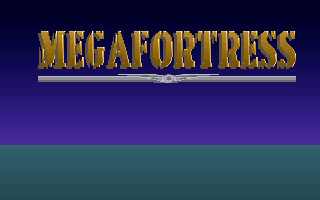

# Megafortress в oldbox

Mindscape **Megafortress** (сборка Sep 04 1991) — DOS-игра в реальном режиме,
устанавливается с дискеты `Megafortress_3.5_Disk.IMA` на жёсткий диск
(программа `INSTALL`, файлы распаковываются в `C:\MEGA`).

## Запуск

Используется загрузочная дискета `assets/floppy/freedos-games.img` (FreeDOS
1.2 + HIMEMX 3.32, `DOS=HIGH`), вариант 5 в `run.bat`. AUTOEXEC.BAT
загружает резидентный INT 33h-драйвер мыши `MOUSE.COM` (Microsoft
`MMOUSE.COM`, собирается в образ скриптом `tools/make_games_floppy.py`),
поэтому игра стартует с поддержкой мыши:

```
A:\> C:
C:\> CD \MEGA
C:\MEGA> MEGA
```

Установка (однократно): `B:` → `INSTALL`.

Титульный экран после успешного старта:


Скриншот выше запечатлён в середине вступительной анимации заката:
полосы закатного неба прокручиваются вниз и уходят с экрана, после чего
остаётся статичная заставка (синее небо + красный логотип
«MEGAFORTRESS»). Анимация заставки синхронизирована с музыкальным
движком через таймер OPL2, поэтому до исправления OPL-таймеров
(звуковая карта не определялась) она замирала на полосах.

## Память

Игра в реальном режиме и использует только обычную (conventional) память:
загрузчик получает всё свободное место, внутри выделяет окно виртуальной
памяти (VMEM), куда страницами грузит театр боевых действий из `MEGA.D01`,
и при нехватке места печатает `Memory exausted: 2001` (код ошибки 0x2001
печатается в hex через INT 10h AH=0Eh) и завершается с кодом 4.

`CHKSYS.EXE` из `C:\MEGA` показывает «Available memory» (наибольший блок
обычной памяти):

| Конфигурация загрузки               | Available memory | Игра |
|---|---|---|
| голый FreeDOS (kernel + FreeCom)    | 439 536 (429 К)  | `Memory exausted: 2001` |
| HIMEMX + `DOS=HIGH`                 | 563 392 (550 К)  | запускается |

Поэтому для игры нужна дискета с HIMEMX и `FDCONFIG.SYS`
(`DEVICE=HIMEMX.EXE`, `DOS=HIGH`); FreeCom при этом сам выгружает свой
транзиент в XMS. JEMM386 пока не используется — см. ниже.

## Найденные и исправленные ошибки CPU

Отладка запуска (FreeDOS `DOS=HIGH` входит в защищённый режим собственным
кодом ядра, а JEMM386 проверяет 386 через POPF) вскрыла две ошибки в
`Cpu::cpl()`:

1. **CPL в реальном режиме.** CPL вычислялся как `CS.selector & 3` — для
   реального режима это мусор (CPL архитектурно равен 0; CS — адрес
   параграфа, а не селектор). Из-за этого POPF в реальном режиме маскировал
   IOPL/NT, и детектор 386 в JEMM386 (`POPF 0x7000; PUSHF`) не срабатывал:
   «Jemm386: at least a 80386 cpu is required».

2. **CPL сразу после `MOV CR0` (PE=1).** До первой дальней передачи
   управления в защищённом режиме CPL берётся из кэшированного дескриптора
   CS, а не из битов селектора. Сегмент, загруженный в реальном режиме,
   кэширует DPL=0, поэтому ядро FreeDOS после `MOV CR0` могло выполнить
   `LLDT AX` без #GP. Старый код давал CPL=2 (младшие биты CS=0x312) и
   зацикливал ядро на исключении.

Теперь `cpl()` возвращает 0 в реальном режиме, 3 в V86 и DPL из
кэшированного байта доступа CS в защищённом режиме (см.
`include/oldbox/cpu.hpp`).

## Осталось (не блокирует игру)

- **JEMM386 5.78 падает** после загрузки («Jemm386: exception 3E ...»)
  на этапе продолжения обработки FDCONFIG/UMB — похоже на проблему
  V86/пейджинга. EMS игре не нужен, поэтому загрузочная дискета собрана
  без него.

## Звук

Детектор игры (AdLib-проба через порт 0x388, одинаковая в `CHKSYS.EXE`
и `MEGA.EXE`) проверяет таймеры OPL2: после маскирования и сброса
(регистр 04h = 60h, затем 80h) статус должен читаться как 00h, а после
записи счётчика таймера 1 = FFh и старта (04h = 21h) с ожиданием — как
C0h. Период таймера = (256 − N) × 80.8 мкс (YM3812), поэтому FFh
переполняется за один тик. В эмуляции OPL3-модуля (`src/audio/opl3.cpp`) таймеры и
статус-регистр реализованы по этому описанию; цикл ожидания игры
(~200 `IN` в порт 0x388) укладывается в тик за счёт моделирования
латентности шины ISA (~1 мкс на портовый цикл) в процессоре.

`CHKSYS.EXE` теперь выводит `sound card: detected`, и на заставке играет
музыка (9-канальный OPL2 через FM-синтезатор карты).

## Мышь

PS/2-мышь подключается к 8042 (порт J4 платы EP-61BXA-M, см.
`specs/mb/36457-ep-61bxa-m-…pdf`). Контроллер эмулируется по главе
«Keyboard and Auxiliary Device Controller» из IBM Personal System/2
Hardware Interface Technical Reference: статус-регистр 64h, командный
байт 20h/60h, команды A7h–AEh, C0h–C2h, D1h–D4h, F0h–FFh, команды
устройства (FFh/F6h/F5h/F4h/F3h/F2h/F0h/EEh/EC/EBh/EAh/E9h/E8h/E7h/E6h)
и стандартный 3-байтовый пакет перемещения (бит 3 первого байта = 1,
знаки X/Y в битах 4/5). Драйвер мыши в гостевой ОС — штатный Microsoft
`MMOUSE.COM` (INT 33h API: игра вызывает AX=00h и AX=14h).

`CHKSYS.EXE` выводит `resident mouse driver: detected` и, после движения
мыши, `mouse activity: detected`; статус — `Ok to run megafortress`
(без пометки «without mouse support»). В эмуляторе мышь захватывается
F1 (или кликом по окну) и уходит гостю как относительные перемещения.
