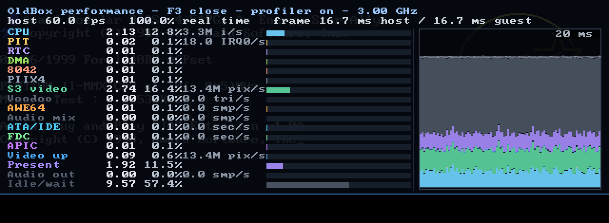

# Счётчики производительности (F3)

Встроенный профилировщик отвечает на вопрос, который возникает при
эмуляции тяжёлого гостя: **почему эмулятор не успевает за реальным временем
и какая модель железа съедает кадр хоста**. Это не отладчик гостевого кода,
а счётчики хостового времени, разложенного по аппаратным узлам машины и по
этапам самого фронтенда.



## Панель F3

- **F3** открывает и закрывает полупрозрачную панель. Эмуляция при этом не
  останавливается, а клавиши продолжают уходить гостю: F3 поглощается
  эмулятором (как и F2), остальные клавиши работают как обычно. Панель
  доступна и при открытой консоли F2.
- Если гостю всё же нужна F3 (просмотр в файловом менеджере), её можно
  отправить командой консоли `key f3`.
- `--perf` открывает панель сразу при запуске окна; в `--headless` режиме
  печатает такой же отчёт после прогона.
- `--no-perf` полностью выключает сбор счётчиков (самый низкий оверхед).

Верхние строки панели:

```text
OldBox performance - F3 close - profiler on - 3.00 GHz - guest 9.7 fps
host 59.9 fps   99.9% real time   frame 16.7 ms host / 16.7 ms guest
```

`host` — частота итераций цикла SDL, а **не** частота кадров игры.
`guest` — сколько раз в секунду реально менялась картинка гостя (фронтенд
сравнивает сетку 32×24 точки кадра до отрисовки панели). На статичном экране
(меню, пауза, неподвижный кадр ролика) `guest` равен 0, хотя `host`
по-прежнему 60. Это и есть число, которое надо сравнивать с ощущаемым fps
игры: `host 60` + `guest 10` означает, что эмулятор успевает вовремя, но
гость рисует всего 10 кадров в секунду.

`% real time` — отношение эмулированного времени к хостовому за последние
две секунды. 100% означает, что эмулятор отдаёт ровно один «секундный»
бюджет планировщика за секунду хоста; сам бюджет задаётся `--sched` и может
быть ниже паспортной частоты CPU (по умолчанию 48 МГц для 233 и 64 МГц для
333). Поэтому 100% не означают, что гость получает настоящий Pentium II:
сравнивайте `CPU` и `guest fps`. 30% — что гость видит один кадр за три с
половиной реальных. `frame A/B` — сколько хостовых миллисекунд занял кадр и
сколько эмулированных он должен был занять (16.7 мс при 60 Гц).

Строки — аппаратные узлы и этапы фронтенда:

| Строка | Что входит | Счётчик работы |
|---|---|---|
| `CPU` | интерпретатор/JIT, гостевые RAM/ROM/MMIO и «лёгкие» обращения к портам | инструкции/с |
| `PIT` | 8254: три счётчика, refresh-бит порта 61h | IRQ0/с |
| `RTC` | MC146818/CMOS | — |
| `DMA` | 8237 | — |
| `8042` | контроллер клавиатуры/мыши | — |
| `PIIX4` | остаток `Piix4::tick`: PM-таймер и маршрутизация IRQ | — |
| `S3 video` | композиция кадра Trio64 (текст/графика/VGA) и 2D-движок | пиксели/с |
| `Voodoo` | растеризация треугольников, fast fill, пересчёт 565→XRGB | треугольники/с |
| `AWE64` | синтез SB16 DSP, EMU8000 и OPL3 (YMF262) в `Awe64::tick` | сэмплы/с |
| `Audio mix` | хостовый ресемплинг карты и микширование PC Speaker | сэмплы/с |
| `ATA/IDE` | PIO-блоки и ATAPI, включая сброс «грязного» образа на диск | сектора/с |
| `FDC` | 82077AA: DMA-передачи секторов | сектора/с |
| `APIC` | таймер локального APIC | — |
| `Video up` | загрузка текстуры в SDL, отрисовка кадра и оверлеев F2/F3 | пиксели/с |
| `Present` | `SDL_RenderPresent`, включая ожидание вертикальной синхронизации | — |
| `Audio out` | постановка буфера в аудиопоток SDL | сэмплы/с |
| `Idle/wait` | сон в бюджете 60 Гц (`SDL_DelayNS`) | — |

Серые/нулевые строки означают, что узел в этом окне не работал: например,
`Voodoo` во время текстового POST или `ATA` при загрузке без дисковых
операций. Это и есть ответ на вопрос «где тормозит»: видно не только
занятые, но и заведомо свободные узлы.

## График

Справа — стопка последних примерно 110 кадров хоста (около двух секунд при
60 Гц). Каждый столбец — один кадр, сегменты раскрашены как строки панели,
серый сегмент — время, не отнесённое ни к одному узлу (опрос событий SDL,
консольный ввод, служебные операции). Горизонтальная линия — бюджет
16.7 мс (60 Гц). Столбец выше линии означает, что в этом кадре эмулятор не
уложился в реальное время; всплеск одного цвета сразу показывает виновника.
Масштаб по вертикали подписан в правом верхнем углу графика (максимум по
окну, не меньше 20 мс).

`Present` и `Idle/wait` — это не эмуляция, а хостовые затраты: презентация
кадра (с ожиданием вертикальной синхронизации) и сон в оставшемся бюджете
кадра. Когда эмулятор успевает с запасом, эти строки растут, а `% real
time` остаётся 100%. Когда не успевает, они близки к нулю, а сумма
остальных строк превышает 16.7 мс.

Если включён vsync, ожидание кадра блокирует сам `SDL_RenderPresent`,
поэтому оно попадает в `Present`, а `Idle` после него уже 0: это одна и та
же пауза, просто в другом вызове. Чтобы оценить запас для `--sched`,
складывайте `Present + Idle`; в панели host-этапы отделены линией, в
текстовом отчёте — строкой `-- host-side (not guest work) --` и итогом
`host`. В строке `status` доля host-этапов показывается отдельно, а в
«четвёрку самых занятых узлов» они больше не попадают.

## Как считаются миллисекунды

- Хостовое время снимается `rdtsc` (на x86-64; на других платформах —
  `std::chrono::steady_clock` в наносекундах) и один раз калибруется по
  `steady_clock` при первом обращении (около 20 мс при старте). Частоту
  часов панель показывает в заголовке.
- Каждый узел обёрнут в RAII-скоуп `PerfScope`: батч тактов PIIX4, кадр S3,
  команда 2D-движка, треугольник Voodoo, блок ATA, сектор FDC, кадр
  аудио-синтеза, презентация SDL. Скоупы не вкладываются друг в друга.
- CPU — не функция, а цикл, поэтому он измеряется «фазой» между двумя
  батчами устройств (`begin_cpu_phase()`/`end_cpu_phase()`). Работа
  устройств, вызванная гостевыми портами внутри фазы (команда
  треугольника Voodoo, чтение блока ATA), вычитается из времени CPU, чтобы
  ни один узел не считался дважды.
- Кадр профилировщика — одна итерация цикла SDL: начало кадра, эмуляция,
  звук, загрузка текстуры, презентация и сон. Хранится 300 кадров (около
  пяти секунд при 60 Гц). Заголовок и строки панели усреднены по последним
  60 кадрам (около секунды при 60 Гц), поэтому время кадра в заголовке —
  это ровно знаменатель процентов в строках; график показывает мгновенную
  историю.
- Сбор включён всегда и стоит около 1% хостового времени: замер на загрузке
  FreeDOS (10 эмулированных секунд) дал 4.35 с без счётчиков и 4.4–4.45 с
  с ними. `--no-perf` убирает и это.
- В `--headless` режиме `--perf` оборачивает прогон в один учётный кадр и
  печатает накопленные суммы; график в этом режиме не нужен.

## Ограничения

- Гостевые обращения к RAM/ROM/MMIO и «дешёвые» порты (PIC, PIT, RTC,
  клавиатура) не размечаются отдельными скоупами — они входят в `CPU`.
  Иначе пришлось бы читать TSC на каждое обращение к памяти и профилировщик
  сам стал бы узким местом. Тяжёлые операции моделей (кадр S3, треугольник
  Voodoo, блок ATA, сектор FDC, синтез EMU8000) размечены и в CPU не
  попадают.
- Интерпретатор и JIT не разделены: оба видны как `CPU`. Для деталей JIT
  есть `--jit-stats`.
- `Present` может включать ожидание вертикальной синхронизации, а
  `Audio out` — блокировку аудиопотока; это хостовые затраты, а не работа
  эмулятора.
- Счётчики событий (`i/s`, `tri/s`, `pix/s`, `smp/s`, `sec/s`) — это также
  средние по окну; они показывают, насколько узел был загружен, но не
  заменяют потактовую трассировку.
- `guest fps` — это видимая частота обновления экрана, а не внутренний
  счётчик кадров игры: сцена, которая перерисовывается с той же картинкой,
  даёт 0. Порог детектора (8 изменённых точек из 768) отсекает мигающий
  текстовый курсор и мелкие HUD-анимации.
- Время самих скоупов входит в измеренные значения (несколько десятков
  наносекунд на батч), поэтому доли могут немного отличаться от «чистого»
  прогона.

## Консоль и командная строка

```text
oldbox> perf
OldBox performance counters (on profiler, host clock 3.00 GHz)
  1 frame, 5.45 s host, 10.00 s guest (183.4% real time), 59.8M instructions
  node            time     share  activity
  CPU             3.61 s   66.2%  11.0M i/s
  PIT            8.37 ms    0.2%  33.0 IRQ0/s
  ...
  S3 video        1.76 s   32.2%  26.4M pix/s
  ...
  measured        5.42 s   99.4%
  unmeasured     34.9 ms    0.6%
oldbox> perf reset
performance counters reset
oldbox> perf off
performance counters disabled
oldbox> perf on
performance counters enabled
```

`perf report` — синоним `perf`; `perf reset` очищает накопленные суммы и
историю; `perf off`/`perf on` включают и выключают сбор на ходу.

Без окна:

```bash
./build/oldbox --bios assets/bios/EP-ZXA.bin \
               --vga-bios assets/vga/S3Trio64_1_14-04.bin \
               --floppy assets/floppy/freedos1440.img \
               --headless --seconds 10 --perf
```

В конце прогона печатается отчёт по узлам (пример выше — как раз загрузка
FreeDOS 1.2 до POST). Обратите внимание: на текстовом POST `S3 video`
занимает около трети хостового времени — это честный результат композиции
720×400 кадров на хосте, а не ошибка эмуляции.

## Как этим пользоваться

- **`host` 60, а `guest` 10.** Эмулятор укладывается в бюджет, но гость
  рисует 10 кадров/с: смотрите `CPU` (упор в процессор) и `--sched`.
  Убедитесь, что это не статичный кадр ролика: `guest` честно показывает 0,
  когда картинка не меняется.
- **`CPU` близко к 100%, остальное мало.** Упирается в интерпретатор.
  Проверьте `--jit` (сравните отчёт с ним и без него) и `--jit-stats`;
  ищите дорогие инструкции/fallback'и.
- **Растёт `S3 video`.** Дорогая композиция кадра или 2D-движок: текстовые
  режимы, линейные режимы, блит/заливка. Смотрите, не перерисовывается ли
  кадр чаще, чем нужно.
- **Растёт `Voodoo`.** Растеризатор: число треугольников и пикселей. В
  играх это обычно главный кандидат на оптимизацию.
- **Растут `AWE64`/`Audio mix`.** Синтез EMU8000/OPL3 (YMF262) или хостовый
  ресемплинг; проверьте, не включён ли звук там, где он не нужен.
- **Растут `ATA/IDE` или `FDC`.** Дисковые операции (PIO-блоки, сброс
  грязных образов). Для CD-ROM это чтение секторов из ISO в памяти.
- **Растут `Present`/`Idle/wait`, а `% real time` = 100%.** Эмулятор не
  тормозит — его ограничивает вертикальная синхронизация/сон, то есть
  железо хоста успевает.
- **Большой серый сегмент (unmeasured).** Время ушло на опрос событий,
  консольный ввод или служебные операции фронтенда, а не на модели.

## Реализация

- `include/oldbox/perf.hpp`, `src/perf.cpp` — счётчики, скоупы, история
  кадров, текстовый отчёт и строка для `status`.
- `src/machine.cpp` — частота планировщика (`--sched`), фаза CPU и
  `tick_devices()`: каждый батч устройств
  обёрнут в скоуп; `src/chipset/piix4.cpp` делит PIIX4 на PIT/RTC/DMA/8042,
  `src/video/s3_trio64.cpp` и `src/video/voodoo.cpp` размечают кадр и
  тяжёлые команды, `src/audio/awe64.cpp` считает сэмплы синтеза,
  `src/storage/ata.cpp` и `src/storage/floppy.cpp` — блоки и сектора,
  `src/chipset/pit.cpp` — IRQ0.
- `src/frontend/sdl3.cpp` — панель F3, скоупы `Video up`/`Present`/
  `Audio out`/`Idle/wait`, границы кадра профилировщика и детектор
  изменившегося кадра гостя (сетка 32×24 → `guest fps`).
- `src/console.cpp` — команда `perf`; `src/config.cpp`, `src/main.cpp` —
  `--perf`/`--no-perf` и отчёт в headless-режиме.
- `tests/test_perf.cpp` — арифметика узлов, вычитание вложенной работы,
  кольцо истории, отчёт и интеграционный прогон машины.
