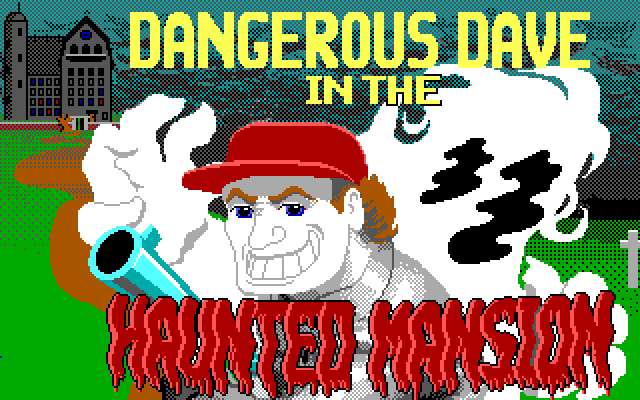
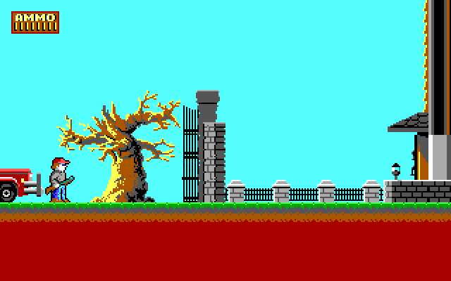

# S3 Trio64: CRTC start address, byte mode и double scan

Проверка по `specs/trio32-trio64-graphics-accelerators-mar1995-*.pdf`
(разделы 11.4.1 «CRTC Timing Specification», 14-26…14-32) и по поведению
Dangerous Dave 2. Найденные ошибки влияли на вывод уровня: вместо страницы
`0x5000` выводилась страница `0` со сдвигом, а 200-строчный кадр растягивался
на 400 строк.

## 1. CR0C/CR0D: старший и младший байты start address

В VGA CRTC:

| регистр | назначение |
|---|---|
| CR0C | Start Address High |
| CR0D | Start Address Low |
| CR0E | Cursor Location High |
| CR0F | Cursor Location Low |

В `display_start_word()` байты были перепутаны:

```cpp
// было
const u32 low = crtc_[0x0C] | (crtc_[0x0D] << 8);
// стало
const u32 low = crtc_[0x0D] | (crtc_[0x0C] << 8);
```

Игра пишет в CR0C/CR0D значение `0x5000` (страница уровня в VRAM):
`CR0C = 0x50`, `CR0D = 0x00`. Старый код собирал из этого `0x0050`,
умножал на 2 и выводил `0x00A0` — начало страницы 0, а не 0x5000. Отсюда
«мусор» на уровне и пропавшая стена.

Аналогично были перепутаны CR0E/CR0F в `text_rgb()` (позиция курсора):
старший байт — CR0E, младший — CR0F.

## 2. CR17 bit 6: byte address mode

Бит 6 регистра CR17 выбирает единицу счётчика адреса памяти:

- `0` — word mode: адрес в словах, к start address добавляется ×2;
- `1` — byte mode: start address задан в байтах, множитель 1.

Dangerous Dave 2 устанавливает `CR17 = 0xE3` (byte mode) и
`CRTC start = 0x5000`, поэтому `m.start` должен быть равен 0x5000, а не
0xA000. Формула теперь:

```cpp
m.start = enhanced ? sw * 8 : chain4 ? sw * 4 : byte_mode ? sw : sw * 2;
```

## 3. CR9 bit 7: DBL SCN (double scanning)

Бит 7 регистра CR9 включает двойную развёртку: каждая логическая строка
повторяется дважды, а регистры вертикального тайминга по-прежнему считают
физические 400 строк. Игра ставит `CR9 = 0xC0` (DBL SCN, max scan line 0)
при `VDE = 400`.

Старый расчёт `rows = vde / char_h` давал 400 логических строк, и рендерер
читал из VRAM лишние 200 строк (следующую страницу/мусор). Теперь:

```cpp
m.dbl_scan = (crtc_[0x09] & 0x80) != 0;
m.scan_per_row = m.char_h * (m.dbl_scan ? 2 : 1);
m.rows = vde / m.scan_per_row;
```

Для текстового режима `sy` делится на 2, поэтому каждая строка шрифта
действительно выводится дважды; для графики кадр остаётся 320×200
(логические строки), как и у mode 13h.

## 4. Периодически неверная палитра: кадр внутри записи таблицы

BIOS `INT 10h AX=0x1002` пишет палитру **по одному регистру**: index/data
на каждый из 16 цветов. Если кадр отрендерить между двумя парами, в кадре
окажутся цвета из двух разных fade-таблиц DD2. На реальном VGA это тоже
возможно, но в GUI это выглядит как «палитра то правильная, то нет».

Теперь S3 отслеживает именно последовательность AR00…AR0F:

- при `attr_write(0, …)` начинается burst;
- последующие индексы 1…15 только накапливаются в `attr_`;
- рендерер использует **последнюю целую** таблицу `render_attr_`;
- на 16-м регистре таблица фиксируется одним снимком.

Если последовательность неполная/одиночная, запись применяется сразу; для
одиночного AR00 есть idle-flush на следующем кадре. Поэтому нет ни
смешанных кадров, ни «дёрганья» между старой и новой таблицей.

Заодно `reset()` явно сбрасывает `mode_`, `width_`, `height_`, `frame_` и
burst-состояние палитры, чтобы после перезапуска не оставалось состояния
предыдущего видеорежима.

## Тесты

Добавлены в `tests/test_s3.cpp`:

- `s3_crtc_start_address_high_low` — CR0C/CR0D не перепутаны; word mode
  умножает start на 2;
- `s3_crtc_byte_mode_start_address` — CR17 bit 6 даёт множитель 1;
- `s3_cr9_double_scan_halves_logical_rows` — 400-строчный тайминг с DBL SCN
  даёт 200 логических строк, последняя строка читается из VRAM;
- `s3_cr9_double_scan_text_cursor` — двойная развёртка в текстовом режиме
  (курсор на строках 26–29);
- существующий `s3_text_mode_builtin_font_and_cursor` обновлён под
  правильные CR0E/CR0F;
- `s3_attribute_palette_table_is_committed_atomically` — кадр после AR00…AR07
  остаётся со старой таблицей, после AR08…AR0F применяется целая новая;
- `s3_reset_restores_power_on_mode_and_palette` — reset возвращает
  текстовый режим, EGA-палитру и чистое поле.

Проходят все 305 тестов; `freedos_boots_to_command_prompt_with_reference_bios`
по-прежнему загружает FreeDOS, а `assets/floppy/dd2.img` доходит до титульного
экрана и до уровня 1 без «Invalid Opcode» и без мусора.

## Результат в DD2




