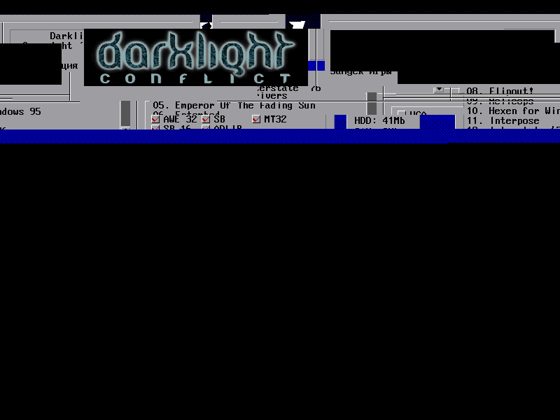
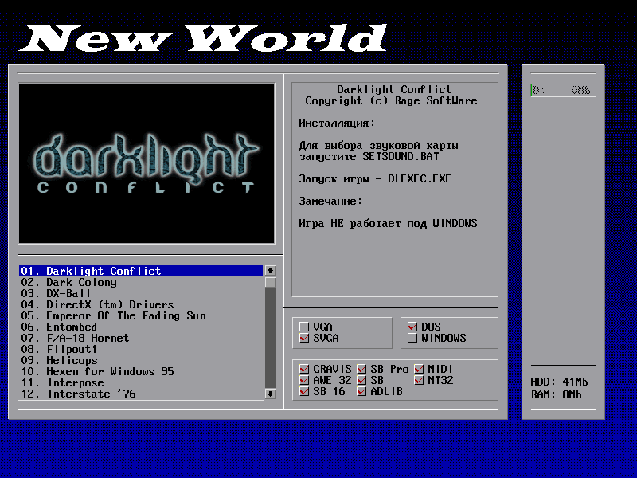

# S3 Trio64: CRTC start address, byte mode и double scan

Проверка по `specs/trio32-trio64-graphics-accelerators-mar1995-*.pdf`
(разделы 11.4.1 «CRTC Timing Specification», 14-26…14-32) и по поведению
Dangerous Dave 2. Найденные ошибки влияли на вывод уровня: вместо страницы
`0x5000` выводилась страница `0` со сдвигом, а 200-строчный кадр растягивался
на 400 строк.

## 1. CR0C/CR0D: старший и младший байты start address

В VGA CRTC:

| регистр | назначение |
|---|---|
| CR0C | Start Address High |
| CR0D | Start Address Low |
| CR0E | Cursor Location High |
| CR0F | Cursor Location Low |

В `display_start_word()` байты были перепутаны:

```cpp
// было
const u32 low = crtc_[0x0C] | (crtc_[0x0D] << 8);
// стало
const u32 low = crtc_[0x0D] | (crtc_[0x0C] << 8);
```

Игра пишет в CR0C/CR0D значение `0x5000` (страница уровня в VRAM):
`CR0C = 0x50`, `CR0D = 0x00`. Старый код собирал из этого `0x0050`,
умножал на 2 и выводил `0x00A0` — начало страницы 0, а не 0x5000. Отсюда
«мусор» на уровне и пропавшая стена.

Аналогично были перепутаны CR0E/CR0F в `text_rgb()` (позиция курсора):
старший байт — CR0E, младший — CR0F.

## 2. CR17 bit 6: byte address mode

Бит 6 регистра CR17 выбирает единицу счётчика адреса памяти:

- `0` — word mode: адрес в словах, к start address добавляется ×2;
- `1` — byte mode: start address задан в байтах, множитель 1.

Dangerous Dave 2 устанавливает `CR17 = 0xE3` (byte mode) и
`CRTC start = 0x5000`, поэтому `m.start` должен быть равен 0x5000, а не
0xA000. Формула теперь:

```cpp
m.start = enhanced ? sw * 8 : chain4 ? sw * 4 : byte_mode ? sw : sw * 2;
```

## 3. CR9 bit 7: DBL SCN (double scanning)

Бит 7 регистра CR9 включает двойную развёртку: каждая логическая строка
повторяется дважды, а регистры вертикального тайминга по-прежнему считают
физические 400 строк. Игра ставит `CR9 = 0xC0` (DBL SCN, max scan line 0)
при `VDE = 400`.

Старый расчёт `rows = vde / char_h` давал 400 логических строк, и рендерер
читал из VRAM лишние 200 строк (следующую страницу/мусор). Теперь:

```cpp
m.dbl_scan = (crtc_[0x09] & 0x80) != 0;
m.scan_per_row = m.char_h * (m.dbl_scan ? 2 : 1);
m.rows = vde / m.scan_per_row;
```

Для текстового режима `sy` делится на 2, поэтому каждая строка шрифта
действительно выводится дважды; для графики кадр остаётся 320×200
(логические строки), как и у mode 13h.

## 4. Периодически неверная палитра: кадр внутри записи таблицы

BIOS `INT 10h AX=0x1002` пишет палитру **по одному регистру**: index/data
на каждый из 16 цветов. Если кадр отрендерить между двумя парами, в кадре
окажутся цвета из двух разных fade-таблиц DD2. На реальном VGA это тоже
возможно, но в GUI это выглядит как «палитра то правильная, то нет».

Теперь S3 отслеживает именно последовательность AR00…AR0F:

- при `attr_write(0, …)` начинается burst;
- последующие индексы 1…15 только накапливаются в `attr_`;
- рендерер использует **последнюю целую** таблицу `render_attr_`;
- на 16-м регистре таблица фиксируется одним снимком.

Если последовательность неполная/одиночная, запись применяется сразу; для
одиночного AR00 есть idle-flush на следующем кадре. Поэтому нет ни
смешанных кадров, ни «дёрганья» между старой и новой таблицей.

Заодно `reset()` явно сбрасывает `mode_`, `width_`, `height_`, `frame_` и
burst-состояние палитры, чтобы после перезапуска не оставалось состояния
предыдущего видеорежима.

## 5. Палитра «мерцала» при вертикальном скроллинге: адрес счётчика не
   заворачивался на 64 КиБ

При вертикальном скроллинге DD2 держит две страницы 320×200 в одном 64-КиБ
окне VGA и переключает их каждый кадр. Вторая страница находится по адресу
`0xE429`: при 64 байтах на строку нижние ~90 строк выходят за `0x10000`.
На реальном VGA 16-битный счётчик адреса заворачивается в начало **той же**
плоскости, поэтому нижняя часть кадра читается с `0x0040` и т. д.

Рендерер складывал `m.start + y * pitch` без заворота, и после `0x10000`
`plane_addr(p, off)` попадал в начало следующей плоскости. В результате
нижняя половина второго буфера показывала пиксели, собранные из чужих
плоскостей: цвета менялись через кадр — это и выглядело как мерцание
палитры. Теперь `ModeInfo::addr_limit` хранит разрядность счётчика (64 КиБ
в byte mode, 128 КиБ в word mode; при ненулевых битах CR69/CR31/CR51 —
1 МиБ), и все пути выборки (planar, chain-4/linear, текстовый режим,
`native_pixel`/`native_write`) маскируют адрес по этому пределу.

Регрессия: `s3_planar_display_address_wraps_at_64k` — начало `0xF000`, строка
52 попадает на `0x10040` и должна читаться из плоскости 0 по адресу `0x0040`,
а не из плоскости 1.

## 6. Индикатор AMMO дёргался при беге: не был реализован AR13 (pixel panning)

Плавный горизонтальный скролл DD2 делает двумя регистрами: `CR0C/CR0D` =
`scroll >> 3`, а `AR13` (через `0x90A8`: порт `0x3C0`, индекс `0x33`) =
`scroll & 7`. Игра рисует HUD с поправкой на этот сдвиг, рассчитывая, что
железо сдвинет влево **весь** кадр, включая AMMO. Рендерер AR13 игнорировал:
картинка двигалась рывками по 8 пикселей, а HUD, скомпенсированный на 1
пиксель, прыгал на 1 пиксель при каждом изменении pan — это и было «дёрганье»
AMMO.

Теперь `ModeInfo::pan` хранит уже **эффективный** сдвиг, и выборка идёт по
пикселю `x + pan`: в planar — со сдвигом внутри байта, в 8-битных режимах —
со сдвигом адреса, в тексте — со сдвигом точки глифа. В 9-точечном тексте
кодировка AR13 другая (таблица H_PX_PAN): `AR13=0` — сдвиг на 1 точка,
`AR13=8` — без сдвига, `AR13=7` — на 8. Поэтому `set_text_mode()` ставит
`AR13=8`, как BIOS mode 3; иначе FreeDOS терял первый символ каждой строки
(`ARRANTY` вместо `WARRANTY`, `reeCom` вместо `FreeCom`).

Регрессии: `s3_attribute_pixel_pan_shifts_planar_output` — при `pan = 1`
экранный пиксель 7 читает пиксель 8 памяти (следующий байт), а не 7;
`s3_nine_dot_text_pan_maps_eight_to_zero_shift` — в 9-точечном тексте
`AR13=8` не сдвигает строку, а `AR13=0` сдвигает на одну точку.

## 7. VBE-банкинг 800x600x8: CR6A — это 64-КиБ страница в chain-4

Оболочка установщика WORLD9 (`INSTALL.EXE`, CyberWare VFS) после пароля
переключается в VBE-режим `0x103` — 800x600, 8 бит/пиксель, chain-4.
ModeInfo этого режима сообщает `WinGranularity = 0x40` (64 КиБ),
`WinSize = 0x40` и 8 банков; приложение рисует кадр 480000 байт через окно
`A0000`, вызывая `INT 10h AX=4F02` и `AX=4F05`.

Обработчик `4F05` в S3 BIOS устроен так (ROM `C000:4EDE`):

- если включён chain-4 (`SR4` бит 3), номер банка пишется в `CR6A` **как
  есть** — это номер 64-КиБ страницы;
- в planar-режимах BIOS пишет `bank * 4`, и `CR6A` работает в документированных
  16-КиБ единицах.

В `cpu_base()` `CR6A` всегда сдвигался на 14, то есть даже в chain-4 номер
банка трактовался как 16-КиБ смещение. Банк 1 попадал в `0x4000` вместо
`0x10000`, банки накладывались друг на друга, и оболочка WORLD9 выводила
«кашу» из кусков разных окон. Теперь единицы `CR6A` зависят от chain-4:

```cpp
if (crtc_[0x6A] & 0x3F) {
    const u32 page = crtc_[0x6A] & 0x3F;
    return (seq_[0x04] & 0x08) ? (page << 16) : (page << 14);
}
return ((crtc_[0x35] & 0x0F) | ((crtc_[0x51] & 0x0C) >> 2)) << 16;
```

Заодно исправлен сдвиг старших бит display start: `CR31` биты 5-4 — это
биты адреса 19-18, поэтому `(CR31 & 0x30) << 14`, а не `<< 12`. `CR51`
биты 1-0 и `CR69` биты 3-0 уже собирались правильно.

До и после:





## Тесты

Добавлены в `tests/test_s3.cpp`:

- `s3_crtc_start_address_high_low` — CR0C/CR0D не перепутаны; word mode
  умножает start на 2;
- `s3_crtc_byte_mode_start_address` — CR17 bit 6 даёт множитель 1;
- `s3_cr9_double_scan_halves_logical_rows` — 400-строчный тайминг с DBL SCN
  даёт 200 логических строк, последняя строка читается из VRAM;
- `s3_cr9_double_scan_text_cursor` — двойная развёртка в текстовом режиме
  (курсор на строках 26–29);
- `s3_vesa_bank_window_selects_64k_page` — `CR6A=2` в chain-4 отображает
  `A0000` на VRAM `0x20000`, `CR6A=3` — на `0x30000`, а соседние страницы
  не затираются;
- существующий `s3_text_mode_builtin_font_and_cursor` обновлён под
  правильные CR0E/CR0F;
- `s3_attribute_palette_table_is_committed_atomically` — кадр после AR00…AR07
  остаётся со старой таблицей, после AR08…AR0F применяется целая новая;
- `s3_reset_restores_power_on_mode_and_palette` — reset возвращает
  текстовый режим, EGA-палитру и чистое поле;
- `s3_planar_display_address_wraps_at_64k` — адрес отображения заворачивается
  на 64 КиБ внутри плоскости (вертикальный скроллинг DD2);
- `s3_attribute_pixel_pan_shifts_planar_output` — AR13 сдвигает выдачу на
  `pan` пикселей (плавный горизонтальный скролл и фиксированный HUD);
- `s3_nine_dot_text_pan_maps_eight_to_zero_shift` — кодировка AR13 в
  9-точечном тексте: 8 = без сдвига, 0 = сдвиг на точку.

Все тесты проходят; `freedos_boots_to_command_prompt_with_reference_bios`
по-прежнему загружает FreeDOS, а `assets/floppy/dd2.img` доходит до титульного
экрана и до уровня 1 без «Invalid Opcode» и без мусора.

## Результат в DD2


