# LM78

## Microprocessor System Hardware Monitor

*National Semiconductor Corporation — February 2000 — DS012873*

> **Source:** [`lm78-66a3ed40ef4df132701615.pdf`](lm78-66a3ed40ef4df132701615.pdf).
> All figures, diagrams and equations have been extracted from the original PDF at native resolution
> into the [`img/`](img/) directory.

---

## Contents

- [General Description](#general-description)
- [Applications](#applications)
- [Features](#features)
- [Key Specifications](#key-specifications)
- [Typical Application](#typical-application)
- [Ordering Information](#ordering-information)
- [Connection Diagram](#connection-diagram)
- [Block Diagram](#block-diagram)
- [Pin Descriptions](#pin-descriptions)
- [Absolute Maximum Ratings](#absolute-maximum-ratings)
- [Operating Ratings](#operating-ratings)
- [DC Electrical Characteristics](#dc-electrical-characteristics)
- [AC Electrical Characteristics](#ac-electrical-characteristics)
- [Electrical Characteristics Notes](#electrical-characteristics-notes)
- [Test Circuit](#test-circuit)
- [Functional Description](#functional-description)
  - [1.0 General Description](#10-general-description)
  - [2.0 Interface](#20-interface)
  - [2.1 Internal Registers of the LM78](#21-internal-registers-of-the-lm78)
  - [2.2 Serial Bus Interface](#22-serial-bus-interface)
  - [3.0 Using the LM78](#30-using-the-lm78)
  - [3.1 Power On](#31-power-on)
  - [3.2 Resets](#32-resets)
  - [3.3 Using the Configuration Register](#33-using-the-configuration-register)
  - [3.4 Starting Conversion](#34-starting-conversion)
  - [3.5 Reading Conversion Results](#35-reading-conversion-results)
  - [4.0 Analog Inputs](#40-analog-inputs)
  - [5.0 Layout and Grounding](#50-layout-and-grounding)
  - [6.0 Fan Inputs](#60-fan-inputs)
  - [7.0 Temperature Measurement System](#70-temperature-measurement-system)
  - [7.1 Temperature Data Format](#71-temperature-data-format)
  - [7.2 Temperature Interrupts](#72-temperature-interrupts)
  - [8.0 The LM78 Interrupt Structure](#80-the-lm78-interrupt-structure)
  - [8.1 Interrupt Clearing](#81-interrupt-clearing)
  - [9.0 Reset and Power Switch Bypass Outputs](#90-reset-and-power-switch-bypass-outputs)
  - [10.0 POST RAM](#100-post-ram)
  - [11.0 NAND Tree Tests](#110-nand-tree-tests)
  - [12.0 Fan Manufacturers](#120-fan-manufacturers)
  - [13.0 Registers and RAM](#130-registers-and-ram)
- [Typical Application (PC Application Circuit)](#typical-application-pc-application-circuit)
- [Physical Dimensions](#physical-dimensions)
- [Life Support Policy](#life-support-policy)

---

## General Description

The LM78 is a highly integrated Data Acquisition system for hardware monitoring of servers, Personal
Computers, or virtually any microprocessor based system. In a PC, the LM78 can be used to monitor
power supply voltages, temperatures, and fan speeds. Actual values for these inputs can be read at
any time, and programmable WATCHDOG™ limits in the LM78 activate a fully programmable and maskable
interrupt system with two outputs.

The LM78 has an on-chip temperature sensor, 5 positive analog inputs, two inverting inputs (for
monitoring negative voltages), and an 8-bit ADC. An input is provided for the overtemperature outputs
of additional temperature sensors and this is linked to the interrupt system. The LM78 provides
inputs for three fan tachometer outputs. Additional inputs are provided for Chassis Intrusion
detection circuits, VID monitor inputs, and chainable interrupt. The LM78 provides both ISA and
Serial Bus interfaces. A 32-byte auto-increment RAM is provided for POST (Power On Self Test) code
storage.

## Applications

- System Hardware Monitoring for Servers and PCs
- Office Electronics
- Electronic Test Equipment and Instrumentation

## Features

- Temperature sensing
- 5 positive voltage inputs
- 2 op amps for negative voltage monitoring
- 3 fan speed monitoring inputs
- Input for additional temperature sensors
- Chassis Intrusion Detector input
- WATCHDOG comparison of all monitored values
- POST code storage RAM
- ISA and I2C™ Serial Bus interfaces

## Key Specifications

| Specification | Value |
| --- | --- |
| Voltage monitoring accuracy | ±1% (max) |
| Temperature accuracy (−10 °C to +100 °C) | ±3 °C (max) |
| Supply voltage | 5V |
| Supply current — operating | 1 mA typ |
| Supply current — shutdown | 10 µA typ |
| ADC resolution | 8 bits |

## Typical Application

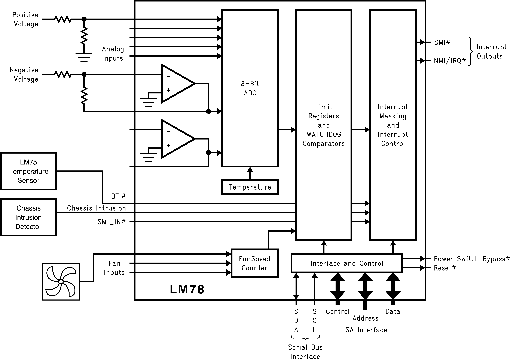

*Typical application block diagram (DS012873-1).*

`#` indicates Active Low ("Not").

---

TRI-STATE® is a registered trademark of National Semiconductor Corporation. 
WATCHDOG™ is a trademark of National Semiconductor Corporation. 
I2C® is a registered trademark of the Philips Corporation.

---

<!-- page 2 -->

## Ordering Information

| Order Number | Device Marking | Package | Temperature Range |
| --- | --- | --- | --- |
| LM78CCVF | LM78CCVF-J | VGZ44A | −10 °C ≤ TA ≤ +100 °C |

## Connection Diagram

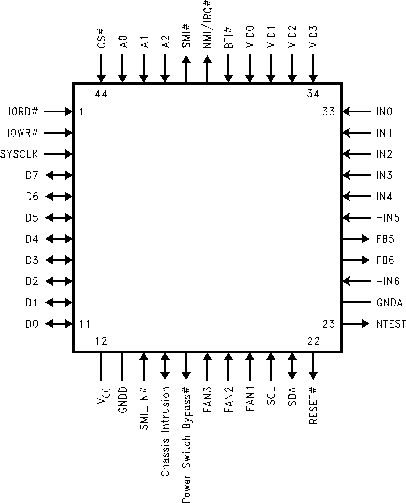

*Connection diagram, 44-lead PQFP (DS012873-2).*

## Block Diagram

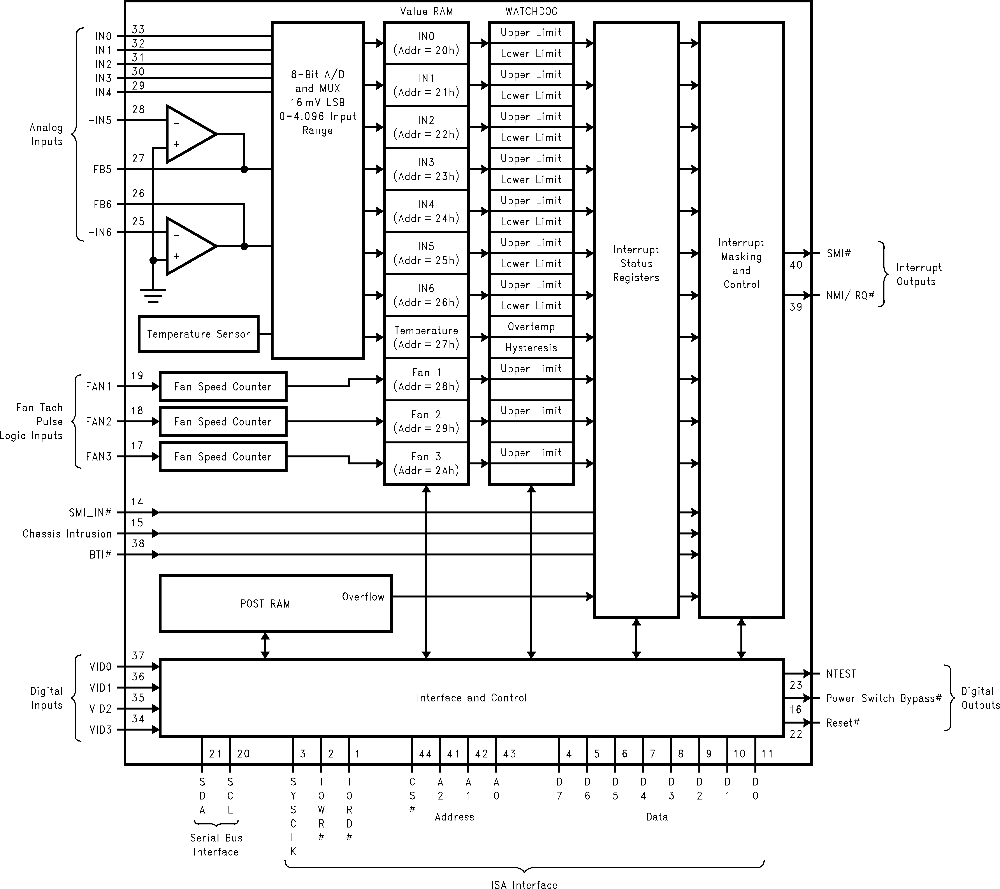

*Block diagram (DS012873-3).*

---

<!-- page 3 -->

## Pin Descriptions

| Pin Name(s) | Pin Number | Number of Pins | Type | Description |
| --- | --- | --- | --- | --- |
| IORD# | 1 | 1 | Digital Input | An active low standard ISA bus I/O Read Control. |
| IOWR# | 2 | 1 | Digital Input | An active low standard ISA bus I/O Write Control. |
| SYSCLK | 3 | 1 | Digital Input | The reference clock for the ISA bus. Typically ranges from 4.167 MHz to 8.33 MHz. The minimum clock frequency this input can handle is 1 Hz. |
| D7–D0 | 4–11 | 8 | Digital I/O | Bi-directional ISA bus Data lines. D0 corresponds to the low order bit, with D7 the high order bit. |
| VCC (+5V) | 12 | 1 | POWER | +5V VCC power. Bypass with the parallel combination of 10 µF (electrolytic or tantalum) and 0.1 µF (ceramic) bypass capacitors. |
| GNDD | 13 | 1 | GROUND | Internally connected to all digital circuitry. |
| SMI_IN# | 14 | 1 | Digital Input | Chainable SMI# (System Management Interrupt) Input. This is an active low input that propagates the SMI# signal to the SMI# output of the LM78 via SMI Mask Register Bit 6 and SMI# enable Bit 1 of the Configuration Register. |
| Chassis Intrusion | 15 | 1 | Digital I/O | An active high input from an external circuit which latches a Chassis Intrusion event. This line can go high without any clamping action regardless of the powered state of the LM78. The LM78 provides an internal open drain on this line, controlled by Bit 7 of NMI Mask Register 2, to provide a minimum 20 ms reset of this line. |
| Power Switch Bypass# | 16 | 1 | Digital Output | An active low push-pull output intended to drive an external P-channel power MOSFET for software power control. |
| FAN3–FAN1 | 17–19 | 3 | Digital Input | 0V to +5V amplitude fan tachometer input. |
| SCL | 20 | 1 | Digital Input | Serial Bus Clock. |
| SDA | 21 | 1 | Digital I/O | Serial Bus bidirectional Data. |
| RESET# | 22 | 1 | Digital Output | Master Reset, 5 mA driver (open drain), active low output with a 20 ms minimum pulse width. Available when enabled via Bit 7 in SMI Mask Register 2. |
| NTEST | 23 | 1 | Test Output | NAND Tree totem-pole output that provides board-level connectivity testing. Refer to Section 11.0 on NAND Tree testing. |
| GNDA | 24 | 1 | GROUND | Internally connected to all analog circuitry. The ground reference for all analog inputs. |
| −IN6 | 25 | 1 | Analog Input | Ground-referred inverting op amp input. Refer to Section 4.0, "ANALOG INPUTS". |
| FB6 | 26 | 1 | Analog Output | Output of inverting op amp for Input 6. Refer to section 4.0, "ANALOG INPUTS". |
| FB5 | 27 | 1 | Analog Output | Output of inverting op amp for Input 5. Refer to section 4.0, "ANALOG INPUTS". |
| −IN5 | 28 | 1 | Analog Input | Ground-referred inverting op amp input. Refer to Section 4.0, "ANALOG INPUTS". |
| IN4–IN0 | 29–33 | 5 | Analog Input | 0V to 4.096V FSR Analog Inputs. |
| VID3–VID0 | 34–37 | 4 | Digital Input | Voltage Supply readouts from P6. This value is read in the VID/Fan Divisor Register. |
| BTI# | 38 | 1 | Digital Input | Board Temperature Interrupt driven by O.S. outputs of additional temperature sensors such as LM75. Provides internal pull-up of 10 kΩ. |
| NMI/IRQ# | 39 | 1 | Digital Output | Non-Maskable Interrupt (open source)/Interrupt Request (open drain). The mode is selected with Bit 5 of the Configuration Register and the output is enabled when Bit 2 of the Configuration Register is set to 1. The default state is disabled and IRQ mode. |
| SMI# | 40 | 1 | Digital Output | System Management Interrupt (open drain). This output is enabled when Bit 1 in the Configuration Register is set to 1. The default state is disabled. |

<!-- page 4 -->

**Pin Descriptions (Continued)**

| Pin Name(s) | Pin Number | Number of Pins | Type | Description |
| --- | --- | --- | --- | --- |
| A2–A0 | 41–43 | 3 | Digital Input | The three lowest order bits of the 16-bit ISA Address Bus. A0 corresponds to the lowest order bit. |
| CS# | 44 | 1 | Digital Input | Chip Select input from an external decoder which decodes high order address bits on the ISA Address Bus. This is an active low input. |
| **TOTAL PINS** | **44** | | | |

---

<!-- page 5 -->

## Absolute Maximum Ratings

*(Notes 1, 2)*

If Military/Aerospace specified devices are required, please contact the National Semiconductor Sales
Office/Distributors for availability and specifications.

| Parameter | Rating |
| --- | --- |
| Positive Supply Voltage (VCC) | 6.5V |
| Voltage on Any Input or Output Pin | −0.3V to (VCC+0.3V) |
| Ground Difference (GNDD–GNDA) | ±300 mV |
| Input Current at any Pin (Note 3) | ±5 mA |
| Package Input Current (Note 3) | ±20 mA |
| Maximum Junction Temperature (TJ max) | 150 °C |
| ESD Susceptibility (Note 5) — Human Body Model | 2000V |
| ESD Susceptibility (Note 5) — Machine Model | 175V |
| Soldering Information, PQFP Package (Note 6) — Vapor Phase (60 seconds) | 215 °C |
| Soldering Information, PQFP Package (Note 6) — Infrared (15 seconds) | 220 °C |
| Storage Temperature | −65 °C to +150 °C |

## Operating Ratings

*(Notes 1, 2)*

| Parameter | Rating |
| --- | --- |
| Operating Temperature Range TMIN ≤ TA ≤ TMAX, LM78 | −55 °C ≤ TA ≤ +125 °C |
| Specified Temperature Range TMIN ≤ TA ≤ TMAX, LM78 | −10 °C ≤ TA ≤ +100 °C |
| Junction to Ambient Thermal Resistance (θJA (Note 4)), NS Package ID: VGZ44A | 62 °C/W |
| Supply Voltage (VCC) | +4.25V to +5.75V |
| Ground Difference (IGNDD–GNDAI) | ≤100 mV |
| VIN Voltage Range | −0.05V to VCC + 0.05V |

---

## DC Electrical Characteristics

*(Note 7)*

The following specifications apply for +4.25 VDC ≤ VCC ≤ +5.75 VDC,
fSYSCLK = 8.33 MHz, RS = 25Ω, unless otherwise specified. **Boldface limits apply
for TA = TJ = TMIN to TMAX; all other limits
TA = TJ = 25 °C.**

| Symbol | Parameter | Conditions | Typical (Note 8) | Limits (Note 9) | Units (Limits) |
| --- | --- | --- | --- | --- | --- |
| **POWER SUPPLY CHARACTERISTICS** | | | | | |
| ICC | Supply Current | Interface Inactive | 1.0 | **2** | mA (max) |
| ICC | Supply Current | Shutdown Mode | 10 | | µA |
| **TEMPERATURE-TO-DIGITAL CONVERTER CHARACTERISTICS** | | | | | |
| | Accuracy | −10 °C ≤ TA ≤ +100 °C | | **±3** | °C (max) |
| | Resolution | | **1** | | °C (min) |
| **ANALOG-TO-DIGITAL CONVERTER CHARACTERISTICS** | | | | | |
| | Resolution (8 bits with full-scale at 4.096V) | | 16 | | mV |
| TUE | Total Unadjusted Error | (Note 10) | | **±1** | % (max) |
| DNL | Differential Non-Linearity | | | **±1** | LSB |
| PSS | Power Supply Sensitivity | | | **±1** | %/V |
| tC | Total Monitoring Cycle Time | (Note 11) | 1.0 | **1.5** | sec (max) |
| **OP AMP CHARACTERISTICS** | | | | | |
| | Output Current (Sourcing) | | 50 | | µA |
| | Input Offset Voltage | IOUT = 50 µA | | **±1** | mV |
| | Input Bias Current | | | **±0.1** | nA |
| | PSRR | | 60 | | dB |
| | DC Open Loop Gain | | 70 | | dB |
| | Gain Bandwidth Product | | 500 | | kHz |
| **MULTIPLEXER/ADC INPUT CHARACTERISTICS** | | | | | |
| | On Resistance | | 400 | **2000** | Ω (max) |
| | Off Channel Leakage Current | | | **±0.1** | nA |
| | Input Current (On Channel Leakage Current) | | | **±0.1** | nA |
| **FAN RPM-TO-DIGITAL CONVERTER** | | | | | |
| | Accuracy | +25 °C ≤ TA ≤ +75 °C | | **±10** | % (max) |
| | Accuracy | −10 °C ≤ TA ≤ +100 °C | | **±15** | % (max) |
| | Full-scale Count | | | **255** | (max) |

<!-- page 6 -->

**DC Electrical Characteristics (Continued)** *(Note 7)*

| Symbol | Parameter | Conditions | Typical (Note 8) | Limits (Note 9) | Units (Limits) |
| --- | --- | --- | --- | --- | --- |
| **FAN RPM-TO-DIGITAL CONVERTER** | | | | | |
| | FAN1 and FAN2 Nominal Input RPM (See Section 6.0) — Divisor = 1, Fan Count = 153 (Note 12) | | 8800 | | RPM |
| | FAN1 and FAN2 Nominal Input RPM (See Section 6.0) — Divisor = 2, Fan Count = 153 (Note 12) | | 4400 | | RPM |
| | FAN1 and FAN2 Nominal Input RPM (See Section 6.0) — Divisor = 3, Fan Count = 153 (Note 12) | | 2200 | | RPM |
| | FAN1 and FAN2 Nominal Input RPM (See Section 6.0) — Divisor = 4, Fan Count = 153 (Note 12) | | 1100 | | RPM |
| | FAN3 Design Nominal Input RPM — Fan Count = 153 (Note 12) | | 4400 | | RPM |
| | Internal Clock Frequency | +25 °C ≤ TA ≤ +75 °C | 22.5 | **20.2** | kHz (min) |
| | Internal Clock Frequency | +25 °C ≤ TA ≤ +75 °C | | **24.8** | kHz (max) |
| | Internal Clock Frequency | −10 °C ≤ TA ≤ +100 °C | 22.5 | **19.1** | kHz (min) |
| | Internal Clock Frequency | −10 °C ≤ TA ≤ +100 °C | | **25.9** | kHz (max) |
| **DIGITAL OUTPUTS (Power Switch Bypass#, NTEST, NMI/IRQ#)** | | | | | |
| VOUT(1) | Logical "1" Output Voltage | IOUT = ±5.0 mA | | **2.4** | V (min) |
| VOUT(0) | Logical "0" Output Voltage | IOUT = ±5.0 mA | | **0.4** | V (max) |
| **ISA D0–D7 DIGITAL OUTPUTS** | | | | | |
| VOUT(1) | Logical "1" Output Voltage | IOUT = ±12.0 mA | | **2.4** | V (min) |
| VOUT(0) | Logical "0" Output Voltage | IOUT = ±12.0 mA | | **0.4** | V (max) |
| IOUT | TRI-STATE® Output Current | VOUT = 0 VDC | 0.005 | **1** | µA (max) |
| IOUT | TRI-STATE® Output Current | VOUT = VCC | −0.005 | **−1** | µA (min) |
| **OPEN DRAIN DIGITAL OUTPUTS (SDA, RESET#, SMI#, Chassis Intrusion)** | | | | | |
| VOUT(0) | Logical "0" Output Voltage | IOUT = −5.0 mA | | **0.4** | V (min) |
| IOH | High Level Output Current | VOUT = VCC | 0.1 | **100** | µA (max) |
| | RESET# and Chassis Intrusion Pulse Width | | 45 | **20** | ms (min) |
| **DIGITAL INPUTS: SMI_IN#, VID0–VID3, BTI#, CS#, A0, A1, A2, Mode Control and Interface Inputs (IORD#, IOWR#, SYSCLK), Data Lines (D0–D7), Chassis Intrusion, and Tach Pulse Logic Inputs (FAN1, FAN2, FAN3)** | | | | | |
| VIN(1) | Logical "1" Input Voltage | | | **2.0** | V (min) |
| VIN(0) | Logical "0" Input Voltage | | | **0.8** | V (max) |
| **SERIAL BUS DIGITAL INPUTS (SCL, SDA)** | | | | | |
| VIN(1) | Logical "1" Input Voltage | | | **0.7 x VCC** | V (min) |
| VIN(0) | Logical "0" Input Voltage | | | **0.3 x VCC** | V (max) |
| **ALL DIGITAL INPUTS EXCEPT FOR BTI#** | | | | | |
| IIN(1) | Logical "1" Input Current | VIN = VCC | −0.005 | **−1** | µA (min) |
| IIN(0) | Logical "0" Input Current | VIN = 0 VDC | 0.005 | **1** | µA (max) |
| CIN | Digital Input Capacitance | | 20 | | pF |
| **BTI# DIGITAL INPUT** | | | | | |
| IIN(1) | Logical "1" Input Current | VIN = VCC | 1 | **10** | µA (max) |
| IIN(0) | Logical "0" Input Current | VIN = 0 VDC | −500 | **−2000** | µA (max) |
| CIN | Digital Input Capacitance | | 20 | | pF |

---

<!-- page 7 -->

## AC Electrical Characteristics

*(Note 13)* The following specifications apply for +4.25 VDC ≤ VCC ≤ +5.75
VDC unless otherwise specified. **Boldface limits apply for TA = TJ =
TMIN to TMAX; all other limits TA = TJ = 25 °C.**

| Symbol | Parameter | Conditions | Typical (Note 8) | Limits (Note 9) | Units (Limits) |
| --- | --- | --- | --- | --- | --- |
| **ISA TIMING CHARACTERISTICS** | | | | | |
| fSYSCLK | System Clock (SYSCLK) Input Frequency | | 8.33 | | MHz |
| tCS(setup) | CS# Active to IORD#/IOWR# Active | | | **10** | ns (min) |
| tCS (hold) | IORD#/IOWR# Inactive to CS# Inactive | | | **10** | ns (min) |
| tSA(setup) | Address Valid to IORD#/IOWR# Active | | | **30** | ns (min) |
| tSA (hold) | IORD#/IOWR# Inactive to Address Invalid | | | **10** | ns (min) |
| **ISA WRITE TIMING** | | | | | |
| tSDWR(setup) | Data Valid to IOWR# Active | | | **5** | ns (min) |
| tSDWR (hold) | IOWR# Inactive to Data Invalid | | | **5** | ns (min) |
| tWR(setup) | IOWR# Active to Rising Edge of SYSCLK | | | **20** | ns (min) |

The delay between consecutive IORD# and IOWR# pulses should be greater than 50 ns to ensure that a
Power-on reset does not occur unintentionally. (See Section 3.2 "Resets")

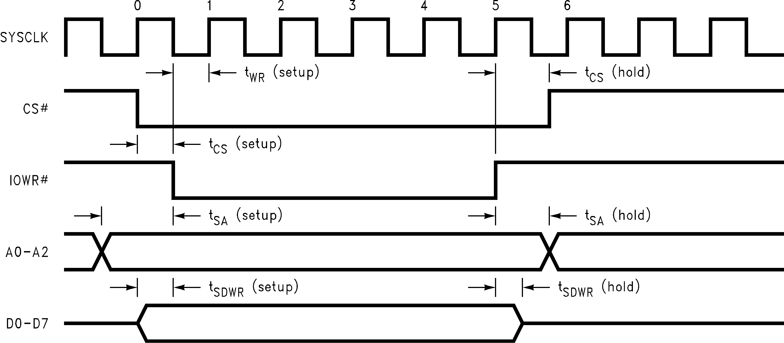

**FIGURE 1.** ISA Bus Write Timing Diagram

<!-- page 8 -->

**AC Electrical Characteristics (Continued)** *(Note 13)* The following specifications apply for
+4.25 VDC ≤ VCC ≤ +5.75 VDC unless otherwise specified. **Boldface
limits apply for TA = TJ = TMIN to TMAX; all other limits
TA = TJ = 25 °C.**

| Symbol | Parameter | Conditions | Typical (Note 8) | Limits (Note 9) | Units (Limits) |
| --- | --- | --- | --- | --- | --- |
| **ISA READ TIMING** | | | | | |
| tSDRD (setup) | Data Valid to IORD# Inactive | | | **120** | ns (min) |
| tSDRD (hold) | IORD# Inactive to Data Invalid | | | **5** | ns (min) |
| tRD(setup) | IORD# Active to Rising Edge of SYSCLK | | | **20** | ns (min) |
| tRS (delay) | Rising Edge of SYSCLK number 1 to Data Valid | With 8.33 MHz SYSCLK | | **360** | ns (max) |

The delay between consecutive IORD# and IOWR# pulses should be greater than 50 ns to ensure that a
Power-on reset does not occur unintentionally. (See Section 3.2 "Resets")

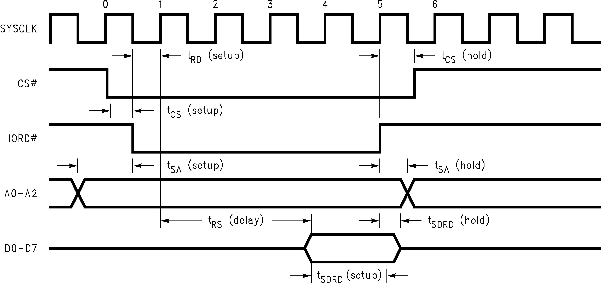

**FIGURE 2.** ISA Bus Read Timing Diagram

<!-- page 9 -->

**AC Electrical Characteristics (Continued)** *(Note 13)* The following specifications apply for
+4.25 VDC ≤ VCC ≤ +5.75 VDC unless otherwise specified. **Boldface
limits apply for TA = TJ = TMIN to TMAX; all other limits
TA = TJ = 25 °C.**

| Symbol | Parameter | Conditions | Typical (Note 8) | Limits (Note 9) | Units (Limits) |
| --- | --- | --- | --- | --- | --- |
| **SERIAL BUS TIMING CHARACTERISTICS** | | | | | |
| t1 | SCL (Clock) Period | | | **2.5** | µs (min) |
| t2 | Data In Setup Time to SCL High | | | **100** | ns (min) |
| t3 | Data Out Stable After SCL Low | | | **0** | ns (min) |
| t4 | SDA Low Setup Time to SCL Low (start) | | | **100** | ns (min) |
| t5 | SDA High Hold Time After SCL High (stop) | | | **100** | ns (min) |

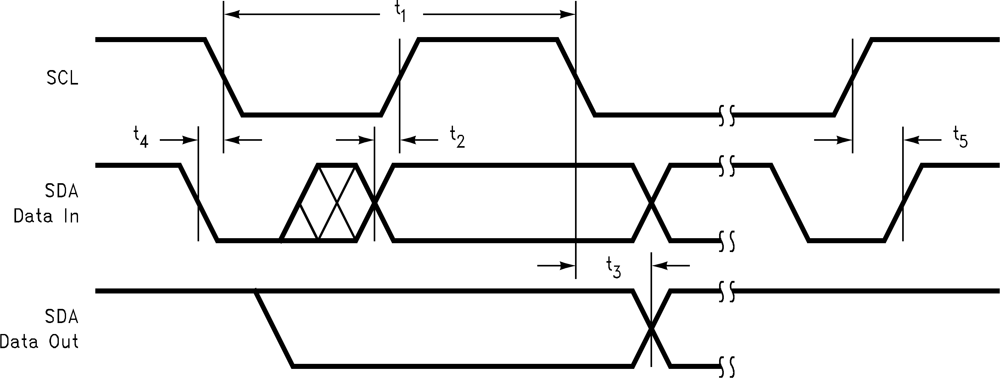

**FIGURE 3.** Serial Bus Timing Diagram

---

<!-- page 10 -->

## Electrical Characteristics Notes

**Note 1:** Absolute Maximum Ratings indicate limits beyond which damage to the device may occur.
Operating Ratings indicate conditions for which the device is functional, but do not guarantee
specific performance limits. For guaranteed specifications and test conditions, see the Electrical
Characteristics. The guaranteed specifications apply only for the test conditions listed. Some
performance characteristics may degrade when the device is not operated under the listed test conditions.

**Note 2:** All voltages are measured with respect to GND, unless otherwise specified.

**Note 3:** When the input voltage (VIN) at any pin exceeds the power supplies
(VIN < (GNDD or GNDA) or VIN > VCC), the current at that pin should
be limited to 5 mA. The 20 mA maximum package input current rating limits the number of pins that can
safely exceed the power supplies with an input current of 5 mA to four.

**Note 4:** The maximum power dissipation must be derated at elevated temperatures and is dictated by
TJmax, θJA and the ambient temperature, TA. The maximum allowable
power dissipation at any temperature is PD = (TJmax−TA)/θJA.

**Note 5:** The human body model is a 100 pF capacitor discharged through a 1.5 kΩ resistor into each
pin. The machine model is a 200 pF capacitor discharged directly into each pin.

**Note 6:** See the section titled "Surface Mount" found in any post 1986 National Semiconductor
Linear Data Book for other methods of soldering surface mount devices.

**Note 7:** Each input and output is protected by a nominal 6.5V breakdown voltage zener diode to
GND; as shown below, input voltage magnitude up to 0.3V above VCC or 0.3V below GND will
not damage the LM78. There are parasitic diodes that exist between the inputs and the power supply
rails. Errors in the ADC conversion can occur if these diodes are forward biased by more than 50 mV.
As an example, if VCC is 4.50 VDC, input voltage must be ≤4.55 VDC,
to ensure accurate conversions.

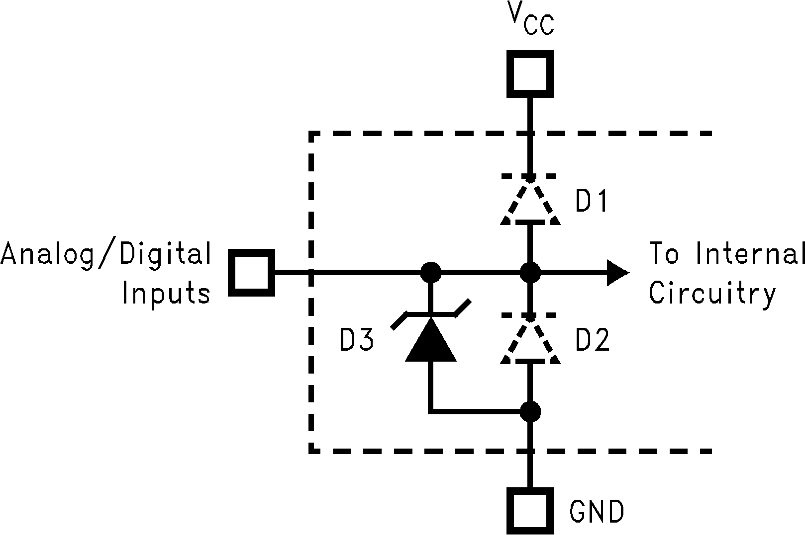

An `x` indicates that the diode exists.

| Pin Name | D1 | D2 | D3 |
| --- | --- | --- | --- |
| IORD# | | | x |
| IOWR# | | | x |
| SYSCLK | | | x |
| D0–D7 | x | x | x |
| SMI_IN# | | | x |
| Chassis Intrusion | | x | x |
| Power Switch Bypass# | x | x | x |

| Pin Name | D1 | D2 | D3 |
| --- | --- | --- | --- |
| FAN1–FAN3 | | | x |
| SCL | | | x |
| SDA | | x | x |
| RESET# | | x | x |
| NTEST | x | x | x |

| Pin Name | D1 | D2 | D3 |
| --- | --- | --- | --- |
| −IN6 | | x | x |
| FB6 | x | x | x |
| FB5 | x | x | x |
| −IN5 | | x | x |
| IN4–IN0 | x | x | x |
| VID3–VID0 | x | x | x |

| Pin Name | D1 | D2 | D3 |
| --- | --- | --- | --- |
| BTI# | x | | x |
| NMI/IRQ# | x | x | x |
| SMI# | | x | x |
| A0–A2 | | | x |
| CS# | | | x |

**FIGURE 4.** ESD Protection Input Structure

**Note 8:** Typicals are at TJ=TA=25 °C and represent most likely parametric
norm.

**Note 9:** Limits are guaranteed to National's AOQL (Average Outgoing Quality Level).

**Note 10:** TUE (Total Unadjusted Error) includes Offset, Gain and Linearity errors of the ADC and
any error introduced by the amplifiers as shown in the circuit of Figure 13.

**Note 11:** Total Monitoring Cycle Time includes temperature conversion, 7 analog input voltage
conversions and 3 tachometer readings. Each temperature and input voltage conversion takes 100 ms
typical and 112 ms maximum. Fan tachometer readings take 20 ms typical, at 4400 rpm, and 200 ms max.

**Note 12:** The total fan count is based on 2 pulses per revolution of the fan tachometer output.

**Note 13:** Timing specifications are tested at the TTL logic levels, VIL=0.4V for a
falling edge and VIH=2.4V for a rising edge. TRI-STATE output voltage is forced to 1.4V.

---

<!-- page 11 -->

## Test Circuit

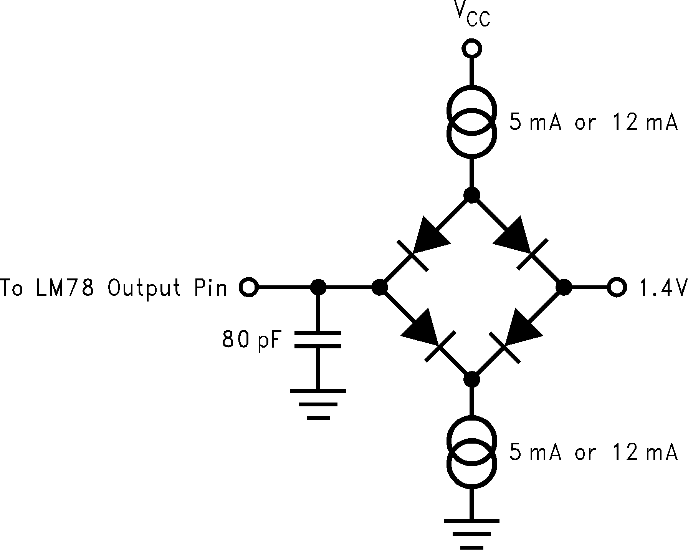

**FIGURE 5.** Digital Output Load Circuitry

---

## Functional Description

### 1.0 General Description

The LM78 provides 7 analog inputs, a temperature sensor, a Delta-Sigma ADC (Analog-to-Digital
Converter), 3 fan speed counters, WATCHDOG registers, and a variety of inputs and outputs on a single
chip. Interfaces are provided for both the ISA parallel bus or Serial Bus. The LM78 performs power
supply, temperature, and fan monitoring for personal computers.

The LM78 continuously converts analog inputs to 8-bit digital words with a 16 mV LSB (Least
Significant Bit) weighting, yielding input ranges of 0V to 4.096V. The two negative analog
inputs provide inverting op amps, with their non-inverting input referred to ground. With additional
external feedback components, these inputs provide measurements of negative voltages (such as -5V
and -12V power supplies). The analog inputs are useful for monitoring several power supplies present
in a typical computer. Temperature is converted to an 8-bit two's-complement digital word with a
1 °C LSB.

Fan inputs measure the period of tachometer pulses from the fans, providing a higher count for lower
fan speeds. The fan inputs are digital inputs with an acceptable range of 0V to 5V and a transition
level of approximately 1.4V. Full scale fan counts are 255 (8-bit counter) and this represents a
stopped or very slow fan. Nominal speeds, based on a count of 153, are programmable from 1100 to
8800 RPM on FAN1 and FAN2, with FAN3 fixed at 4400 RPM. Signal conditioning circuitry is included to
accommodate slow rise and fall times.

The LM78 provides a number of internal registers, as detailed in Figure 6. These include:

- **Configuration Register:** Provides control and configuration.
- **Interrupt Status Registers:** Two registers to provide status of each WATCHDOG limit or Interrupt
  event.
- **Interrupt Mask Registers:** Allows masking of individual Interrupt sources, as well as separate
  masking for each of both hardware Interrupt outputs.
- **VID/Fan Divisor Registers:** A register to read the status of the VID input lines. The high bits
  of this register contain the divisor bits for FAN1 and FAN2 inputs.
- **Serial Bus Address Register:** Contains the Serial Bus address. At power on it assumes the
  default value of 0101101 binary, and can be altered via the ISA or Serial Bus interface.
- **Chip Reset/ID Register:** Allows resetting of all the registers to the default power-on reset
  value. Provides a bit for identification between the current version of this device and an older
  version which does not have this reset capability.
- **POST RAM:** FIFO RAM to store up to 32 bytes of 8-bit POST codes. Overflow of the POST RAM will
  set an Interrupt. The POST RAM, located at base address x0h and x4h, allows for easy decoding to
  address 80h and 84h, the normal addresses for outputting of POST codes. Interrupt will only be set
  when writing to port x0h or x4h. The POST RAM can be read via ports 85h and 86h.
- **Value RAM:** The monitoring results: temperature, voltages, fan counts, and WATCHDOG limits are
  all contained in the Value RAM. The Value RAM consists of a total of 64 bytes. The first 11 bytes
  are all of the results, the next 19 bytes are the WATCHDOG limits, and are located at 20h-3Fh,
  including two unused bytes in the upper locations. The next 32 bytes, located at 60h-7Fh, mirror
  the first 32 bytes with identical contents. The only difference in the upper bytes are that they
  auto-increment the LM78 Internal Address Register when read from or written to via the ISA bus
  (auto-increment is not available for Serial Bus communications).

When the LM78 is started, it cycles through each measurement in sequence, and it continuously loops
through the sequence approximately once every second. Each measured value is compared to values
stored in WATCHDOG, or Limit registers. When the measured value violates the programmed limit the
LM78 will set a corresponding Interrupt in the Interrupt Status Registers. Two hardware Interrupt
lines, SMI# and NMI/IRQ#, are fully programmable with separate masking of each Interrupt source, and
masking of each output. In addition, the Configuration Register has control bits to enable or
disable the hardware Interrupts.

Additional digital inputs are provided for chaining of SMI# (System Management Interrupt), outputs of
multiple external LM75 temperature sensors via the BTI# (Board Temperature Interrupt) input, and a
Chassis Intrusion input. The Chassis Intrusion input is designed to accept an active high signal
from an external circuit that latches when the case is removed from the computer.

<!-- page 12 -->

### 2.0 Interface

The LM78 only decodes the three lowest address bits on the ISA bus. Referring to the ISA bus timing
diagrams in Figure 1 and Figure 2, the Chip Select Input, CS#, should be taken low by external
address decoder circuitry to access the LM78. The LM78 decodes the following base addresses:

- Port x0h: Power On Self Test codes from ISA bus.
- Port x4h: Power On Self Test codes from ISA bus.
- Port x5h: The LM78's Internal Address Register
- Port x6h: Data Register

IORD# is the standard ISA bus signal that indicates to the LM78 that it may drive data on to the ISA
data bus. IOWR# is the standard ISA command to the LM78 that it may latch data from the ISA bus.

SYSCLK is the standard ISA SYSCLK, typically 8.33 MHz. This clock is used only for timing of the ISA
interface of the LM78. All other clock functions within LM78 such as the ADC and fan counters are
done with a separate asynchronous internal clock.

A typical application designed to utilize the POST RAM would decode the LM78 to the address space
starting at 80h, which is where POST codes are output to. Otherwise, the LM78 can be decoded into a
different desired address space.

To communicate with an LM78 Register, first write the address of that Register to Port x5h. Read or
write data from or to that register via Port x6h. A write will take IOWR# low, while a read will take
IORD# low.

If the Serial Bus Interface and ISA bus interface are used simultaneously there is the possibility of
collision. To prevent this from occurring in applications where both interfaces are used, read port
x5h and if the Most Significant Bit, D7, is high, ISA communication is limited to reading port x5h
only until this bit is low. A Serial Bus communication occurring while ISA is active will not be a
problem, since even a single bit of Serial Bus communication requires 10 microseconds, in comparison
to less than a microsecond for an entire ISA communication.

<!-- page 13 -->

**FIGURE 6.** LM78 Register Structure

<!-- page 14 -->

#### 2.1 Internal Registers of the LM78

**TABLE 1.** The internal registers and their corresponding internal LM78 address is as follows:

| Register | LM78 Internal Hex Address (This is the data to be written to Port x5h) | Power on Value | Notes |
| --- | --- | --- | --- |
| Configuration Register | 40h | 0000 1000 | |
| Interrupt Status Register 1 | 41h | 0000 0000 | Auto-increment to the address of Interrupt Status Register 2 after a read or write to Port x6h. |
| Interrupt Status Register 2 | 42h | 0000 0000 | |
| SMI Mask Register 1 | 43h | 0000 0000 | Auto-increment to the address of SMI Mask Register 2 after a read or write to Port x6h. |
| SMI Mask Register 2 | 44h | 0000 0000 | |
| NMI Mask Register 1 | 45h | 0000 0000 | Auto-increment to the address of NMI Mask Register 2 after a read or write to Port x6h. |
| NMI Mask Register 2 | 46h | 0100 0000 | |
| VID/Fan Divisor Register | 47h | 0101 XXXX | The first four bits set the divisor for Fan Counters 1 and 2. The lower four bits reflect the state of the VID inputs. |
| Serial Bus Address Register | 48h | 0010 1101 | |
| Chip Reset/ID Register | 49h | 0100 0000 | |
| POST RAM | 00h-1Fh | | Auto-increment when written to from Port x0h or x4h. Auto-increment after a read or write to Port x6h, with a separate pointer. Auto-incrementing stops when address 1Fh is reached. |
| Value RAM | 20h-3Fh | | |
| Value RAM | 60h-7Fh | | Auto-increment after a read or write to Port x6h. Auto-incrementing stops when address 7Fh is reached. |

A typical communication with the LM78 would consist of:

1. Write to Port x5h the LM78 Internal Address (from column 2 above) of the desired register.
   Alternatively, when both ISA and Serial Bus interfaces are used, the first step in a communication
   may be to read Port x5h to ascertain the state of the Busy bit to avoid contention with a Serial
   Bus communication.
2. Read or write the corresponding registers data with reads/writes from Port x6h.

The LM78 Internal Address latches, and does not have to be written if it is already pointing at the
desired register. The LM78 Internal Address Register is read/write (Bit 7 is read only).

<!-- page 15 -->

#### 2.2 Serial Bus Interface

When using the Serial Bus Interface a write will always consist of the LM78 Serial Bus Interface
Address byte, followed by the Internal Address Register byte, then the data byte. There are two cases
for a read:

1. If the Internal Address Register is known to be at the desired Address, simply read the LM78 with
   the Serial Bus Interface Address byte, followed by the data byte read from the LM78.
2. If the Internal Address Register value is unknown, write to the LM78 with the Serial Bus Interface
   Address byte, followed by the Internal Address Register byte. Then restart the Serial
   Communication with a Read consisting of the Serial Bus Interface Address byte, followed by the
   data byte read from the LM78.

In all other respects the LM78 functions identically for Serial Bus communications as it does for ISA
communications. Auto-Increment does not operate. When writing to or reading from a Register which
Auto-Increments with ISA communications, the Register must be manually incremented for Serial Bus
communications.

The default power on Serial Bus address for the LM78 is: 0101101 binary. This address can be changed
by writing any desired value to the Serial Bus address register, which can be done either via the ISA
or Serial Bus. During any Serial Bus communication, the BUSY bit (bit 7) in the address register at
x5h will be high, and any ISA activity in that situation should be limited to reading port x5h only.

All of these communications are depicted in the Serial Bus Interface Timing Diagrams as shown in
Figure 7.

**(a) Serial Bus Write to the Internal Address Register followed by the Data Byte**

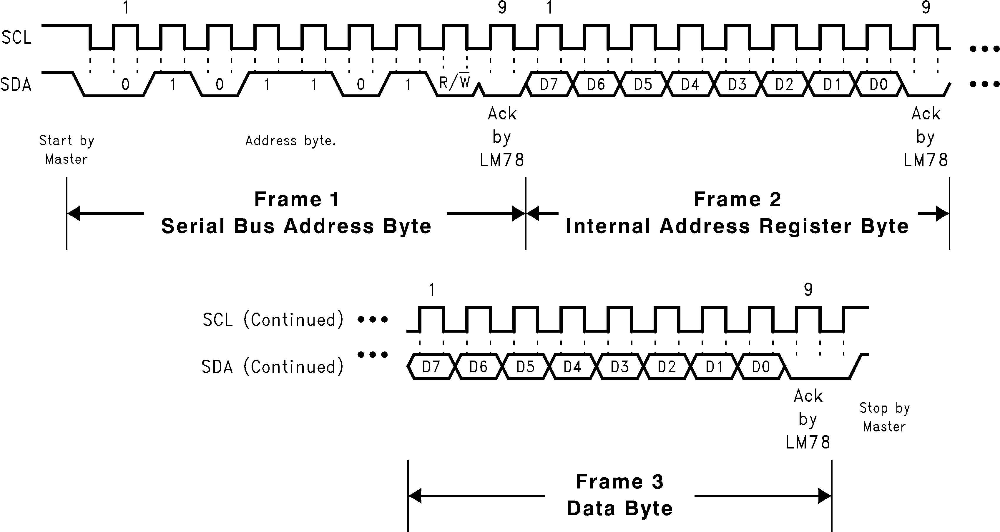

**(b) Serial Bus Write to the Internal Address Register Only**

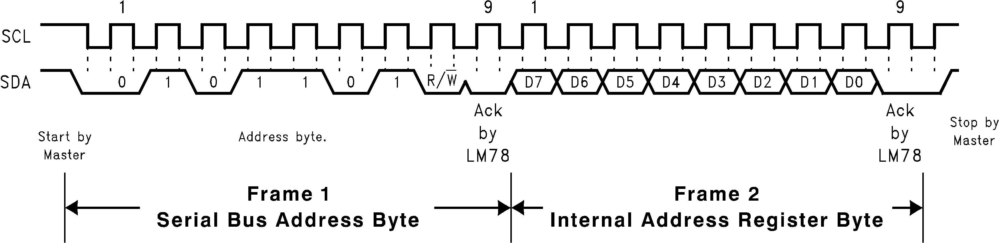

**(c) Serial Bus Read from a Register with the Internal Address Register Preset to Desired Location**

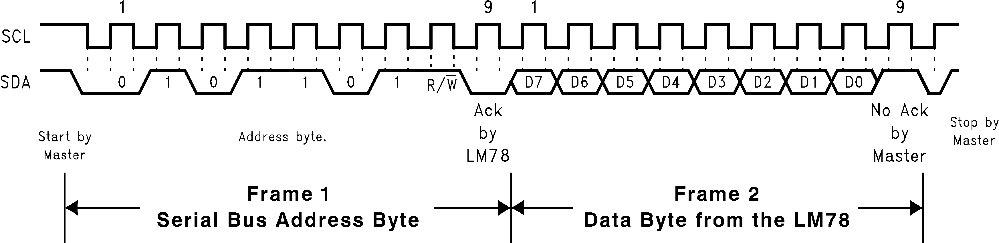

**FIGURE 7.** Serial Bus Timing

<!-- page 16 -->

### 3.0 Using the LM78

#### 3.1 Power On

When power is first applied, the LM78 performs a "power on reset" on several of its registers. The
power on condition of registers is shown in Table 1. Registers whose power on values are not shown
have power on conditions that are indeterminate (this includes the value RAM and WATCHDOG limits).
The ADC is inactive. In most applications, usually the first action after power on would be to write
WATCHDOG limits into the Value RAM.

#### 3.2 Resets

Configuration Register INITIALIZATION accomplishes the same function as power on reset on most
registers. The POST RAM, Value RAM conversion results, and Value RAM WATCHDOG limits are not Reset
and will be indeterminate immediately after power on. If the Value RAM contains valid conversion
results and/or Value RAM WATCHDOG limits have been previously set, they will not be affected by a
Configuration Register INITIALIZATION. Power on reset, or Configuration Register INITIALIZATION,
clear or initialize the following registers (the initialized values are shown on Table 1):

- Configuration Register
- Interrupt Status Register 1
- Interrupt Status Register 2
- SMI Mask Register 1
- SMI Mask Register 2
- NMI Mask Register 1
- NMI Mask Register 2
- VID/Fan Divisor Register
- Serial Bus Address Register (Power on reset only, not reset by Configuration Register
  INITIALIZATION)

Configuration Register INITIALIZATION is accomplished by setting Bit 7 of the Configuration Register
high. This bit automatically clears after being set.

The LM78-J allows the user to perform an unconditional complete Power-on reset by writing a one to
Bit 5 of the Chip Reset/ID Register. The LM78-J can be differentiated from the LM78 without the J
suffix by reading Chip Reset/ID Register Bit 6. A high would indicate that the LM78-J is being used.

The LM78-J allows an unconditional complete Power-on reset to be initiated by taking the IOWR# and
IORD# signal lines low simultaneously, for at least 50 ns, while CS# is high. The delay between
consecutive IORD# and IOWR# pulses should be greater than 50 ns to ensure that a Power-on reset does
not occur unintentionally.

In systems where the serial bus is only being used it may be advantageous to take both IOWR# and IORD#
to the system reset pulse. In this way whenever the system is reset the LM78-J will also be reset to
a known state.

#### 3.3 Using the Configuration Register

The Configuration Register provides all control over the LM78. At power on, the ADC is stopped and
INT_Clear is asserted, clearing the SMI# and NMI/IRQ# hardwire outputs. The Configuration Register
starts and stops the LM78, enables and disables interrupt outputs and modes, and provides the Reset
function described in Section 3.2.

Bit 0 of the Configuration Register controls the monitoring loop of the LM78. Setting Bit 0 low stops
the LM78 monitoring loop and puts the LM78 in shutdown mode, reducing power consumption. ISA and
Serial Bus communication is possible with any register in the LM78 although activity on these lines
will increase shutdown current, up to as much as maximum rated supply current, while the activity
takes place. Taking Bit 0 high starts the monitoring loop, described in more detail subsequently.

Bit 1 of the Configuration Register enables the SMI# Interrupt hardwire output when this bit is taken
high. Similarly, Bit 2 of the Configuration Register enables the NMI/IRQ# Interrupt hardwire output
when taken high. The NMI/IRQ# mode is determined by Bit 5 in the Configuration Register. When Bit 5 is
low the output is an active low IRQ output. Taking Bit 5 high inverts this output to provide an
active high NMI output.

The Power Switch Bypass# provides an active low at the Power Switch Bypass# output when set high. This
is intended for use in software power control by activating an external power control MOSFET.

#### 3.4 Starting Conversion

The monitoring function (Analog inputs, temperature, and fan speeds) in the LM78 is started by
writing to the Configuration Register and setting INT_Clear (Bit 3), low, and Start (bit 0), high.
The LM78 then performs a "round-robin" monitoring of all analog inputs, temperature, and fan speed
inputs approximately once a second. The sequence of items being monitored corresponds to locations in
the Value RAM and is:

1. Temperature
2. IN0
3. IN1
4. IN2
5. IN3
6. IN4
7. -IN5
8. -IN6
9. Fan 1
10. Fan 2
11. Fan 3

#### 3.5 Reading Conversion Results

The conversion results are available in the Value RAM. Conversions can be read at any time and will
provide the result of the last conversion. Because the ADC stops, and starts a new conversion
whenever it is read, reads of any single value should not be done more often than once every 120 ms.
When reading all values, allow at least 1.5 seconds between reading groups of values. Reading more
frequently than once every 1.5 seconds can also prevent complete updates of Interrupt Status
Registers and Interrupt Outputs.

A typical sequence of events upon power on of the LM78 would consist of:

1. Set WATCHDOG Limits
2. Set Interrupt Masks
3. Start the LM78 monitoring process

### 4.0 Analog Inputs

The 8-bit ADC has a 16 mV LSB, yielding a 0V to 4.08V (4.096–1LSB) input range. This is true for all
analog inputs. In PC monitoring applications these inputs would most often be connected to power
supplies. The 2.5V and 3.3V supplies can be directly connected to the inputs. The 5V and 12V inputs
should be attenuated with external resistors to any desired value within the input range.

<!-- page 17 -->

A typical application, such as is shown in Figure 8, might select the input voltage divider to
provide 3V at the analog inputs of the LM78. This is sufficiently high for good resolution of the
voltage, yet leaves headroom for upward excursions from the supply of about 25%. To simplify the
process of resistor selection, set the value of R2 first. Select a value for R2 between 10 kΩ and
100 kΩ. This is low enough to avoid errors due to input leakage currents yet high enough to both
protect the inputs under overdrive conditions as well as minimize loading of the source. Then select
R1 to provide a 3V input according to:

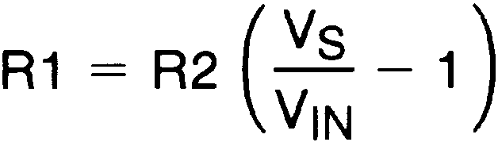

The negative inputs provide inverting op amps with non-inverting inputs connected to ground. The
outputs of these op amps are designed to only drive the input of the LM78 and their associated
feedback loops. Avoid heavy loading, long lines, and capacitive loading with these op amps. Additional
loading may cause oscillations and thus erroneous readings. The optimum feedback resistor (resistor
from Feedback to -IN pin) value is approximately 60 kΩ, based on the op amp nominal output current
rating of 50 µA at an output voltage of 3V. Locate the feedback resistors as close as possible to the
LM78. The recommended range for RIN is from 30 kΩ to 300 kΩ. Select RIN
according to:

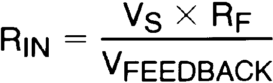

The analog inputs have internal diodes that clamp inputs exceeding the power supply and ground.
Exceeding any analog input has no detrimental effect on other channels. The input diodes will also
clamp voltages appearing at the inputs of an un-powered LM78. External resistors should be included
to limit input currents to the values given in the ABSOLUTE MAXIMUM RATINGS for Input Current At Any
Pin. Inputs with the attenuator networks will usually meet these requirements. If it is possible for
inputs without attenuators (such as the 2.5V or 3.3V supplies) to be turned on while LM78 is powered
off, additional resistors of about 10 kΩ should be added in series with the inputs to limit the input
current.

### 5.0 Layout and Grounding

Analog inputs will provide best accuracy when referred to the AGND pin. A separate, low-impedance
ground plane for analog ground, which provides a ground point for the voltage dividers and analog
components, will provide best performance but is not mandatory. Analog components such as voltage
dividers and feedback resistors should be located physically as close as possible to the LM78.

The power supply bypass, the parallel combination of 10 µF (electrolytic or tantalum) and 0.1 µF
(ceramic) bypass capacitors connected between pin 12 and ground, should also be located as close as
possible to the LM78.

### 6.0 Fan Inputs

Inputs are provided for signals from fans equipped with tachometer outputs. These are logic-level
inputs with an approximate threshold of 1.4V. Signal conditioning in the LM78 accommodates the slow
rise and fall times typical of fan tachometer outputs. The maximum input signal range is 0 to
VCC. In the event these inputs are supplied from fan outputs which exceed 0 to
VCC, either resistive division or diode clamping must be included to keep inputs within
an acceptable range, as shown in Figure 9. R2 is selected so that it does not develop excessive
voltage due to input leakage. R1 is selected based on R2 to provide a minimum input of 2V and a
maximum of VCC. R1 should be as low as possible to provide the maximum possible input up
to VCC for best noise immunity. Alternatively, use a shunt reference or zener diode to
clamp the input level.

If fans can be powered while the power to the LM78 is off, the LM78 inputs will provide diode
clamping. Limit input current to the Input Current at Any Pin specification shown in the ABSOLUTE
MAXIMUM RATINGS section. In most cases, open collector outputs with pull-up resistors inherently
limit this current. If this maximum current could be exceeded, either a larger pull up resistor
should be used or resistors connected in series with the fan inputs.

The Fan Inputs gate an internal 22.5 kHz oscillator for one period of the Fan signal into an 8-bit
counter (maximum count = 255). The default divisor, located in the VID/Fan Divisor Register, is set
to 2 (choices are 1, 2, 4, and 8) providing a nominal count of 153 for a 4400 rpm fan with two pulses
per revolution. Typical practice is to consider 70% of normal RPM a fan failure, at which point the
count will be 219.

Determine the fan count according to:

Note that Fan 1 and Fan 2 Divisors are programmable via the VID/Fan Divisor Register. Fan 3 is not
adjustable, and its Divisor is always set to 2.

Fans that provide only one pulse per revolution would require a divisor set twice as high as fans
that provide two pulses, thus maintaining a nominal fan count of 153. Therefore, the divisor should
be set to 4 for a fan that provides 1 pulse per revolution with a nominal RPM of 4400.

<!-- page 18 -->

| Voltage Measurements (VS) | R1 or RIN | R2 or RF | Voltage at Analog Inputs |
| --- | --- | --- | --- |
| +2.50V | 0 | NONE | +2.50V |
| +3.30V | 0 | NONE | +3.30V |
| +5V | 6.8 kΩ | 10 kΩ | +2.98V |
| +12V | 30 kΩ | 10 kΩ | +3.00V |
| −12V | 240 kΩ | 60 kΩ | +3.00V |
| −5V | 100 kΩ | 60 kΩ | +3.00V |

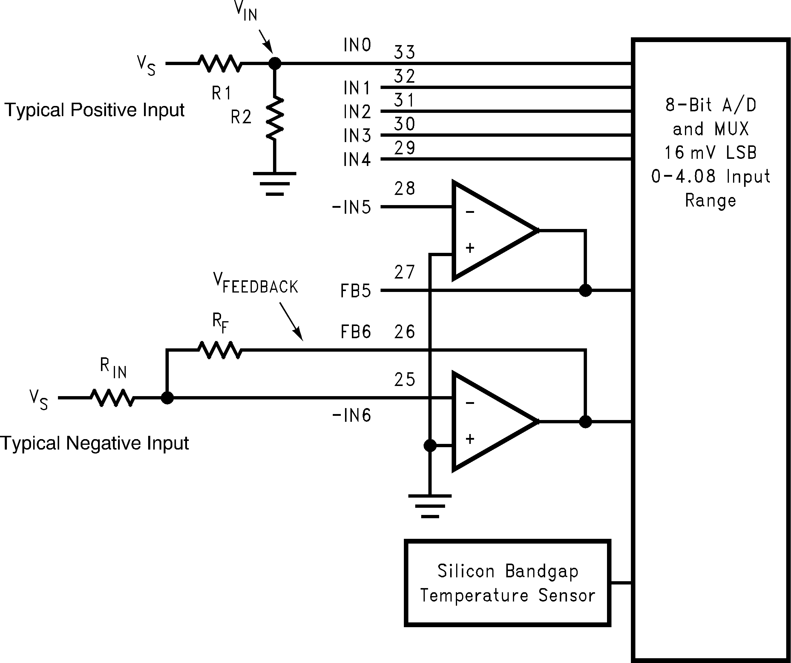

**FIGURE 8.** Input Examples. Resistor Values Shown Provide Approximately 3V at the Analog Inputs

<!-- page 19 -->

Counts are based on 2 pulses per revolution tachometer outputs.

| RPM | Time per Revolution | Counts for "Divide by 2" (Default) in Decimal | Comments |
| --- | --- | --- | --- |
| 4400 | 13.64 ms | 153 counts | Typical RPM |
| 3080 | 19.48 ms | 219 counts | 70% RPM |
| 2640 | 22.73 ms | 255 counts (maximum counts) | 60% RPM |

| Mode Select | Nominal RPM | Time per Revolution | Counts for the Given Speed in Decimal | 70% RPM | Time per Revolution for 70% RPM |
| --- | --- | --- | --- | --- | --- |
| Divide by 1 | 8800 | 6.82 ms | 153 | 6160 | 9.74 ms |
| Divide by 2 | 4400 | 13.64 ms | 153 | 3080 | 19.48 ms |
| Divide by 4 | 2200 | 27.27 ms | 153 | 1540 | 38.96 ms |
| Divide by 8 | 1100 | 54.54 ms | 153 | 770 | 77.92 ms |

**(a) Fan with Tach Pull-Up to +5V**

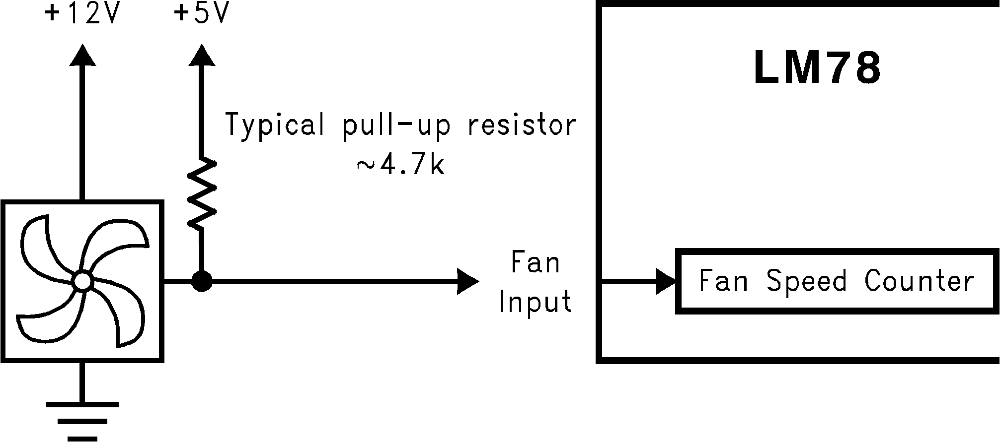

**(b) Fan with Tach Pull-Up to +12V, or Totem-Pole Output and Resistor Attenuator**

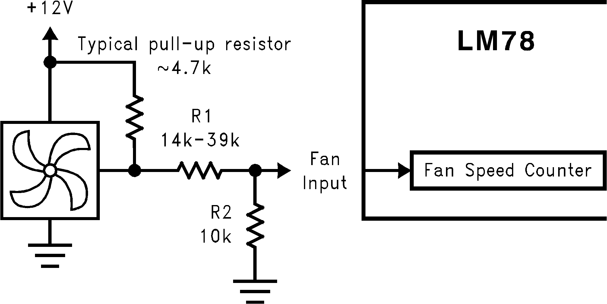

**(c) Fan with Tach Pull-Up to +12V and Diode Clamp**

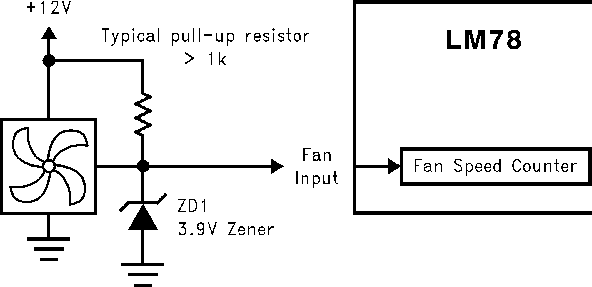

**(d) Fan with Strong Tach Pull-Up or Totem Pole Output and Diode Clamp**

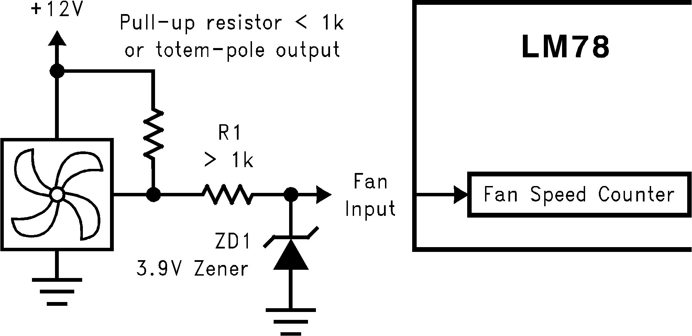

**FIGURE 9.** Alternatives for Fan Inputs

---

<!-- page 20 -->

### 7.0 Temperature Measurement System

The LM78 bandgap type temperature sensor and ADC perform 8-bit two's-complement conversions of the
temperature. A digital comparator is also incorporated that compares the readings to the
user-programmable Overtemperature setpoint and Hysteresis values.

#### 7.1 Temperature Data Format

Temperature data can be read from the Temperature, TOI Set Point, and THYST Set
Point registers; and written to the TOI Set Point, and THYST Set Point
registers. Temperature data is represented by an 8-bit, two's complement word with an LSB (Least
Significant Bit) equal to 1.0 °C:

| Temperature | Digital Output — Binary | Digital Output — Hex |
| --- | --- | --- |
| +125 °C | 0111 1101 | 7Dh |
| +25 °C | 0001 1001 | 19h |
| +1.0 °C | 0000 0001 | 01h |
| +0 °C | 0000 0000 | 00h |
| −1.0 °C | 1111 1111 | FFh |
| −25 °C | 1110 0111 | E7h |
| −55 °C | 1100 1001 | C9h |

#### 7.2 Temperature Interrupts

The normal mode for temperature interrupts in the LM78 is an "Interrupt" mode operating in the
following way: Exceeding TOI causes an interrupt that will remain active indefinitely
until reset by reading Interrupt Status Register 1. Once an interrupt event has occurred by crossing
TOI, then reset, an interrupt will only occur again by the temperature going below
THYST. Again, it will remain active indefinitely until being reset by reading Interrupt
Status Register 1.

A "Comparator" mode for temperature interrupts can be made available by setting the THYST
limit to 127 °C. This results in a simple "thermostat" type of function where an interrupt will be
set whenever the temperature exceeds the TOI limit. Reading Interrupt Status Register 1
will clear the interrupt as usual, but the interrupt will set again after the completion of another
measurement cycle. It will remain set until the temperature goes below the TOI limit
(allow up to two measurement cycles for clearing after descending below TOI while in
Comparator mode).

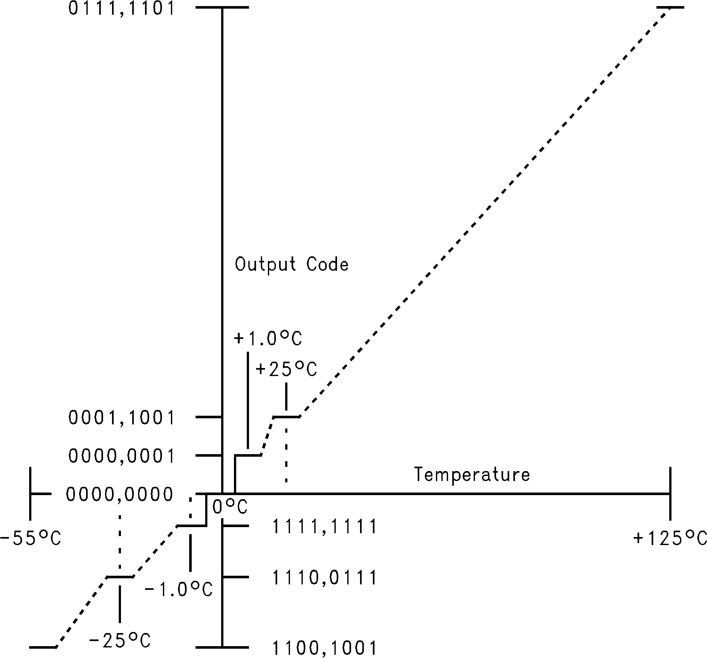

**FIGURE 10.** Temperature-to-Digital Transfer Function *(Non-Linear Scale for Clarity)*

**(a) Interrupt Mode**

\*Note: Interrupt resets occur only when interrupt Status Register 1 is read.

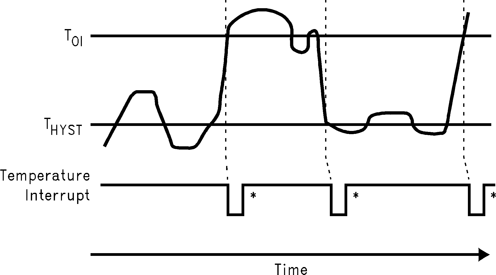

**(b) Comparator Mode**

Interrupt resets occur when Interrupt Status Register 1 is read but will set again when monitoring
cycle continues (as long as temperature exceeds TOI). When temperature descends below
TOI allow up to two monitoring loops before the Temperature Interrupt resets.

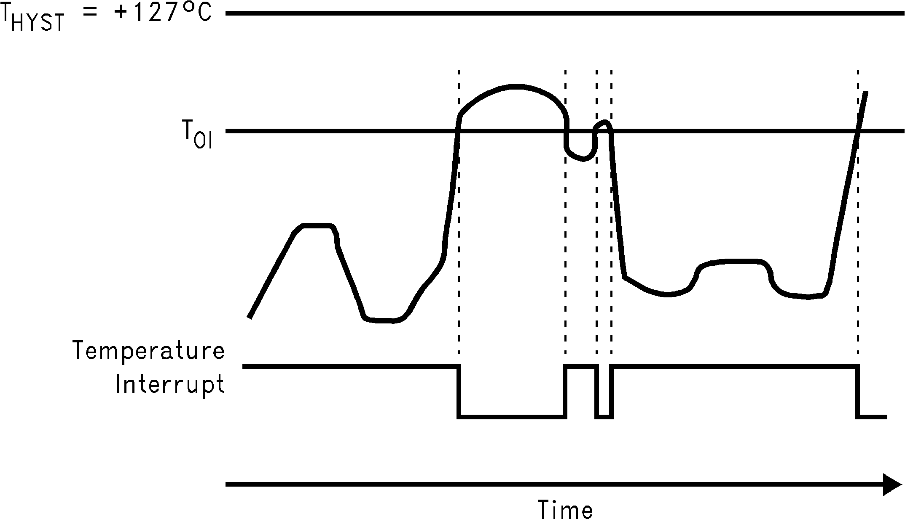

**FIGURE 11.** Temperature Interrupt Response Diagram

<!-- page 21 -->

### 8.0 The LM78 Interrupt Structure

Figure 12 depicts the Interrupt Structure of the LM78. The LM78 can generate Interrupts as a result
of each of its internal WATCHDOG registers on the analog, temperature, and fan inputs. Overflow of
the POST RAM (greater than 32 bytes written to POST RAM) will also cause an Interrupt.

External Interrupts can come from the following three sources. While the labels suggest a specific
type or source of Interrupt, these labels are not restrictions of their usage, and they could come
from any desired source:

- **BTI#:** This is an active low Interrupt intended to come from the O.S. output of LM75 temperature
  sensors. The LM75 O.S. output goes active when its temperature exceeds a programmed threshold. Up
  to 8 LM75s can be connected to a single Serial Bus bus with their O.S. outputs wire or'd to the
  BTI# input of the LM78. If the temperature of any LM75 exceeds its programmed limit, it drives BTI#
  low. This generates an Interrupt to notify the host of a possible overtemperature condition.
  Provides an internal pull-up of 10 kΩ.

**FIGURE 12.** Interrupt Structure

<!-- page 22 -->

- **Chassis Intrusion:** This is an active high interrupt from any type of device that detects and
  captures chassis intrusion violations. This could be accomplished mechanically, optically, or
  electrically, and circuitry external to the LM78 is expected to latch the event. The design of the
  LM78 allows this input to go high even with no power applied to the LM78, and no clamping or other
  interference with the line will occur. This line can also be pulled low for at least 20 ms by the
  LM78 to reset a typical Chassis Intrusion circuit. Accomplish this reset by setting Bit 7 of NMI
  Mask Register 2 high. The bit in the Register is self-clearing.
- **SMI_IN#:** This active low Interrupt merely provides a way to chain the SMI# Interrupt from other
  devices through the LM78 to the processor.

All Interrupts are indicated in the two Interrupt Status Registers. The NMI/IRQ# and SMI# outputs have
individual mask registers, and individual masks for each Interrupt. As described in Section 3.3,
these two hardware Interrupt lines can also be enabled/disabled in the Configuration Register. The
Configuration Register is also used to set the mode of the NMI/IRQ# Interrupt line.

#### 8.1 Interrupt Clearing

Reading the Interrupt Status Register will output the contents of the Register, and reset the
Register. A subsequent read done before the analog "round-robin" monitoring loop is complete will
indicate a cleared Register. Allow at least 1.5 seconds to allow all Registers to be updated between
reads.

In summary, the Interrupt Status Register clears upon being read, and requires at least 1.5 seconds
to be updated. When the Interrupt Status Register clears, the hardware interrupt line will also
clear until the Registers are updated by the monitoring loop.

The hardware Interrupt lines are cleared with the INT_Clear bit, which is Bit 3 of the Configuration
Register. When this bit is high, the LM78 monitoring loop will stop. It will resume when the bit is
low.

### 9.0 Reset and Power Switch Bypass Outputs

In PC applications the Power Switch Bypass# provides a gate drive signal to an external P-channel
MOSFET power switch. This external MOSFET then would keep power turned on regardless of the state of
front panel power switches when software power control is used. In any given application this signal
is not limited to the function described by its label. For example, since the LM78 incorporates
temperature sensing, the Power Switch Bypass# output could also be utilized to control power to a
cooling fan. Take Power Switch Bypass# active low by setting Bit 6 in the Configuration Register high.

RESET# is intended to provide a master reset to devices connected to this line. SMI Mask Register 2,
Bit 7, must be set high to enable this function. Setting Bit 4 in the Configuration Register high
outputs at least 20 ms low on this line, at the end of which Bit 4 in the Configuration Register
automatically clears. Again, the label for this pin is only its suggested use. In applications where
the RESET# capability is not needed it can be used for any type of digital control that requires a 20
ms active low open drain output.

### 10.0 POST RAM

The POST RAM is located at address x0h and x4h, which typical address decoders will decode to 80h or
84h, where the BIOS will output Power On Self Test codes. A write to the POST RAM auto-increments the
internal pointer of the LM78. Up to 32 bytes may be stored. An excess of 32 bytes will generate an
Interrupt and stop incrementing.

The POST RAM is read like any other register at Ports x5h and x6h, with the POST RAM located at
the LM78 Internal Address from 00h to 1Fh. Reading the POST RAM via x6h will also auto-increment, but
this is a separate pointer than the one used for ports 80h and 84h.

### 11.0 NAND Tree Tests

A NAND tree is provided in the LM78 for Automated Test Equipment (ATE) board level connectivity
testing. NAND tree tests are accomplished in either power on reset or Configuration Register reset
state, with the Start Bit, Bit 0 of the Configuration Register low, and the INT_Clear (Bit 3) high.
In this mode, forcing the SMI# output low takes all pins except Power Switch Bypass#, RESET#, -IN5,
-IN6, VCC, GNDA, and GNDD to a high impedance (either TRI-STATE or open drain) state. All
high impedance pins can be taken to 0 and VCC to accomplish NAND tree tests.

To perform a NAND tree test all pins included in the NAND tree should be driven to 1. Each individual
pin (excluding the aforementioned exceptions) can be toggled and the resulting toggle observed on
the NTEST pin. Allow for a typical propagation delay of 200 ns.

<!-- page 23 -->

### 12.0 Fan Manufacturers

Manufacturers of cooling fans with tachometer outputs are listed below:

**NMB Tech** 
9730 Independence Ave. 
Chatsworth, California 91311 
818 341-3355 
818 341-8207

| Model Number | Frame Size | Airflow CFM |
| --- | --- | --- |
| 2408NL | 2.36 in sq. X 0.79 in (60 mm sq. X 20 mm) | 9-16 |
| 2410ML | 2.36 in sq. X 0.98 in (60 mm sq. X 25 mm) | 14-25 |
| 3108NL | 3.15 in sq. X 0.79 in (80 mm sq. X 20 mm) | 25-42 |
| 3110KL | 3.15 in sq. X 0.98 in (80 mm sq. X 25 mm) | 25-40 |

**Mechatronics Inc.** 
P.O. Box 20 
Mercer Island, WA 98040 
800 453-4569

Various sizes available with tach output option.

**Sanyo Denki America, Inc.** 
468 Amapola Ave. 
Torrance, CA 90501 
310 783-5400

| Model Number | Frame Size | Airflow CFM |
| --- | --- | --- |
| 109P06XXY601 | 2.36 in sq. X 0.79 in (60 mm sq. X 20 mm) | 11-15 |
| 109R06XXY401 | 2.36 in sq. X 0.98 in (60 mm sq. X 25 mm) | 13-28 |
| 109P08XXY601 | 3.15 in sq. X 0.79 in (80 mm sq. X 20 mm) | 23-30 |
| 109R08XXY401 | 3.15 in sq. X 0.98 in (80 mm sq. X 25 mm) | 21-42 |

<!-- page 24 -->

### 13.0 Registers and RAM

#### 13.1 Address Register (Port x5h)

The main register is the ADDRESS Register located at Port x5h. The bit designations are as follows:

| Bit | Name | Read/Write | Description |
| --- | --- | --- | --- |
| 6-0 | Address Pointer | Read/Write | Address of RAM and Registers. See the tables below for detail. |
| 7 | Busy | Read Only | A one indicates the device is busy because of a Serial Bus transaction or another ISA bus transaction. By checking this bit, multiple ISA drivers can use LM78 without interfering with each other or a Serial Bus driver.  It is the user's responsibility not to have Serial Bus and ISA bus operations at the same time.  This bit is: **Set:** with a write to Port x5h or when a Serial Bus transaction is in progress. **Reset:** with a write or read from Port x6h if it is set by a write to Port x5h, or when the Serial Bus transaction is finished. |

| Bit 7 | Bit 6 | Bit 5 | Bit 4 | Bit 3 | Bit 2 | Bit 1 | Bit 0 |
| --- | --- | --- | --- | --- | --- | --- | --- |
| Busy (Power On default 0) | A6 | A5 | A4 | A3 | A2 | A1 | A0 |

*Address Pointer (Power On default 00h)* — bits A6–A0 form the Address Pointer.

**Address Pointer Index (A6–A0)**

| Registers and RAM | A6–A0 in Hex | Power On Value of Registers: <7:0> in Binary | Notes |
| --- | --- | --- | --- |
| Configuration Register | 40h | 0000 1000 | |
| Interrupt Status Register 1 | 41h | 0000 0000 | Auto-increment to the address of Interrupt Status Register 2 after a read or write to Port x6h. |
| Interrupt Status Register 2 | 42h | 0000 0000 | |
| SMI Mask Register 1 | 43h | 0000 0000 | Auto-increment to the address of SMI Mask Register 2 after a read or write to Port x6h. |
| SMI Mask Register 2 | 44h | 0000 0000 | |
| NMI Mask Register 1 | 45h | 0000 0000 | Auto-increment to the address of NMI Mask Register 2 after a read or write to Port x6h. |
| NMI Mask Register 2 | 46h | 0100 0000 | |
| VID/Fan Divisor Register | 47h | <7:4> = 0101; <3:0> = VID3–VID0 | |
| Serial Bus Address Register | 48h | 0010 1101 | |
| Chip Reset/ID Register | 49h | 0100 0000 | |
| POST RAM | 00–1Fh | | Auto-increment to the next location after a read or write to Port x6h and stop at 1Fh. |
| Value RAM | 20–3Fh | | |
| Value RAM | 60–7Fh | | Auto-increment to the next location after a read or write to Port x6h and stop at 7Fh. |

<!-- page 25 -->

#### 13.2 Data Register (Port x6h)

Power on default <7:0> = 00h

| Bit | Name | Read/Write | Description |
| --- | --- | --- | --- |
| 7–0 | Data | Read/Write | Data to be read from or to be written to RAM and Register. |

#### 13.3 Configuration Register — Address 40h

Power on default <7:0> = 00001000 binary

| Bit | Name | Read/Write | Description |
| --- | --- | --- | --- |
| 0 | Start | Read/Write | A one enables startup of monitoring operations, a zero puts the part in standby mode. Note: The outputs of Interrupt pins will not be cleared if the user writes a zero to this location after an interrupt has occurred unlike "INT_Clear" bit. |
| 1 | SMI# Enable | Read/Write | A one enables the SMI# Interrupt output. |
| 2 | NMI/IRQ# Enable | Read/Write | A one enables the NMI/IRQ# Interrupt output. |
| 3 | INT_Clear | Read/Write | A one disables the SMI# and NMI/IRQ# outputs without affecting the contents of Interrupt Status Registers. The device will stop monitoring. It will resume upon clearing of this bit. |
| 4 | RESET# | Read/Write | A one outputs at least a 20 ms active low reset signal at RESET# if <7> = 1 in SMI Mask Register 2. This bit is cleared once the pulse has gone inactive. |
| 5 | NMI/IRQ# Select | Read/Write | A one selects NMI, and a zero selects IRQ. |
| 6 | Power Switch Bypass# | Read/Write | A one in this bit drives a zero on Power Switch Bypass# pin. |
| 7 | INITIALIZATION | Read/Write | A one restores power on default value to all registers except the Serial Bus Address register. This bit clears itself since the power on default is zero. |

<!-- page 26 -->

#### 13.4 Interrupt Status Register 1 — Address 41h

Power on default <7:0> = 00h

| Bit | Name | Read/Write | Description |
| --- | --- | --- | --- |
| 0 | IN0 | Read Only | A one indicates a High or Low limit has been exceeded. |
| 1 | IN1 | Read Only | A one indicates a High or Low limit has been exceeded. |
| 2 | IN2 | Read Only | A one indicates a High or Low limit has been exceeded. |
| 3 | IN3 | Read Only | A one indicates a High or Low limit has been exceeded. |
| 4 | Temperature | Read Only | A one indicates a High or Low limit has been exceeded. |
| 5 | BTI# | Read Only | A one indicates an interrupt has occurred from the Board Temperature Interrupt (BTI#) input (O.S. output of multiple LM75 chips). |
| 6 | FAN1 | Read Only | A one indicates the fan count limit has been exceeded. |
| 7 | FAN2 | Read Only | A one indicates the fan count limit has been exceeded. |

#### 13.5 Interrupt Status Register 2 — Address 42h

Power on default <7:0> = 00h

| Bit | Name | Read/Write | Description |
| --- | --- | --- | --- |
| 0 | IN4 | Read Only | A one indicates a High or Low limit has been exceeded. |
| 1 | -IN5 | Read Only | A one indicates a High or Low limit has been exceeded. |
| 2 | -IN6 | Read Only | A one indicates a High or Low limit has been exceeded. |
| 3 | FAN3 | Read Only | A one indicates the fan count limit has been exceeded. |
| 4 | Chassis Intrusion | Read Only | A one indicates Chassis Intrusion has gone high. |
| 5 | FIFO Overflow | Read Only | A one indicates an overflow in FIFO (POST RAM) i.e. 32nd location in FIFO has been written via Port x0h or x4h. |
| 6 | SMI_IN# | Read Only | A one indicates SMI_IN# has gone low. |
| 7 | Reserved | Read Only | |

#### 13.6 SMI Mask Register 1 — Address 43h

Power on default <7:0> = 00h

| Bit | Name | Read/Write | Description |
| --- | --- | --- | --- |
| 0 | IN0 | Read/Write | A one disables the corresponding interrupt status bit for SMI# interrupt. |
| 1 | IN1 | Read/Write | A one disables the corresponding interrupt status bit for SMI# interrupt. |
| 2 | IN2 | Read/Write | A one disables the corresponding interrupt status bit for SMI# interrupt. |
| 3 | IN3 | Read/Write | A one disables the corresponding interrupt status bit for SMI# interrupt. |
| 4 | Temperature | Read/Write | A one disables the corresponding interrupt status bit for SMI# interrupt. |
| 5 | BTI# | Read/Write | A one disables the corresponding interrupt status bit for SMI# interrupt. |
| 6 | FAN1 | Read/Write | A one disables the corresponding interrupt status bit for SMI# interrupt. |
| 7 | FAN2 | Read/Write | A one disables the corresponding interrupt status bit for SMI# interrupt. |

<!-- page 27 -->

#### 13.7 SMI Mask Register 2 — Address 44h

Power on default <7:0> = 00h

| Bit | Name | Read/Write | Description |
| --- | --- | --- | --- |
| 0 | IN4 | Read/Write | A one disables the corresponding interrupt status bit for SMI# interrupt. |
| 1 | -IN5 | Read/Write | A one disables the corresponding interrupt status bit for SMI# interrupt. |
| 2 | -IN6 | Read/Write | A one disables the corresponding interrupt status bit for SMI# interrupt. |
| 3 | FAN3 | Read/Write | A one disables the corresponding interrupt status bit for SMI# interrupt. |
| 4 | Chassis Intrusion | Read/Write | A one disables the corresponding interrupt status bit for SMI# interrupt. |
| 5 | FIFO Overflow | Read/Write | A one disables the corresponding interrupt status bit for SMI# interrupt. |
| 6 | SMI_IN# | Read/Write | A one disables the corresponding interrupt status bit for SMI# interrupt. |
| 7 | RESET# Enable | Read/Write | <7> = 1 in SMI Mask Register 2 enables the RESET# in the Configuration Register. |

#### 13.8 NMI Mask Register 1 — Address 45h

Power on default <7:0> = 00h

| Bit | Name | Read/Write | Description |
| --- | --- | --- | --- |
| 0 | IN0 | Read/Write | A one disables the corresponding interrupt status bit for NMI/IRQ# interrupt. |
| 1 | IN1 | Read/Write | A one disables the corresponding interrupt status bit for NMI/IRQ# interrupt. |
| 2 | IN2 | Read/Write | A one disables the corresponding interrupt status bit for NMI/IRQ# interrupt. |
| 3 | IN3 | Read/Write | A one disables the corresponding interrupt status bit for NMI/IRQ# interrupt. |
| 4 | Temperature | Read/Write | A one disables the corresponding interrupt status bit for NMI/IRQ# interrupt. |
| 5 | BTI# | Read/Write | A one disables the corresponding interrupt status bit for NMI/IRQ# interrupt. |
| 6 | FAN1 | Read/Write | A one disables the corresponding interrupt status bit for NMI/IRQ# interrupt. |
| 7 | FAN2 | Read/Write | A one disables the corresponding interrupt status bit for NMI/IRQ# interrupt. |

#### 13.9 NMI Mask Register 2 — Address 46h

Power on <7:0> = 01000000 binary

| Bit | Name | Read/Write | Description |
| --- | --- | --- | --- |
| 0 | IN4 | Read/Write | A one disables the corresponding interrupt status bit for NMI/IRQ# interrupt. |
| 1 | -IN5 | Read/Write | A one disables the corresponding interrupt status bit for NMI/IRQ# interrupt. |
| 2 | -IN6 | Read/Write | A one disables the corresponding interrupt status bit for NMI/IRQ# interrupt. |
| 3 | FAN3 | Read/Write | A one disables the corresponding interrupt status bit for NMI/IRQ# interrupt. |
| 4 | Chassis Intrusion | Read/Write | A one disables the corresponding interrupt status bit for NMI/IRQ# interrupt. |
| 5 | FIFO Overflow | Read/Write | A one disables the corresponding interrupt status bit for NMI/IRQ# interrupt. |
| 6 | SMI_IN# | Read/Write | A one disables the corresponding interrupt status bit for NMI/IRQ# interrupt.  Note: The Power on default is 1 for this bit. |
| 7 | Chassis Clear | Read/Write | A one outputs a minimum 20 ms active low pulse on the Chassis Intrusion pin. The register bit self clears after the pulse has been output. |

<!-- page 28 -->

#### 13.10 VID/Fan Divisor Register — Address 47h

Power on – <7:4> is 0101, and <3:0> is mapped to VID <3:0>

| Bit | Name | Read/Write | Description |
| --- | --- | --- | --- |
| 3-0 | VID <3:0> | Read Only | The VID <3:0> inputs |
| 5-4 | FAN1 RPM Control | Read/Write | FAN1 Speed Control. <5:4> = 00 - divide by 1; <5:4> = 01 - divide by 2; <5:4> = 10 - divide by 4; <5:4> = 11 - divide by 8. |
| 7-6 | FAN2 RPM Control | Read/Write | FAN2 Speed Control. <7:6> = 00 - divide by 1; <7:6> = 01 - divide by 2; <7:6> = 10 - divide by 4; <7:6> = 11 - divide by 8. |

#### 13.11 Serial Bus Address Register — Address 48h

Power on default Serial Bus address <6:0> = 0101101 and <7> = 0 binary

| Bit | Name | Read/Write | Description |
| --- | --- | --- | --- |
| 6-0 | Serial Bus Address | Read/Write | Serial Bus address <6:0> |
| 7 | Reserved | Read Only | |

#### 13.12 Chip Reset/ID Register — Address 49h

Power on default for the LM78-J <7:0> = 0100 0000; Power on default for LM78 <7:0> = 0000 0000.

| Bit | Name | Read/Write | Description |
| --- | --- | --- | --- |
| 0-4 | Reserved | Read Only | |
| 5 | Chip Reset | Read/Write | A one will reset all the registers of the LM78 to the power on default state. |
| 6 | Device ID | Read Only | When set, the latest version of the LM78, the LM78-J, is being used. When cleared designates the old version of LM78. |
| 7 | Reserved | Read Only | |

#### 13.13 POST RAM — Address 00h–1Fh

The address pointer for the POST RAM auto-increments when written to at Port x0h or x4h. Once the
address pointer reaches 1Fh, a FIFO overflow interrupt will be generated and the FIFO will stop
incrementing. Normal reads via Port x5h and x6h auto-increment a separate pointer, and will not cause
a FIFO overflow interrupt.

#### 13.14 Value RAM — Address 20h–3Fh or 60h–7Fh (auto-increment)

| Address A6–A0 | Address A6–A0 with Auto-Increment | Description |
| --- | --- | --- |
| 20h | 60h | IN0 reading |
| 21h | 61h | IN1 reading |
| 22h | 62h | IN2 reading |
| 23h | 63h | IN3 reading |
| 24h | 64h | IN4 reading |
| 25h | 65h | -IN5 reading |
| 26h | 66h | -IN6 reading |
| 27h | 67h | Temperature reading |
| 28h | 68h | FAN1 reading — Note: This location stores the number of counts of the internal clock per revolution. |
| 29h | 69h | FAN2 reading — Note: This location stores the number of counts of the internal clock per revolution. |
| 2Ah | 6Ah | FAN3 reading — Note: This location stores the number of counts of the internal clock per revolution. |
| 2Bh | 6Bh | IN0 High Limit |
| 2Ch | 6Ch | IN0 Low Limit |
| 2Dh | 6Dh | IN1 High Limit |
| 2Eh | 6Eh | IN1 Low Limit |
| 2Fh | 6Fh | IN2 High Limit |
| 30h | 70h | IN2 Low Limit |
| 31h | 71h | IN3 High Limit |
| 32h | 72h | IN3 Low Limit |
| 33h | 73h | IN4 High Limit |
| 34h | 74h | IN4 Low Limit |
| 35h | 75h | -IN5 High Limit |
| 36h | 76h | -IN5 Low Limit |
| 37h | 77h | -IN6 High Limit |
| 38h | 78h | -IN6 Low Limit |
| 39h | 79h | Over Temperature Limit (High) |
| 3Ah | 7Ah | Temperature Hysteresis Limit (Low) |
| 3Bh | 7Bh | FAN1 Fan Count Limit — Note: It is the number of counts of the internal clock for the Low Limit of the fan speed. |
| 3Ch | 7Ch | FAN2 Fan Count Limit — Note: It is the number of counts of the internal clock for the Low Limit of the fan speed. |
| 3Dh | 7Dh | FAN3 Fan Count Limit — Note: It is the number of counts of the internal clock for the Low Limit of the fan speed. |
| 3E–3Fh | 7E–7Fh | Reserved |

<!-- page 29 -->

**Note:** Setting all ones to the high limits for voltages and fans (0111 1111 binary for
temperature) means interrupts will never be generated except the case when voltages go below the low
limits.

For voltage input high limits, the device is doing > comparison. For low limits, however, it is doing
≤ comparison.

---

<!-- page 30 -->

## Typical Application (PC Application Circuit)

**FIGURE 13.** In this PC application the LM78 monitors temperature, fan speed for 3 fans, and 7
power supply voltages. It also monitors the O.S. Output of up to 8 LM75 digital temperature sensors
as well as an optical chassis intrusion detector.

---

<!-- page 31 -->

## Physical Dimensions

*inches (millimeters) unless otherwise noted*

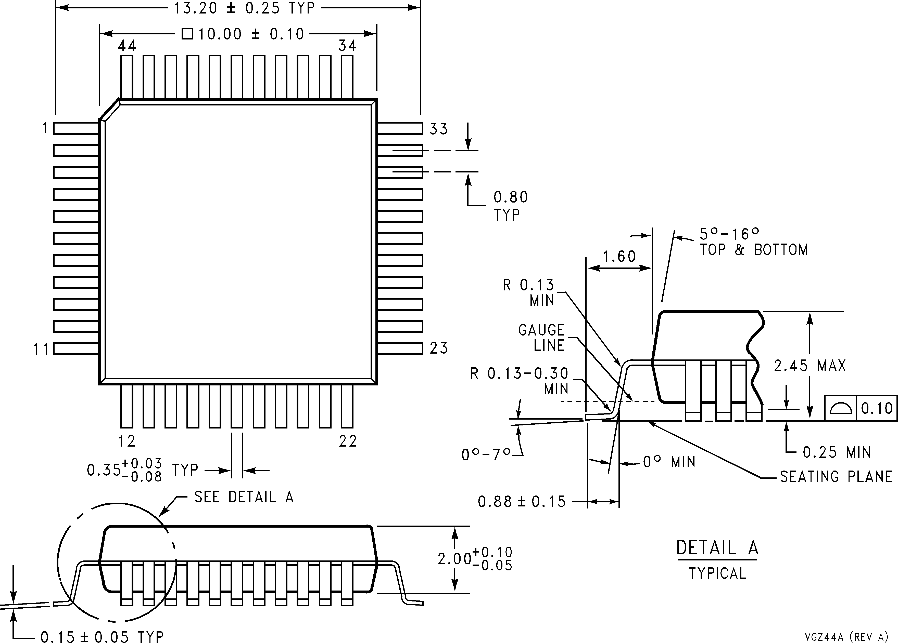

**44-Lead (10 mm x 10 mm) Molded Plastic Quad Flatpak** 
Order Number LM78CCVF-J 
NS Package Number VGZ44A

---

## Life Support Policy

NATIONAL'S PRODUCTS ARE NOT AUTHORIZED FOR USE AS CRITICAL COMPONENTS IN LIFE SUPPORT DEVICES OR
SYSTEMS WITHOUT THE EXPRESS WRITTEN APPROVAL OF THE PRESIDENT AND GENERAL COUNSEL OF NATIONAL
SEMICONDUCTOR CORPORATION. As used herein:

1. Life support devices or systems are devices or systems which, (a) are intended for surgical
   implant into the body, or (b) support or sustain life, and whose failure to perform when properly
   used in accordance with instructions for use provided in the labeling, can be reasonably expected
   to result in a significant injury to the user.
2. A critical component is any component of a life support device or system whose failure to perform
   can be reasonably expected to cause the failure of the life support device or system, or to affect
   its safety or effectiveness.

**National Semiconductor Corporation — Americas** 
Tel: 1-800-272-9959 
Fax: 1-800-737-7018 
Email: support@nsc.com

**National Semiconductor Europe** 
Fax: +49 (0) 180-530 85 86 
Email: europe.support@nsc.com 
Deutsch Tel: +49 (0) 69 9508 6208 
English Tel: +44 (0) 870 24 0 2171 
Français Tel: +33 (0) 1 41 91 8790

**National Semiconductor Asia Pacific Customer Response Group** 
Tel: 65-2544466 
Fax: 65-2504466 
Email: ap.support@nsc.com

**National Semiconductor Japan Ltd.** 
Tel: 81-3-5639-7560 
Fax: 81-3-5639-7507 
www.national.com

---

*LM78 Microprocessor System Hardware Monitor*

National does not assume any responsibility for use of any circuitry described, no circuit patent
licenses are implied and National reserves the right at any time without notice to change said
circuitry and specifications.
