# S3 Trio32/Trio64 Integrated Graphics Accelerators

## Trio32/Trio64 Graphics Accelerators — Data Book

*S3 Incorporated — March 1995 — 2770 San Tomas Expressway, Santa Clara, CA 95051-0968*

> **Source:** [`trio32-trio64-graphics-accelerators-mar1995-683a4e3d90be5389587761.pdf`](trio32-trio64-graphics-accelerators-mar1995-683a4e3d90be5389587761.pdf).
> This Markdown edition was produced from the scanned 278-page data book. The text was
> transcribed from the scan's OCR layer, re-ordered into reading order (including the two-column
> pages) and corrected for OCR noise. The 50 figures were cut from the page scans at
> high resolution into [`img/`](img/) and are embedded below. Register bit-field layouts are
> given as Markdown tables (`Bits` / `Field`); the four registers whose bits are not described in
> the running text keep the scanned diagram. Register and pin tables were rebuilt as Markdown
> tables. The original pagination (e.g. *14-21*) is not reproduced — the printed page numbers
> survive only inside [Appendix A](#appendix-a-register-reference) register references and in
> the [figure index](#list-of-figures) at the end.

---

## Contents

- [Notational Conventions](#notational-conventions)
- [Notices](#notices)
- [Section 1: Introduction](#section-1-introduction)
  - [1.1 Overview](#11-overview)
  - [1.2 Advanced Architecture/Feature Set](#12-advanced-architecturefeature-set)
  - [1.3 Multimedia Support Features](#13-multimedia-support-features)
  - [1.4 Full Software Support](#14-full-software-support)
  - [1.5 Green PC/Monitor Plug and Play Support](#15-green-pcmonitor-plug-and-play-support)
  - [1.6 Resolutions Supported](#16-resolutions-supported)
- [Section 2: Mechanical Data](#section-2-mechanical-data)
  - [2.1 Thermal Specifications](#21-thermal-specifications)
  - [2.2 Mechanical Dimensions](#22-mechanical-dimensions)
- [Section 3: Pins](#section-3-pins)
  - [3.1 Pinout Diagrams](#31-pinout-diagrams)
  - [3.2 Pin Descriptions](#32-pin-descriptions)
  - [3.3 Pin Lists](#33-pin-lists)
- [Section 4: Electrical Data](#section-4-electrical-data)
  - [4.1 Maximum Ratings](#41-maximum-ratings)
  - [4.2 DC Specifications](#42-dc-specifications)
  - [4.3 AC Specifications](#43-ac-specifications)
- [Section 5: Reset and Initialization](#section-5-reset-and-initialization)
  - [5.1 Configuration Strapping](#51-configuration-strapping)
  - [5.2 Test Mode](#52-test-mode)
- [Section 6: System Bus Interfaces](#section-6-system-bus-interfaces)
  - [6.1 PCI Bus Interface](#61-pci-bus-interface)
  - [6.2 VL-Bus Interface](#62-vl-bus-interface)
- [Section 7: Display Memory](#section-7-display-memory)
  - [7.1 Display Memory Configurations](#71-display-memory-configurations)
  - [7.2 Display Memory Refresh](#72-display-memory-refresh)
  - [7.3 Display Memory Functional Timing](#73-display-memory-functional-timing)
  - [7.4 Display Memory Access Control](#74-display-memory-access-control)
  - [7.5 Shared Frame Buffer](#75-shared-frame-buffer)
- [Section 8: RAMDAC Functionality](#section-8-ramdac-functionality)
  - [8.1 Color Modes](#81-color-modes)
  - [8.2 RAMDAC Register Access](#82-ramdac-register-access)
  - [8.3 RAMDAC Snooping](#83-ramdac-snooping)
  - [8.4 Sense Generation](#84-sense-generation)
- [Section 9: Clock Synthesis and Control](#section-9-clock-synthesis-and-control)
  - [9.1 Clock Synthesis](#91-clock-synthesis)
  - [9.2 Clock Reprogramming](#92-clock-reprogramming)
  - [9.3 DCLK Control](#93-dclk-control)
- [Section 10: Miscellaneous Functions](#section-10-miscellaneous-functions)
  - [10.1 Video BIOS ROM Interface](#101-video-bios-rom-interface)
  - [10.2 Green PC Support](#102-green-pc-support)
  - [10.3 General Input Port](#103-general-input-port)
  - [10.4 General Output Port](#104-general-output-port)
  - [10.5 Feature Connector Interface](#105-feature-connector-interface)
  - [10.6 Genlocking](#106-genlocking)
  - [10.7 Interrupt Generation](#107-interrupt-generation)
- [Section 11: Software Setup](#section-11-software-setup)
  - [11.1 CHIP WAKEUP](#111-chip-wakeup)
  - [11.2 REGISTER ACCESS](#112-register-access)
  - [11.3 TESTING FOR THE PRESENCE OF A Trio32/Trio64 CHIP](#113-testing-for-the-presence-of-a-trio32trio64-chip)
  - [11.4 GRAPHICS MODE SETUP](#114-graphics-mode-setup)
- [Section 12: VGA Compatibility Support](#section-12-vga-compatibility-support)
  - [12.1 VGA COMPATIBILITY](#121-vga-compatibility)
  - [12.2 VESA SUPER VGA SUPPORT](#122-vesa-super-vga-support)
- [Section 13: Enhanced Mode Programming](#section-13-enhanced-mode-programming)
  - [13.1 DIRECT BITMAP ACCESSING—LINEAR ADDRESSING](#131-direct-bitmap-accessinglinear-addressing)
  - [13.2 BITMAP ACCESS THROUGH THE GRAPHICS ENGINE](#132-bitmap-access-through-the-graphics-engine)
  - [13.3 MEMORY MAPPING OF ENHANCED MODE REGISTERS](#133-memory-mapping-of-enhanced-mode-registers)
  - [13.4 PROGRAMMING](#134-programming)
  - [13.4 RECOMMENDED READING](#134-recommended-reading)
- [Section 14: VGA Standard Register Descriptions](#section-14-vga-standard-register-descriptions)
  - [14.1 General Registers](#141-general-registers)
  - [14.2 Sequencer Registers](#142-sequencer-registers)
  - [14.3 CRT Controller Registers](#143-crt-controller-registers)
  - [14.4 GRAPHICS CONTROLLER REGISTERS](#144-graphics-controller-registers)
  - [14.5 ATTRIBUTE CONTROLLER REGISTERS](#145-attribute-controller-registers)
  - [14.6 SETUP REGISTERS](#146-setup-registers)
  - [14.7 RAMDAC REGISTERS](#147-ramdac-registers)
- [Section 15: S3 VGA Register Descriptions](#section-15-s3-vga-register-descriptions)
- [Section 16: System Control Register Descriptions](#section-16-system-control-register-descriptions)
- [Section 17: System Extension Register Descriptions](#section-17-system-extension-register-descriptions)
- [Section 18: Enhanced Commands Register Descriptions](#section-18-enhanced-commands-register-descriptions)
- [Section 19: PCI Register Descriptions](#section-19-pci-register-descriptions)
- [Appendix A: Register Reference](#appendix-a-register-reference)
  - [A.1 VGA Registers](#a1-vga-registers)
  - [A.2 S3 VGA Registers](#a2-s3-vga-registers)
  - [A.3 System Control Registers](#a3-system-control-registers)
  - [A.4 System Extension Registers](#a4-system-extension-registers)
  - [A.5 Enhanced Commands Registers](#a5-enhanced-commands-registers)
  - [A.6 PCI Configuration Space Registers](#a6-pci-configuration-space-registers)
- [Index](#index)
- [List of Figures](#list-of-figures)

---

## Notational Conventions

The following notational conventions are used in this data book:

Signal names are shown in all uppercase letters. For example, XD.

A bar over a signal name indicates an active low signal. For example, OE.

n-m indicates a bit field from bit n to bit m. For example, 7-0 specifies bits 7 through 0, inclusive.

n:m indicates a signal (pin) range from n to m. For example, D[7:0] specifies data lines 7 through 0, inclusive.

Use of a trailing letter H indicates a hexadecimal number. For example, 7AH is a hexadecimal number.

Use of a trailing letter b indicates a binary number. For example, 010b is a binary number.

When numerical modifiers such as K or M are used, they refer to binary rather than decimal form. Thus, for example, 1 KByte would be equivalent to 1024, not 1,000 bytes.

## Notices

© Copyright 1994, 1995 S3 Incorporated. All rights reserved. No part of this publication may be reproduced, stored in a retrieval system, or transmitted in any form or by any means, electronic, mechanical, photocopying, or otherwise, without the prior written consent of S3 Incorporated, 2770 San Tomas Expwy., Santa Clara CA 95051-0968. The S3 Corporate Logo, S3 on Board, S3 on Board design, S3 801, S3 805, S3 PS805, S3 805i, S3 928, S3 928PCI, Vision64, Vision864, Vision866, Vision868, Vision964, Vision968, Vision/XA, Trio, Trio32, Trio64, MIC, Galileo, SDAC No Compromise Integration, No Compromise Acceleration and Innovations in Acceleration are trademarks of S3 Incorporated and S3 and True Acceleration are registered trademarks of S3 Incorporated. Other trademarks referenced in this document are owned by their respective companies. The material in this document is for information only and is subject to change without notice. S3 Incorporated reserves the right to make changes in the product design without reservation and without notice to its users.

Additional information may be obtained from:

S3 Incorporated, Literature Department, 2770 San Tomas Expressway, Santa Clara, CA 95051-0968.

Telephone: 408-980-5400, Fax: 408-980-5444

## Section 1: Introduction

**High-Performance Integrated DRAM-based GUI Accelerator Product Family**

- Pin-compatible S3 Trio64 (64-bit Graphics Engine) and S3 Trio32 (32-bit Graphics Engine)

**Integrated 24-bit RAMDAC and Programmable Dual-clock Synthesizer**

- 135 MHz output pixel data rate

**High Non-Interlaced Screen Resolution Support**

- 1280 x 1024 x 256 colors
- 1024 x 768 x 64K colors (Trio64)
- 800 x 600 x 16.7M colors

**64-bit DRAM Memory Interface - Trio64**  
**32-bit DRAM Memory Interface - Trio32**

- 1-, 2-, and 4-MByte DRAM video memory support (Trio64)
- 0.5-, 1- and 2-MByte DRAM video memory support (Trio32)
- 256Kx4/8/16 fast-page mode and EDO DRAMs supported

**DDC Monitor Communications Support**

**Extensive Static/Dynamic Power Savings**

**Industry-standard Local Bus Support**

- Glueless PCI bus support (fully compliant with Revision 2.0)
- Glueless VESA VL-Bus support

**Multimedia Features**

- VESA advanced feature connector (VAFC)
- 16-bit bidirectional support
- 8-bit bidirectional feature connector support
- S3 Shared Frame Buffer Interface support
- Genlock capability

**Green PC Power Savings Features**

- Full hardware and BIOS support for VESA Display Power Management Signaling (DPMS) monitor power savings modes

**Full Software Support**

- Drivers for all major operating systems
- Video BIOS support
- VGA Register Level Compatibility and Super VGA graphics modes support

**Industry-Standard 208-pin PQFP package**

### 1.1 Overview

The Trio64 and Trio32 products are the first in a series of highly-integrated products to be offered by S3. Both products combine a 24-bit RAMDAC, dual programmable clock generators, and high-performance accelerator core in a single device. This provides an optimal, cost-effective DRAM-based graphics solution targeted for motherboard designs as well as add-in card applications. By incorporating an enhanced version of the 64-bit graphics engine used in the S3 Vision family products with an on-chip RAMDAC/clock synthesizer capable of 135 MHz output pixel data rates, the Trio product family provides extremely high graphics performance and support of non-interlaced screen resolutions of up to 1280x1024x256 colors at 72 Hz. The high-performance Trio64 and cost-effective Trio32 are pin-compatible with each other, enabling easy implementation of graphics subsystems at different price/performance points. System designs that implement the Trio32 with 1 MByte of video memory can be quickly upgraded to the higher-performance Trio64 with 2 MBytes of video memory.

### 1.2 Advanced Architecture/Feature Set

The Trio64 provides a 64-bit high performance graphics engine and a 32/64 bit interface to DRAM memory (up to 4 MBytes) for maximum memory bandwidth. The Trio32 incorporates a high-performance 32-bit graphics engine and supports a 32-bit interface to DRAM memory (up to 2 MBytes). Fast page mode DRAMs as well as the latest advanced Extended Data Out (EDO) DRAMs are supported by the Trio32 and Trio64.

An on-chip 24-bit RAMDAC/clock supports output pixel data rates of up to 135 MHz. This allows non-interlaced screen resolutions of up to 1280x1024x256 colors for the Trio32 and Trio64. The Trio64 implements in hardware full acceleration of graphics functions such as BitBLTs with ROPs, 2-point line draws, trapezoidal and polygon fills, clipping, and cursor support for maximum performance. Memory-mapped I/O reads and writes of all command setup and execute registers are also supported. A fast linear addressing scheme reduces software overhead by mapping the display memory into the CPU's upper memory address space and permitting direct CPU access to the display memory.

### 1.3 Multimedia Support Features

Both the Trio64 and Trio32 incorporate genlock circuitry to synchronize graphics output with an external NTSC or PAL signal. Both support an 8-bit bidirectional feature connector or a 16-bit baseline configuration of the VESA Advanced Feature Connector (VAFC) specification to permit video overlay with external video data.

The Trio32/Trio64 also supports S3's Shared Frame Buffer Interface. This uses a bus request/bus grant protocol to arbitrate access to a shared frame buffer.

### 1.4 Full Software Support

S3 provides comprehensive software driver support for Microsoft Windows, Windows NT, IBM OS/2 and SCO OpenDesktop, DOS applications drivers available include AutoCAD and Microstation PC. Trio64 and Trio32 are based upon the same architecture as other S3 accelerators, ensuring driver compatibility and reliability. Full video BIOS support is also provided.

### 1.5 Green PC/Monitor Plug and Play Support

The Trio64 and Trio32 provide full hardware and BIOS support for VESA's Display Power Management (DPMS) protocol. This allows the video subsystem to put a DPMS-compliant monitor into power savings modes in order to meet the EPA's "Energy Star" requirements. The Trio32/Trio64 also supports the VESA Display Data Channel (DDC) standard that permits transfer of monitor identification and resolution support data.

### 1.6 Resolutions Supported

**Table 1-1. Trio32 Video Resolutions**

| Resolution | 0.5 MB DRAM | 1 MB DRAM | 2 MB DRAM |
| --- | --- | --- | --- |
| 640x480x4 | ✓ | ✓ | ✓ |
| 640x480x8 | ✓ | ✓ | ✓ |
| 640x480x16 | | ✓ | ✓ |
| 640x480x24 | | ✓ | ✓ |
| 640x480x32 | | | ✓ |
| 800x600x4 | ✓ | ✓ | ✓ |
| 800x600x8 | ✓ | ✓ | ✓ |
| 800x600x16 | | ✓ | ✓ |
| 1024x768x4 | ✓ | ✓ | ✓ |
| 1024x768x8 | | ✓ | ✓ |
| 1024x768x16 (IL) | | | ✓ |
| 1152x864x8 | | ✓ | ✓ |
| 1280x1024x4 | | ✓ | ✓ |
| 1280x1024x8 | | | ✓ |
| 1600x1200x4 (IL) | | ✓ | ✓ |
| 1600x1200x8 (IL) | | | ✓ |

**Table 1-2. Trio64 Video Resolutions**

| Resolution | 1 MB DRAM | 2 MB DRAM | 4 MB DRAM |
| --- | --- | --- | --- |
| 640x400x32 | ✓ | ✓ | ✓ |
| 640x480x4 | ✓ | ✓ | ✓ |
| 640x480x8 | ✓ | ✓ | ✓ |
| 640x480x16 | ✓ | ✓ | ✓ |
| 640x480x32 | | ✓ | ✓ |
| 800x600x4 | ✓ | ✓ | ✓ |
| 800x600x8 | ✓ | ✓ | ✓ |
| 800x600x16 | ✓ | ✓ | ✓ |
| 800x600x32 | | ✓ | ✓ |
| 1024x768x4 | ✓ | ✓ | ✓ |
| 1024x768x8 | ✓ | ✓ | ✓ |
| 1024x768x16 | | ✓ | ✓ |
| 1024x768x32 (IL) | | | ✓ |
| 1152x864x8 | ✓ | ✓ | ✓ |
| 1280x1024x4 | ✓ | ✓ | ✓ |
| 1280x1024x8 | | ✓ | ✓ |
| 1280x1024x16 (IL) | | | ✓ |
| 1600x1200x4 (IL) | ✓ | ✓ | ✓ |
| 1600x1200x8 (IL) | | ✓ | ✓ |

Extended VGA text modes up to 132 columns by 43 rows are possible as well.

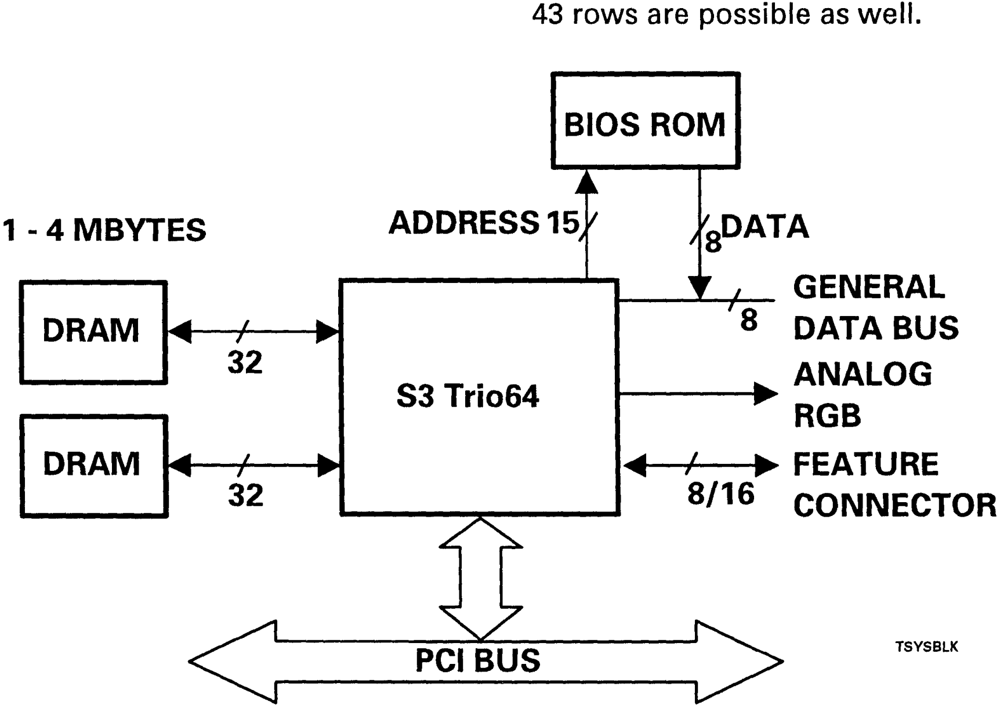

*Figure 1-1. PCI Bus System Block Diagram.*

## Section 2: Mechanical Data

### 2.1 Thermal Specifications

| Parameter | Min | Typ | Max | Unit |
| --- | --- | --- | --- | --- |
| Thermal Resistance ΘJC | | 8 | | °C/W |
| Thermal Resistance ΘJA (Still Air) | | 37 | | °C/W |
| Power Dissipation | | 1.5 | 2.00 | W |
| Junction Temperature | | | 125 | °C |

### 2.2 Mechanical Dimensions

The Trio32 and Trio64 both come in a 208-pin PQFP package. The mechanical dimensions are given in Figure 2-1.

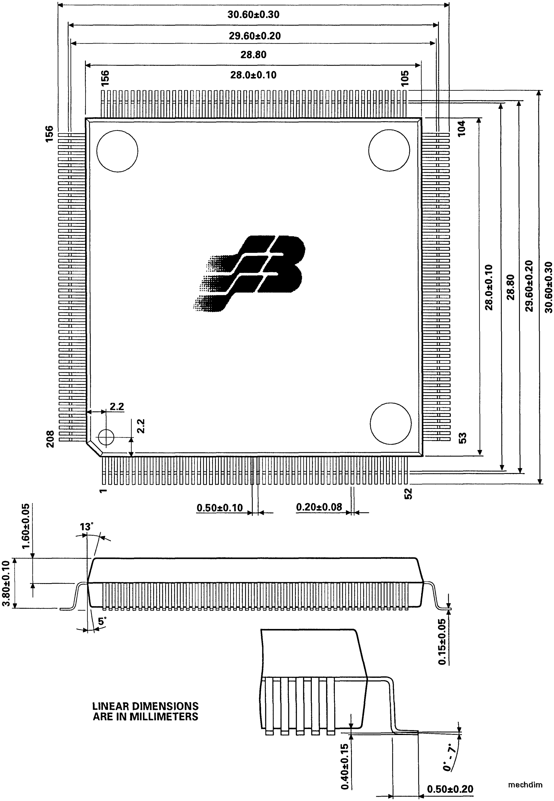

*Figure 2-1. 208-pin PQFP Mechanical Dimensions.*

## Section 3: Pins

### 3.1 Pinout Diagrams

The Trio32 and Trio64 both come in a 208-pin PQFP package. The PCI bus pinout for the Trio32 is shown in Figure 3-1. The Trio32 pinout for the VESA local bus configuration is shown in Figure 3-2. The PCI bus pinout for the Trio64 is shown in Figure 3-3. The Trio64 pinout for the VESA local bus configuration is shown in Figure 3-4. Active low pins are indicated by an overbar. N/C indicates a no connect.

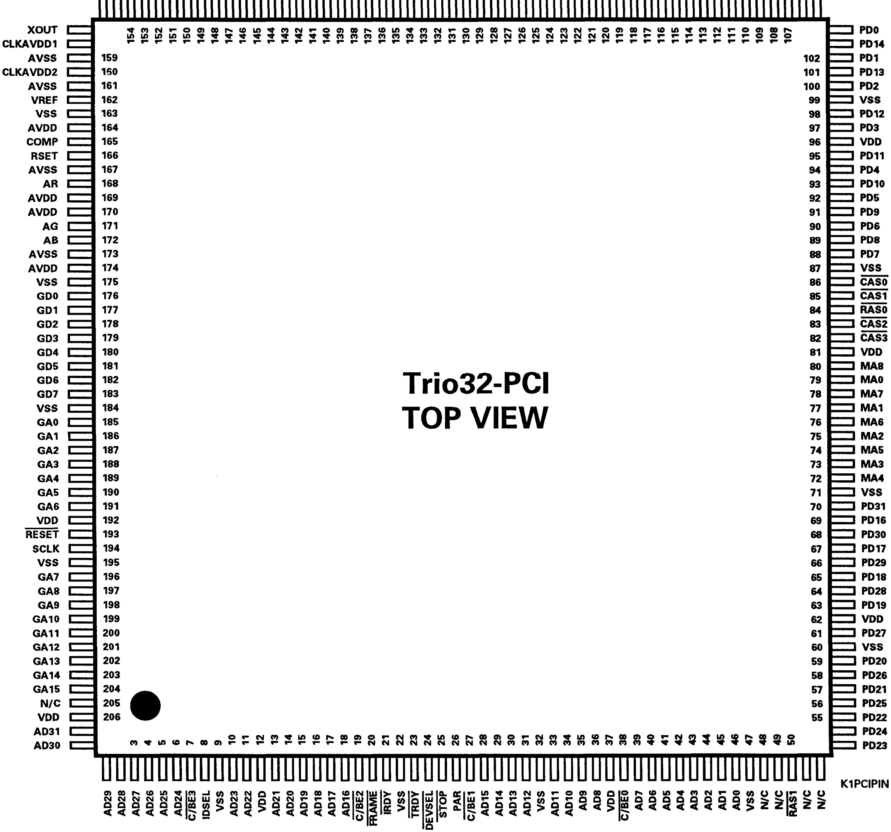

*Figure 3-1. Trio32 PCI Bus Configuration Pinout.*

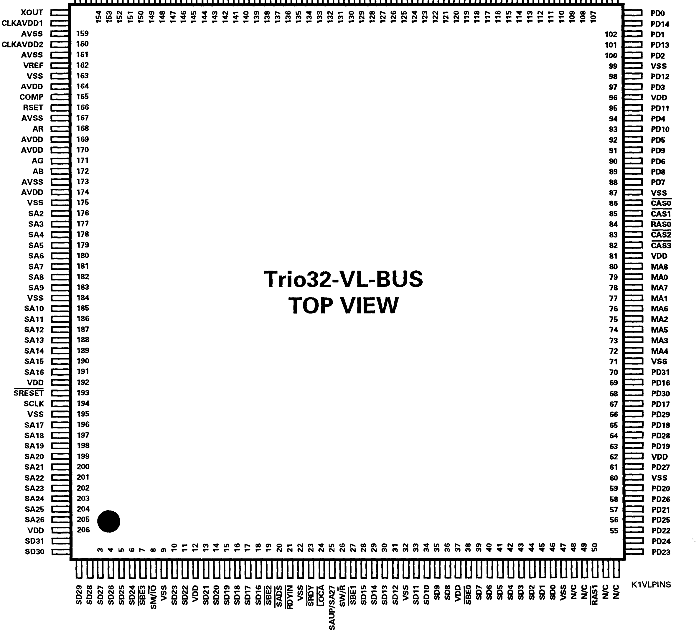

*Figure 3-2. Trio32 VL-Bus Configuration Pinout.*

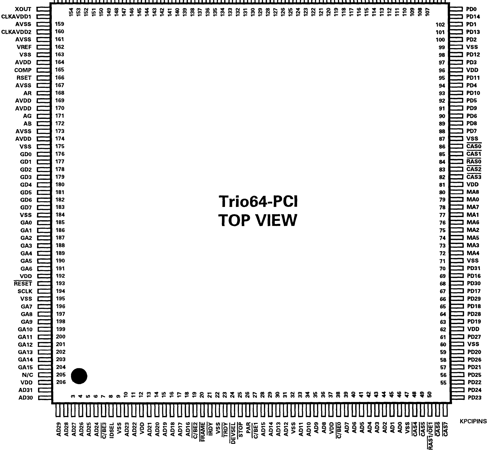

*Figure 3-3. Trio64 PCI Bus Configuration Pinout.*

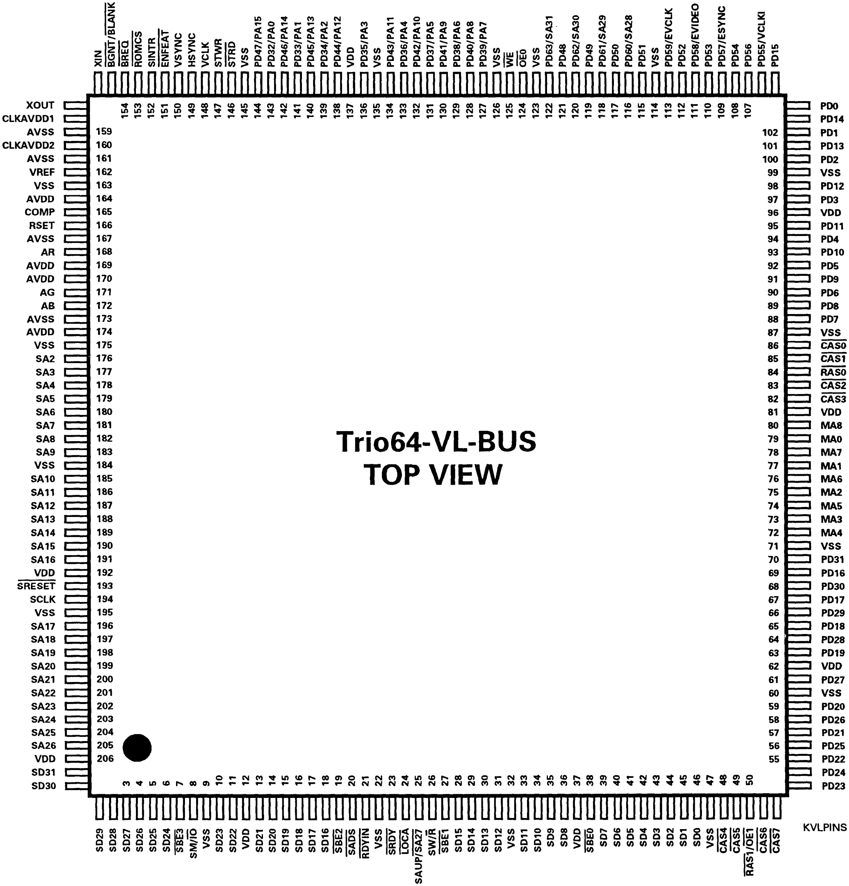

*Figure 3-4. Trio64 VL-Bus Configuration Pinout.*

### 3.2 Pin Descriptions

The following table provides a brief description of each pin on the Trio32/Trio64 for their PCI bus and VL-Bus configurations. The pin functions the same for both Trio32 and Trio64 unless otherwise noted. The following definitions are used in these descriptions:

I - Input signal
O - Output signal
B - Bidirectional signal

Some pins have multiple names. This either reflects the different functions performed by those pins depending on the bus configuration selected by power-on-strapping or multiplexed pins whose functions are selected via a register bit setting. The pin definitions and functions are given for each possible case.

**Table 3-1. Pin Descriptions**

| Symbol | Type | Pin Number(s) | Description |
| --- | --- | --- | --- |
| **BUS INTERFACES** | | | |
| *Address and Data* | | | |
| AD[31:0] | B | 207-208, 1-6, 10-11, 13-18, 28-31, 33-36, 39-46 | (PCI) Multiplexed Address/Data Bus. A bus transaction (cycle) consists of an address phase followed by one or more data phases. |
| SD[31:0] | B | 207-208, 1-6, 10-11, 13-18, 28-31, 33-36, 39-46 | (VL) System Data Bus. |
| SA[31:28] | I | 122, 120, 118, 116 | (VL) System Address Bus Lines 31:28. If bit 7 of CR68 is set to 1, these pins function as SA[31:28]. Otherwise, they function as PD lines for a 64-bit memory bus for the Trio64 or are no connects for the Trio32. |
| SAUP/SA27 | I | 25 | (VL) Upper Address Decode/System Address Bus Line 27. If bit 7 of CR68 is cleared to 0, this pin functions as SA27. Otherwise, this pin is the input for an upper address line decode indicating an access to the Trio32/Trio64 memory space. The SAUP functionality will normally not be used with the Trio32. |
| SA26 | I | 205 | (VL) System Address Bus Line 26. |
| GA[15:0] | B | 204-196, 191-185 | (PCI) BIOS ROM Address Bus. |
| SA[25:10] | B | 204-196, 191-185 | (VL) System Address Bus Lines 25:10. |
| GD[7:0] | B | 183-176 | (PCI) General Data Bus. |
| SA[9:2] | B | 183-176 | (VL) System Address Bus Lines 9:2. |
| C/BE[3:0] | I | 7, 19, 27, 38 | (PCI) Bus Command/Data Byte Enables. These signals carry the bus command during the address phase and the byte enables during the data phase. |
| SBE[3:0] | I | 7, 19, 27, 38 | (VL) Data Byte Enables. |
| *Bus Control* | | | |
| SCLK | I | 194 | (PCI) PCI System Clock. |
| SCLK | I | 194 | (VL) CPU System Clock. |
| INTA | O | 152 | (PCI) Interrupt Request. |
| SINTR | O | 152 | (VL) Interrupt Request. |
| IRDY | I | 21 | (PCI) Initiator Ready. A bus data phase is completed when both IRDY and TRDY are asserted on the same cycle. |
| RDYIN | I | 21 | (VL) Local Bus Cycle End Acknowledge. The Trio32/Trio64 holds read data valid on the system data bus until this input is asserted. |
| TRDY | O | 23 | (PCI) Target Ready. A bus data phase is completed when both IRDY and TRDY are asserted on the same cycle. |
| SRDY | O | 23 | (VL) Local Bus Cycle End. |
| DEVSEL | O | 24 | (PCI) Device Select. The Trio32/Trio64 drives this signal active when it decodes its address as the target of the current access. |
| LOCA | O | 24 | (VL) Local Bus Access Cycle Indicator. This signal is output during local bus cycles to allow system logic chip sets to prevent concurrent EISA/ISA cycle generation. |
| IDSEL | I | 8 | (PCI) Initialization Device Select. This input is the chip select for PCI configuration register reads/writes. |
| SM/IO | I | 8 | (VL) Memory/I/O Cycle Indicator. This signal is high for a memory cycle and low for an I/O cycle. |
| RESET | I | 193 | (PCI) System Reset. Asserting this signal forces the registers and state machines to a known state. |
| SRESET | I | 193 | (VL) System Reset. |
| FRAME | I | 20 | (PCI) Cycle Frame. This signal is asserted by the bus master to indicate the beginning of a bus transaction. It is deasserted during the final data phase of a bus transaction. |
| SADS | I | 20 | (VL) System Address Strobe. |
| PAR | O | 26 | (PCI) Parity. The Trio32/Trio64 asserts this signal to verify even parity during reads. |
| SW/R | I | 26 | (VL) Write/Read Cycle Indicator. This signal is high for a write and low for a read. |
| STOP | O | 25 | (PCI) Stop. The Trio32/Trio64 asserts this signal to indicate a target disconnect. |
| SAUP/SA27 | I | 25 | (VL) Upper Address Decode/System Address Bus Line 27. If bit 7 of CR68 is cleared to 0, this pin functions as SA27. Otherwise, this pin is the input for an upper address line decode indicating an access to the Trio32/Trio64 memory space. The SAUP functionality will normally not be used with the Trio32. |
| **CLOCK CONTROL** | | | |
| XIN | I | 156 | Reference Frequency Input. If an external crystal is used, it is connected between XOUT and this pin. A stable external frequency source can also be input via this pin. If PD11 is strapped low at power-on, this becomes the DCLK (dot clock) input, bypassing the internal oscillator. This is normally only used for test purposes. |
| XOUT | O | 157 | Crystal Output. If an external 14.318 MHz crystal is used, it is connected between XIN and this pin. This pin drives the crystal via an internal oscillator. |
| **DISPLAY MEMORY INTERFACE** | | | |
| *Address and Data* | | | |
| PD[63:32] | B | 122, 120, 118, 116, 113, 111, 109, 107, 106, 108, 110, 112, 115, 117, 119, 121, 144, 142, 140, 138, 134, 132, 130, 128, 127, 129, 131, 133, 136, 139, 141, 143 | Display Memory Pixel Data Bus Lines 63:32. These signals are available only on the Trio64. Certain of these pins are enabled for feature connector operation when bit 0 of SRD is set to 1 or as system address lines if bit 7 of CR68 is set to 1. |
| PD[31:0] | B | 70, 68, 66, 64, 61, 58, 56, 54, 53, 55, 57, 59, 63, 65, 67, 69, 105, 103, 101, 98, 95, 93, 91, 89, 88, 90, 92, 94, 97, 100, 102, 104 | Display Memory Pixel Data Bus Lines 31:0. PD[23:0] are also used as the system configuration strapping bits, providing system configuration and setup information upon power-on or reset. |
| MA[8:0] | O | 80, 78, 76, 74, 72, 73, 75, 77, 79 | Memory Address Bus. The video memory row and column addresses are multiplexed on these lines. |
| *Memory Control* | | | |
| RAS[1:0] | O | 50, 84 | Row Address Strobes. For the Trio64, RAS1 is output on pin 50 when bit 2 of CR36 is set to 1 (fast page mode memory) and bit 6 of SRA is set to 1. RAS1 is used to select the upper 2 MBytes of a 4-MByte fast page mode memory configuration. It is not available for EDO memory operation, limiting EDO configurations to 2 MBytes. For the Trio32, pin 50 always acts as RAS1 and selects the second MByte of memory (either fast page or EDO). |
| CAS[7:4] | O | 52, 51, 49, 48 | Column Address Strobe Lines 7:4. These are available only on the Trio64. They are not driven when the feature connector is enabled by setting bit 0 of SRD to 1. This prevents contention on the multiplexed PD lines when using fast page mode memory. |
| CAS[3:0] | O | 82, 83, 85, 86 | Column Address Strobe Lines 3:0. |
| WE | O | 125 | Write Enable. |
| OE[1:0] | O | 50, 124 | Output Enables. For the Trio64, OE1 is output on pin 50 when bit 2 of CR36 is cleared to 0 (EDO memory). If the feature connector is disabled (bit 0 of SRD cleared to 0), this output is the same as OE0 (for 64-bit PD bus operation). If the feature connector is enabled (bit 0 of SRD set to 1), OE1 is held high (not asserted). This ensures that EDO memory data is not driven on the multiplexed PD lines when the feature connector is enabled. OE1 is never generated for the Trio64 in fast page mode operation. Instead, if bit 6 of SRA is cleared to 0 (default), a second OE0 signal is output on pin 50. This allows the same board to use either fast page or EDO memory in 2-MByte designs with no additional hardware. OE1 is not generated on the Trio32 because the feature connector signals are not multiplexed on PD lines. |
| **VIDEO INTERFACE** | | | |
| COMP | | 165 | Compensation Pin. This pin is tied to VDD through a 0.1 µF capacitor. |
| VREF | | 162 | Voltage Reference. This pin is tied to VSS through a 0.1 µF capacitor. |
| RSET | | 166 | Reference Resistor. This pin is tied to VSS through an external resistor to control the full-scale current value. |
| AR | O | 168 | Analog Red. Analog red output to the monitor. |
| AG | O | 171 | Analog Green. Analog green output to the monitor. |
| AB | O | 172 | Analog Blue. Analog blue signal to the monitor. |
| ENFEAT | O | 151 | Enable Feature Connector. Setting bit 0 of SRD to 1 drives this signal low. It is used to enable the feature connector buffers required in Trio64 memory configurations of 2 MBytes or larger. |
| BLANK | B | 155 | Video Blank. This signal is multiplexed with the BGNT signal. This pin functions as BLANK when bit 0 of SRD is set to 1 and as BGNT when bit 0 of SRD is cleared to 0. When ESYNC is high, BLANK is a feature connector output. When ESYNC is low, BLANK is a feature connector input that, when driven low, turns off the video output. |
| ESYNC | I | 109 | External SYNC. This signal is multiplexed with PD57 on the Trio64. Setting bit 0 of SRD to 1 selects the ESYNC input function. When ESYNC is driven low, HSYNC, VSYNC and BLANK become inputs. When ESYNC is high, HSYNC and VSYNC are tri-stated and BLANK becomes an output to the feature connector. |
| EVIDEO | I | 111 | External Video. This signal is multiplexed with PD58 on the Trio64. Setting bit 0 of SRD to 1 for the Trio64 selects the EVIDEO function. When this input is asserted low, PA[15:0] are inputs and are sampled by VCLKI. When this input is high, PA[15:0] are outputs to the feature connector. |
| EVCLK | I | 113 | External VCLK. This signal is multiplexed with PD59 on the Trio64. Setting bit 0 of SRD to 1 selects the EVCLK function. When this input is asserted low, VCLK is an input to the internal RAMDAC. When this input is high, VCLK is output to the feature connector. |
| VCLK | B | 148 | Video/Pixel Clock. When EVCLK is high, this signal is an output to the feature connector. When EVCLK is low, this becomes an input used only for test purposes. |
| VCLKI | I | 106 | VCLK Input. This signal is multiplexed with PD55 on the Trio64. Enabling the feature connector selects the VCLKI function. Setting bit 1 of SRB to 1 causes VCLKI to be used to clock in feature connector pixel data to the internal RAMDAC. |
| HSYNC | O | 149 | Horizontal Sync. When ESYNC is high, this signal is an output to the feature connector. It is tri-stated when ESYNC is low. |
| VSYNC | B | 150 | Vertical Sync. When ESYNC is high, this signal is an output to the feature connector. It is tri-stated when ESYNC is low unless bit 0 of CR56 is set to 1. In this case, this signal becomes an input for genlocking. |
| PA[15:0] | B | 144, 142, 140, 138, 134, 132, 130, 128, 127, 129, 131, 133, 136, 139, 141, 143 | Pixel Address Lines [15:0]. These signals are multiplexed with PD signals on the Trio64. Setting bit 0 of SRD to 1 selects the PA[15:0] function. When EVIDEO is high, PA[15:0] are outputs to the feature connector. When EVIDEO is low, PA[15:0] are inputs and are sampled by VCLKI. |
| **MISCELLANEOUS FUNCTIONS** | | | |
| *General Data Port* | | | |
| GA[15:0] | O | 204-196, 191-185 | (PCI) General Address Bus. These signals provide the address for BIOS ROM reads. |
| GD[7:0] | B | 206-199 | (PCI) General Data Bus. These signals carry data for BIOS ROM reads, General Output Port output and General Input Port input. |
| ROMEN | O | 153 | (PCI) ROM Enable. This signal provides the chip output enable input for BIOS ROM reads. |
| ROMCS | O | 153 | (VL) ROM Chip Select. This signal provides the chip output enable for BIOS ROM reads. |
| SD[15:8] | O | 28-31, 33-36 | (VL) System Data Bus 15:8. When data is written to the General Output Port register (CR5C), STWR is asserted to strobe the contents of this register into the external GOP register. The data is driven via SD[15:8]. |
| STWR | O | 147 | General Output Port Write Strobe. Write strobe for the General Output Port (CR5C) buffer. |
| SD[7:0] | I | 39-46 | (VL) System Data Bus 7:0. When bit 2 of CR55 is set to 1 to enable the General Input Port function, a read of 3C8H asserts STRD. This strobes the GIP buffer and drives the contents of this buffer onto SD[7:0]. |
| STRD | O | 146 | General Input Port Read Strobe. This signal is asserted to strobe the General Input Port buffer when bit 2 of CR55 is set to 1 and the 3C8H port is read. |
| *Bus Master Control* | | | |
| BREQ | I | 154 | Bus Request. When bit 2 of CR50 is set to 1, this is the Bus Request input from another display memory master. This supports shared frame buffer operation. The appropriate input signal must be selected by external hardware. |
| BGNT | O | 155 | Bus Grant. This signal is multiplexed with the BLANK signal. This pin functions as BLANK when bit 0 of SRD is set to 1 and as BGNT when bit 0 of SRD is cleared to 0. Bit 2 of CR50 must be set to 1 to enable bus request/bus grant operation. The Trio32/Trio64 asserts this signal in response to a BREQ input to notify another display memory master that it can take control of the display memory bus. The Trio32/Trio64 raises this signal to reclaim bus control. |
| **POWER AND GROUND** | | | |
| VDD | I | 12, 37, 62, 81, 96, 137, 192, 206 | Digital power supply |
| AVDD | I | 164, 169, 170, 174 | Analog power supply (RAMDAC) |
| CLKAVDD[1:2] | I | 158, 160 | Analog power supply (clock synthesizer) |
| VSS | I | 9, 22, 32, 47, 60, 71, 87, 114, 123, 126, 135, 145, 163, 175, 184, 195 | Digital ground |
| AVSS | I | 159, 161, 167, 173 | Analog ground |

### 3.3 Pin Lists

Table 3-2 lists all Trio32/Trio64 pins alphabetically. The pin number(s) corresponding to each pin name are given in the appropriate chip/bus interface type column. Table 3-3 lists all Trio32/Trio64 pins in numerical order. The pin name corresponding to each pin number is given in the appropriate chip/bus interface column.

**Table 3-2. Alphabetical Pin Listing**

| Name | Trio32 PCI | Trio32 VL | Trio64 PCI | Trio64 VL |
| --- | --- | --- | --- | --- |
| AB | 172 | 172 | 172 | 172 |
| AD[31:0] | 207-208, 1-6, 10-11, 13-18, 28-31, 33-36, 39-46 |  | 207-208, 1-6, 10-11, 13-18, 28-31, 33-36, 39-46 |  |
| AG | 171 | 171 | 171 | 171 |
| AR | 168 | 168 | 168 | 168 |
| AVDD | 164, 169, 170, 174 | 164, 169, 170, 174 | 164, 169, 170, 174 | 164, 169, 170, 174 |
| AVSS | 159, 161, 167, 173 | 159, 161, 167, 173 | 159, 161, 167, 173 | 159, 161, 167, 173 |
| BGNT | 155 | 155 | 155 | 155 |
| BLANK | 155 | 155 | 155 | 155 |
| BREQ | 154 | 154 | 154 | 154 |
| CAS[3:0] | 82, 83, 85, 86 | 82, 83, 85, 86 | 82, 83, 85, 86 | 82, 83, 85, 86 |
| CAS[7:4] |  |  | 52, 51, 49, 48 | 52, 51, 49, 48 |
| C/BE[3:0] | 7, 19, 27, 38 |  | 7, 19, 27, 38 |  |
| CLKAVDD[1:2] | 158, 160 | 158, 160 | 158, 160 | 158, 160 |
| COMP | 165 | 165 | 165 | 165 |
| DEVSEL | 24 |  | 24 |  |
| ENFEAT | 151 | 151 | 151 | 151 |
| ESYNC | 109 | 109 | 109 | 109 |
| EVCLK | 113 | 113 | 113 | 113 |
| EVIDEO | 111 | 111 | 111 | 111 |
| FRAME | 20 |  | 20 |  |
| GA[15:0] | 204-196, 191-185 |  | 204-196, 191-185 |  |
| GD[7:0] | 183-176 |  | 183-176 |  |
| HSYNC | 149 | 149 | 149 | 149 |
| IDSEL | 8 |  | 8 |  |
| INTA | 152 |  | 152 |  |
| IRDY | 21 |  | 21 |  |
| LOCA |  | 24 |  | 24 |
| MA[8:0] | 80, 78, 76, 74, 72, 73, 75, 77, 79 | 80, 78, 76, 74, 72, 73, 75, 77, 79 | 80, 78, 76, 74, 72, 73, 75, 77, 79 | 80, 78, 76, 74, 72, 73, 75, 77, 79 |
| OE0 | 124 | 124 | 124 | 124 |
| OE1 |  |  | 50 | 50 |
| PA[15:0] | 144, 142, 140, 138, 134, 132, 130, 128, 127, 129, 131, 133, 136, 139, 141, 143 | 144, 142, 140, 138, 134, 132, 130, 128, 127, 129, 131, 133, 136, 139, 141, 143 | 144, 142, 140, 138, 134, 132, 130, 128, 127, 129, 131, 133, 136, 139, 141, 143 | 144, 142, 140, 138, 134, 132, 130, 128, 127, 129, 131, 133, 136, 139, 141, 143 |
| PAR | 26 |  | 26 |  |
| PD[63:0] | 70, 68, 66, 64, 61, 58, 56, 54, 53, 55, 57, 59, 63, 65, 67, 69, 105, 103, 101, 98, 95, 93, 91, 89, 88, 90, 92, 94, 97, 100, 102, 104 | 70, 68, 66, 64, 61, 58, 56, 54, 53, 55, 57, 59, 63, 65, 67, 69, 105, 103, 101, 98, 95, 93, 91, 89, 88, 90, 92, 94, 97, 100, 102, 104 | 122, 120, 118, 116, 113, 111, 109, 107, 106, 108, 110, 112, 115, 117, 119, 121, 144, 142, 140, 138, 134, 132, 130, 128, 127, 129, 131, 133, 136, 139, 141, 143, 70, 68, 66, 64, 61, 58, 56, 54, 53, 55, 57, 59, 63, 65, 67, 69, 105, 103, 101, 98, 95, 93, 91, 89, 88, 90, 92, 94, 97, 100, 102, 104 | 122, 120, 118, 116, 113, 111, 109, 107, 106, 108, 110, 112, 115, 117, 119, 121, 144, 142, 140, 138, 134, 132, 130, 128, 127, 129, 131, 133, 136, 139, 141, 143, 70, 68, 66, 64, 61, 58, 56, 54, 53, 55, 57, 59, 63, 65, 67, 69, 105, 103, 101, 98, 95, 93, 91, 89, 88, 90, 92, 94, 97, 100, 102, 104 |
| RAS[1:0] | 50, 84 | 50, 84 | 50, 84 | 50, 84 |
| RESET | 193 |  | 193 |  |
| RDYIN |  | 21 |  | 21 |
| ROMEN | 153 |  | 153 |  |
| ROMCS |  | 153 |  | 153 |
| RSET | 166 | 166 | 166 | 166 |
| SA[31:2] |  | 122, 120, 118, 116, 25, 205-196, 191-185, 183-176 |  | 122, 120, 118, 116, 25, 205-196, 191-185, 183-176 |
| SADS |  | 20 |  | 20 |
| SAUP |  | 25 |  | 25 |
| SBE[3:0] |  | 7, 19, 27, 38 |  | 7, 19, 27, 38 |
| SCLK | 194 | 194 | 194 | 194 |
| SD[31:0] |  | 207-208, 1-6, 10-11, 13-18, 28-31, 33-36, 39-46 |  | 207-208, 1-6, 10-11, 13-18, 28-31, 33-36, 39-46 |
| SINTR |  | 152 |  | 152 |
| SM/IO |  | 8 |  | 8 |
| SRDY |  | 23 |  | 23 |
| SRESET |  | 193 |  | 193 |
| STOP | 25 |  | 25 |  |
| STWR | 147 | 147 | 147 | 147 |
| SW/R |  | 26 |  | 26 |
| TRDY | 23 |  | 23 |  |
| VCLK | 148 | 148 | 148 | 148 |
| VCLKI | 106 | 106 | 106 | 106 |
| VDD | 12, 37, 62, 81, 96, 137, 192, 206 | 12, 37, 62, 81, 96, 137, 192, 206 | 12, 37, 62, 81, 96, 137, 192, 206 | 12, 37, 62, 81, 96, 137, 192, 206 |
| VREF | 162 | 162 | 162 | 162 |
| VSS | 9, 22, 32, 47, 60, 71, 87, 114, 123, 126, 135, 145, 163, 175, 184, 195 | 9, 22, 32, 47, 60, 71, 87, 114, 123, 126, 135, 145, 163, 175, 184, 195 | 9, 22, 32, 47, 60, 71, 87, 114, 123, 126, 135, 145, 163, 175, 184, 195 | 9, 22, 32, 47, 60, 71, 87, 114, 123, 126, 135, 145, 163, 175, 184, 195 |
| VSYNC | 150 | 150 | 150 | 150 |
| WE | 125 | 125 | 125 | 125 |
| XIN | 156 | 156 | 156 | 156 |
| XOUT | 157 | 157 | 157 | 157 |

**Table 3-3. Numerical Pin Listing**

| Number | Trio32 PCI | Trio32 VL | Trio64 PCI | Trio64 VL |
| --- | --- | --- | --- | --- |
| 1 | AD29 | SD29 | AD29 | SD29 |
| 2 | AD28 | SD28 | AD28 | SD28 |
| 3 | AD27 | SD27 | AD27 | SD27 |
| 4 | AD26 | SD26 | AD26 | SD26 |
| 5 | AD25 | SD25 | AD25 | SD25 |
| 6 | AD24 | SD24 | AD24 | SD24 |
| 7 | C/BE3 | SBE3 | C/BE3 | SBE3 |
| 8 | IDSEL | SM/IO | IDSEL | SM/IO |
| 9 | VSS | VSS | VSS | VSS |
| 10 | AD23 | SD23 | AD23 | SD23 |
| 11 | AD22 | SD22 | AD22 | SD22 |
| 12 | VDD | VDD | VDD | VDD |
| 13 | AD21 | SD21 | AD21 | SD21 |
| 14 | AD20 | SD20 | AD20 | SD20 |
| 15 | AD19 | SD19 | AD19 | SD19 |
| 16 | AD18 | SD18 | AD18 | SD18 |
| 17 | AD17 | SD17 | AD17 | SD17 |
| 18 | AD16 | SD16 | AD16 | SD16 |
| 19 | C/BE2 | SBE2 | C/BE2 | SBE2 |
| 20 | FRAME | SADS | FRAME | SADS |
| 21 | IRDY | RDYIN | IRDY | RDYIN |
| 22 | VSS | VSS | VSS | VSS |
| 23 | TRDY | SRDY | TRDY | SRDY |
| 24 | DEVSEL | LOCA | DEVSEL | LOCA |
| 25 | STOP | SAUP/SA27 | STOP | SAUP/SA27 |
| 26 | PAR | SW/R | PAR | SW/R |
| 27 | C/BE1 | SBE1 | C/BE1 | SBE1 |
| 28 | AD15 | SD15 | AD15 | SD15 |
| 29 | AD14 | SD14 | AD14 | SD14 |
| 30 | AD13 | SD13 | AD13 | SD13 |
| 31 | AD12 | SD12 | AD12 | SD12 |
| 32 | VSS | VSS | VSS | VSS |
| 33 | AD11 | SD11 | AD11 | SD11 |
| 34 | AD10 | SD10 | AD10 | SD10 |
| 35 | AD9 | SD9 | AD9 | SD9 |
| 36 | AD8 | SD8 | AD8 | SD8 |
| 37 | VDD | VDD | VDD | VDD |
| 38 | C/BE0 | SBE0 | C/BE0 | SBE0 |
| 39 | AD7 | SD7 | AD7 | SD7 |
| 40 | AD6 | SD6 | AD6 | SD6 |
| 41 | AD5 | SD5 | AD5 | SD5 |
| 42 | AD4 | SD4 | AD4 | SD4 |
| 43 | AD3 | SD3 | AD3 | SD3 |
| 44 | AD2 | SD2 | AD2 | SD2 |
| 45 | AD1 | SD1 | AD1 | SD1 |
| 46 | AD0 | SD0 | AD0 | SD0 |
| 47 | VSS | VSS | VSS | VSS |
| 48 | N/C | N/C | CAS4 | CAS4 |
| 49 | N/C | N/C | CAS5 | CAS5 |
| 50 | RAS1 | RAS1 | RAS1/OE1 | RAS1/OE1 |
| 51 | N/C | N/C | CAS6 | CAS6 |
| 52 | N/C | N/C | CAS7 | CAS7 |
| 53 | PD23 | PD23 | PD23 | PD23 |
| 54 | PD24 | PD24 | PD24 | PD24 |
| 55 | PD22 | PD22 | PD22 | PD22 |
| 56 | PD25 | PD25 | PD25 | PD25 |
| 57 | PD21 | PD21 | PD21 | PD21 |
| 58 | PD26 | PD26 | PD26 | PD26 |
| 59 | PD20 | PD20 | PD20 | PD20 |
| 60 | VSS | VSS | VSS | VSS |
| 61 | PD27 | PD27 | PD27 | PD27 |
| 62 | VDD | VDD | VDD | VDD |
| 63 | PD19 | PD19 | PD19 | PD19 |
| 64 | PD28 | PD28 | PD28 | PD28 |
| 65 | PD18 | PD18 | PD18 | PD18 |
| 66 | PD29 | PD29 | PD29 | PD29 |
| 67 | PD17 | PD17 | PD17 | PD17 |
| 68 | PD30 | PD30 | PD30 | PD30 |
| 69 | PD16 | PD16 | PD16 | PD16 |
| 70 | PD31 | PD31 | PD31 | PD31 |
| 71 | VSS | VSS | VSS | VSS |
| 72 | MA4 | MA4 | MA4 | MA4 |
| 73 | MA3 | MA3 | MA3 | MA3 |
| 74 | MA5 | MA5 | MA5 | MA5 |
| 75 | MA2 | MA2 | MA2 | MA2 |
| 76 | MA6 | MA6 | MA6 | MA6 |
| 77 | MA1 | MA1 | MA1 | MA1 |
| 78 | MA7 | MA7 | MA7 | MA7 |
| 79 | MA0 | MA0 | MA0 | MA0 |
| 80 | MA8 | MA8 | MA8 | MA8 |
| 81 | VDD | VDD | VDD | VDD |
| 82 | CAS3 | CAS3 | CAS3 | CAS3 |
| 83 | CAS2 | CAS2 | CAS2 | CAS2 |
| 84 | RAS0 | RAS0 | RAS0 | RAS0 |
| 85 | CAS1 | CAS1 | CAS1 | CAS1 |
| 86 | CAS0 | CAS0 | CAS0 | CAS0 |
| 87 | VSS | VSS | VSS | VSS |
| 88 | PD7 | PD7 | PD7 | PD7 |
| 89 | PD8 | PD8 | PD8 | PD8 |
| 90 | PD6 | PD6 | PD6 | PD6 |
| 91 | PD9 | PD9 | PD9 | PD9 |
| 92 | PD5 | PD5 | PD5 | PD5 |
| 93 | PD10 | PD10 | PD10 | PD10 |
| 94 | PD4 | PD4 | PD4 | PD4 |
| 95 | PD11 | PD11 | PD11 | PD11 |
| 96 | VDD | VDD | VDD | VDD |
| 97 | PD3 | PD3 | PD3 | PD3 |
| 98 | PD12 | PD12 | PD12 | PD12 |
| 99 | VSS | VSS | VSS | VSS |
| 100 | PD2 | PD2 | PD2 | PD2 |
| 101 | PD13 | PD13 | PD13 | PD13 |
| 102 | PD1 | PD1 | PD1 | PD1 |
| 103 | PD14 | PD14 | PD14 | PD14 |
| 104 | PD0 | PD0 | PD0 | PD0 |
| 105 | PD15 | PD15 | PD15 | PD15 |
| 106 | VCLKI | VCLKI | PD55/VCLKI | PD55/VCLKI |
| 107 | N/C | N/C | PD56 | PD56 |
| 108 | N/C | N/C | PD54 | PD54 |
| 109 | ESYNC | ESYNC | PD57/ESYNC | PD57/ESYNC |
| 110 | N/C | N/C | PD53 | PD53 |
| 111 | EVIDEO | EVIDEO | PD58/EVIDEO | PD58/EVIDEO |
| 112 | N/C | N/C | PD52 | PD52 |
| 113 | EVCLK | EVCLK | PD59/EVCLK | PD59/EVCLK |
| 114 | VSS | VSS | VSS | VSS |
| 115 | N/C | N/C | PD51 | PD51 |
| 116 | N/C | SA28 | PD60 | PD60/SA28 |
| 117 | N/C | N/C | PD50 | PD50 |
| 118 | N/C | SA29 | PD61 | PD61/SA29 |
| 119 | N/C | N/C | PD49 | PD49 |
| 120 | N/C | SA30 | PD62 | PD62/SA30 |
| 121 | N/C | N/C | PD48 | PD48 |
| 122 | N/C | SA31 | PD63 | PD63/SA31 |
| 123 | VSS | VSS | VSS | VSS |
| 124 | OE0 | OE0 | OE0 | OE0 |
| 125 | WE | WE | WE | WE |
| 126 | VSS | VSS | VSS | VSS |
| 127 | PA7 | PA7 | PD39/PA7 | PD39/PA7 |
| 128 | PA8 | PA8 | PD40/PA8 | PD40/PA8 |
| 129 | PA6 | PA6 | PD38/PA6 | PD38/PA6 |
| 130 | PA9 | PA9 | PD41/PA9 | PD41/PA9 |
| 131 | PA5 | PA5 | PD37/PA5 | PD37/PA5 |
| 132 | PA10 | PA10 | PD42/PA10 | PD42/PA10 |
| 133 | PA4 | PA4 | PD36/PA4 | PD36/PA4 |
| 134 | PA11 | PA11 | PD43/PA11 | PD43/PA11 |
| 135 | VSS | VSS | VSS | VSS |
| 136 | PA3 | PA3 | PD35/PA3 | PD35/PA3 |
| 137 | VDD | VDD | VDD | VDD |
| 138 | PA12 | PA12 | PD44/PA12 | PD44/PA12 |
| 139 | PA2 | PA2 | PD34/PA2 | PD34/PA2 |
| 140 | PA13 | PA13 | PD45/PA13 | PD45/PA13 |
| 141 | PA1 | PA1 | PD33/PA1 | PD33/PA1 |
| 142 | PA14 | PA14 | PD46/PA14 | PD46/PA14 |
| 143 | PA0 | PA0 | PD32/PA0 | PD32/PA0 |
| 144 | PA15 | PA15 | PD47/PA15 | PD47/PA15 |
| 145 | VSS | VSS | VSS | VSS |
| 146 | STRD | STRD | STRD | STRD |
| 147 | STWR | STWR | STWR | STWR |
| 148 | VCLK | VCLK | VCLK | VCLK |
| 149 | HSYNC | HSYNC | HSYNC | HSYNC |
| 150 | VSYNC | VSYNC | VSYNC | VSYNC |
| 151 | ENFEAT | ENFEAT | ENFEAT | ENFEAT |
| 152 | INTA | SINTR | INTA | SINTR |
| 153 | ROMEN | ROMCS | ROMEN | ROMCS |
| 154 | BREQ | BREQ | BREQ | BREQ |
| 155 | BGNT/BLANK | BGNT/BLANK | BGNT/BLANK | BGNT/BLANK |
| 156 | XIN | XIN | XIN | XIN |
| 157 | XOUT | XOUT | XOUT | XOUT |
| 158 | CLKAVDD1 | CLKAVDD1 | CLKAVDD1 | CLKAVDD1 |
| 159 | AVSS | AVSS | AVSS | AVSS |
| 160 | CLKAVDD2 | CLKAVDD2 | CLKAVDD2 | CLKAVDD2 |
| 161 | AVSS | AVSS | AVSS | AVSS |
| 162 | VREF | VREF | VREF | VREF |
| 163 | VSS | VSS | VSS | VSS |
| 164 | AVDD | AVDD | AVDD | AVDD |
| 165 | COMP | COMP | COMP | COMP |
| 166 | RSET | RSET | RSET | RSET |
| 167 | AVSS | AVSS | AVSS | AVSS |
| 168 | AR | AR | AR | AR |
| 169 | AVDD | AVDD | AVDD | AVDD |
| 170 | AVDD | AVDD | AVDD | AVDD |
| 171 | AG | AG | AG | AG |
| 172 | AB | AB | AB | AB |
| 173 | AVSS | AVSS | AVSS | AVSS |
| 174 | AVDD | AVDD | AVDD | AVDD |
| 175 | VSS | VSS | VSS | VSS |
| 176 | GD0 | SA2 | GD0 | SA2 |
| 177 | GD1 | SA3 | GD1 | SA3 |
| 178 | GD2 | SA4 | GD2 | SA4 |
| 179 | GD3 | SA5 | GD3 | SA5 |
| 180 | GD4 | SA6 | GD4 | SA6 |
| 181 | GD5 | SA7 | GD5 | SA7 |
| 182 | GD6 | SA8 | GD6 | SA8 |
| 183 | GD7 | SA9 | GD7 | SA9 |
| 184 | VSS | VSS | VSS | VSS |
| 185 | GA0 | SA10 | GA0 | SA10 |
| 186 | GA1 | SA11 | GA1 | SA11 |
| 187 | GA2 | SA12 | GA2 | SA12 |
| 188 | GA3 | SA13 | GA3 | SA13 |
| 189 | GA4 | SA14 | GA4 | SA14 |
| 190 | GA5 | SA15 | GA5 | SA15 |
| 191 | GA6 | SA16 | GA6 | SA16 |
| 192 | VDD | VDD | VDD | VDD |
| 193 | RESET | SRESET | RESET | SRESET |
| 194 | SCLK | SCLK | SCLK | SCLK |
| 195 | VSS | VSS | VSS | VSS |
| 196 | GA7 | SA17 | GA7 | SA17 |
| 197 | GA8 | SA18 | GA8 | SA18 |
| 198 | GA9 | SA19 | GA9 | SA19 |
| 199 | GA10 | SA20 | GA10 | SA20 |
| 200 | GA11 | SA21 | GA11 | SA21 |
| 201 | GA12 | SA22 | GA12 | SA22 |
| 202 | GA13 | SA23 | GA13 | SA23 |
| 203 | GA14 | SA24 | GA14 | SA24 |
| 204 | GA15 | SA25 | GA15 | SA25 |
| 205 | N/C | SA26 | N/C | SA26 |
| 206 | VDD | VDD | VDD | VDD |
| 207 | AD31 | SD31 | AD31 | SD31 |
| 208 | AD30 | SD30 | AD30 | SD30 |

## Section 4: Electrical Data

### 4.1 Maximum Ratings

**Table 4-1. Absolute Maximum Ratings**

|  |  |
| --- | --- |
| Ambient temperature | 0° C to 70° C |
| Storage temperature | -40° C to 125° C |
| DC Supply Voltage | -0.5V to 7.0V |
| I/O Pin Voltage with respect to VSS | -0.5V to VDD+0.5V |

### 4.2 DC Specifications

Note: In all cases below, digital VDD = 5V ± 5% and the operating temperature is 0° C to 70° C.

**Table 4-2. RAMDAC/Clock Synthesizer DC Specifications**

| Symbol | Parameter | Min | Typical | Max | Unit |
| --- | --- | --- | --- | --- | --- |
| AVDD | DAC supply voltage | 4.75 | 5 | 5.25 | V |
| AVDD (CLOCK) | PLL supply voltage | 4.75 | 5 | 5.25 | V |
| VREF | Internal voltage reference | 1.10 | 1.235 | 1.35 | V |

**Table 4-3. RAMDAC Characteristics**

|  | Min | Typical | Max | Unit |
| --- | --- | --- | --- | --- |
| Resolution Each DAC |  | 8 |  | bits |
| LSB Size |  | 66 |  | µA |
| Integral Linearity Error |  |  | ± 1 | LSB |
| Differential Linearity Error |  |  | ± 1 | LSB |
| Output Full-Scale Current |  | 17 |  | mA |
| DAC to DAC Mismatch |  |  | 5% |  |
| Power Supply Rejection Ratio |  |  | 0.5 | %/% AVDD |
| Output Compliance | 0.0 |  | 1.5 | V |
| Output Capacitance |  |  | 30 | pF |
| Glitch Impulse |  | 75 |  | pV-Sec |

**Table 4-4. Digital DC Specifications (VDD = 5V ± 5%)**

| Symbol | Parameter | Min | Max | Unit |
| --- | --- | --- | --- | --- |
| VIL | Input Low Voltage | -0.5 | 0.8 | V |
| VIH | Input High Voltage | 2.4 (Note 1) | VDD +0.5 | V |
| VOL | Output Low Voltage |  | VSS + 0.4 | V |
| VOH | Output High Voltage | 2.4 |  | V |
| IOL1 | Output Low Current | 4 (Note 2) |  | mA |
| IOH1 | Output High Current | -2 |  | mA |
| IOL2 | Output Low Current | 8 (Note 3) |  | mA |
| IOH2 | Output High Current | -4 |  | mA |
| IOL3 | Output Low Current | 16 (Note 4) |  | mA |
| IOH3 | Output High Current | -8 |  | mA |
| IOL4 | Output Low Current | 24 (Note 5) |  | mA |
| IOH4 | Output High Current | -10 |  | mA |
| IOZ | Output Tri-state Current |  | 1 | µA |
| CIN | Input Capacitance |  | 5 | pF |
| COUT | Output Capacitance |  | 5 | pF |
| ICC | Power Supply Current |  | 380 (Note 6) | mA |

Notes for Table 4-4

1. The value for pins 25 (STOP) and 26 (PAR) is 2.6V.
2. IOL1, IOH1 for pins GA[15:0] (SA[25:10]), GD[7:0] (SA[9:2], ROMEN (ROMCS), INTA (SINTR), BGNT/BLANK, STRD, STWR, HSYNC, VSYNC, VCLK, ENFEAT, MA[8:0], CAS[7:0], PD[31:0], PD[39:32]/PA[7:0], PD[47:40]/PA[15:8], PD[54:48], PD55/VCLKI, PD56, PD57/ESYNC, PD58/EVIDEO, PD59/EVCLK, PD[63:60]/(SA[31:28]). PD[63:32] are not available on the Trio32.
3. IOL2, IOH2 for pins AD[31:0] (SD[31:0]), RAS1/OE1, RAS0 (OE1 is not available on the Trio32)
4. IOL3, IOH3 for pins OE0, WE
5. IOL4, IOH4 for pins PAR (SW/R), STOP (SAUP), DEVSEL (LOCA), TRDY (SRDY)
6. Based on a package limit of 2 W.
7. Pin names for VL-Bus configurations are shown in parentheses.

### 4.3 AC Specifications

Note: All AC timings are based on an 80 pF test load.

**Table 4-5. RAMDAC AC Specifications**

| Parameter | Typical | Max | Unit | Notes |
| --- | --- | --- | --- | --- |
| DAC Output Delay | 5 |  | ns | 1 |
| DAC Output Rise/Fall Time | 3 |  | ns | 2 |
| DAC Output Settling Time | 15 |  | ns |  |
| DAC-to-DAC Output Skew | 2 | 5 | ns | 3 |

Notes for Table 4-5

1. Measured from the 50% point of VCLK to the 50% point of full scale transition
2. Measured from 10% to 90% full scale
3. With DAC outputs equally loaded

#### 4.3.1 Clock Timing

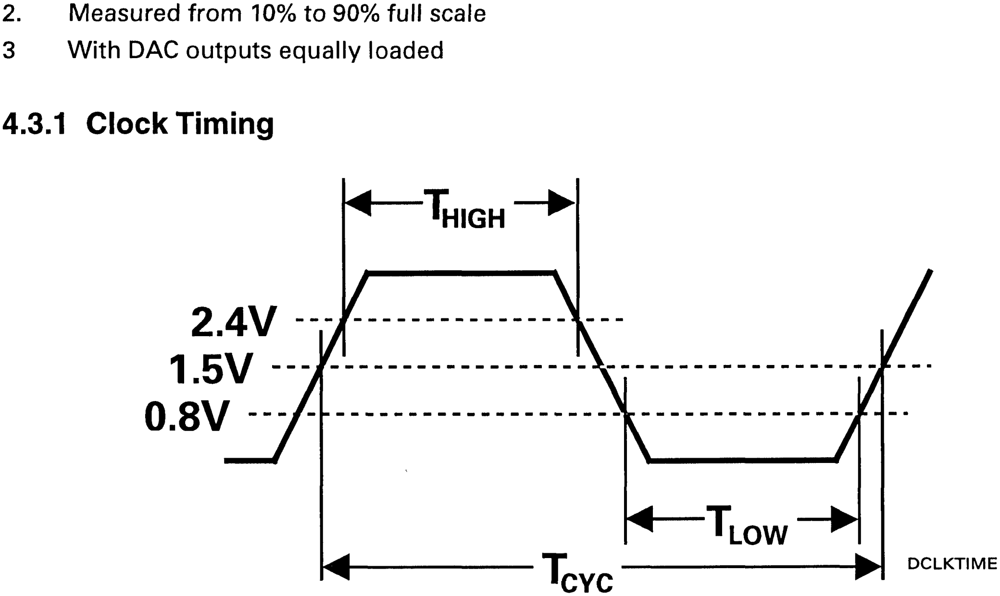

*Figure 4-1. Clock Waveform Timing.*

**Table 4-6. Clock Waveform Timing**

| Symbol | Parameter | Min | Max | Units | Notes |
| --- | --- | --- | --- | --- | --- |
| TCYC | SCLK Cycle Time (VL-Bus) | 20 | 125 | ns | 1 |
|  | SCLK Cycle Time (PCI) | 30 | 125 | ns | 1 |
|  | MCLK Cycle Time | 16.67 | 100 | ns |  |
|  | DCLK Cycle Time (VGA Mode) | 25 | 100 | ns | 1 |
|  | DCLK Cycle Time (Enhanced Mode) | 12.5 | 100 | ns | 1, 2 |
| THIGH | SCLK High Time (VL-Bus) | 8 | 80 | ns |  |
|  | SCLK High Time (PCI) | 12 | 80 | ns |  |
| TLOW | SCLK Low Time (VL-Bus) | 8 | 80 | ns |  |
|  | SCLK Low Time (PCI) | 12 | 80 | ns |  |
|  | SCLK Slew Rate | 1 | 4 | V/ns | 3 |

Notes:

1. fDCLK ≥ 1/2 fSCLK to ensure valid writes to the PLLs.
2. For DCLK rates above 80 MHz, clock doubling is used. The maximum DCLK rate with clock doubling is 67.5 MHz.
3. Rise and fall times are specified in terms of the edge rate measured in V/ns. This slew rate must be met across the minimum peak-to peak portion of the clock waveform.

#### 4.3.2 Input/Output Timing

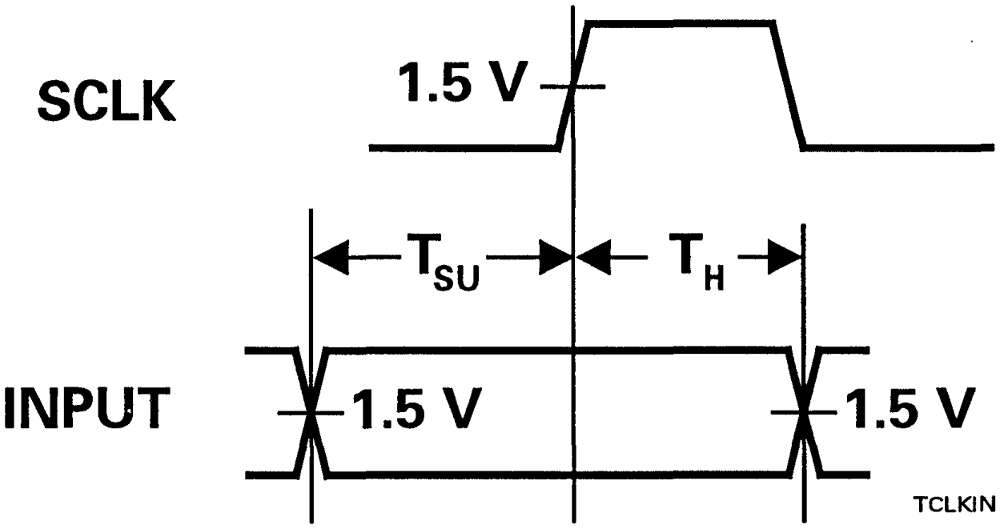

*Figure 4-2. Input Timing.*

**Table 4-7. SCLK-Referenced Input Timing**

| Symbol | Parameter | Min | Units |
| --- | --- | --- | --- |
| **PCI Bus** |  |  |  |
| TSU | AD[31:0], C/BE[3:0], FRAME, IRDY, IDSEL setup | 7 | ns |
| TH | AD[31:0] hold | 1 | ns |
| TH | C/BE[3:0], FRAME, IRDY, IDSEL hold | 1 | ns |
| **VL-Bus** |  |  |  |
| TSU | AD[31:2], BE[3:0], SM/IO, SW/R, SADS (address phase) setup | 12 | ns |
| TH | AD[31:2], BE[3:0], SM/IO, SW/R, SADS (address phase) hold | 1 | ns |
| TSU | AD[31:2], BE[3:0], D1, D0, SADS (data phase) setup | 4 | ns |
| TH | AD[31:2], BE[3:0], D1, D0, SADS (data phase) hold | 1 | ns |
| TSU | RDYIN setup | 6 | ns |
| TH | RDYIN hold | 1 | ns |
| **Miscellaneous** |  |  |  |
| TSU | ROM Data GD[7:0] Setup (PCI) | 5 | ns |
| TH | ROM Data GD[7:0] Hold (PCI) | 7 | ns |
| TSU | General Input Port GD[7:0] setup | 5 | ns |
| TH | General Input Port GD[7:0] hold | 7 | ns |

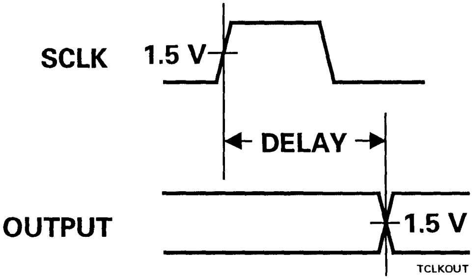

*Figure 4-3. Output Timing.*

**Table 4-8. SCLK-Referenced Output Timing**

| Parameter | TMIN | TMAX | Units | Notes |
| --- | --- | --- | --- | --- |
| **PCI Bus** |  |  |  |  |
| AD[31:0] valid delay | 2 | 16 | ns | 1 |
| DEVSEL, PAR delay | 2 | 11 | ns | Medium DEVSEL timing used |
| STOP delay | 2 | 11 | ns |  |
| TRDY delay | 2 | 11 | ns |  |
| INTA delay | 2 | 11 | ns |  |
| **VL-Bus** |  |  |  |  |
| AD[31:2], D1, D0 valid delay | 7 | 16 | ns |  |
| SINTR delay | 5 | 30 | ns |  |
| SRDY delay | 5 | 11 | ns |  |
| LOCA active delay | 5 | 15 | ns |  |
| LOCA inactive delay | 5 | 20 | ns |  |
| **Miscellaneous** |  |  |  |  |
| STRD delay | 3 | 15 | ns |  |
| ROMEN (PCI) delay | 4 | 10 |  |  |
| ROM Address valid delay (PCI) | 5 | 30 | ns |  |
| AD[7:0] ROM Data valid delay (PCI) | 5 | 30 | ns |  |

**Note**

1. Due to the timing for TRDY for read cycles, data is not sampled on the clock edge immediately following its becoming valid. This guarantees the PCI 2.0 specification time of 11 ns.

**Table 4-9. Display Memory Read/Write Timing**

Note: In this table, t = 1/MCLK

| Parameter | Min | Units | Notes |
| --- | --- | --- | --- |
| MA[8:0] setup with respect to CAS, RAS low | 3 | ns |  |
| MA[8:0] hold with respect to CAS, RAS low | t | ns |  |
| PD[63:0] setup to CAS high (PD[31:0] for Trio32) (EDO) | -t/2 | ns | 1 |
| PD[63:0] hold from CAS high (PD[31:0] for Trio32) (EDO) | t | ns | 1 |
| PD[63:0] setup to CAS high (PD[31:0] for Trio32) | 1 | ns | 2 |
| PD[63:0] hold from CAS high (PD[31:0] for Trio32) | 0 | ns | 2 |
| PD[63:0] setup to WE low (PD[31:0] for Trio32) | 0 | ns |  |
| PD[63:0] hold from WE low (PD[31:0] for Trio32) | t | ns |  |
| CAS[7:0], OE[1:0] additional active time (CAS[3:0], OE0 for Trio32) | 3.5 | ns | 3 |
| CAS setup (CAS before RAS refresh) | t + 12 | ns |  |
| Page cycle time | 2t | ns |  |

Notes for Table 4-9

1. EDO mode read cycle. Refer to the EDO read timing in Section 7.
2. Fast page mode read cycle
3. The active time for these signals can be stretched via bits 1–0 of CR68. This value is approximate.

**Table 4-10. Feature Connector Timing - Output from Trio32/Trio64 to Feature Connector**

| Symbol | Parameter | Min | Units | Notes |
| --- | --- | --- | --- | --- |
| TSU | PA[15:0], BLANK setup to VCLK rising | 5 | ns |  |
| TH | PA[15:0], BLANK hold from VCLK rising | 5 | ns |  |

**Table 4-11. Feature Connector Timing - Output from Feature Connector to Trio32/Trio64**

| Symbol | Parameter | Min | Max | Units | Notes |
| --- | --- | --- | --- | --- | --- |
| TSU | PA[15:0], BLANK setup to VCLK or VCLKI rising | 6 |  | ns | 1 |
| TH | PA[15:0], BLANK hold from VCLK or VCLKI rising | 6 |  | ns | 1 |
|  | VCLK | 25 | 40 | ns | 1 |
|  | VCLKI | 27 | 40 | ns | 1, 2 |
|  | VCLK, VCLKI duty cycle | 40 | 60 | % |  |
|  | VCLK, VCLKI high time | 10 | 25 | ns |  |
|  | VCLK, VCLKI low time | 10 | 25 | ns |  |
|  | VCLK, VCLKI slew rate | 1 | 4 | V/ns |  |

Notes for Table 4-11

1. Pixel data is clocked into the internal RAMDAC using VCLK for a pass-through feature connector and VCLKI for a VAFC configuration.
2. This corresponds to the VESA VAFC specification of a maximum clock of 37.5 MHz.

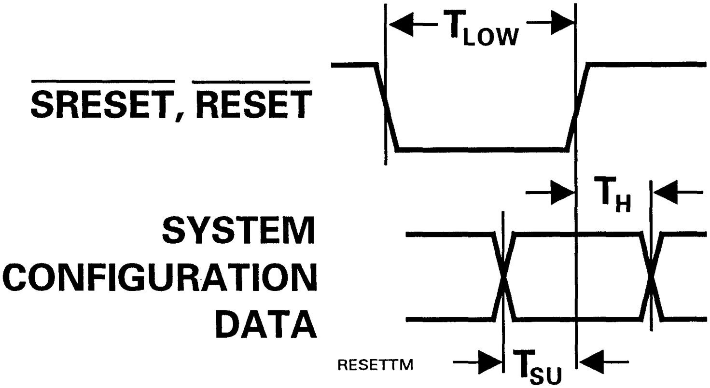

*Figure 4-4. Reset Timing.*

**Table 4-12. Reset Timing**

| Symbol | Parameter | Min | Units |
| --- | --- | --- | --- |
| TLOW | SRESET (VL) or RESET (PCI) active pulse width | 400 | ns |
| TSU | PD[23:0] setup to SRESET (VL) or RESET (PCI) inactive | 20 | ns |
| TH | PD[23:0] hold from SRESET (VL) or RESET (PCI) inactive | 10 | ns |

## Section 5: Reset and Initialization

The reset signal (RESET for PCI, SRESET for VL-Bus) resets the internal state machines in the Trio32/Trio64 and places all registers in their power-on default states. It also initiates several configuration actions, as described in this section.

### 5.1 Configuration Strapping

The PD[23:0] pins can be individually pulled either high or low through 47 KΩ resistors. These pull-ups and pull-downs do not affect normal operation of the pins as part of the pixel data bus, but they do force the pins to a definite state during reset. At the rising edge of the reset signal, this state is sampled and the data loaded into the CR36, CR37 and CR68 registers. The data is used for system configuration, such as system bus and memory parameter selection. The definitions of the PD[23:0] strapping bits at the rising edge of the reset signal are shown in Table 5-2.

Strapping bits 7–5 define the display memory size. However, the S3 BIOS determines this value directly and writes it to CR36 bits 7–5 after reset. Therefore, systems using the S3 BIOS do not need to strap the PD[7-5] pins. Other pins may also not require strapping, depending on the design and bus type.

Strapping bits 15–13 and 22–20 provide monitor information. The interpretation of the bit values is dependent on the video BIOS.

### 5.2 Test Mode

Upon power-on reset, most output pins are tri-stated. However, some must be kept active to support the reset process. To facilitate bed-of-nails testing at the PCB level, the Trio32/Trio64 incorporate a test mode that tri-states all output pins and makes all bi-directional pins inputs. To enter this mode, power-on strapping bit 9 (CR37, bit 1) must be pulled low at reset. The outputs that are normally not tri-stated on reset but which are tri-stated in test mode are shown in Table 5-1.

**Table 5-1. Signals Tri-Stated by Test Mode**

| Signal Name |
| --- |
| RAS[1:0] |
| CAS[3:0] |
| CAS[7:4] (Trio64 only) |
| WE |
| OE0 |
| OE1 (Trio64 only) |
| MA[8:0] |

**Table 5-2. Definition of PD[23:0] at the Rising Edge of the Reset Signal**

| CR Bits | PD Bits | Value | Function |
| --- | --- | --- | --- |
| **System Bus Select** |  |  |  |
| CR36_1–0 | 1–0 | 00 | Reserved |
|  |  | 01 | VESA local bus |
|  |  | 10 | PCI local bus |
|  |  | 11 | Reserved |
| **Memory Page Mode Select** |  |  |  |
| CR36_3–2 | 3–2 | 00 | Reserved |
|  |  | 01 | Reserved |
|  |  | 10 | Extended data out (EDO) mode |
|  |  | 11 | Fast page mode |
| **Enable Video BIOS (VL-Bus)** |  |  |  |
| CR36_4 | 4 | 0 | Disable video BIOS access (system BIOS contains video BIOS) |
|  |  | 1 | Enable video BIOS access |
| **Display Memory Size** |  |  |  |
| CR36_7–5 | 7–5 | 000 | 4 MBytes (Trio64 only - reserved for Trio32) |
|  |  | 001 | Reserved |
|  |  | 010 | Reserved |
|  |  | 011 | Reserved |
|  |  | 100 | 2 MBytes |
|  |  | 101 | Reserved |
|  |  | 110 | 1 MByte |
|  |  | 111 | 0.5 MByte (Trio32 only) |
| **Enable Trio32/Trio64 (VL-Bus)** |  |  |  |
| CR37_0 | 8 | 0 | Disable Trio32/Trio64 except for Video BIOS accesses |
|  |  | 1 | Enable Trio32/Trio64 |
| **Test Mode** |  |  |  |
| CR37_1 | 9 | 0 | All outputs tri-stated and all bi-directional pins become inputs |
|  |  | 1 | Normal operation. Certain outputs required for the reset process are not tri-stated during reset |
| **Video BIOS ROM Size (VL-Bus)** |  |  |  |
| CR37_2 | 10 | 0 | 64-KByte video BIOS |
|  |  | 1 | 32-KByte video BIOS |
| **Clock Select** |  |  |  |
| CR37_3 | 11 | 0 | Use external DCLK on XIN pin and external MCLK on STRD pin (test purposes only) |
|  |  | 1 | Use internal DCLK, MCLK |
| **RAMDAC Write Snooping (VL-Bus)** |  |  |  |
| CR37_4 | 12 | 0 | Disable LOCA/SRDY for RAMDAC writes |
|  |  | 1 | Enable LOCA/SRDY for RAMDAC writes |

**Table 5-2. Definition of PD[23:0] at the Rising Edge of the Reset Signal (Continued)**

| CR Bits | PD Bits | Value | Function |
| --- | --- | --- | --- |
| **Monitor Identification** |  |  |  |
| CR37_7–5 | 15–13 |  | The S3 video BIOS uses these bits for monitor information |
| **CAS/OE Low Stretch, WE Low Delay** |  |  |  |
| CR68_1–0 | 17–16 | 00 | approximately 6.5 ns stretch (nominal), 2 units WE delay |
|  |  | 01 | approximately 5 ns stretch (nominal), 1 unit WE delay |
|  |  | 10 | approximately 3.5 ns stretch (nominal), no WE delay |
|  |  | 11 | No stretch or delay |
| **RAS Low Timing Select** |  |  |  |
| CR68_2 | 18 | 0 | 4.5 MCLKs |
|  |  | 1 | 3.5 MCLKs |
| **RAS Pre-Charge Timing Select** |  |  |  |
| CR68_3 | 19 | 0 | 3.5 MCLKs |
|  |  | 1 | 2.5 MCLKs |
| **Monitor Identification** |  |  |  |
| CR68_6–4 | 22–20 |  | The S3 video BIOS may use these bits for monitor information |
| **Upper System Address Bus Decode/Memory Data Bus Size** |  |  |  |
| CR68_7 | 23 | 0 | Trio32/Trio64 decodes all 32 system address lines (VL-Bus); Trio64 memory data bus is 32 bits (VL-Bus and PCI) |
|  |  | 1 | Trio32/Trio64 uses SAUP input as upper address decode (VL-Bus); Trio64 memory data bus is 32 bits (1 MByte of memory) or 64-bits (2 or more MBytes of memory) (VL-Bus and PCI) |

## Section 6: System Bus Interfaces

The Trio32/Trio64 interfaces to either a PCI bus or a VESA local bus (VL-Bus). This section describes the connections and functional characteristics of these interfaces.

### 6.1 PCI Bus Interface

The Trio32/Trio64 provides a complete PCI interface. Power-on strapping bits 1–0 must be set to 10b to enable this interface. The pinout and other specifications are in complete conformance with Revision 2 of the PCI specification. No glue logic is required.

#### 6.1.1 PCI Configuration

The Vendor ID register (Index 00H) in the PCI Configuration space is hardwired to 5333H to specify S3 Incorporated as the vendor. The Device ID register is hardwired to 8811 for both the Trio32 and Trio64. This allows the same BIOS to be used with both chips. The BIOS must use CR2E to differentiate between the Trio32 and Trio64.

Bits 10–9 of the Status register (Index 06H) are hardwired to 01b to specify medium DEVSEL timing. The Class Code register (Index 08H) is hardwired to 30000H to specify that the Trio32/Trio64 is a VGA compatible device. Bits 3–0 of the Base Address 0 register (Index 10H) are hardwired to 00H. This indicates that the "pre-fetchable" bit is cleared to 0, the base register can be located anywhere in a 32-bit address space and the base register is located in memory space.

#### 6.1.2 PCI Bus Cycles

Figures 6-1 and 6-2 show the basic PCI read and write cycles respectively. Bit 1 of the PCI Command register (Index 04H) must be set to 1 to allow memory space access. Bit 0 of the PCI Command register must be set to 1 to allow I/O space access.

Figures 6-3 and 6-4 show two examples of PCI bus disconnection. These examples show cases where data is transferred after STOP is asserted. In example A, data is transferred after FRAME is deasserted because the master was not ready (IRDY deasserted on clock 2). In example B, data is transferred before FRAME is deasserted. See revision 2.0 or later of the PCI Local Bus Specification for a complete explanation of disconnects. Bit 7 of the CR66 register must be set to 1 to enable PCI disconnects.

The PCI configuration register space occupies 256 bytes. When a configuration read or write command is issued, the AD[7:0] lines contain the address of the register in this space to be accessed. Figures 6-5 and 6-6 show the configuration read and write cycles respectively. The Trio32/Trio64 supports or returns 0 for the first 64 bytes of configuration space.

The Trio32/Trio64 drives even parity information onto the PAR line during read transactions. This operation is depicted in Figure 6-7.

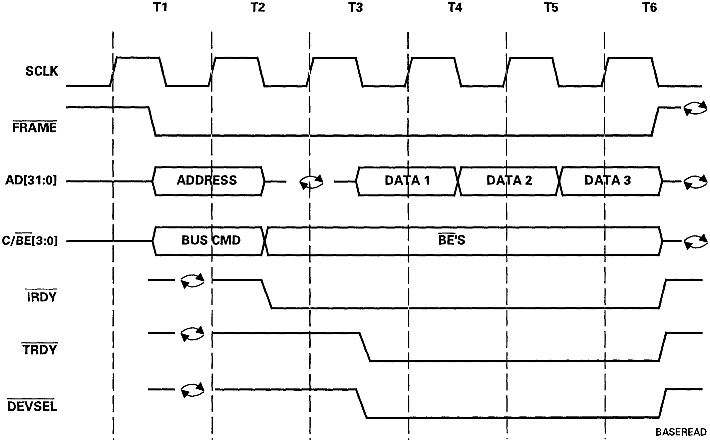

*Figure 6-1. Basic PCI Read Cycle.*

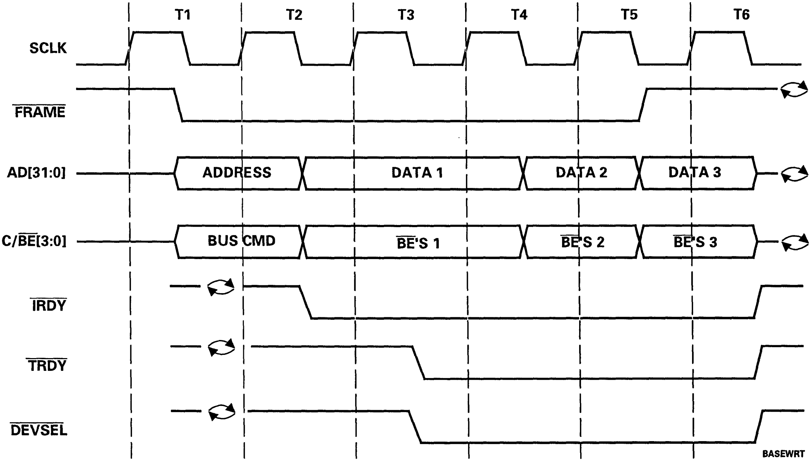

*Figure 6-2. Basic PCI Write Cycle.*

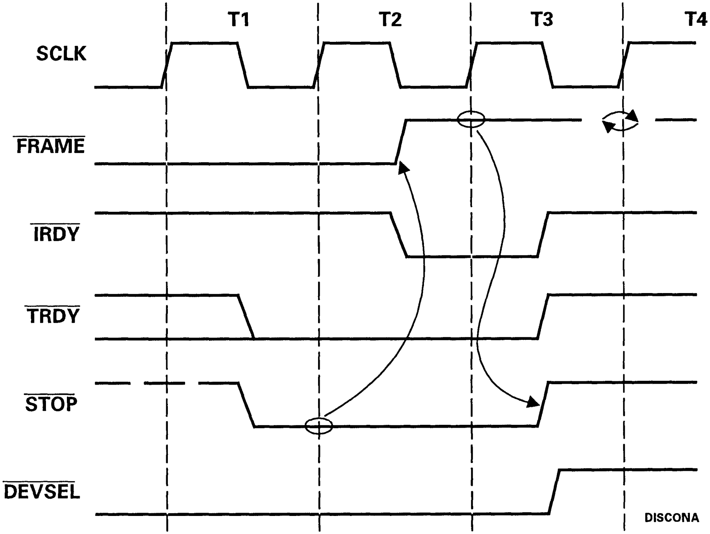

*Figure 6-3. PCI Disconnect Example A.*

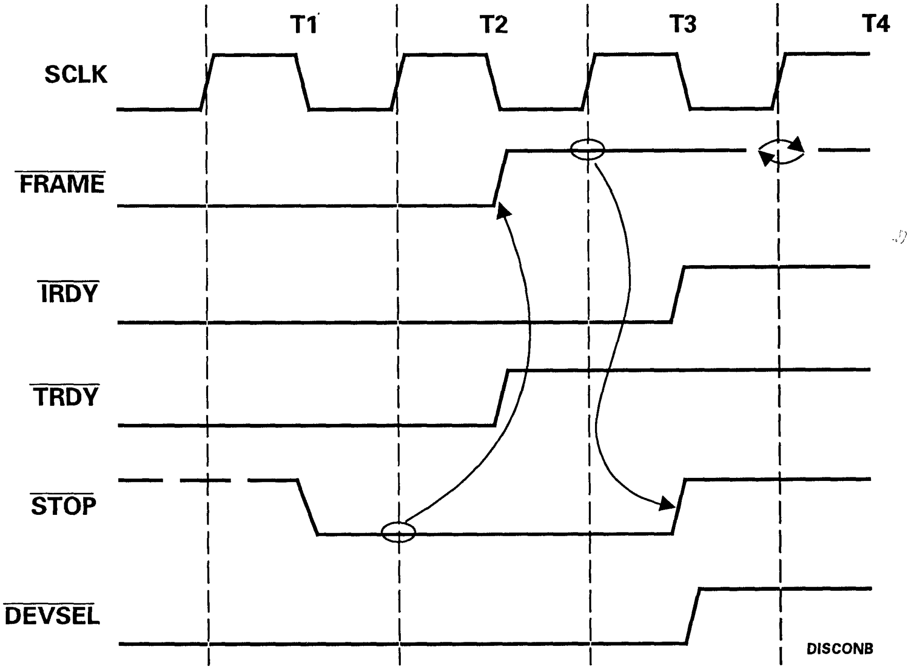

*Figure 6-4. PCI Disconnect Example B.*

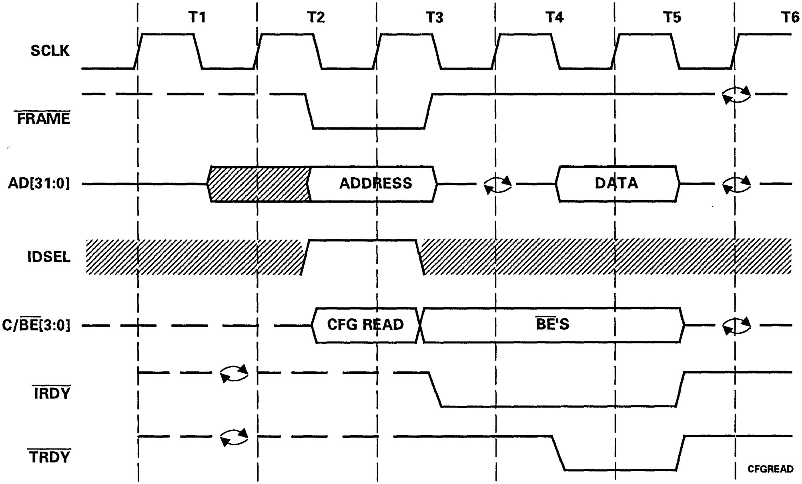

*Figure 6-6. PCI Configuration Read Cycle.*

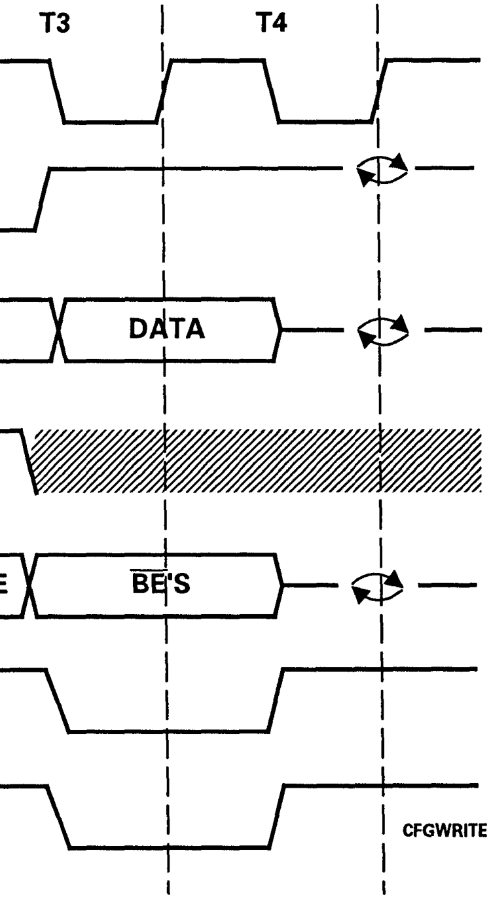

*Figure 6-5. PCI Configuration Write Cycle.*

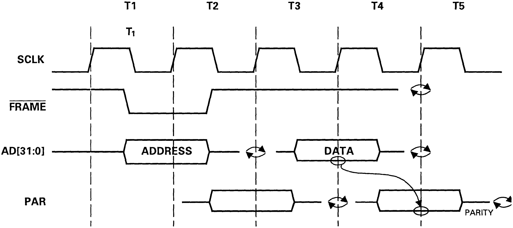

*Figure 6-7. Read Parity Operation.*

### 6.2 VL-Bus Interface

Power-on strapping bits 1–0 must be set to 01b to enable VL-Bus operation. The Trio32 provides a totally glueless interface to the VL-Bus. The Trio64 interface is also glueless if it is configured to operate with a 32-bit PD bus (bit 7 of CR68 cleared to 0). With more than 1 MByte of memory (64-bit PD bus), the Trio64 decodes address lines SA[26:2] and pin 25 becomes the SAUP upper address decode for linear addressing. If SAUP is a logical zero, the Trio64 will not respond to bus cycles. If SAUP is a logical one, the Trio64 may respond.

When the PD bus is 64 bits, bits 26–XX of the linear addressing window base address are defined in CR59-CR5A. XX is 16 for a 64K window, 20 for a 1-MByte window, 21 for a 2-MByte window and 22 for a 4-MByte window. If SAUP is pulled high, the Trio64 will respond to any access where SA[26:XX] matches bits 26–XX in CR59-CR5A. This means that the Trio64 will respond to any of 32 address windows with respect to 128-MByte boundaries.

S3 recommends that the design limit the Trio64 to responding to accesses below 512 MBytes. This is easily and inexpensively accomplished by using a 74x27 to logically NOR SA[31:29] as the SAUP input. This means the Trio64 will respond to any of four different address windows.

If response to a single linear addressing window above 128 MBytes is required, a PLD can be used to decode the appropriate address space.

The SAUP input can also be used by the Trio32. This is provided for compatibility with Trio64 designs, but is never required because the Trio32 always operates with a 32-bit PD bus and can therefore always decode SA[31:2].

#### 6.2.1 VL-Bus Cycles

The basic VL-Bus read cycle is shown in Figure 6-8. The address is latched by the Trio32/Trio64 on one of two rising SCLK edges as shown in Figure 6-8 and explained in Note 1.

The basic VL-Bus write cycle is shown in Figure 6-9. The single wait-state is the default configuration. This can be changed to 0 wait-states (SRDY asserted one cycle earlier) by clearing bit 4 of CR40 to 0. The address is latched at the end of T1. By default, write data is latched on the first rising SCLK edge after the assertion of RDYIN.

#### 6.2.2 SRDY Generation

For a VL-Bus configuration, the Trio32/Trio64 raises its SRDY output early in the T1 cycle and then tri-states it. It then asserts SRDY to signal the end of the cycle. Some systems synchronize or otherwise delay this signal and then assert RDY to the processor. If this is done, this RDY signal should also be fed to the RDYIN input of the Trio32/Trio64 (see Note 3 of Figure 6-9). The Trio32/Trio64 holds read data active until RDYIN is asserted. If the SRDY signal is not intercepted, it should be fed to both the processor RDY input and the Trio32/Trio64 RDYIN input.

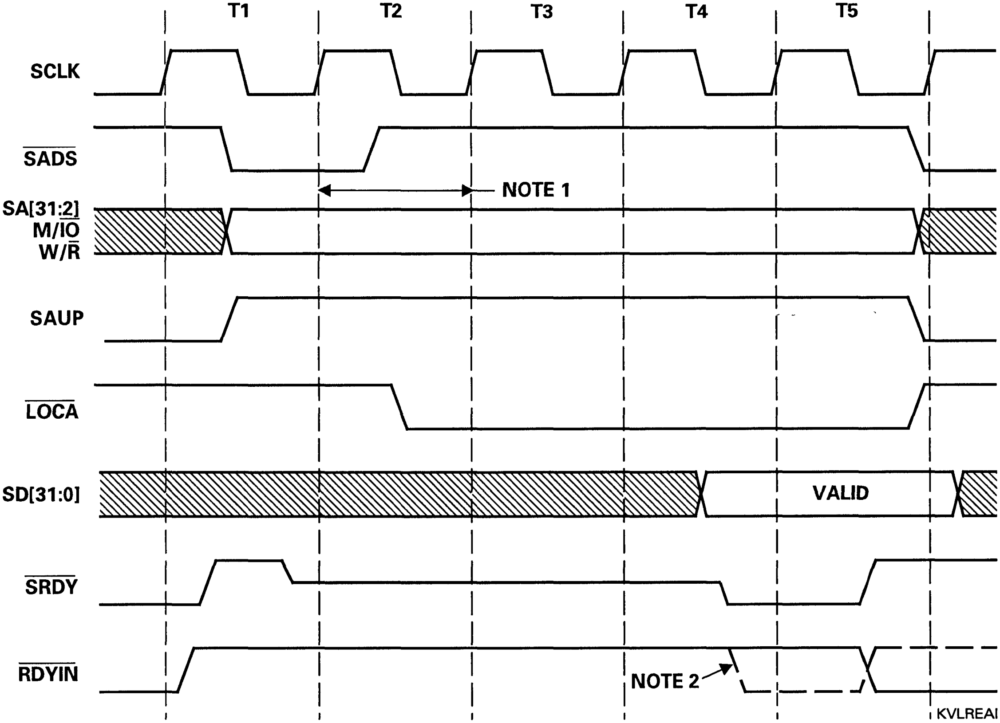

*Figure 6-8. VL-Bus Read Cycle.*

**Notes**

1. For one decode wait state (bit 4 of CR40 set to 1), the address is latched on the first clock edge indicated here if bit 3 of CR58 is set to 1. If this bit is cleared to 0, the address is latched on the second clock edge indicated. The address is always latched on the first clock edge if bit 4 of CR40 is cleared to 0.
2. The system chip set can delay the RDYIN input by 1 or more cycles. This example assumes a 1 cycle delay, as indicated by the solid line. Note that read data is held valid an extra cycle.

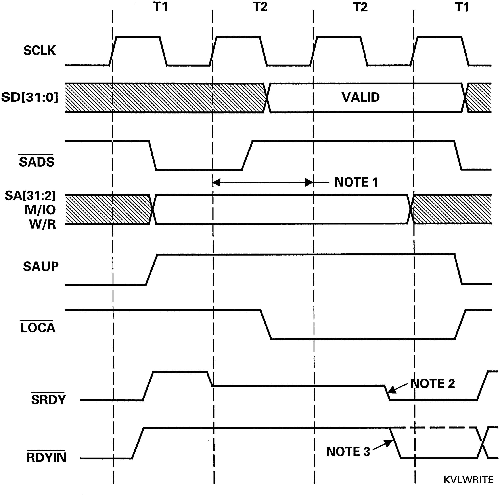

*Figure 6-9. 1 Wait-state VL-Bus Write Cycle.*

**Notes**

1. For one decode wait state (bit 4 of CR40 set to 1), the address is latched on the first clock edge indicated here if bit 3 of CR58 is set to 1. If this bit is cleared to 0, the address is latched on the second clock edge indicated. The address is always latched on the first clock edge if bit 4 of CR40 is cleared to 0.
2. The wait-state is inserted by setting bit 4 of CR40 to 1 to delay SRDY assertion by 1 cycle from the assertion of SADS. This is the default value.
3. Data is latched on the rising SCLK edge following assertion of RDYIN.

## Section 7: Display Memory

The Trio32/Trio64 supports a DRAM-based video frame buffer. This section describes the various configurations supported, the functional timing for memory accesses and the operation of various register bits that affect memory timing and operation. It also describes how access to display memory is controlled to maximize graphics performance and how the Trio32/Trio64 can share the frame buffer with a secondary memory controller for multimedia applications.

### 7.1 Display Memory Configurations

The Trio32/Trio64 uses either fast page mode or extended data out (EDO) DRAMs for its frame buffer. All DRAMs can be configured as 256Kx4, 256Kx8 or 256Kx16. A Tech Note lists recommended DRAMs.

For loading reasons, a maximum of 8 DRAM chips can be used for the frame buffer. Table 7-1 shows the supported memory size/chip count configurations. For a 0.5 MByte Trio32 configuration, the chip count is half that for 1 MByte.

**Table 7-1. Memory Size/Chip Count Configurations**

|  | 256Kx4 | 256Kx8 | 256Kx16 |
| --- | --- | --- | --- |
| 1 MB | 8 | 4 | 2 |
| 2 MB |  | 8 | 4 |
| 4 MB |  |  | 8 |

The Trio32 operates with a 32-bit memory data (PD) bus (16 bits for 0.5 MByte). It can be configured with 0.5, 1 or 2 MBytes of fast page or EDO memory regardless of whether or not feature connector operation is enabled.

The Trio64 can operate with either a 32- or 64-bit PD bus. If bit 7 of CR68 is cleared to 0 (either via power-on strapping of PD23 or by programming), the PD bus size for the Trio64 is fixed at 32 bits. In this mode, the Trio64 can only support 1 MByte of memory. Note that the Trio64 should not be strapped for a 32-bit PD bus if its memory configuration is larger than 1 MByte as this will prevent correct memory size detection by the BIOS. Strapping the Trio64 for 32-bits should only be done for a 1-MByte maximum memory design using a glueless feature connector interface.

If bit 7 of CR68 is set to 1, the PD bus size for the Trio64 is determined by the memory size specified in bits 7-5 of CR36. For a 1-MByte configuration, the bus size is 32 bits. For 2-MByte or larger configurations, the bus size is 64 bits. EDO memory can be used for 1- or 2-MByte configurations. Fast page mode memory is required for 4-MByte configurations.

If the Trio64 is enabled for feature connector operation (bit 0 of SRD set to 1), the Trio64 must first be configured for a 32-bit PD bus. This disables all data and control signals (PD[63:32], CAS[7:4], RAS1/OE1), for memory above 1 MByte, allowing certain multiplexed pins to function as feature connector signal pins. Because of the 32-bit PD bus operation, the resolutions supported and performance of the Trio64 during feature connector operation are the same as for the Trio32 with 1 MByte of memory.

Figure 7-1 shows a 2-MByte configuration using 256Kx16 DRAMs. The same connections are used for both Trio32 and Trio64 1-MByte configurations since both use a 32-bit memory data bus with 1 MByte of memory. The second MByte shown in this figure applies only to the Trio32. Either fast page or EDO DRAMs can be used. If x4 DRAMs are used, the maximum configuration is 1 MByte. Each x16 chip is replaced by four x4 chips, with two chips per CAS line. The 2-MByte configuration can be supported with x8 DRAMs. Each x16 chip is replaced by two x8 chips, with 1 chip per CAS line. A 0.5 MByte Trio32 configuration requires only the chip or chips driven by RAS0, CAS0 and CAS1 and only uses PD[15:0].

Figure 7-2 shows a Trio64 2-MByte configuration where either fast page or EDO memory is supported with the same hardware design. The rationale behind this design, including why it cannot be upgraded to 4 MBytes, is explained next.

For fast page mode memory (bit 2 of CR36 set to 1), preventing memory data from being driven on the multiplexed PD lines for feature connector operation means not driving CAS[7:4]. Since the CAS lines control the memory output buffers, this means no data is driven on PD[63:32].

The fast page mode solution does not work for EDO memory (bit 2 of CR36 is cleared to 0) because OE turns off the output buffers instead of CAS and the same OE signal (OE0) normally drives all memory banks. The Trio64 handles this by providing a second OE output (OE1) on pin 50. For 64-bit PD bus operation, this output is identical to OE0 so all memory banks are enabled for output. When the feature connector is enabled, OE1 stays high throughout the entire memory cycle. Therefore, by connecting pin 50 to the OE inputs of the 2nd MByte of memory, the desired memory data output is achieved for EDO memory for all operational modes.

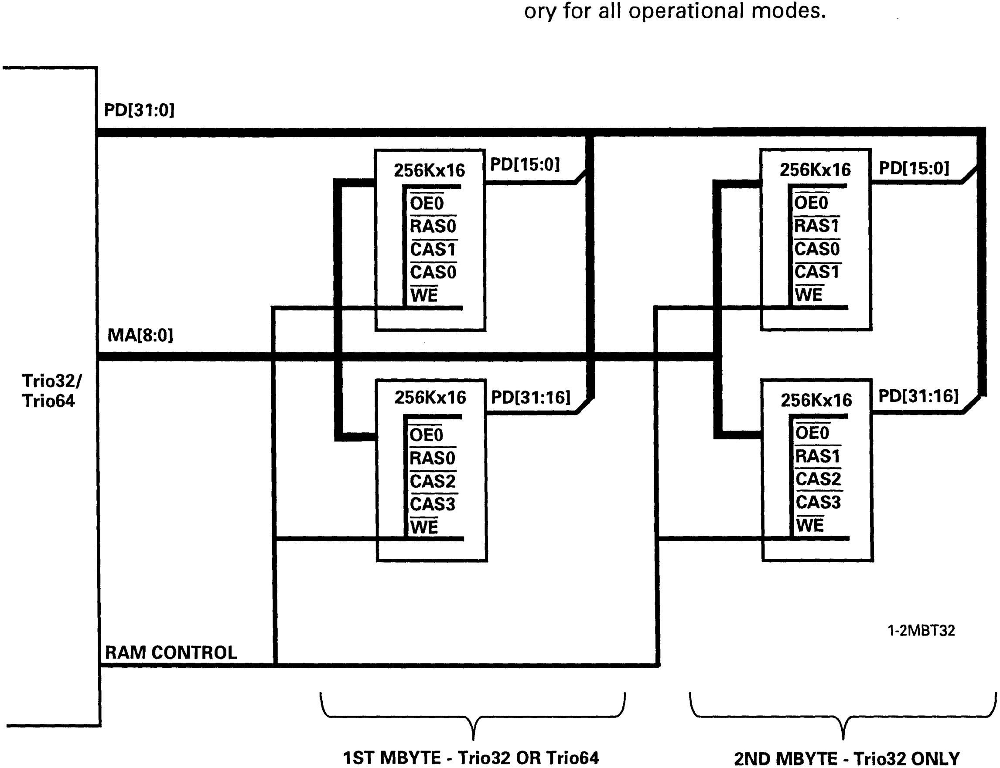

*Figure 7-1. 1-MByte Trio32/64 - 2 MByte Trio32 Memory.*

Fast page memory does not require OE1. All OE inputs are driven by the OE0 signal. If fast page mode operation is selected, both pin 124 and pin 50 (by default) will output OE0.

A 4-MByte Trio64 configuration requires RAS1 to select the 3rd and 4th MBytes. The Trio64 outputs RAS1 on pin 50 when bit 6 of SRA is set to 1 for fast page mode operation. (This bit is a don't care for EDO operation, where pin 50 always outputs OE1. The power-on default for this bit is 0, which causes pin 50 to output OE0 for fast page mode operation as explained above.) Figure 7-3 shows a 4-MByte Trio64 fast page mode configuration using RAS1. Since RAS1 is not available for EDO mode, the maximum EDO memory configuration is 2 MBytes.

![2-MByte Trio64 DRAM configuration using eight 256Kx16 DRAMs with RAS0, CAS[3:0] and OE0](img/s3-trio-fig7-2-2-mbyte-trio64-dram-configuration.png)

*Figure 7-2. 2-MByte Trio64 DRAM Configuration.*

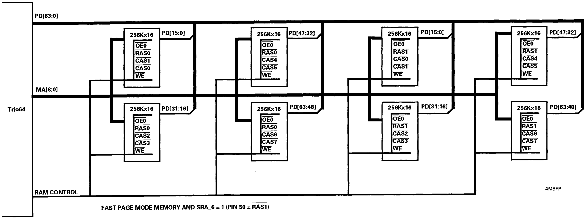

*Figure 7-3. 4-MByte Trio64 FP DRAM Configuration.*

### 7.2 Display Memory Refresh

The Trio32/Trio64 uses the standard CAS before RAS DRAM refresh method. The functional timing for this can be found in any standard DRAM data book.

The number of refresh cycles performed per horizontal line is determined by bit 6 of CR11. If bit 2 of CR3A is set to 1, the number of refresh cycles per horizontal line is determined by the setting of bits 1-0 of CR3A. Refreshes are performed during the horizontal blanking period.

### 7.3 Display Memory Functional Timing

Figure 7-4 shows the functional timing for a fast page mode read cycle. This also shows how certain parameters for various control signals can be adjusted to meet the access time requirements of a variety of DRAMs. Bits 1-0 of CR68 allow the pulse widths of the CAS and OE signals to be adjusted. Bit 2 of CR68 allows adjustment of the RAS low time. Bit 3 of CR68 allows adjustment of the RAS precharge (high) time. All of these settings in CR68 can be made by power-on strapping of PD[23:16] at reset or by programming after reset.

Figure 7-5 shows the functional timing for a fast page mode write cycle. The RAS and CAS signals can be adjusted as explained for the read cycle above. The WE is delayed and the CAS signals are stretched via bits 1-0 of CR68.

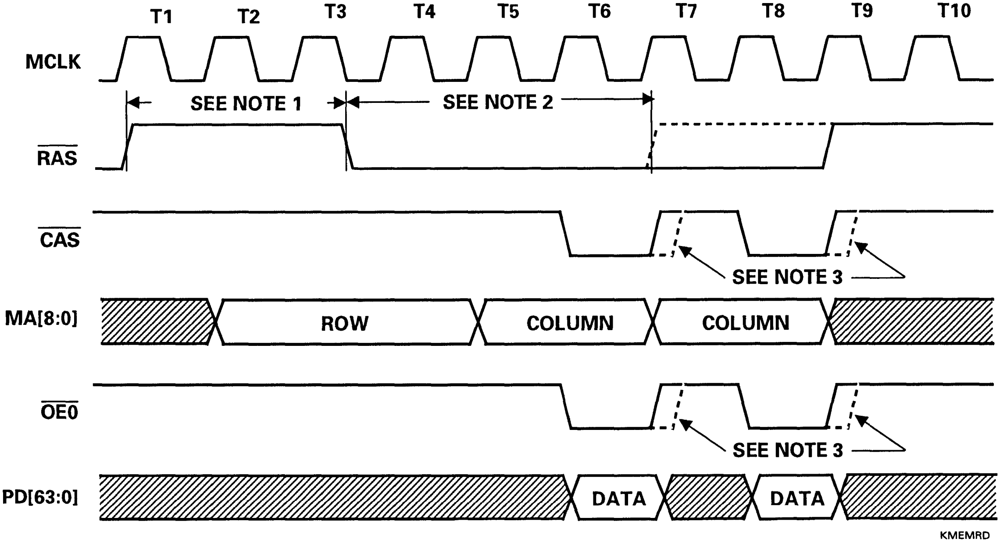

*Figure 7-4. Fast Page Mode Read Cycle.*

Notes

1. The minimum RAS precharge time can be adjusted from 2.5 to 3.5 MCLKs via bit 3 of CR68.
2. The minimum RAS low time for a single column access is 3.5 MCLKs as shown in this figure. (The dashed line shows the RAS signal if the second page mode cycle were to be eliminated.) This minimum RAS active time can be lengthened to 4.5 MCLKs via bit 2 of CR68.
3. The CAS and OE active (low) times can be stretched via bits 1-0 of CR68.

Figure 7-6 shows the functional timing for an Extended Data Out (EDO) mode read cycle. One difference between an EDO read cycle and a fast page mode read cycle is that since EDO memory holds the data valid longer, it allows the data to be latched one cycle later (rising edges of T8 and T10). This allows the use of slower access time memory or a faster MCLK. However, the last page access (or first for a single access) must be stretched one MCLK to allow the data to be latched because EDO memory does not keep data valid after OE goes inactive. Despite this, EDO memory will generally provide better performance than fast page mode memory. Note that RAS, the last CAS and OE are all stretched one MCLK. With EDO, OE is held low for the entire cycle instead of being pulsed as in a fast page mode cycle.

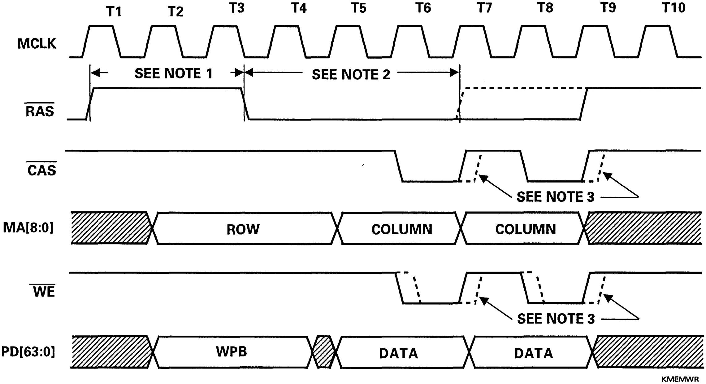

*Figure 7-5. Fast Page Mode Write Cycle.*

Notes

1. The minimum RAS precharge time can be adjusted from 2.5 to 3.5 MCLKs via bit 3 of CR68.
2. The minimum RAS low time for a single column access is 3.5 MCLKs as shown in this figure. (The dashed line shows the RAS signal if the second page mode cycle were to be eliminated.) This minimum RAS active time can be lengthened to 4.5 MCLKs via bit 2 of CR68.
3. The CAS active (low) time can be stretched and the WE active (low) time delayed via bits 1-0 of CR68.

The timing adjustments for RAS and for CAS/OE/WE as described above for a fast page read cycle also apply to EDO cycles. Note that if the minimum RAS active time is specified as 3.5 MCLKs, the actual minimum for a single EDO read cycle will be 4.5 MCLKs.

The cycle depicted in Figure 7-6 is for 64-bit PD bus operation (2 MBytes of memory and feature connector operation disabled). If the feature connector is enabled, OE0 only enables data output on PD[31:0] and OE1 (not shown) stays high the entire cycle to disable output on PD[63:32].

An EDO write cycle is functionally the same as a fast page mode write cycle.

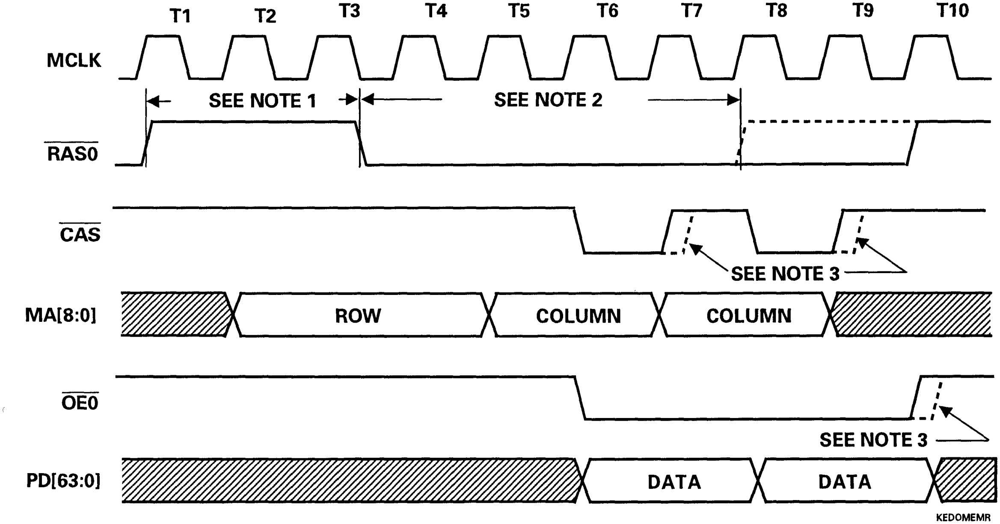

*Figure 7-6. EDO Mode Read Cycle.*

Notes

1. The minimum RAS precharge time can be adjusted from 2.5 to 3.5 MCLKs via bit 3 of CR68.
2. The minimum RAS low time for a single column access is 4.5 MCLKs as shown in this figure. This is achieved by specifying 3.5 MCLKs in bit 2 of CR68. (The dashed line shows the RAS signal if the second page mode cycle were to be eliminated.) This minimum RAS active time can be lengthened by 1 MCLK via bit 2 of CR68.
3. The CAS and OE active (low) times can be stretched via bits 1-0 of CR68.

### 7.4 Display Memory Access Control

Figure 7-7 shows that a number of processes compete for access to display memory for a Trio64. The Trio32 is similar except that the Graphics Engine and Display FIFO data paths are each 32 bits. These competing processes are (in decreasing order of access priority):

- RAM refresh (not explicitly shown)
- Hardware cursor fetch (not shown)
- Display FIFO reads
- Secondary controller request/grant (S3 Shared Frame Buffer Interface)
- CPU accesses
- Graphics Engine accesses

For the Trio64, the display FIFO is 32 bits wide by 16 positions deep with 1 MByte of display memory or 64 bits wide by 16 positions deep for 2 or 4 MBytes of display memory. This FIFO provides the display refresh data to the RAMDAC and must never underrun, i.e., output more data than has been input to it from display memory. If an underrun occurs, the display may be corrupted.

The Trio32/Trio64 provides a patented technique for maximizing video performance while preventing display FIFO underrun. This involves programming of two parameters. These are the M parameter (bits 7-3 of CR54) and N parameter (bits 7-0 of CR60). Note that these are not the same as the PLL M and PLL N parameters used to specify the clock synthesizer frequencies.

When the Trio32/Trio64 transfers data from display memory to the FIFO, the N parameter specifies one less than the number of 4-byte (1 MByte of memory) or 8-byte (2 or 4 MBytes of memory for a Trio64) units to write. When N units have been written or the FIFO is filled, whichever comes first, the Trio32/Trio64 then allows the other display memory processes access to memory. Filling of the FIFO also stops at the end of active display. FIFO filling cannot begin again until the scan line position defined by the Start Display FIFO register (CR3B), which is normally programmed with a value 5 less than the value programmed in CR0 (horizontal total). This provides time during the horizontal blanking period for RAM refresh and hardware cursor fetch.

The M parameter specifies the number of 8-byte (4-byte for Trio32) memory access cycles (less one) that can be performed for reasons other than display FIFO filling. (One entry cycle requires 6-9 MCLKs; one page mode cycle requires 2 MCLKs.) When this number of access cycles has been performed, memory control is returned for FIFO filling. For example, a value of 01010b (10 decimal) specifies that eleven memory cycles are available to the CPU, Graphics Engine, etc., before FIFO filling restarts. For one entry cycle and 10 page mode cycles, this would be a maximum of 9 + (10x2) = 29 MCLKs allowed before memory access is returned for FIFO filling. If during the processing period controlled by the M parameter there is time when there are no memory access requests and the M value has not been reached, control is immediately returned to FIFO filling as specified by the N parameter.

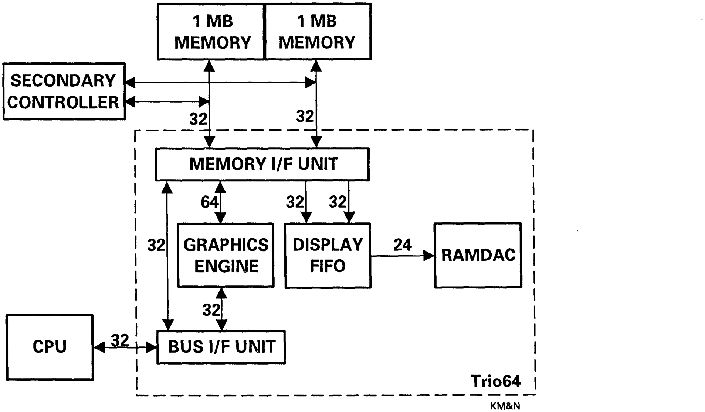

*Figure 7-7. Display Memory Access Sources.*

M should be maximized for maximum graphics performance. The maximum value of M possible without causing a FIFO underrun is dependent on the pixel data bandwidth required for the particular mode in question. The calculation is based on a FIFO filling bandwidth of 120 (1 MByte) or 240 (2 or 4 MBytes) MBytes/second. The maximum value is also possibly dependent on the N parameter value if the FIFO is not filled each cycle.

Note that the M and N parameters should only be changed with the screen turned off. This is done by setting bit 5 of SR1 to 1.

The above discussion assumes that the Trio32/Trio64 has control of the memory bus. The next section describes the implications of allowing a secondary memory controller to take control of the display memory bus.

### 7.5 Shared Frame Buffer

For multimedia applications, the Trio32/Trio64 provides the S3 Shared Frame Buffer Interface. (Note that bandwidth limitations severely restrict the usability of this function for the Trio32.) This allows it to share the video frame buffer (display memory) with a secondary controller. At all times, the Trio32/Trio64 serves as the primary display memory controller. As the primary controller, the Trio32/Trio64 takes responsibility for screen management functions such as DRAM refresh cycles and the arbitration of frame buffer requests from a secondary controller. The shared frame buffer function is enabled via bit 2 of CR50. Bit 0 of SRD must be cleared to 0 to select the BGNT function for pin 155.

The Trio32/Trio64 has two pins that are used for the frame buffer arbitration. These pins implement a Bus REQuest (BREQ) and Bus GraNT (BGNT) protocol. BREQ is an input to the Trio32/Trio64 and BGNT is an output. When the Trio32/Trio64 grants the bus to the secondary controller, it also floats its memory control output signals so that the secondary controller has full access to the memory. With full access to memory, the secondary controller can operate at its optimum speed for memory accessing.

Since the Trio32/Trio64 is responsible for screen and DRAM refreshing, it must ensure that the secondary controller does not retain control of the memory bus for too long a time. It uses the P parameter to provide this control. The 5-bit P parameter field (bits 4-0 of SRA) is programmed in units of 2 MCLKs. The value programmed specifies one less than the number of MCLKs times 2 that the secondary controller can retain control of the memory bus before the Trio32/Trio64 removes its bus grant. For example, a programmed value of 5 (decimal) specifies that the Trio32/Trio64 will remove its bus grant after (5+1)x2 = 12 MCLKs. At maximum, the bus can be granted for 64 MCLKs.

How long the secondary controller can retain control without causing problems is a function of many variables, including the M and N parameter settings, the pixel data bandwidth of the RAMDAC, the needs of the CPU and Graphics Engine to access display memory and the timing of the bus request (during screen active or inactive). In general, the secondary controller should retain control for a period less than the time that would normally be allocated to the M parameter, and the time allocated to the P parameter should be subtracted from the time allocated to the M parameter. For pure live video display without graphics updating, the M parameter can be set to 0 (allowing 1 memory cycle) and the rest of the non-FIFO fill bandwidth given to the P parameter. See Section 7.4, Display Memory Access Control for more information on the M and N parameters.

The timing diagram shown in Figure 7-8 illustrates the arbitration handshake between the Trio32/Trio64 and the secondary controller. This figure is explained in the following paragraphs.

Display FIFO filling ends at the end of the active display time for each scan line and does not begin again until the Start FIFO Fetch time, which is typically programmed to be just before the end of blanking. Therefore, the Trio32/Trio64 response to a BREQ depends on whether the request occurs during the active display period or during blanking.

First, assume that the secondary controller asserts the BREQ signal to the Trio32/Trio64 during the active display time to request the bus. This asynchronous input is internally synchronized by the Trio32/Trio64. The Trio32/Trio64 then grants control of the pixel data bus and memory control signals to the secondary controller by asserting BGNT immediately after completion of memory accesses controlled by the N parameter (FIFO filling) and tri-stating the memory bus signals within 15 ns of this assertion. If the Trio32/Trio64 is performing a memory cycle controlled by the M parameter (CPU or Graphics Engine access) when the secondary controller requests the bus, it completes both the M cycle processing and the next N (FIFO fill) cycle processing before asserting BGNT. In other words, during the active display period, the Trio32/Trio64 only grants control of the bus at the end of display FIFO filling. Subsequent M parameter-controlled processing is then delayed until bus control is returned to the Trio32/Trio64.

Second, assume that the request occurs during the inactive display period (blanking). The Trio32/Trio64 will complete any ongoing cursor fetch or DRAM refresh and then grant control of the memory bus with the timing described above. If it is doing M parameter processing, it will complete that processing and then grant the bus provided a hardware cursor fetch or DRAM refresh is not pending.

When control has been granted to the secondary controller, it keeps the BREQ signal active and is then able to perform read and write cycles to the display memory. Return of control to the Trio32/Trio64 can be initiated by either the Trio32/Trio64 or the secondary controller. During the active display period, the Trio32/Trio64 removes its bus grant (raises BGNT high) when the number of MCLK cycles specified by the P parameter has occurred. The secondary controller must then raise BREQ high within 500 ns, tri-state its memory bus signals within 15 ns of raising BREQ and give up the bus for at least 60 ns. The secondary controller can then reassert BREQ at any time. Note that the Trio32/Trio64 can remove its bus grant in as little as three MCLK periods.

During the blanking period, the Trio32/Trio64 removes its bus grant whenever it needs to do a hardware cursor fetch or DRAM refresh. It also raises BGNT at the start of FIFO filling as specified by the Start Display FIFO register (CR3B). The secondary controller must then give up the bus with the timing described above.

The secondary controller can give up the bus by raising BREQ and tri-stating its memory bus signals. The Trio32/Trio64 then raises its BGNT signal within 5 MCLKs and begins to drive the memory bus signals. This sequence is shown in the second bus grant cycle depicted in Figure 7-8.

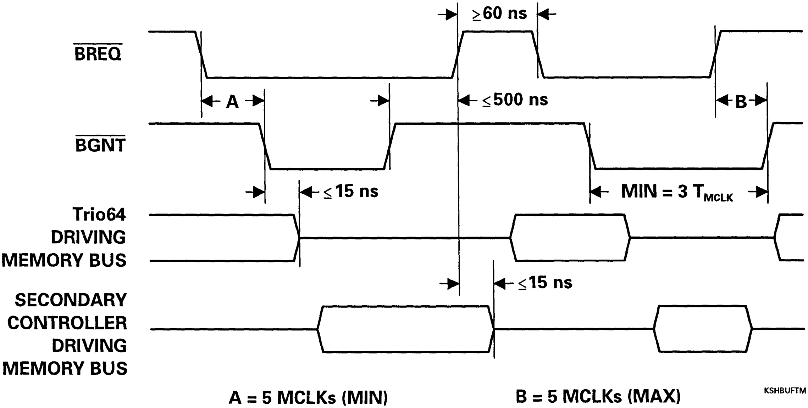

*Figure 7-8. Shared Frame Buffer Protocol Timing.*

## Section 8: RAMDAC Functionality

For 8 bits/pixel modes, the Trio32/Trio64 internal 24-bit RAMDAC provides three 256 6-bit word color look-up table (LUT) RAMs feeding three 8-bit DACs. A clock doubled mode is also provided for 8 bits/pixel modes. A 24-bit LUT bypass is provided for 15/16- and 24-bit color modes. A special 640x480x24 mode is provided for the Trio32 to allow true color operation with 1 MByte of memory. The block diagram for the internal RAMDAC is shown in Figure 8-1.

### 8.1 Color Modes

The Trio32/Trio64 internal RAMDAC provides 6 color modes of the following 3 primary types:

1. 8 bits (low byte of the internal pixel address bus) are latched each pixel clock and are used to select a LUT location.
2. 16 bits (low two bytes of the internal pixel address bus) are latched each pixel clock. These select two consecutive LUT locations, the data from which is clocked out to the DACs at twice the pixel clock rate.
3. 15 or 16 bits (lower two bytes of the internal pixel address bus) or 24 bits (all three bytes of the internal address bus) are transferred directly to the DACs each pixel clock.

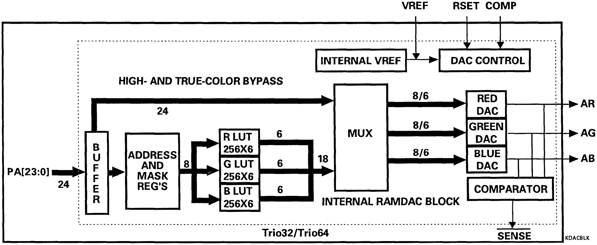

*Figure 8-1. Internal RAMDAC Block Diagram.*

**Table 8-1 Trio32/Trio64 Color Modes**

| Color Mode | CR67 Bits 7–4 | PA Bits | MAX DCLK | MAX Pixel Rate | Description |
| --- | --- | --- | --- | --- | --- |
| 0 | 0000 | 7:0 | 80 MHz | 80 MHz | 8-bit pseudo-color (LUT) - Default |
| 8 | 0001 | 15:0 | 67.5 MHz | 135 MHz | Two 8-bit pseudo-color (LUT) |
| 9 | 0011 | 15:0 | 80 MHz | 80 MHz | 15-bit high-color (LUT Bypass) |
| 10 | 0101 | 15:0 | 80 MHz | 80 MHz | 16-bit high-color (LUT Bypass) |
| 12 | 0111 | 23:0 | 75 MHz | 25 MHz | 640x480x24-bit packed (LUT Bypass-Trio32) |
| 13 | 1101 | 23:0 | 50 MHz | 50 MHz | 24-bit true-color (LUT Bypass) |

Each of the 6 color modes is listed in Table 3-1. The desired mode is selected by programming bits 7–4 of CR67.

#### 8.1.1 8 Bits/Pixel - Mode 0

Mode 0 is selected by setting bits 7–4 of CR67 to 0000b. In this mode, the low 8 internal pixel address bus bits are ANDed with the contents of the Pixel Read Mask register (3C6H). The result of the AND operation selects one of 256 LUT locations. This results in the output of 6 bits of color information to each of the DACs. The byte coding for the internal pixel data bus is shown in Figure 8-2.

#### 8.1.2 Output-doubled 8 Bits/Pixel - Mode 8

This mode is selected by setting bits 7–4 of CR67 to 0001b. In this mode, latching of pixel data from the lower two bytes of the internal pixel data bus is based on the pixel clock (VCLK) and output of pixel data from the latches to the DACs is based on an internal clock running at twice the VCLK rate. Either bit 4 or bit 6 of SR15 must be set to 1 when this mode is selected and bit 7 of SR18 must also be set to 1. The byte coding for the internal pixel data bus is shown in Figure 8-2.

This mode processes two pixels per VCLK with a maximum VCLK rate of 67.5 MHz. This results in an effective pixel output clock rate of 135 MHz.

The internal pixel bus bits are ANDed with the contents of the Pixel Read Mask register. The result of the AND operation selects one of 256 LUT locations. This results in the output of 6 bits of color information to each of the DACs.

#### 8.1.3 15/16-Bits/Pixel - Modes 9 and 10

These modes are selected by setting bits [7:4] of CR67 to 0011b (15 bits/pixel) or 0101b (16 bits/pixel). In either case, one pixel is transferred on the lower two bytes of the internal pixel bus each VCLK cycle. This data is sent directly to the DACs via the LUT bypass. The byte coding is shown in Figures 8-3 and 8-4.

![Bit layout of the 8 bits/pixel internal pixel address bus: middle byte ignored, lower byte PA[7:0]](img/s3-trio-fig8-2-8-bits-pixel-internal-pa-bus-coding.png)

*Figure 8-2. 8 Bits/Pixel Internal PA Bus Coding.*

![Bit layout of the 15 bits/pixel internal pixel address bus: middle byte PA[15:8] and lower byte PA[7:0]](img/s3-trio-fig8-3-15-bits-pixellnternal-pa-bus-coding.png)

*Figure 8-3. 15 Bits/Pixel Internal PA Bus Coding.*

![Bit layout of the 16 bits/pixel internal pixel address bus: middle byte PA[15:8] and lower byte PA[7:0]](img/s3-trio-fig8-4-16-bits-pixellnternal-pa-bus-coding.png)

*Figure 8-4. 16 Bits/Pixel Internal PA Bus Coding.*

#### 8.1.4 Packed 24 Bits/Pixel - Mode 12 (Trio32 Only)

This mode is selected by setting bit 3 of SRB to 1, bits 7–4 of CR67 to 0111b and bits 7–4 of CR67 to 0000b. It is used for a resolution of 640x480x24. Each pixel is stored in 24 bits of memory, allowing operation with 1 MByte of memory. One byte of color data is retrieved each DCLK. DCLK is internally divided by 3 to provide the VCLK to the internal RAMDAC. Thus, one pixel (with the coding shown in Figure 8-5) is latched into the RAMDAC every three DCLKs. Bits 4–3 of CR65 must be set to 10b for this mode to delay BLANK to the RAMDAC by 2 DCLKs. The internal hardware cursor cannot be used in this mode.

#### 8.1.5 24 Bits/Pixel - Mode 13

This mode is selected by setting bits [7:4] of CR67 to 1101b. One pixel is transferred to the DACs each VCLK cycle via the LUT bypass. The byte coding for the internal pixel address bus is shown in Figure 8-5.

![Bit layout of the 24 bits/pixel internal pixel address bus: upper byte PA[23:16], middle byte PA[15:8] and lower byte PA[7:0]](img/s3-trio-fig8-5-24-bits-pixellnternal-pa-bus-coding.png)

*Figure 8-5. 24 Bits/Pixel Internal PA Bus Coding.*

### 8.2 RAMDAC Register Access

The standard VGA RAMDAC register set (3C6H - 3C9H) is used to access the internal RAMDAC registers.

### 8.3 RAMDAC Snooping

For PCI bus configurations, setting bit 5 of the Command configuration space register (Index 04H) to 1 causes the Trio32/Trio64 to snoop for RAMDAC writes. This means that the Trio32/Trio64 will write the data to its local RAMDAC but will not claim the cycle by asserting DEVSEL. This allows the ISA controller to also generate a write cycle to a secondary RAMDAC. The Trio32/Trio64 always provides the data for RAMDAC reads.

If bit 5 of the PCI Command register is cleared to 0, the Trio32/Trio64 claims all RAMDAC read and write cycles.

Bits 2–0 of CR34 allow handling of PCI master aborts and retries to be individually enabled or disabled during RAMDAC cycles.

If power-on strapping bit 12 (CR37, bit 4) is pulled low at reset for a VL-Bus configuration, LOCA and SRDY are not generated by the Trio32/Trio64 for RAMDAC write accesses. The Trio32/Trio64 generates write cycles to the local RAMDAC and the ISA controller also generates cycles to an off-board RAMDAC (mirroring). RAMDAC reads are always from the local RAMDAC.

If bit 7 of CR37 is set to 1, the Trio32/Trio64 claims all RAMDAC read and write cycles (LOCA and SRDY are generated).

### 8.4 Sense Generation

The internal RAMDAC contains analog voltage comparators. These drive the internal SENSE signal active low whenever the output on any of the AR, AG or AB pins exceeds 330 mV ± 20%. The state of this internal signal can be read via bit 4 of 3C2H. This information can be used to detect the existence and type of monitor (color/mono) connected to the system.

## Section 9: Clock Synthesis and Control

The Trio32/Trio64 contains two phase-locked loop (PLL) frequency synthesizers. These generate the DCLK (video clock) and MCLK (memory clock signals for the graphics controller block. The DCLK signal is converted to the VCLK signal by the graphics controller block. This signal latches pixel data to the RAMDAC.

### 9.1 Clock Synthesis

Each PLL scales a single reference frequency input on the XIN pin. By placing a parallel-resonant crystal between the XOUT output pin and the XIN pin, the reference frequency is generated by the Trio32/Trio64's internal oscillator. Alternately, a CMOS-compatible clock input can be connected to XIN to provide the reference frequency.

The frequency synthesized by each PLL is determined by the following equation:

fOUT = ((M+2) × fREF) / ((N+2) × 2^R)

where R = 0, 1, 2 or 3

Programmed PLL M and PLL N values should be consistent with the following constraints:

1. 135 MHz ≤ ((M+2) × fREF) / (N+2) ≤ 270 MHz

2. min N ≥ 1

Note that values used for the parameters are the integer equivalents of the programmed value. In particular, the R value is the code, not the actual frequency divisor.

On power-up, the CLK1 frequency is 44.606 MHz. This can be reprogrammed in exactly the same manner as explained above for the CLK0 frequencies.

The PLL M value can be programmed with any integer value from 1 to 127. The binary equivalent of this value is programmed in bits 6–0 of SR11 for the MCLK and in bits 6–0 of SR13 for the DCLK. The PLL feedback loop frequency from the voltage controlled oscillator stage is scaled by dividing that frequency by (M+2).

The PLL N value can be programmed with any integer value from 1 to 31. The binary equivalent of this value is programmed in bits 15–11 of SR10 for the MCLK and in bits 15–11 of SR12 for the DCLK. The reference frequency is divided by (N+2) before being fed to the phase detector stage of the PLL.

The PLL R value is a 2-bit range value that can be programmed with any integer value from 0 to 3. The R value is programmed in bits 6–5 of SR10 for MCLK and bits 6–5 of SR12 for DCLK. This value codes the selection of a frequency divider for the PLL output. This is shown Table 9-1.

**Table 9-1. PLL R Parameter Decoding**

| R-Range Code | Frequency Divider |
| --- | --- |
| 00 | 1 |
| 01 | 2 |
| 10 | 4 |
| 11 | 8 |

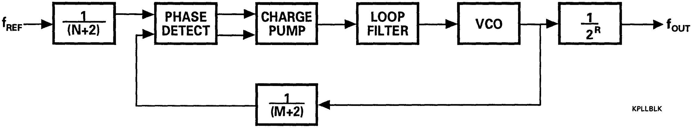

*Figure 9-1. PLL Block Diagram.*

The entire PLL block diagram is shown in Figure 9-1.

The following sequence may be followed to arrive at M and N values for any mode.

1. Calculate an R which does not violate the following constrains:

135 MHz < 2^R × fOUT ≤ 270 MHz

2. Start with N1 = 1 and calculate:

M = [fOUT × (N+2) × 2^R / fREF] - 2

3. Determine if the following constraint is met:

0.995 fOUT < ((M+2) × fREF) / ((N+2) × 2^R) < 1.005 fOUT

4. If the constraint in step 3 is met, the M and N values used will generate the desired frequency (within the specified tolerance). If the constrain is not met, repeat steps 2 and 3 with N increased by 1 each time until the constraint in step 3 is met. Note that multiple combinations of M and N are possible for a given output frequency.

### 9.2 Clock Reprogramming

The Trio32/Trio64 powers up with a DCLK frequency of 25.125 MHz (standard VGA) and an MCLK frequency of 45 MHz. The DCLK frequency can be changed to 28.322 MHz by setting bits 3–2 of 3C2H to 01b and can be changed back to 25.125 MHz by setting bits 3–2 of 3C2H to 00b. The loading of the DCLK frequency values requires that bit 1 of SR15 be set to 1.

All other DCLK frequencies must be generated by re-programming SR12 and SR13. The new PLL parameter values can be loaded in one of two ways. If bit 5 of SR15 is cleared to 0, the new DCLK frequency is loaded by setting bit 1 of SR15 to 1 and then setting bits 3–2 of 3C2H to 11 (if they are not already programmed to this value). Bit 1 of SR15 should be left at a value of 1. Actual loading will be delayed for a short but variable period of time.

The alternate approach to loading the new DCLK frequency is to program bits 3–2 of 3C2 to 11 (if they are not already programmed to this value). Next, program SR12 and SR13 and then toggle bit 5 of SR15 by programming it to a 1 and then a 0. This immediately loads the DCLK and MCLK frequencies (no variable delay). For example, pseudocode to change DCLK to the frequency specified by PLL parameter values of 34H and 56H is:

```text
3C2 <= 6FH   ; DCLK specified by CR12 and CR13
3C4 <= 12H   ; CR12 index
3C5 <= 34H   ; CR12 PLL value
3C4 <= 13H   ; CR13 index
3C5 <= 56H   ; CR13 PLL value
3C4 <= 15H   ; CR15 index
3C5 <= RMW   ; Use read/modify/write to set bit 5 to 1 and leave other bits unchanged
3C5 <= RMW   ; Use read/modify/write to clear bit 5 to 0 and leave other bits unchanged
```

Either loading approach should work. The second (immediate loading) approach helps with system testing since the timing of the load is predictable. The first approach (via bit 1 of SR15) has the advantage of separating the loading of DCLK from that of MCLK.

After power-up, all MCLK frequency changes must be made by re-programming SR10 and SR11. If bit 5 of SR15 is cleared to 0, the new frequency does not take effect until a 1 has been written to bit 0 of SR15. This bit must then be cleared to 0 to prevent repeated loading. Actual loading will be delayed for a short but variable period of time.

As explained above for DCLK, toggling bit 5 of SR15 (0,1,0) immediately loads both the DCLK values in SR12 and SR13 and the MCLK values in SR10 and SR11.

### 9.3 DCLK Control

DCLK is generated by the internal clock synthesizer. VCLK is the signal used to clock pixel data into the internal RAMDAC. For most modes of operation, VCLK is generated directly from VCLK and has the same frequency and phase (neglecting internal gate delays). Bit 0 of CR67 provides the option to invert DCLK before it becomes VCLK.

In mode 8, the internal RAMDAC requires two clocks. The normal internal DCLK frequency is divided by two via bit 4 of SR15 to provide the standard VCLK input. Undivided DCLK provides the other input. This clock can be inverted via bit 6 of SR15.

The internal RAMDAC can also have pixel data clocked in by an externally provided feature connector clock. For the VESA Advanced Feature Connector (VAFC), this clock is VCLKI, which is selected via bit 1 of SRB. For a pass-through connector, this clock is input on the VCLK pin and is enabled by asserting the EVCLK signal and by clearing bit 3 of CR33 to 0.

Certain 4 bits/pixel modes require that DCLK be halved. This is the case for bit 6 of AR10 set to 1 and bit 4 of CR3A cleared to 0 and is enabled by setting bit 4 of SR15 to 1 and clearing bit 3 of CR33 to 0.

## Section 10: Miscellaneous Functions

This section explains how the Trio32/Trio64 interfaces to the video BIOS ROM and feature connector. The General I/O Ports, Green PC support, genlocking and interrupt generation are also described.

### 10.1 Video BIOS ROM Interface

The video BIOS ROM contains power-on initialization, mode setup, and video data read/write routines. The video BIOS can be part of the system ROM or it can be implemented separately.

#### 10.1.1 Disabling BIOS ROM Accesses

If the video BIOS is integrated with the system BIOS in a VL-Bus configuration, then power-on strapping bit 4 (CR36, bit 4) must be pulled low to disable BIOS accesses. For PCI configurations, bit 0 of the BIOS ROM Base Address register (Index 30H) is cleared to 0 to disable BIOS accesses.

#### 10.1.2 BIOS ROM Hardware Interface

A separate implementation of the video BIOS for a PCI configuration is shown in Figure 10-1. The implementation for a VL-Bus configuration is shown in Figure 10-2. The ROM is accessed via the ISA bus. This allows a shadowed BIOS to be accessed by a CPU memory read without also generating data directly from the physical ROM. Only 8-bit ROMs are supported.

![BIOS ROM PCI configuration interface: GD[7:0], GA[15:0] and ROMEN to the BIOS ROM](img/s3-trio-fig10-1-bios-rom-pci-configuration-interface.png)

*Figure 10-1. BIOS ROM PCI Configuration Interface.*

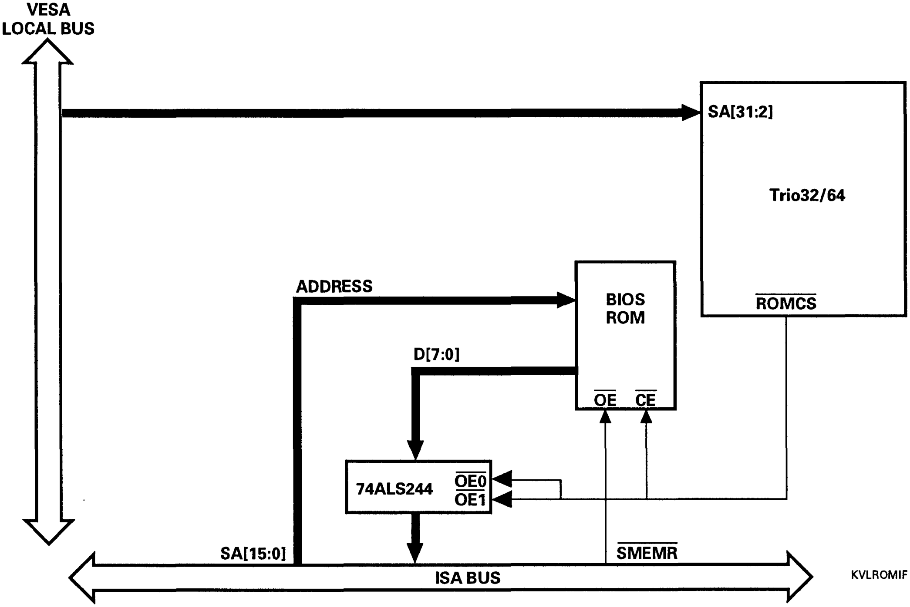

*Figure 10-2. BIOS ROM VL-Bus Configuration Interface.*

#### 10.1.3 BIOS ROM Read Functional Timing

Figure 10-3 depicts the PCI configuration functional timing for reading one byte from the ROM. ROMEN is asserted to drive the byte of read data at the address on GA[15:0] to the General Data Bus. The Trio32/Trio64 latches the data one clock before deassertion of ROMEN and then drives this data onto the AD bus.

The Trio32/Trio64 also supports 16- and 32-bit ROM reads, as defined by the states of the byte enables. For a 16-bit read, the Trio32/Trio64 automatically increments the lower address once and generates the second byte of read data. For a 32-bit read, the Trio32/Trio64 automatically increments the lower address three times and generates the remaining three bytes of read data. In both cases, TRDY is delayed until all the required data is available on the AD bus. For 16-, 24- or 32-bit accesses, the ROM access time must be 10 SCLKs or less, as opposed to the 14 SCLKs shown in Figure 10.3 for an 8-bit access.

For a VL-Bus configuration, a BIOS ROM read is a standard ISA bus read cycle with the Trio32/Trio64 providing its ROMCS output as the ROM chip and buffer enable (see Figure 10-2). ROMCS is asserted during the time the ROM address is valid and therefore will be active when the chipset asserts the ISA SMEMR signal.

#### 10.1.4 BIOS ROM Address Mapping

The Trio32/Trio64 maps the CPU memory address spaces for the video BIOS ROM into physical ROM addresses. If implemented separately for a VL-Bus system, the video BIOS normally uses the standard address range C0000H-C7FFFH (32 KBytes). If power-on strapping bit 10 (CR37, bit 2) is strapped low or if bit 2 of CR37 is cleared to 0 in a VL-Bus system, the video BIOS address range becomes C0000H-CFFFFH (64 KBytes). PCI systems support a relocatable 64-KByte video BIOS address range via the BIOS ROM Base Address configuration register (Index 30H).

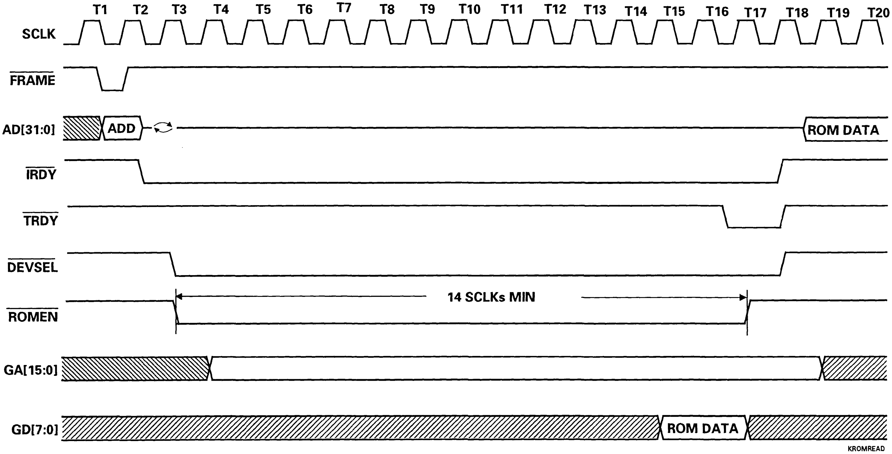

*Figure 10-3. BIOS ROM Read Functional Timing - PCI.*

### 10.2 Green PC Support

The Trio32/Trio64 provides support for the VESA Display Power Management Signaling (DPMS) protocol by allowing independent control of the HSYNC and VSYNC signals. To use this capability, the bit pattern xxxx0110b must be written to the SR8 register to unlock access to the SRD register. Bits 5–4 of SRD then control the state of HSYNC and bits 7–6 of SRD control the state of VSYNC.

### 10.3 General Input Port

The Trio32/Trio64 provides an 8-bit General Input Port (GIP). The block diagram showing how this is implemented for a PCI configuration is shown in Figure 10-4. The block diagram for a VL-Bus configuration is shown in Figure 10-5.

Bit 2 of the Extended DAC Control register (CR55) is set to 1 to enable the GIP read function. The data is read from an external buffer by an I/O read of port 3C8H (the same as the DAC Write Index off-chip register). When STRD is asserted for a PCI configuration, this data is driven to the Trio32/Trio64 via GD[7:0] and latched by the rising edge of the internal MCLK preceding deassertion of STRD. The data then appear almost immediately on AD[7:0]. The functional timing for this is shown in Figure 10-6. The entire cycle from assertion of FRAME until data appears on AD[7:0] is approximately 22–24 SCLKs.

When STRD is asserted for a VL-Bus configuration, the data is immediately placed on SD[7:0]. The functional timing for this operation is shown in Figure 10-7. The entire cycle from assertion of SADS to data being available on SD[7:0] takes approximately 18–20 SCLKs.

### 10.4 General Output Port

The Trio32/Trio64 provides an 8-bit General Output Port (GOP). The block diagram showing how this is implemented for a PCI configuration is shown in Figure 10-4. The block diagram for a VL-Bus configuration is shown in Figure 10-5.

The General Output Port register (CR5C) can be set to any value by a CPU write. This causes the STWR signal to be asserted and then deasserted. Deassertion latches data into the GOP latch. For a PCI configuration, the programmed values are provided to the latch via GD[7:0]. The functional timing for this operation is shown in Figure 10-8. The entire cycle from assertion of FRAME until latching of data in the GIP buffer is approximately 8–10 SCLKs.

For a VL-Bus configuration, the programmed values are provided to the latch via SD[15:8]. The functional timing for this is shown in Figure 10-9.

The entire cycle from assertion of SADS to latching of data in the GOP buffer takes approximately 6–8 SCLKs. One use of the GOP is to provide programmable control of external logic.

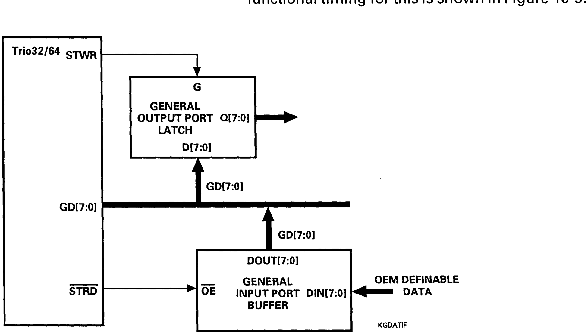

*Figure 10-4. General I/O Port Interfaces (PCI).*

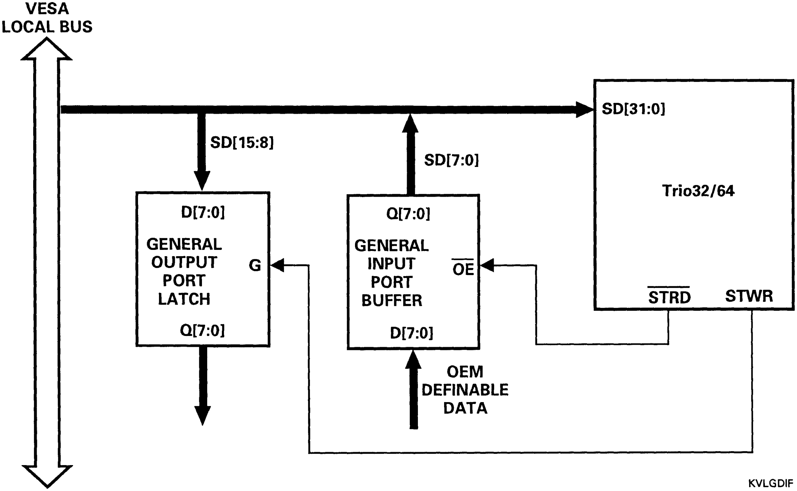

*Figure 10-5. General I/O Port Interfaces (VL-Bus).*

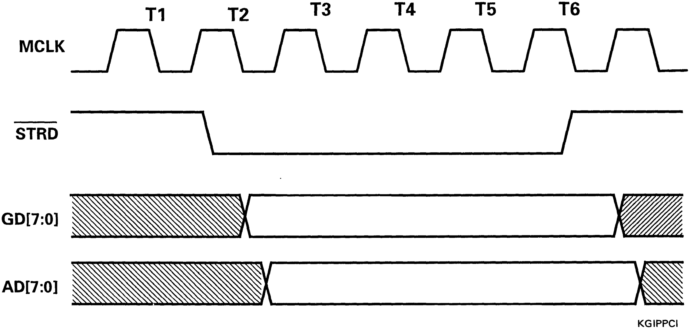

*Figure 10-6. General Input Port Timing (PCI).*

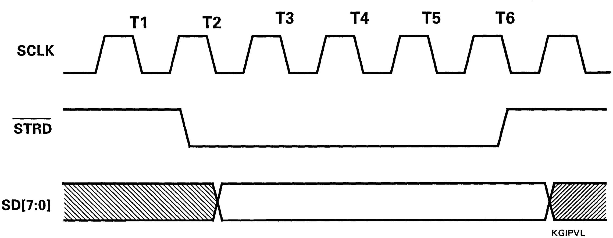

*Figure 10-7. General Input Port Timing (VL-Bus).*

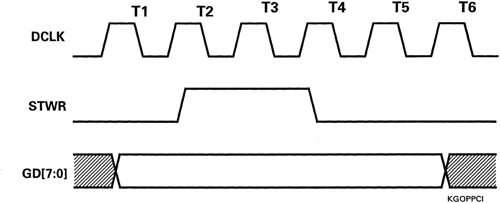

*Figure 10-8. General Output Port Timing (PCI).*

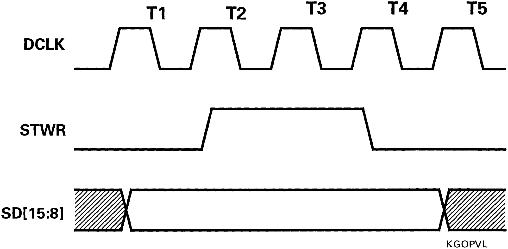

*Figure 10-9. General Output Port Timing (VL-Bus).*

### 10.5 Feature Connector Interface

The Trio32/Trio64 provides an interface to either a baseline VESA Advanced Feature Connector (VAFC) or pass-through bidirectional feature connector. In all cases (Trio32 and Trio64), bit 0 of SRD must be set to 1 to enable feature connector operation. For the Trio64, where feature connector signals are multiplexed with PD signals, setting this bit selects the feature connector signals.

For a VAFC implementation, ESYNC and EVCLK are pulled up. This means that HSYNC, VSYNC, BLANK and VCLK are always outputs to the feature connector. Pixel address data (PA[15:0]) is an output from the Trio32/Trio64 if EVIDEO is high and is an input to the Trio32/Trio64 if EVIDEO is low. If bit 1 of SRB is set to 1, pixel data input is strobed into the internal RAMDAC by VCLKI.

Figure 10-10 shows a VAFC implementation for a 32-bit PD bus Trio32/Trio64 implementation. This means that the Trio64 is restricted to 32-bit PD bus operation regardless of its memory size. The Trio32 always operates with a 32-bit PD bus and can have 1 or 2 MBytes of memory.

Figure 10-11 shows the VAFC implementation for Trio64 64-bit PD bus designs. The additional buffers are required to isolate the PD bus from the feature connector during 64-bit operation. This means that memory size will be at least 2 MBytes. Setting bit 0 of SRD to 1 drives the ENFEAT pin low, enabling the isolation buffers. Note that the Trio64 always uses a 32-bit PD bus when feature connector operation is enabled and that the speed of the interface (VCLK/DCLK) is limited to 37.5 MHz. See the VESA VAFC specification for further description and timing specifications.

Figure 10-12 shows a bidirectional 8-bit pass-through feature connector implementation for the Trio32 or the Trio64 configured for 32-bit PD bus operation. When the feature connector function is enabled by setting bit 0 of SRD to 1, the direction of the pixel data is controlled by the polarity of the EVIDEO signal. If EVIDEO is low, pixel data is an input to the Trio32/Trio64. If EVIDEO is high, the Trio32/Trio64 outputs pixel data to the feature connector.

If ESYNC is low, HSYNC, VSYNC and BLANK are inputs to the Trio32/Trio64. If ESYNC is high, these three signals are outputs. If EVCLK is low, VCLK is an input to the Trio32/Trio64 and is used to clock the pixel data to the internal RAMDAC. If EVCLK is high, VCLK is an output.

Trio64 memory configurations of 2 MBytes and larger will generally use the entire 64-bit PD bus. In these cases, EVIDEO, ESYNC, EVCLK and PA[7:0] are multiplexed with some of the upper 32 PD lines. The buffers shown in Figure 10-13 prevent the PD lines from being driven by the feature connector during 64-bit PD bus operation. As with the VAFC connector, the Trio64 uses a 32-bit PD bus during feature connector operations.

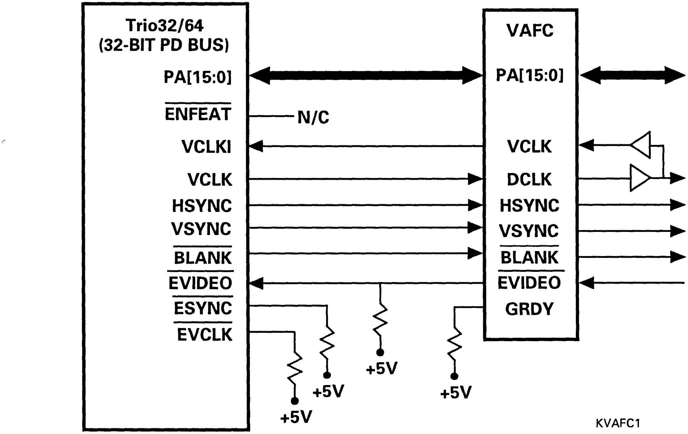

*Figure 10-10. VAFC Implementation (32-bit PD Bus).*

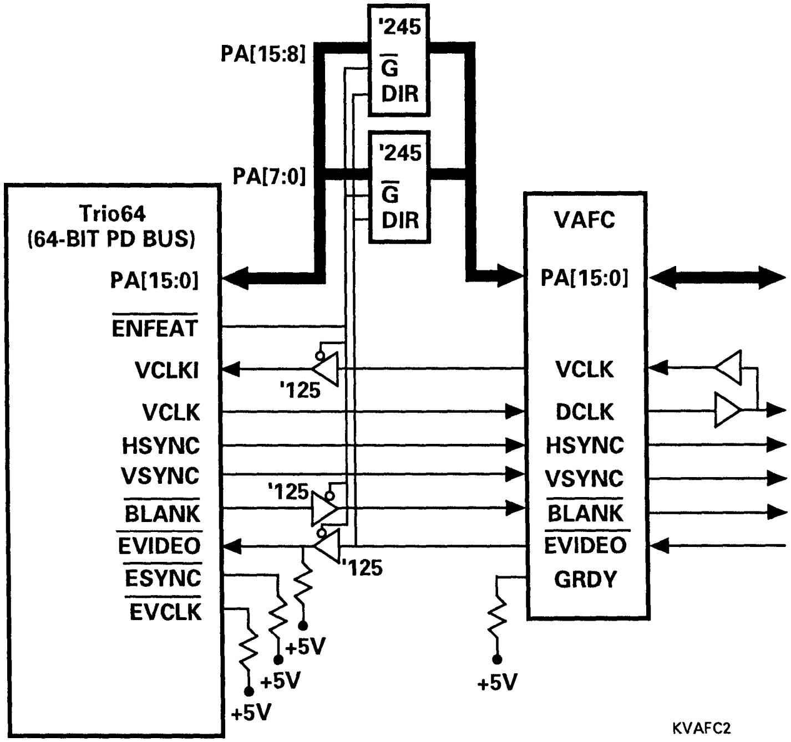

*Figure 10-11. VAFC Implementation (64-bit PD Bus).*

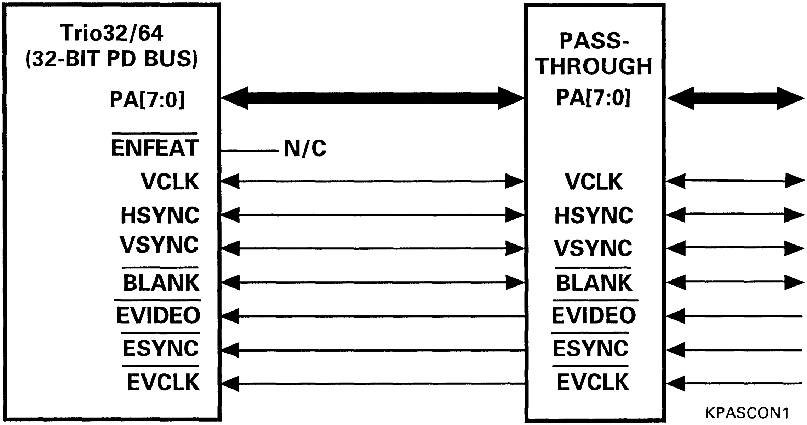

*Figure 10-12. Pass-Thru Feature Connector (32-bit PD).*

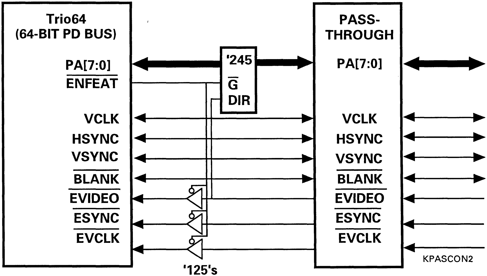

*Figure 10-13. Pass-Thru Feature Connector (64-bit PD).*

### 10.6 Genlocking

Genlocking allows two different video sources (one or both being an S3 accelerator) to contribute to the construction of a single frame of pixel data. The VSYNC output of a master video source is input to the slave video source to provide the basis for genlocking. This process ensures that each screen refresh cycle (frame) begins at exactly the same physical location on the screen.

The total time for each horizontal scan (screen active, blanking, retrace and front and back porches) is called the Horizontal Total. It is programmed in character clocks (minus 5) in the CR0 register. The internal horizontal character counter counts up from 0 (the first pixel on the line) until it reaches the Horizontal Total. It then resets to 0, signaling the start of a new line. HSYNC is typically deasserted several character clocks before the horizontal counter resets to 0. This is indicated by the Δ1 gap in Figure 10-14.

Similarly, VSYNC is typically deasserted (ending the vertical retrace) some number of scan lines before the vertical counter resets to 0. This is the Δ2 depicted in Figure 10-14. Both the horizontal and vertical counters reset to 0 (times A and C in Figure 10-14) after VSYNC is deasserted (time B in Figure 10-14).

The total adjustment is indicated by the vector in Figure 10-15. The horizontal component of this vector (Δ1) is programmed into bits 3–0 of CR63. The programmed value is the number of character clocks from deassertion of HSYNC to the horizontal counter reset (both for the master). This programmed value should never exceed the horizontal total programmed in CR0.

The vertical component of this vector (Δ2) is programmed into bits 7–0 of CR57. The programmed value is the number of scan lines from the deassertion of VSYNC to the vertical counter reset.

Note that this adjustment does not affect any of the CRT control timings other than to shift them in time. In other words, the lengths of the blanking period, HSYNC and VSYNC pulses, etc., do not change; their occurrences are all delayed by a fixed amount.

The result of these adjustments is that both video sources use the same starting point as a reference for pixel data written to the frame buffer. As long as both use the same VCLK frequency and have the same CRT control parameters (H and V Total, etc.), pixels contributed by either source should appear in the proper places on the screen.

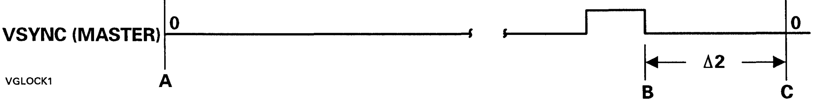

*Figure 10-14. Genlocking Master Sync Timing.*

One additional problem is that the character clocks of the master and slave will probably not be exactly in phase after the horizontal and vertical counter reset adjustment. To rectify this, bits 6–4 of the CR63 register are programmed with a value equal to the number of DCLKs (dot clocks) the character clock of the slave must be delayed from the rising edge of the master's VSYNC rising edge to bring the character clocks in phase.

In general, genlocking programming should be performed during the vertical sync period to avoid screen jitter.

See the *Genlocking Tech Note* for several implementation examples, including one describing how to genlock to a television-style (NTSC, PAL) external source.

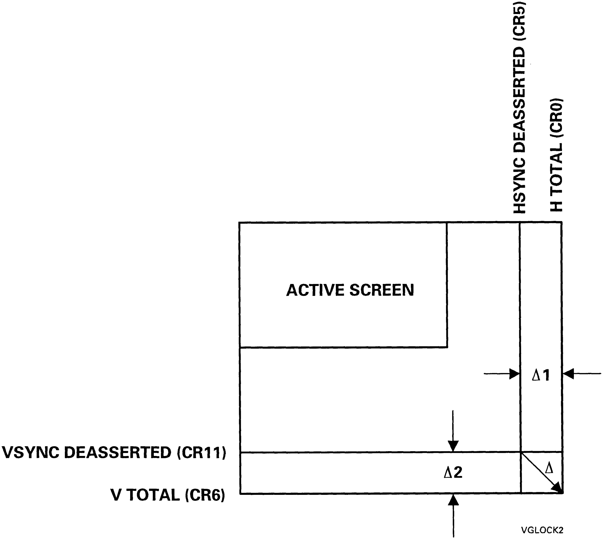

*Figure 10-15. Genlocking Timing Adjustments.*

### 10.7 Interrupt Generation

For a PCI configuration, pin 152 is pulled low to signal an interrupt (INTA). For a VL-Bus configuration, pin 152 is pulled high to signal an interrupt (SINTR).

Whatever the mode of operation (VGA or Enhanced), bit 4 of CR32 must be set to 1 to enable interrupt generation.

When the Trio32/Trio64 is being operated in VGA mode (bit 0 of 4AE8H cleared to 0), only a vertical retrace can generate an interrupt. This is enabled when bit 5 of CR11 is cleared to 0 and a 1 has been programmed into bit 4 of CR11. When an interrupt occurs, it is cleared by writing a 0 to bit 4 of CR11. The interrupt must then be re-enabled by writing a 1 to the same bit. Note that the BIOS clears both bit 4 and bit 5 of CR11 to 0 during power-on, a mode set or a reset. Thus, interrupt generation is disabled until bit 4 is set to 1.

When the Trio32/Trio64 is being operated in Enhanced mode (bit 0 of 4AE8H set to 1), interrupts can be generated by a vertical retrace, Graphics Engine (GE) busy, command FIFO overflow and FIFO empty. These are enabled via bits 8–11 respectively of 42E8H. The status of these interrupts can be read via bits 0–3 respectively of 42E8H. Writing a 1 to any of bits 0–3 of 42E8H clears the corresponding interrupt.

Multiple interrupts can be enabled at the same time in Enhanced mode. The interrupt pin will remain asserted until all interrupt status bits are cleared.

## Section 11: Software Setup

This section describes the basic operations required to set up the Trio32/Trio64.

### 11.1 CHIP WAKEUP

The following program wakes up the Trio32/Trio64.

```
; Program runs as COM file
; Program enables S3 chips
code    segment
        assume  CS:code, DS:code
        ORG     100h
start:
        mov     dx,46E8h      ; Video Subsystem Enable register address
        mov     al,10h        ; bit 3 = 0, disable I/O and memory decoders
                              ; bit 4 = 1; place video subsystem in setup mode
        out     dx,al         ; write new bit values to 46E8H
        mov     dx,102h       ; Setup Option Select register address
        mov     al,01h        ; Video subsystem responds to commands,
                              ; addresses & data
        out     dx,al         ; Write new bit value to 102H
        mov     dx,46E8h      ; Video Subsystem Enable register address
        mov     al,08h        ; Bit 3 = 1, enable I/O and memory decoders
                              ; Bit 4 = 0, return to operational mode
        out     dx,al         ; Write new bit values to 46E8H
        mov     dx,4AE8h
        xor     al,al         ; Enable standard VGA functions and screen size
        out     dx,al         ; Write new bit values to 4AE8h
        [load CRTCs]          ; See Section 11.4.1
        mov     dx,3C6h       ; DAC Mask register address
        mov     al,0FFh       ; DAC Mask register initialization value
        out     dx,al         ; Initialize DAC mask and release BLANK signal
        mov     dx,3C2h
        mov     al,23h        ; Enable memory, color base, page 0,
                              ; clock @ 28.322 MHz
        out     dx,al         ; Write new bit values to 3C2h
        mov     ah,4Ch
        int     21h           ; return to DOS
code    ENDS
        END     start
```

### 11.2 REGISTER ACCESS

#### 11.2.1 Unlocking the S3 Registers

The S3 registers (CR30 and higher plus the Enhanced Commands registers) must be unlocked before they can be accessed by the CPU. The code to do this is:

```
; Write code to CR38 to provide access to the S3 VGA registers (CR30-CR3F)
;
        mov     dx,3d4h       ; copy index register address into dx
        mov     al,38h        ; copy index for CR38 register into al
        out     dx,al         ; write index to index register
        inc     dx            ; increment dx to 3D5h (data register address)
        mov     al,48h        ; copy unlocking code (01xx10xxb, x=don't care) to al
        out     dx,al         ; write the unlocking code to the data register
        dec     dx            ; restore the index register address to dx
;
; Write code to CR39 to provide access to the System Control and System Extension
; registers (CR40-CRFF)
;
; dx is already loaded with 3D4h because of the previous instruction
;
        mov     al,39h        ; copy index for CR39 register into al
        out     dx,al         ; write index to index register
        inc     dx            ; increment dx to 3D5h (data register address)
        mov     al,0a5h       ; copy unlocking code to al (the code a5H also unlocks
                              ; access to configuration registers CR36, CR37 and CR68
        out     dx,al         ; write the unlocking code to the data register
        dec     dx            ; restore the index register address to dx
;
; Set bit 0 in CR40 to enable access to the Enhanced Commands registers.
;
; dx is already loaded with 3D4h because of previous instruction
        mov     al,40h        ; copy index for CR40 register into al
        out     dx,al         ; write index to index register
        inc     dx            ; increment dx to 3D5h (data register address)
        in      al,dx         ; read register data for read/modify/write operation
        or      al,1          ; set bit 0 to 1
        out     dx,al         ; write the unlocking code to the data register
        dec     dx            ; restore the index register address to dx
```

#### 11.2.2 Locking the S3 Registers

Relocking the S3 registers is done by repeating the code used to unlock the registers except:

1. The values written to the CR38 and CR39 registers must change at least one of the significant bits in the valid code pattern. For example, 00h will always accomplish this.

2. After first verifying that the Graphics Engine is not busy (bit 9 of 9AE8H is 0), bit 0 of CR40 must be cleared to 0. A read-modify-write cycle must be used instead of the code used above to prevent overwriting of any changes made to bits 7–1 in CR40 since reset.

```
        mov     dx,3d4h       ; copy index register address into dx
        mov     al,40h        ; copy index for CR40 register into al
        out     dx,al         ; write index to index register
        inc     dx            ; increment dx to 3D5h (data register address)
        in      al,dx         ; read content of CR40 into al
        and     al,0feh       ; clear bit 0 to 0
        out     dx,al         ; write to CR40 to lock the Enhanced Commands registers
        dec     dx            ; restore the index register address to dx
```

#### 11.2.3 Unlocking/Locking Other Registers

The Extended Sequencer registers (SR9–SR18) have been added to the standard VGA sequencer register set to provide a variety of new capabilities. To gain access to these registers, write xxxx0110b (x = don't care) to SR8. Writing a bit pattern that changes one of the significant bits re-locks access to the SRD register.

In addition to the standard VGA register access controls, the Trio32/Trio64 provides a number of bits extending the control of access to these registers. These are listed in Table 9-1.

**Table 11-1. VGA Register Access Control Extensions**

| Register Bit | Controls Access To: |
| --- | --- |
| CR33, bit 1 | CR7, bits 1 and 6 (1 = disable write protect setting of CR11, bit 7) |
| CR33, bit 4 | RAMDAC register (1 = disable writes) |
| CR33, bit 6 | Palette/Overscan registers (1 = lock) |
| CR35, bit 4 | Vertical Timing registers (1 = lock) |
| CR35, bit 5 | Horizontal Timing registers (1 = lock) |

### 11.3 TESTING FOR THE PRESENCE OF A Trio32/Trio64 CHIP

After unlocking, a Trio32 or Trio64 can be identified via CR30 and CR2E. The following code aborts the driver program and returns to DOS if a Trio32/Trio64 chip is not found.

```
        mov     dx,3d4h       ; copy index register address into dx
        mov     al,30h        ; copy index for CR30 register into al
        out     dx,al         ; write index to index register
        inc     dx            ; increment dx to 3D5h (data register address)
        in      al,dx         ; read content of CR30 into al
        and     al,0f0h       ; mask out revision status (lower nibble)
        cmp     al,0e0h       ; compare chip ID to the desired chip ID (E0h for
                              ; Trio32/Trio64)
        jne     not_E0x       ; jump to a label if chip ID does not match desired ID
        mov     dx,3d4h       ; copy index register address into dx
        mov     al,2eh        ; copy index for CR2E register into al
        out     dx,al         ; write index to index register
        inc     dx            ; increment dx to 3D5h (data register address)
        in      al,dx         ; read content of CR2E into al
        cmp     al,10h        ; compare chip ID to the desired chip ID (10h for
                              ; Trio32)
        je      Trio32_10h    ; jump to Trio32_10h if device ID is 10h
        cmp     al,11h        ; compare chip ID to the desired chip ID (11h for
                              ; Trio64)
        je      Trio64_11h    ; jump to Trio64_11h if device ID is 11h
        jmp     not_E0x       ; jump to not_E0x if device ID is not for Trio32 or Trio64
Trio32_10h:
Trio64_11h:
not_E0x:
        mov     ax,4c00h      ; terminate with a return code of zero
        int     21h           ; return to DOS
```

### 11.4 GRAPHICS MODE SETUP

The Trio32/Trio64 provides a number of standard VGA, VESA Super VGA and S3 Enhanced graphics modes. See the *S3 Video BIOS and Utilities OEM Guide* for a complete listing of modes supported by the S3 BIOS.

#### 11.4.1 VGA Mode Setup

The Trio32/Trio64 powers up into a standard VGA mode determined by the BIOS. The mode can then be altered by programming the standard VGA registers. All standard VGA and VESA modes are supported.

For each mode, the CRTC timing must be appropriately specified. Table 9-2 shows the required parameters, the relevant register bits for each and the value to be programmed for each. These parameters must also be programmed for the Enhanced modes discussed in the next section.

**Table 11-2. CRTC Timing Specification Summary**

| Parameter | Register Bits | Value to be Programmed |
| --- | --- | --- |
| Horizontal Total | CR5D_0, CR0_7–0 | Character clocks per horizontal period (HSYNC active to next HSYNC active) - 5 |
| Horizontal Display End | CR5D_1, CR1_7–0 | Character clocks of active display - 1 |
| Start Horizontal Blank | CR5D_2, CR2_7–0 | Character clock counter value at which horizontal blanking begins |
| End Horizontal Blank | CR5_7, CR3_4–0 | Least significant six bits of the character clock counter value at which horizontal blanking ends. The BLANK pulse width can be extended by 64 DCLKs via bit 3 CR5D |
| Start Horizontal Sync | CR5D_4, CR4_7–0 | Character clock counter value at which HSYNC becomes active |
| End Horizontal Sync | CR5_4–0 | Least significant five bits of the character clock counter value at which HSYNC goes inactive. The HSYNC pulse width can be extended by 32 DCLKs via bit 5 of CR5D |
| Vertical Total | CR5E_0, CR7_5, CR7_0, CR6_7–0 | Number of scan lines from VSYNC active to next VSYNC active - 2 |
| Vertical Retrace Start | CR5E_4, CR7_7, CR7_2, CR10_7–0 | Number of scan lines at which VSYNC becomes active |
| Vertical Retrace End | CR12_3–0 | Least significant 4 bits of the scan line counter value at which VSYNC goes inactive |
| Vertical Display End | CR5E_1, CR7_6, CR7_1, CR12_7–0 | Scan lines of active display -1 |
| Offset | CR51_5–4, CR13_7–0 | This value multiplied by 2 (byte mode), 4 (word mode) or 8 (doubleword mode) specifies the difference between the starting byte addresses of two consecutive scan lines |
| Start Vertical Blank | CR5E_2, CR9_5, CR7_3, CR15_7–0 | Number of scan lines at which vertical blanking begins - 1 |
| End Vertical Blank | CR16_7–0 | Least significant eight bits of the scan line counter at which vertical blanking ends |
| Line Compare | CR5E_6, CR9_6, CR7_4, CR18_7–0 | Number of scan lines at which the screen is split into screen A and screen B |

See standard VGA and VESA-compliant documentation for the other setup steps.

#### 11.4.2 S3 Enhanced Mode Setup

The Enhanced Graphics Command register group is unlocked by setting bit 0 of the System Configuration register (CR40) to 1. After that, bit 0 of 4AE8H must be set to 1 to enable Enhanced mode functions. Bit 2 of 4AE8H is also programmed at this time for the desired mode as explained in Table 9-3. A screen refresh rate is selected. The CRTC timing registers are programmed as explained in the previous section. The Enhanced mode setup bits are then programmed. Table 11-4 shows register bit values for a particular mode for the bitmap specification bits described in Table 11-3 as well as for other bits typically used when defining a mode. Some modes may require programming of bits not mentioned in this example.

**Table 11-3. Register Bits Affecting the Bitmap Definition**

| Register Bits | Description |
| --- | --- |
| CR13 | Specifies the logical screen width (pitch). Bits 5–4 of CR51 are extension bits 9–8 for this value. |
| CR31_1 | This is set to 1 to enable a 2Kx1Kx4 map for 1024x768 or 800x600 resolutions, or a 2Kx512x8 map for 640x480 resolution. |
| CR31_3 | This bit must be set to 1 to enable Enhanced mode memory mapping. This forces operation in doubleword mode. |
| CR3A_4 | 0 = 4-bit modes<br>1 = 8/16/24/32-bit modes |
| CR42_5 | 0 = Non-interlaced operation<br>1 = Interlaced operation |
| CR50_0,7,6 | Screen Width Definition<br>000 = 1024 (for 2048 if bit 1 of CR31 = 1) (Default)<br>001 = 640<br>010 = 800 (or 1600x1200x4 if bit 2 of 4AE8H = 1)<br>011 = 1280<br>100 = 1152<br>101 = Reserved<br>110 = 1600<br>111 = Reserved |
| CR50_5–4 | Pixel Color Depth Definition<br>00 = 1 byte. Bit 2 of 4AE8H selects between 4 (=0) and 8 (=1) bits/pixel.<br>01 = 2 bytes (16 bits/pixel)<br>10 = Reserved<br>11 = 4 bytes (32 bits/pixel). True color (24 bits/pixel) is handled by this setting, with the upper byte unused. |
| 4AE8H_2 | If bits 0,7,6 of CR50 are 010b, this bit is set to 1 for 1600x1200x4 mode.<br>If bits 5,4 of CR50 are 00b, this bit is set to 1 for 4 bits/pixel modes. |

**Table 11-4. Enhanced Mode Setup for 1024x768x8 Resolution at 75 Hz Refresh**

| Register | Value (Hex) | Description |
| --- | --- | --- |
| CR31 | 09 | Enables use of a CPU base address offset. Enables use of Enhanced mode memory mappings. |
| CR34 | 10 | Enables CR3B (display FIFO fetch start position). |
| CR3A | 15 | Enables RAM refresh count specification and specifies 1 RAM refresh cycle per horizontal line. Configures attribute controller shift registers for 8 bits/pixel. |
| CR3B | 9C | Specifies the time from the start of display active until the start of fetching data into the display FIFO for the next line. This is typically 5 less than the value programmed in CR0 but may vary for some modes. |
| CR3C | 00 | Not used for this non-interlaced mode. |
| CR40 | See Description | Bit 0 must be set to 1 early in the setup process to enable Enhanced mode register access. Bit 5 selects 0 or 1 wait state. This bit defaults to 1 wait state, which will almost always be required for proper operation of the Trio32/Trio64 in a VL-Bus configuration. Consequently, the S3 BIOS protects this bit from being overwritten during the normal setup process. |
| CR50 | 00 | Bits 0,7,6 specify the screen width of 1024 pixels. Bits 5,4 specify a pixel length of 8 bits/pixel. |
| CR51 | 00 | Bits 5,4 are extension bits for CR13. These are not required for this mode. |
| CR54 | 70 | M parameter value. This (plus 1) specifies how many 8-byte memory accesses are available before display FIFO filling starts again. |
| CR5C | See Description | The General Output Port is not used during the setup of this mode unless the clock generator requires serial input for DCLK selection or frequency programming. |
| CR5D | 00 | No horizontal overflow bits are required for this mode. |
| CR5E | 00 | No vertical overflow bits are required for this mode. |
| CR60 | FF | N parameter value. This (plus 1) specifies the number of 4-byte (1 MByte of memory) or 8-byte (2 or 4 MBytes of memory) units to transfer to the display FIFO before allowing memory access for another purpose. This value (255 decimal) ensures that the FIFO will always be filled before the memory is released. |
| CR67 | 00 | Bits 7–4 specify the RAMDAC color mode. This value selects 8 bits/pixel. |

#### 11.4.3 Hardware Graphics Cursor Setup

Use of the 64x64 bits hardware graphics cursor is enabled by setting bit 0 of the Hardware Graphics Cursor Mode register (CR45) to 1. The hardware cursor only works in Enhanced mode (bit 1 of 4AE8H = 1). See the Programmable Hardware Cursor section of the Enhanced Mode Programming section for more information.

## Section 12: VGA Compatibility Support

This section describes the Trio32/Trio64's support for standard VGA and VESA Super VGA graphics standards.

### 12.1 VGA COMPATIBILITY

The Trio32/Trio64 is compatible with the VGA standard. These modes are not accelerated using the Graphics Engine. However, other design features including a multi-modal FIFO provide excellent VGA performance.

Several of the standard VGA registers have been modified or extended in the Trio32/Trio64. Table 10-1 describes these changes.

**Table 12-1. Standard VGA Registers Modified or Extended in the Trio32/Trio64**

| Register | Change to Standard VGA Definition |
| --- | --- |
| 3C4H | The sequencer address has been extended from 3 to 4 bits to support the new SR8 - SR18 registers. |
| SR8 | This new register unlocks/locks access to the new SR9 - SR18 registers. |
| SR9 - SR18 | These new registers provide a variety of capabilities. |
| CR0 | Extension bit 8 is bit 0 of CR5D. Bit 5 of CR35 controls access to this register. Bit 7 of CR43 doubles the parameter size. |
| CR1 | Extension bit 8 is bit 1 of CR5D. Bit 5 of CR35 controls access to this register. Bit 7 of CR43 doubles the parameter size. |
| CR2 | Extension bit 8 is bit 2 of CR5D. Bit 5 of CR35 controls access to this register. Bit 7 of CR43 doubles the parameter size. |
| CR3 | The length of the blanking pulse defined in this register can be extended by 64 DCLKs via bit 3 of CR5D. Bit 5 of CR35 controls access to this register. Bit 7 of CR43 doubles the parameter size. |
| CR4 | Extension bit 8 is bit 4 of CR5D. Bit 5 of CR35 controls access to this register. Bit 7 of CR43 doubles the parameter size. |
| CR5 | The length of the HSYNC pulse defined in this register can be extended by 32 DCLKs via bit 5 of CR5D. Bit 5 of CR35 controls access to this register. Bit 7 of CR43 doubles the parameter size. |
| CR6 | In addition to the standard VGA extensions (bit 8 is bit 0 of CR7, bit 9 is bit 5 of CR47), bit 10 is bit 0 of CR5E. Bit 4 of CR35 controls access to this register. |
| CR7 | Bit 4 of CR35 controls access to bits 0, 2, 3, 5 and 7 of this register. |
| CR9 | Bit 4 of CR35 controls access to bit 5 of this register. |
| CRC | The display start address is a 20-bit value for the Trio32/Trio64. The extension bits (20-16) are bits 4-0 of CR69. |
| CRE | The cursor location address is a 20-bit value for the Trio32/Trio64. The extension bits (20-16) are bits 4-0 of CR69. |
| CR10 | In addition to the standard VGA extensions (bit 8 is bit 2 of CR7, bit 9 is bit 7 of CR7), bit 10 is bit 4 of CR5E. Bit 4 of CR35 controls access to this register. |
| CR11 | Bit 4 of CR35 controls access to bits 3-0 of this register. Bit 6 (3/5 refresh cycles per line) can be overridden by CR3A_2-0. Setting bit 1 of CR33 to 1 disables the write protect effect of bit 7 of this register on bits 1 and 6 of CR7. |
| CR12 | In addition to the standard VGA extensions (bit 8 is bit 1 of CR7, bit 9 is bit 6 of CR7), bit 10 is bit 1 of CR5E. |
| CR13 | Bit 2 of CR43 is the old extension bit (bit 8) of this register. Bits 5-4 of CR51 are the new extension bits (bits 9-8) of this register. |
| CR15 | In addition to the standard VGA extensions (bit 8 is bit 3 of CR7, bit 9 is bit 5 of CR9), bit 10 is bit 2 of CR5E. Bit 4 of CR35 controls access to this register. |
| CR16 | Bit 4 of CR35 controls access to this register. |
| CR17 | Bit 5 of CR35 controls access to bit 2 of this register. |
| CR18 | In addition to the standard VGA extensions (bit 8 is bit 4 of CR7, bit 9 is bit 6 of CR9), bit 10 is bit 6 of CR5E. |
| AR00-AR0F | Bit 6 of CR33 controls access to these registers. |
| 46E8H | If bit 2 of CR65 is set to 1, the setup address is 3C3H instead of this address. |
| 3C6H-3C9H | Bit 4 of CR33 controls writes to these registers. |

For a detailed discussion of VGA programming, see *Programmer's Guide to the EGA, VGA and Super VGA Cards, 3rd Edition* by Richard F. Ferraro (Addison-Wesley Publishing Company, Inc).

### 12.2 VESA SUPER VGA SUPPORT

The Trio32/Trio64 supports the extended (Super) VGA modes defined by VESA. All modes are accelerated by the Trio32/Trio64's Graphics Engine except for the planar (4 bits/pixel) ones.

## Section 13: Enhanced Mode Programming

Enhanced mode provides a level of performance far beyond what is possible with the VGA architecture. Hardware line drawing, BitBLT, rectangle fill and other drawing functions are implemented. Also implemented are data manipulation functions, such as data extension, data source selection, and read/write bitplane control. Hardware clipping is supported by 4 registers that define a rectangular clipping area. While in Enhanced mode, the display memory bit map can be updated in two ways. One is to have the CPU write directly to memory. (This is also possible in non-Enhanced modes via paging.) The other is to have the CPU issue commands to the Graphics Engine, which then controls pixel updating. This section explains these two methods and provides a comprehensive set of Enhanced mode programming examples.

### 13.1 DIRECT BITMAP ACCESSING—LINEAR ADDRESSING

Linear addressing is useful when software requires direct access to display memory. In general, large image transfers to display memory can be performed faster using the Graphics Engine and memory-mapped I/O transfers.

Enhanced mode operation must be enabled before linear addressing is enabled. This means that bit 0 of 4AE8H is set to 1 to enable Enhanced mode functions and bit 3 of CR31 is set to 1 to specify Enhanced mode memory mapping.

The Trio32 provides linear addressing of up to 2 MBytes of display memory. The Trio64 provides linear addressing of up to 4 MBytes of display memory. Linear addressing of more than 64 KBytes requires that the CPU be operated in 386 protected mode.

The Graphics Engine busy flag, bit 9 of 9AE8H, should be verified to be 0 (not busy) before linear addressing is enabled by setting bit 4 of CR58 or bit 4 of 4AE8H to 1. The size of the linear address window is set via bits 1-0 of CR58. The base address for the linear addressing window is set via CR59 and CR5A (or via the Base Address 0 (Index 10H) PCI configuration register for PCI systems).

The linear addressing window size can be set to 64 KBytes. The base address for the window is set by programming bits 31-16 of the window position in CR59–CR5A. This allows the CPU to be operated in real mode. If bit 0 of CR31 is set to 1, the memory page offset (64K bank) specified in bits 5-0 of CR6A is added to the linear addressing window position base address, allowing access to up to 2 (Trio32) or 4 (Trio64) MBytes of display memory through a 64-KByte window.

### 13.2 BITMAP ACCESS THROUGH THE GRAPHICS ENGINE

When updating the display bitmap through the Graphics Engine, all CPU data moves through the Pixel Data Transfer registers (E2E8H and E2EAH). These can be memory mapped as explained in Memory Mapping of Enhanced Mode Registers later in this section.

The Graphics Engine manipulates the bits for each pixel to assign a color index or true color value, which is then translated via a programmable RAMDAC before being displayed on a CRT. Selected bits in a pixel can be masked off from being displayed by programming the DAC Mask register (3C6H). The Trio64 can manipulate 64 bits each clock cycle, from two 32-bit pixels to eight 8-bit pixels. The Trio32 can manipulate 32 bits each clock cycle.

Figure 13-1 is a flowchart for the process of updating the color of each pixel. Start at the block labeled 'New Color' in the middle of Figure 13-1. At this stage, a color has been determined that may or may not be used to update a pixel in the bitmap. How this color is determined will be covered later.

The first hurdle for the new color is the color compare process. If this is turned off (bit 8 of BEE8H, Index 0EH = 0), the new color is passed to the Write Mask register (AAE8H). If the plane to which the pixel update is directed has been masked off in this register, no update occurs. Otherwise, the new color value is written to the bitmap.

If color compare is enabled (bit 8 of BEE8H, Index 0EH = 1), the new color value (source) is compared to a color value programmed into the Color Compare (B2E8H) register. The sense of the color comparison is determined by the SRC NE (source not equal) bit (bit 7) of BEE8H, Index 0EH. If this bit is 0, the new pixel color value is passed to the write mask only when the source color does not match the color in the Color Compare register. If this bit is 1, the new pixel color value is passed to the write mask only when the source color matches the color in the Color Compare register. If the new pixel color value is not passed to the write mask, no update occurs. Notice that the source color is used for the comparison, as opposed to the destination (bitmap) color used by the standard VGA color compare operation.

The new color is the result of a logical mix performed on a color source and the current color in the bitmap. For example, the color source could be XORed with the bitmap color. The new color can also be selected by operating on only the color source or the bitmap color, e.g., NOT color source. Both the color source and the logical mix operation are specified in either the Background Mix register (B6E8H) or the Foreground Mix register (BAE8H). Which of these two registers is used is determined by the settings of bits [7:6] of the Pixel Control register (BEE8H, Index 0AH).

To set up the pixel color updating scheme, the programmer specifies one of four color sources by writing bits 6-5 of the Background Mix and Foreground Mix registers. The color sources are:

- Background Color register (A2E8H)
- Foreground Color register (A6E8H)
- CPU (via the Pixel Data Transfer registers (E2E8H, E2EAH))
- Current display bitmap color index

One of 16 logical operations is chosen by writing bits 3-0 of the Background Mix and Foreground Mix registers. Examples of logical operations are making the new pixel color index equal to the NOT of the current bitmap color index or making the new index equal to the XOR of the source and current bitmap indices.

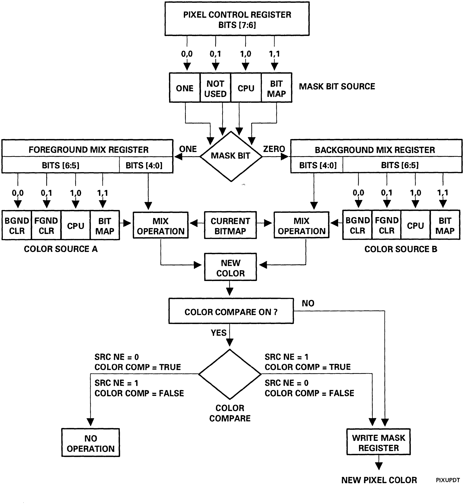

*Figure 13-1. Pixel Update Flowchart.*

When the logical operation and color source have been specified in the Background and Foreground Mix registers, bits 7-6 of the Pixel Control register are written to specify the source of the mask bit value. If the resulting mask bit is a 'ONE', the Foreground Mix register is used to determine the color source and mix. If the mask bit is a 'ZERO', the Background Mix register is used to determine the color source and mix. There are three sources for the mask bit value:

- Always ONE (Foreground Mix register used)
- CPU (via the Pixel Data Transfer registers (E2E8H, E2EAH))
- Bitmap

Setting bits 7-6 to 00b sets the mask bit to 'ONE'. All drawing updates to the video bitmap use the Foreground Mix register settings. This setup is used to draw solid lines, through-the-plane image transfers to display memory and BitBLTs.

If bits 7-6 are set to 10b, the mask bit source is the CPU. After the draw operation command is issued to the Drawing Command register (9AE8), a mask bit corresponding to every pixel drawn on the display must be provided via the Pixel Data Transfer register(s). If the mask bit is 'ONE', the Foreground Mix register is used. If the mask bit is 'ZERO', the Background Mix register is used. Note that if the color source is the CPU, the mask bit source cannot also be the CPU, and vice versa. This setup is used to transfer monochrome images such as fonts and icons to the screen.

If bits 7-6 are set to 11b, the current display bit map is selected as the mask bit source. The Read Mask register (AAE8H) is set up to indicate the active planes. When all bits of the read-enabled planes for a pixel are a 1, the mask bit 'ONE' is generated. If any one of the read-enabled planes is a 0, then a mask bit 'ZERO' is generated. If the mask bit is 'ONE', the Foreground Mix register is used. If the mask bit is 'ZERO', the Background Mix register is used. Note that if the color source is the bitmap, the mask bit source cannot also be the bitmap, and vice versa. This setting is used to BitBLT patterns and character images.

### 13.3 MEMORY MAPPING OF ENHANCED MODE REGISTERS

The Trio32/Trio64 provides two memory-mapped I/O schemes. The standard method provides each memory-mapped register with a single memory address. Most of the Enhanced registers are provided such an address. The packed register method allows two 16-bit registers to be accessed by a single 32-bit write cycle. In addition, more registers can be accessed via the packed method than by the standard method. The packed register method provides improved performance. The standard method provides backwards compatibility with older software.

#### 13.3.1 Standard Memory Mapping of Enhanced Mode Registers

Most of the Enhanced registers can be memory-mapped (MMIO). This function is enabled by setting bit 4 of CR53 or bit 5 of 4AE8H to 1.

Image writes normally made via I/O addresses E2E8H and E2EAH (the Pixel Data Transfer registers) are made instead by accessing any memory location in the 32-KByte address space from A0000H to A7FFFH. This allows efficient use of the MOVSW and MOVSD assembly language commands. Accesses must be to even word or doubleword addresses, depending on the specification of the bus width via bits 10-9 of 98E8H. Software must not make E2E8H, E2EAH writes beyond the A7FFFH range.

Accesses to the Enhanced command registers are made to particular locations in the A8000H to AFFFFH address range as shown in Table 13-1. Both 16-bit reads and writes are supported. Only 32-bit writes (bit 9 of BEE8H_E set to 1) are supported.

If MMIO is enabled, bit 7 of SR9 allows register access to be either I/O or MMIO or MMIO only.

**Table 13-1. Enhanced Registers Memory Mapping**

| Register Mnemonic | I/O Address (Hex)<br>MMIO = Axxxx | Register Mnemonic<br>(Packed) | Packed MMIO Address (Hex)<br>(Axxxx) |
| --- | --- | --- | --- |
| CUR_Y, CUR_X | 82E8, 86E8 | ALT_CURXY | 8100, 8102 |
| CUR_Y2*, CUR_X2* | 82EA, 86EA | ALT_CURXY2 | 8104, 8106 |
| DESTY_AXSTP, DESTX_DIASTP | 8AE8, 8EE8 | ALT_STEP | 8108, 810A |
| Y2_AXSTP2*, X2_DIASTP2* | 8AEA, 8EEA | ALT_STEP2 | 810C, 810E |
| ERR_TERM, ERR_TERM2* | 92E8, 92EA | ALT_ERR | 8110, 8112 |
| CMD, CMD2* | 9AE8, 9AEA | ALT_CMD | 8118, 811A |
| SHORT_STROKE | 9EE8 |  | 811C |
| BKGD_COLOR | A2E8 |  | 8120 |
| FRGD_COLOR | A6E8 |  | 8124 |
| WRT_MASK | AAE8 |  | 8128 |
| RD_MASK | AEE8 |  | 812C |
| COLOR_CMP | B2E8 |  | 8130 |
| BKGD_MIX, FRGD_MIX | B6E8, BAE8 | ALT_MIX | 8134, 8136 |
| SCISSORS_T, SCISSORS_R | BEE8_1, BEE8_2 |  | 8138, 813A |
| SCISSORS_B, SCISSORS_R | BEE8_3, BEE8_4 |  | 813C, 813E |
| PIX_CNTL, MULT_MISC2* | BEE8_A, BEE8_D |  | 8140, 8142 |
| MULT_MISC, READ_SEL | BEE8_E, BEE8_F |  | 8144 |
| MIN_AXIS_PCNT, MAJ_AXIS_PCNT | BEE8_0, 96E8 | ALT_PCNT | 8148, 814A |
| MAJ_AXIS_PCNT2* | 96EA |  | 814C |
| PIX_TRANS | E2E8, E2EA | PIX-TRANS |  |
| PAT_Y*, PAT_X* | EAE8, EAEA | ALT_PAT | 8168, 816A |

\* These registers are available only for the Trio64.

#### 13.3.2 Packed MMIO Register Mapping

For improved performance, most of the Enhanced mode registers can also be written (but not read) via a packed configuration. The 16-bit registers are paired so that two registers can be accessed via a single 32-bit write. The addresses for this packed configuration are given in Table 13-1. The packed register access function is enabled when MMIO is enabled.

### 13.4 PROGRAMMING

Three different programming schemes are available, I/O, standard MMIO and packed register MMIO. Examples of how each is used to assign vertical and horizontal coordinates to Current X and Y Position registers (82E8H and 86E8H) are:

I/O Format:

```
MOV DX,CUR_X
MOV AX,X
OUT DX,AX
MOV DX,CUR_Y
MOV AX,Y
OUT DX,AX
```

Standard MMIO Format:

```
Enable MMIO
Point ES to A000H
Load x and y values into AX and BX
MOV ES:[CUR_Y], BX
MOV ES:[CUR_X], AX
```

Packed Register MMIO:

```
Enable MMIO
Point ES to A000H
Load the x and y values into EAX (y value in the low word and x value in the high word), i.e.,
       31           15           0
EAX <= |     X      |     Y      |
MOV ES:[ALT_CURXY], EAX
```

The packed register MMIO scheme is the most efficient and is used where appropriate in the programming examples provided later in this section. All assume that the ES register points to A000H.

#### 13.4.1 Notational Conventions

The REGMNEMONIC on the left hand side of the arrow is the register mnemonic of the I/O port being written into. Text following a ';' is a comment.

```
REGMNEMONIC <= XXXXH                ; Load a hexadecimal value into the register.
REGMNEMONIC <= XXXXD                ; Load a decimal value into the register.
REGMNEMONIC <= XXXX                 ; Load a decimal value into the register
REGMNEMONIC <= XXXXXXXXXXXXXXXXB    ; Load a binary value into the register.
```

Image transfers (CPU pixel data writes to the frame buffer) are notated as follows:

```
COUNT
PIX_TRANS <= IMAGEDATA
```

The COUNT is the number of CPU writes. PIX_TRANS means either the E2E8H, E2EAH pixel transfer registers or the 32K memory space from A0000H to A7FFFH as explained in Section 13.3.1 above.

#### 13.4.2 Initial Setup

All examples assume the desired mode is selected.

The Bitmap Access Through the Graphics Engine section earlier in this section explains in detail how the colors, mixes and the data extensions are set for each example. These registers need not be set repeatedly before a series of draw commands if they use the same colors, mixes and data extension.

All bitmap updates are affected by the settings in the clipping registers (BEE8H, Indices 1-4) and the choice of internal or external clipping (BEE8H, Index E, bit 5). These must be set up so they include the area being drawn into.

If color compare is to be used, it must be enabled by setting bit 8 of BEE8H, Index 0EH to 1. Bit 7 of this register determines whether a TRUE or FALSE comparison allows the pixel update to continue. The comparison color is programmed into the Color Compare register (B2E8).

All planes are enabled for writing unless explicitly set otherwise in an example. This is done via the Write Mask register (AAE8H).

#### 13.4.3 Programming Examples

This section provides programming examples for the following Enhanced mode drawing operations:

- Solid Line
- Textured Line
- Rectangle Fill Solid
- Image Transfer—Through the Plane
- Image Transfer—Across the Plane
- BitBLT—Through the Plane
- BitBLT—Across the Plane
- PatBLT—Through the Plane
- PatBLT—Across the Plane
- Short Stroke Vectors
- Polyline (Trio64 only)
- Polygon Fill Solid - (Trio64 only)
- Polygon Fill Pattern - (Trio64 only)
- 4-Point Method Trapezoid Fill Solid - (Trio64 only)
- 4-Point Method Trapezoid Fill Pattern - (Trio64 only)
- Bresenham Parameter Trapezoid Fill Solid- (Trio64 only)
- Bresenham Parameter Trapezoid Fill Pattern- (Trio64 only)
- Programmable Hardware Cursor

Some programming steps are repeated in multiple examples. They are explained in detail at their first occurrence. Therefore, readers are encouraged to work through the examples from first to last. The register mnemonics used in the examples are listed in Table 13-1. Other mnemonics used are:

| Mnemonic | Description |
| --- | --- |
| NEW | Mix = 00111b in bits 4-0 of BAE8H or B6E8H. This overwrites the present bitmap color value with a new value. |
| XOR | Mix = 00101b in bits 4-0 of BAE8H or B6E8H. The current bitmap color is XORed with the new color. |

#### 13.3.3.1 Solid Line

This command draws a one pixel wide solid line from screen coordinates x1,y1 to x2,y2. Bresenham parameters are used to define the line. The Pixel Control register (BEE8H, Index AH) must be set to A000H to select the Foreground Mix register to specify the color source and mix type.

Setup:

Drawing a line using axial coordinates requires programming the axial step constant into the Destination Y-Position/Axial Step Constant (8AE8H) register (DESTY_AXSTP), the diagonal step constant into the Destination X-Position/Diagonal Step Constant (8EE8H) register (DESTX_DIASTP) and the error term into the Error Term (92E8H) register (ERR_TERM). Calculation of these Bresenham parameters is based on the MAX and MIN parameters as calculated below.

```
MAX = maximum(ABS(x2-x1), ABS(y2-y1))
MIN = minimum(ABS(x2-x1), ABS(y2-y1))
```

where maximum means choose the largest of the two terms in parentheses and minimum means choose the smallest. ABS means take the absolute value of the expression.

Bits 7-5 of the Drawing Command (9AE8H) register (CMD) specify the drawing direction. Setting bit 7 to 1 means that the Y drawing direction is positive (y1 < y2). Clearing bit 7 to 0 means the Y drawing direction is negative (y1 > y2). Setting bit 6 to 1 means that Y is the major (longer) axis (ABS(x2-x1) > ABS(y2-y1)). Clearing bit 6 to 0 means that X is the major axis. Setting bit 5 to 1 means that the X drawing direction is positive (x1 < x2). Clearing bit 5 to 0 means that the X drawing direction is negative (x1 > x2). These values replace the DDD sequence in the write to the CMD register shown in the pseudocode below.

The mix NEW represents a setting of 0111b in bits 3-0 of the Foreground Mix (BAE8H) register (FRGD_MIX). This overwrites the present bitmap color value with a new value.

The remainder of the setup is:

```
ES:[FRGD_MIX] <= 0027H          ; color source is FRGD_COLOR, mix type is NEW
ES:[FRGD_COLOR] <= 00000002H    ; color index
ES:[PIXEL_CNTL] <= A000H        ; FRGD_MIX provides color source and mix type
```

Drawing Operation:

```
                  31           15           0
ES:[ALT_CURXY] <= |     x1     |     y1     |   ; set starting coordinate

ES:[MAJ_AXIS_PCNT] <= MAX - 1        ; length in pixels of the major axis - 1
                 31           15           0
ES:[ALT_STEP] <= |2*(MIN-MAX) |   2*MIN    |   ; diagonal and axial step constants

If the X drawing direction is positive then
      ES:[ERR_TERM] <= 2 * MIN - MAX          ; error term
else if the X drawing direction is negative
      ES[ERR_TERM] <= 2 * MIN - MAX - 1       ; error term
ES:[CMD] <= 00100000DDD10001b   ; Draw line command (bits 15-13, 11), draw (as opposed to
                                ; just move current position)(bit 4), bit 0 is always 1
```

#### 13.3.3.2 Textured Line

The line draw command can be used to draw a one pixel wide textured line from screen coordinates x1,y1 to x2,y2. The texture is created by (1) setting bits 7-6 of the Pixel Control register (BEE8H, Index AH) to A080H to specify the CPU as the source of the mask bit selecting the mix register, (2) specifying a background and foreground color, (3) setting bit 8 of the Command register (9AE8H) to 1 (wait for CPU data) and (4) setting bit 1 of the Command register to 1 (multi-pixel). When the pattern bit sent by the CPU is a 1, the Foreground Mix register specifies the color source and mix. When the bit is a 0, the Background Mix register specifies the color source and mix. This example uses the mix NEW for the foreground mix, XOR for the background mix, foreground color index 2 and background color index 4. The 32-bit line texture/pattern (PATTERN) is 00110000111100110011000011110011b. This requires that bits 10-9 of the Command register be set to 10b to specify a 32-bit bus.

Setup:

The XOR mix corresponds to a setting of 0101b in bits 3-0 of the Background Mix (B6E8H) register (BKGD_MIX). See the Solid Line example for an explanation of other parameters and registers used in this example.

```
                31           15           0
ES:[ALT_MIX] <= |   0027H    |   0005H    |   ; FRGD_COLOR is color source and NEW is mix,
                                ; BKGD_COLOR is color source and XOR is mix
ES:[FRGD_COLOR] <= 00000002H    ; color index
ES:[BKGD_COLOR] <= 00000004H    ; color index
ES:[PIXEL_CNTL] <= A080H        ; mask data selecting mix register is provided by the CPU
```

Drawing Operation:

```
                  31           15           0
ES:[ALT_CURXY] <= |     x1     |     y1     |   ; set starting coordinates

ES:[MAJ_AXIS_PCNT <= MAX - 1        ; length in pixels of the major axis - 1
                 31           15           0
ES:[ALT_STEP] <= |2*(MIN-MAX) |   2*MIN    |   ; diagonal and axial step constants

If the X drawing direction is positive then
      ES:[ERR_TERM] <= 2 * MIN - MAX          ; error term
else if the X drawing direction is negative
      ES[ERR_TERM] <= 2 * MIN - MAX - 1       ; error term
ES:[CMD] <= 00100101DDD10011b   ; Draw line (bits 15-13, 11), 32-bit bus (bits 10-9), wait for data
                                ; from the CPU (bit 8), draw (bit 4), multi-pixel (bit 1)
COUNT (of PATTERN dwords) = (MAX + 31)/32 (See Note)
PIX_TRANS <= 00110000111100110011000011110011b   ; Output PATTERN to Pixel Data Transfer
                                                 ; registers COUNT times
```

**Note**

The COUNT of the number of writes required by the CPU is a function of the number of bits to be transferred and the width of the transfer (8, 16 or 32 bits as specified by bits 10-9 of the Drawing Command register (9AE8H)). The number of bits transferred per line must be an even multiple of the transfer width. If this is not the case, the last write per line must be padded with one or more dummy bits to meet this requirement. For example, if the transfer width is 8 bits and nine bits are to be transferred for the line, two bytes must be written per line, with the upper 7 bits of the second byte padded. In general, the number of padding bits per line will vary from 0 to (n-1), where n is the transfer width in bits.

With a transfer width of 8 bits, the number of byte writes required per line can be determined from the formula n = (MAX+7)/8, with n being truncated to an integer if the result contains a fraction. Thus a MAX = 11 transfer requires (11+7)/8 = 2 1/4 = 2 bytes. The formulas for all transfer widths are given below.

```
8-bit transfers: COUNT = (MAX+7)/8 bytes
16-bit transfers: COUNT = (MAX+15)/16 words
32-bit transfers: COUNT = (MAX+31)/32 dwords
```

#### 13.3.3.3 Rectangle Fill Solid

This command draws a solid rectangle with its top left corner at x1,y1, height = HEIGHT and width = WIDTH. The Pixel Control register (BEE8H, Index AH) must be set to A000H to select the Foreground Mix register to specify the color source and mix type. This example uses the mix NEW and color index 2. The drawing direction (bits 7-5 in the write to the CMD register below) is set to X positive, X major and Y positive (101b).

Setup:

```
ES:[FRGD_MIX] <= 0027H          ; color source is FRGD_COLOR, NEW mix type
ES:[FRGD_COLOR] <= 00000002H    ; color index
ES:[PIXEL_CNTL] <= A000H        ; FRGD_MIX specifies the color source and mix type
```

Drawing Operation:

```
                  31           15           0
ES:[ALT_CURXY] <= |     x1     |     y1     |   ; set starting coordinates

                 31           15           0
ES:[ALT_PCNT] <= |  WIDTH-1   |  HEIGHT-1  |   ; rectangle width

ES:[CMD] <= 0100000010110001b   ; Draw rectangle (bits 15-13, 11), draw (bit 4)
```

**Note**

The rectangle can be defined by specifying any one of the four corners and setting bits 7-5 accordingly. Always select X as the major axis (bit 6 =0). No matter how the rectangle is defined, it always fills from left to right and top to bottom.

| Corner | X direction (bit 5) | Y direction (bit 7) |
| --- | --- | --- |
| top left | positive (1) | positive (1) |
| top right | negative (0) | positive (1) |
| bottom left | positive (1) | negative (0) |
| bottom right | negative (0) | negative (0) |

#### 13.3.3.4 Image Transfer—Through the Plane

This command transfers a rectangular image from the CPU to the display memory through the plane. "through the plane" means the complete color index is transferred for each pixel, e.g., in 8 bits/pixel mode, one byte is required to transfer one pixel to memory. The image is stored as an array of pixels arranged in row major fashion (consecutively increasing memory addresses). The Pixel Control register must be set to A000H to select the Foreground Mix register to specify the color source and mix type. The color source must be specified as the CPU. Bit 12 of the Command register must be set to 1 (swap ON) for Intel-type architectures. Bit 8 of the Command register must be set to 1 (wait for CPU data) and bits 6 and 5 must also be set to 1 to specify X as the major axis and a left-to-right drawing direction. This example uses a mix type of NEW and x1,y1 is the top left corner of the rectangle on the screen. The height and width of the rectangle (in pixels) are HEIGHT and WIDTH. Doubleword CPU writes are supported by setting bits 10-9 of the Command register to 10b.

Setup:

```
ES:[FRGD_MIX] <= 0047H          ; color source is the CPU, mix type is NEW
ES:[PIXEL_CNTL] <= A000H        ; FRGD_MIX is the source for color source and mix type
```

Drawing Operation:

```
                  31           15           0
ES:[ALT_CURXY] <= |     x1     |     y1     |   ; set destination starting coordinates

                 31           15           0
ES:[ALT_PCNT] <= |  WIDTH-1   |  HEIGHT-1  |   ; rectangle width

Wait for Graphics Engine not busy    ; loop till bit 9 of 9AE8H register is 0
ES:[CMD] <= 01010101D0110001b   ; Draw rectangle (bits 15-13, 11), swap ON (bit 12),
                                ; 32-bit transfers (bits 10-9), wait for CPU data (bit 8),
                                ; always X Major (bit 6) & X Positive (bit 5), draw (bit 4)
COUNT (of image pixel data to transfer) = (See Note)
PIX_TRANS <= IMAGEDATA; Output image data to the Pixel Data Transfer registers for COUNT dwords.
```

**Note**

The COUNT of the number of writes required by the CPU is a function of the number of pixels to be transferred, the width of the transfer (8, 16 or 32 bits as specified by bits 10-9 of the Drawing Command register (9AE8H)) and the color depth (bits/pixel). The number of pixels transferred per line must be an even multiple of the transfer width. If this is not the case, the last write per line must be padded with one or more dummy pixels to meet this requirement. For example, at 4 bits/pixel, each byte holds two pixels. If the transfer width is one byte and three pixels are to be transferred per line, two bytes must be written per line, with the upper nibble of the second byte a dummy pixel. If the transfer width is 16 bits, from one to three dummy pixels may be required to make the number of pixels per line an even multiple of 16. The number of word writes required per line can be determined from the formula n = (W+3)/4, with n being truncated to an integer if the result contains a fraction. Thus a six pixel transfer requires (6+3)/4 = 2.25 = 2 words. This is then multiplied by the height of the image (in pixels) to determine the COUNT of words to be transferred. Similar procedures apply to every other combination of the variables affecting the COUNT. The formulas for all cases are given below, where W is the width of the image and H is the height of the image, both in pixels.

```
COUNT for 4 bits/pixel modes
8-bit transfers: COUNT = (W+1)/2 * H bytes
16-bit transfers: COUNT = (W+3)/4 * H words
32-bit transfers: COUNT = (W+7)/8 * H dwords

COUNT for 8 bits/pixel modes
8-bit transfers: COUNT = W * H bytes
16-bit transfers: COUNT = (W+1)/2 * H words
32-bit transfers: COUNT = (W+3)/4 * H dwords

COUNT for 16 bits/pixel modes
8-bit transfers: Do not use this combination
16-bit transfers: COUNT = W * H words
32-bit transfers: COUNT = (W+1)/2 * H dwords

COUNT for 32 bits/pixel modes
8-bit transfers: COUNT = Do not use this combination
16-bit transfers: COUNT = 2W * H words
32-bit transfers: COUNT = W * H dwords
```

Note that in 32 bits/pixel modes, the upper byte is a dummy byte providing padding for a 24-bit pixel.

#### 13.3.3.5 Image Transfer—Across the Plane

The image transfer command can also be used to transfer a rectangular image from the CPU to the display memory across the plane. "across the plane" means that each bit sent by the CPU is stored in display memory as a single pixel. These pixels are arranged in row major fashion (consecutively increasing memory addresses). An "across the plane" transfer is created by (1) setting bits 7-6 of the Pixel Control register (BEE8H, Index AH) to A080H to specify the CPU as the source of the mask bit selecting the mix register, (2) specifying a background and foreground color, (3) setting bit 8 of the Command register (9AE8H) to 1 (wait for CPU data) and (4) setting bit 1 of the Command register to 1 (multi-pixel). When the pattern bit sent by the CPU is a 1, the Foreground Mix register specifies the color source and mix. When the bit is a 0, the Background Mix register specifies the color source and mix. This example uses a mix type of NEW, and x1,y1 is the top left corner of the rectangle on the screen. The height and width of the rectangle (in pixels) are HEIGHT and WIDTH. The monochrome image is translated so that pixels corresponding to a 1 in the bit image are given color index 4 and pixels corresponding to a 0 in the bit image are given color index 0. This example uses word transfers from the CPU as specified by setting bits 10-9 of the Command register to 01b for a 16-bit bus width.

Setup:

```
                31           15           0
ES:[ALT_MIX] <= |   0027H    |   0005H    |   ; FRGD_COLOR color source and mix is NEW
                                ; BKGD_COLOR is color source and mix is XOR
ES:[FRGD_COLOR] <= 00000004H    ; foreground color index 4
ES:[BKGD_COLOR] <= 00000000H    ; background color index 0
ES:[PIXEL_CNTL] <= A080H        ; selection of mix register is based on data from the CPU
```

Drawing Operation:

```
                  31           15           0
ES:[ALT_CURXY] <= |     x1     |     y1     |   ; set destination starting coordinates

                 31           15           0
ES:[ALT_PCNT] <= |  WIDTH-1   |  HEIGHT-1  |   ; rectangle width

Wait for Graphics Engine not busy    ; loop till bit 9 of 9AE8H register is 0
CMD <= 01010011D0110011b         ; Draw rectangle (bits 15-13, 11), swap ON (bit 12),
                                 ; 16-bit transfers (bits 10-9), wait for CPU data (bit 8),
                                 ; always X Major (bit 6) & X Positive (bit 5), draw (bit 4),
                                 ; multi-pixel (bit 1)
COUNT (of image pixel data to transfer) = ((WIDTH +15)/16)*HEIGHT words
PIX_TRANS <= IMAGEDATA; Output image data to Pixel Transfer register for COUNT words
```

**Notes**

The COUNT of the number of writes required by the CPU is a function of the number of pixels to be transferred and the width of the transfer (8, 16 or 32 bits as specified by bits 10-9 of 9AE8H). Except for the case where bits 10-9 of 9AE8H are 11b, the number of pixels transferred per line must be an even multiple of the transfer width. If this is not the case, the last write per line must be padded with one or more dummy pixels to meet this requirement. For example, if the transfer width is 8 bits and nine pixels are to be transferred per line, two bytes must be written per line, with the upper 7 bits of the second byte padded. In general, the number of padding bits per line will vary from 0 to (n-1), where n is the transfer width in bits.

With a transfer width of 8 bits, the number of byte writes required per line can be determined from the formula n = (W+7)/8, with n being truncated to an integer if the result contains a fraction. Thus a 13-bit pixel transfer requires (13+7)/8 = 2.5 = 2 bytes. This is then multiplied by the height of the image (in pixels) to determine the COUNT of bytes to be transferred. Similar procedures apply to every other combination of the variables affecting the COUNT. The formulas for all cases are given below, where W is the width of the image and H is the height of the image, both in pixels.

```
8-bit transfers: COUNT = (W+7)/8 * H bytes (9AE8H_10-9 = 00b)
16-bit transfers: COUNT = (W+15)/16 * H words (9AE8H_10-9 = 01b)
32-bit transfers: COUNT = (W+31)/32 * H dwords (9AE8H_10-9 = 10b)
New 32-bit transfers: COUNT = (((W+7)/8*H)+3)/4 dwords (9AE8H_10-9 = 11b) (Trio32 only)
```

The differences between the two 32-bit transfer options are:

1. For 9AE8H_10-9 set to 10b, every line of the transfer must start with a fresh doubleword. In other words, all unneeded bits in a doubleword transfer for a given line are discarded. After a rectangular image is transferred, the current drawing position is a the bottom left, meaning the next rectangle, if drawn, will be below the previous rectangle.

2. (Trio32 8, 16 and 24 bits/pixel modes only) For 9AE8H_10-9 set to 11b, only bits from the end of the line width to the next byte boundary are discarded. Data for the next line begins with the next byte. After a rectangular image is transferred, the current drawing position is a the top right, meaning the next rectangle, if drawn, will be to the right of the previous rectangle.

To write to a single plane, set the foreground mix to 'logical one' (0002H), the background mix to 'logical zero' (0001H), and the Write Mask register (AAE8H) to select the desired (single) plane for updates.

#### 13.3.3.6 BitBLT—Through the Plane

This command copies a source rectangular area in display memory to another location in display memory. The Pixel Control register must be set to A000H to select the Foreground Mix register to specify the color source and mix type. The color source must be specified as the bitmap (display memory). Bit 6 of the Command register must be set to 1 to specify X as the major axis. For this example, assume x1,y1 is the top left corner of the source rectangle in display memory and x2,y2 is the top left corner of the destination rectangle. The rectangles can be overlapping or disjoint. The height and width (in pixels) of the rectangle being copied are HEIGHT and WIDTH.

Setup:

First, the values of the Srcx, Srcy, Destx and Desty must be determined.

Case 1: Source and destination rectangles do not overlap

For X Positive, Y Positive: Srcx = x1, Srcy = y1, Destx = x2, Desty = y2

Case 2: Source and destination rectangles overlap

```
If x1 > x2
      then if X Positive, Srcx = x1, Destx = x2
else
      Srcx = x1 + WIDTH -1, Destx = x2 + WIDTH -1      ; X Negative

If y1 > y2
      then if Y Positive, Srcy = y1, Desty = y2
else
      Srcy = y1 + HEIGHT -1, Desty = y2 + HEIGHT -1    ; Y Negative
```

```
ES:[PIXEL_CNTL] <= A000H        ; FRGD_MIX is the source of color source and mix type
ES:[FRGD_MIX] <= 0067H          ; color source is display memory and mix type is NEW
```

Draw Operation:

```
                  31           15           0
ES:[ALT_CURXY] <= |    Srcx    |    Srcy    |   ; set starting coordinates

                 31           15           0
ES:[ALT_STEP] <= |   Destx    |   Desty    |   ; set destination coordinates

                 31           15           0
ES:[ALT_PCNT] <= |  WIDTH-1   |  HEIGHT-1  |   ; rectangle width and height

ES:[CMD] <= 11000000D0D10001b   ; BitBLT (bits 15-13, 11), always X Major (bit 6), draw (bit 4)
```

#### 13.3.3.7 BitBLT—Across the Plane

This uses the same command as a BitBLT through the plane. However, instead of copying complete pixels (with color affected only by the mix), this "across the plane" transfer uses only the bits in the color planes specified by setting the Read Mask register (AEE8H), e.g., bit 3 of every pixel, to determine the destination rectangle. With more than one plane enabled for read, if all the bits in the planes enabled for read are '1's then a '1' is read. If a bit in any one of the planes enabled for read is a '0', then '0' is read. An "across the plane" transfer is created by (1) setting bits 7-6 of the Pixel Control register (BEE8H, Index AH) to A0C0H to specify the bitmap as the source of the mask bit selecting the mix register, (2) programming the Read and Write Mask registers to specify the plane to read from and write to and (3) setting bit 1 of the Command register to 1 (multi-pixel). In this example, when the bit read is a 1, a 1 is copied as specified by the foreground mix. When the bit read is a 0, a 0 is copied as specified by the background mix. Assume x1,y1 is the top left corner of the source rectangle on the display, and x2,y2 is the top left corner of the destination rectangle. The image is read from plane 0 and written to plane 2. The rectangles could be overlapping or disjoint. The height and width (in pixels) of the rectangle are HEIGHT and WIDTH.

Setup:

First, the values of the Srcx, Srcy, Destx and Desty must be determined.

Case 1: Source and destination rectangles do not overlap

For X Positive, Y Positive: Srcx = x1, Srcy = y1, Destx = x2, Desty = y2

Case 2: Source and destination rectangles overlap

```
If x1 > x2
      then if X Positive, Srcx = x1, Destx = x2
else
      Srcx = x1 + WIDTH -1, Destx = x2 + WIDTH -1      ; X Negative

If y1 > y2
      then if Y Positive, Srcy = y1, Desty = y2
else
      Srcy = y1 + HEIGHT -1, Desty = y2 + HEIGHT -1    ; Y Negative
```

```
ES:[PIXEL_CNTL] <= A0C0H        ; data from display memory selects mix register
                31           15           0
ES:[ALT_MIX] <= |   0002H    |   0001H    |   ; result of foreground mix is always logical 1,
                                ; result of background mix is always logical 0
ES:[RD_MASK] <= 00000001H       ; read from plane 0
ES:[WRT_MASK] <= 00000004H      ; plane 2 enabled for write
```

Draw Operation:

```
                  31           15           0
ES:[ALT_CURXY] <= |    Srcx    |    Srcy    |   ; set starting coordinates

                 31           15           0
ES:[ALT_STEP] <= |   Destx    |   Desty    |   ; set destination coordinates

                 31           15           0
ES:[ALT_PCNT] <= |  WIDTH-1   |  HEIGHT-1  |   ; rectangle width and height

ES:[CMD] <= 11000000D0D10001b   ; BitBLT (bits 15-13, 11), always X Major (bit 6), draw (bit 4),
                                ; multi-pixel (bit 1)
```

**Note**

It is possible to translate a monochrome image, e.g., text fonts, stored in a single plane in display memory into a 2-color image. This is accomplished by setting the mix registers differently and setting the desired background and foreground colors. If the source bit is a '1', then the corresponding pixel at the destination is colored with the foreground color index. The destination pixel is colored with the background color index if the corresponding source bit is a '0'. The setup for this is as follows:

```
ES:[WRT_MASK] <= FFFFFFFFH      ; enable all planes for writing
ES:[FRGD_MIX] <= 0027H          ; color source foreground, mix type NEW
ES:[BKGD_MIX] <= 0007H          ; color source background, mix type NEW
ES:[FRGD_COLOR] <= 00000004H    ; foreground color
ES:[BKGD_COLOR] <= 00000001H    ; background color
```

#### 13.3.3.8 PatBLT—Pattern Fill Through the Plane

An 8x8 pixel pattern is initially copied into an off-screen area of display memory using an image transfer operation or a direct write (linear addressing). This command then repeatedly tiles this source pattern into a destination rectangle of arbitrary size. The colors of the destination pixels are affected only by the mix selected. The destination rectangle must not overlap the source pattern. Each copy is aligned to an 8-pixel boundary (x coordinate = 0, 8, etc.), with pixels outside the destination rectangle boundary not being drawn. The Pixel Control register must be set to A000H to select the Foreground Mix register to specify the color source and mix type. The color source must be specified as the bitmap (display memory). Bit 6 of the Command register must be set to 1 to specify X as the major axis. In this example, assume x1,y1 is the top left corner of the pixel pattern and x2,y2 is the top left corner of the destination rectangle. The height and width (in pixels) of the rectangle are HEIGHT and WIDTH.

Setup:

```
ES:[PIXEL_CNTL] <= A000H        ; FRGD_MIX is the source of color source and mix type
ES:[FRGD_MIX] <= 0067H          ; color source is display memory, mix type is NEW
```

Draw Operation

```
                  31           15           0
ES:[ALT_CURXY] <= |     x1     |     y1     |   ; set starting coordinates

                 31           15           0
ES:[ALT_STEP] <= |     x2     |     y2     |   ; set destination coordinates

                 31           15           0
ES:[ALT_PCNT] <= |  WIDTH-1   |  HEIGHT-1  |   ; rectangle width and height

ES:[CMD] <= 11100000D0D10001b   ; PatBLT (bits 15-13,11), always X Major (bit 6), draw (bit 4)
```

#### 13.3.3.9 PatBLT—Pattern Fill Across the Plane

This uses the same command as a PatBLT through the plane. However, instead of copying complete pixels (with color affected only by the mix), this "across the plane" transfer uses only the bits in the color planes specified by setting the Read Mask register (AEE8H), e.g., bit 3 of every pixel, to determine the destination rectangle. With more than one plane enabled for read, if all the bits in the planes enabled for read are '1's then a '1' is read. If a bit in any one of the planes enabled for read is a '0', then '0' is read. An "across the plane" transfer is created by (1) setting bits 7-6 of the Pixel Control register (BEE8H, Index AH) to A0C0H to specify the bitmap as the source of the mask bit selecting the mix register, (2) programming the Read and Write Mask registers to specify the plane to read from and write to and (3) setting bit 1 of the Command register to 1 (multi-pixel). In this example, when the bit read is a 1, a 1 is copied as specified by the foreground mix. When the bit read is a 0, a 0 is copied as specified by the background mix. In this example, assume x1,y1 is the top left corner of the pixel pattern and x2,y2 is the top left corner of the destination rectangle. The image is read from plane 0 and written to plane 2. The height and width of the destination rectangle are HEIGHT and WIDTH.

Setup:

```
ES:[PIXEL_CNTL] <= A0C0H        ; data from display memory selects mix register
                31           15           0
ES:[ALT_MIX] <= |   0002H    |   0001H    |   ; result of foreground mix is always logical 1,
                                ; result of background mix is always logical 0
ES:[RD_MASK] <= 00000001H       ; read from plane 0
ES:[WRT_MASK] <= 00000004H      ; plane 2 enabled for write
```

Draw Operation:

```
                  31           15           0
ES:[ALT_CURXY] <= |     x1     |     y1     |   ; set starting coordinates

                 31           15           0
ES:[ALT_STEP] <= |     x2     |     y2     |   ; set destination coordinates

                 31           15           0
ES:[ALT_PCNT] <= |  WIDTH-1   |  HEIGHT-1  |   ; rectangle width and height

ES:[CMD] <= 11100000D0D10011b   ; PatBLT (bits 15-13, 11), always X Major (bit 6), draw (bit 4),
                                ; multi-pixel (bit 1)
```

**Note**

To expand the source mono pattern into a 2-color pattern, set the foreground mix to 27H, the background mix to 7H and the foreground and background colors as desired. Also set the write mask (AAE8H) to FFFFFFFFH. This needs to be set only once. It is altered only by another write.

#### 13.3.3.10 Short Stroke Vectors

This command rapidly draws short lines (up to 15 pixels in length). Such lines are constrained to one of the 8 directions at 45 degree increments starting at 0 degrees. The current point x1,y1 is set and a NOP command is issued to set all the desired drawing parameters without actually writing a pixel. For example, bit 2 (Last Pixel Off) would be set to 1 (OFF) for drawing connected lines until the last line is drawn. The short stroke vector parameters are then loaded in the Short Stroke Vector Transfer (9EE8H) register (SHORT_STROKE). Two vectors can be defined at a time, one in the low byte and one in the high byte. For the low byte, bits [7:5] define the direction, with bit 4 set to '1' for a draw operation or to '0' for a move current position operation. Bits 3-0 define the length of the short line. Let SSVD0, SSVD1, ... SSVDN-1 bytes be the short stroke vector data for N lines.

Setup:

```
ES:[PIXEL_CNTL] <= A000H        ; FRGD_MIX is the source of color source and mix type
ES:[FRGD_MIX] <= 0027H          ; use the foreground color, mix type NEW
ES:[FRGD_COLOR]<= 00000004H     ; foreground color index 4
```

Draw Operation:

```
                  31           15           0
ES:[ALT_CURXY] <= |     x1     |     y1     |   ; set starting coordinates

ES:[CMD] <= 00010010XXX11111b   ; NOP (bits 15-13, 11), byte swap (bit 12), 16-bit transfers
                                ; (bits 10-9), draw (bit 4), radial drawing direction (bit 3),
                                ; last pixel off (bit 2), multi-pixel (bit 1)
While space available in the FIFO
ES:[SHORT_STROKE] <= SSVD1 SHL 8 + SSVD0; SSVD1 shifted to high byte, SSVD0 in low byte
ES:[SHORT_STROKE] <= SSVD3 SHL 8 + SSVD2; byte swap turned on to read vectors out in
                                        ; correct order
      :
      :
      :
ES:[SHORT_STROKE] <= SSVDN-1 SHL 8 + SSVDN-2
```

#### 13.3.3.11 Polyline/2-Point Line (Trio64 Only)

This command draws a line from point P1 (x1,y1) to point P2 (x2,y2). It can be used to draw an additional line from the end point of the last line drawn by specifying only the next end point. This can be repeated for as many polyline segments as desired. The Pixel Control register must be set to A000H to select the Foreground Mix register to specify the color source and mix type. The color source must be specified as the foreground color.

Setup:

```
ES:[FRGD_MIX] <= 0027H          ; color source is FRGD_COLOR, NEW mix type
ES:[FRGD_COLOR]<= 00000002H     ; color index
ES:[PIXEL_CNTL] <= A000H        ; FRGD_MIX specifies the color source and mix type
```

Draw Operation:

```
                  31           15           0
ES:[ALT_CURXY] <= |     x1     |     y1     |   ; set starting coordinates

                 31           15           0
ES:[ALT_STEP] <= |     x2     |     y2     |   ; set destination coordinates

ES:[CMD] <= 0010100000010001b    ; draw 2-point line (bits 15-13, 11), draw (bit 4)
```

Repeat the last two instructions to draw additional polyline segments.

**Note**

This command is faster for drawing a 2-point line than the Solid Line drawing command. However, the Bresenham parameters are fixed in hardware and cannot be manipulated by the programmer as with the Solid Line command. A textured line cannot be drawn with this command.

#### 13.3.3.12 Polygon Fill Solid (Trio64 Only)

This command draws a polygon and fills it with a solid color. Any number of sides can be drawn, but the shape must be such that any horizontal line must intersect the polygon edges in no more than two places. To accomplish this, all edge segments must be drawn downward. The exception is that any edge can be horizontal. The Pixel Control register must be set to A000H to select the Foreground Mix register to specify the color source and mix type. This example uses the mix NEW and color index 2. This example shows how to draw the polygon shown in Figure 13-2.

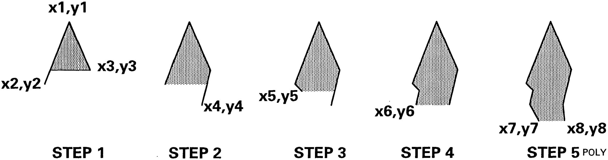

*Figure 13-2. Polygon Example Drawing Steps.*

Setup:

```
ES:[FRGD_MIX] <= 0027H          ; color source is FRGD_COLOR, NEW mix type
ES:[FRGD_COLOR] <= 00000002H    ; color index
ES:[PIXEL_CNTL] <= A000H        ; FRGD_MIX specifies the color source and mix type
```

Draw Operation:

```
                  31           15           0
ES:[ALT_CURXY] <= |     x1     |     y1     |   ; set starting coordinates for segment 1 of left side

                 31           15           0
ES:[ALT_STEP] <= |     x2     |     y2     |   ; set destination coordinates for segment 1 of left side

                   31           15           0
ES:[ALT_CURXY2] <= |     x1     |     y1     |   ; set starting coordinates for segment 1 of right side

                  31           15           0
ES:[ALT_STEP2] <= |     x3     |     y3     |   ; set destination coordinates for segment 1 of right side
ES:[CMD]<= 0110000000010001b   ; draw polygon (bits 15-13, 11), draw (bit 4) - Step 1
                  31           15           0
ES:[ALT_STEP2] <= |     x4     |     y4     |   ; set destination coordinates for segment 2 of right side
ES:[CMD]<= 0110000000010001b   ; draw polygon (bits 15-13, 11) - Step 2
                 31           15           0
ES:[ALT_STEP] <= |     x5     |     y5     |   ; set destination coordinates for segment 2 of right side
```

```
ES:[CMD]<= 0110000000010001b   ; draw polygon (bits 15-13, 11) - Step 3
                 31           15           0
ES:[ALT_STEP] <= |     x6     |     y6     |   ; set destination coordinates for segment 3 of left side

ES:[CMD]<= 0110000000010001b   ; draw polygon (bits 15-13, 11) - Step 4

                 31           15           0
ES:[ALT_STEP] <= |     x7     |     y7     |   ; set destination coordinates for segment 4 of left side

                  31           15           0
ES:[ALT_STEP2] <= |     x8     |     y8     |   ; set destination coordinates for segment 3 of right side
ES:[CMD]<= 0110000000010001b   ; draw polygon (bits 15-13, 11) - Step 4
```

The generation of this polygon is summarized in the following table.

**Table 13-2. Polygon Fill Example Summary**

| Step | First Line<br>ALT_CURXY<br>x | First Line<br>ALT_CURXY<br>y | First Line<br>ALT_STEP<br>x | First Line<br>ALT_STEP<br>y | Second Line<br>ALT_CURXY2<br>x | Second Line<br>ALT_CURXY2<br>y | Second Line<br>ALT_STEP2<br>x | Second Line<br>ALT_STEP2<br>y |
| --- | --- | --- | --- | --- | --- | --- | --- | --- |
| Step 1 | x1 | y1 | x2 | y2 | x1 | y1 | x3 | y3 |
| CMD |  |  |  |  |  |  |  |  |
| Step 2 |  |  |  |  |  |  | x4 | y4 |
| CMD |  |  |  |  |  |  |  |  |
| Step 3 |  |  | x5 | y5 |  |  |  |  |
| CMD |  |  |  |  |  |  |  |  |
| Step 4 |  |  | x6 | y6 |  |  |  |  |
| CMD |  |  |  |  |  |  |  |  |
| Step 5 |  |  | x7 | y7 |  |  | x8 | y8 |
| CMD |  |  |  |  |  |  |  |  |

**Notes**

1. The current y for the first two line segments must be the same (y1 in the example). The current x for these two line segments can be the same (point) or different (horizontal top edge).

2. The fill proceeds down until it reaches an end point for one of the edges. The next line segment is then drawn as an extension of this edge, with the fill again stopping at the first end point it reaches. For example, note how after segment 2 of the right side is drawn to x4,y4, the fill stops at x2,y2 of the first segment of the left side.

3. Segment 3 of the left side ends at the same vertical position as segment 2 of the right side (Step 4). When this occurs, both edges of the polygon must be extended by the next command. This is shown in Step 5.

4. For the step that closes the polygon (Step 5 in the example), the destination y positions must be the same (y7 = y8 in the example) for the two edge segments making the closure. As with the top edge, the x positions may be different (forming a horizontal bottom edge) or the same (a point).

5. When two lines join or cross at an angle other than 90 degrees, the common pixel will not be drawn.

#### 13.3.3.13 Polygon Fill Pattern (Trio64 Only)

This command operates exactly as the polygon fill solid except that an 8x8 pixel pattern is tiled into the polygon instead of a solid color. The 8x8 pattern can either be color or mono and must first be programmed into off-screen memory using an image transfer or linear addressing. The colors of the destination pixels are affected only by the mix selected. The destination polygon must not overlap the source pattern. Each copy is aligned to an 8-pixel boundary (x coordinate = 0, 8, etc.), with pixels outside the destination polygon boundary not being drawn. For a color pattern, the Pixel Control register must be set to A000H to select the Foreground Mix register to specify the color source and mix type. The color source must be specified as the bitmap (display memory). For a mono pattern, the Pixel Control register must be set to A0C0H to select the bitmap as the source of the mask bit selecting the mix register. If the pattern bit is a 1, the Foreground Mix register is chosen, which must be programmed to select the foreground color. If the pattern bit is a 0, the Background Mix register is chosen, which must be programmed to select the background color.

Setup: (Color Pattern)

```
ES:[PIXEL_CNTL] <= A000H        ; FRGD_MIX is the source of color source and mix type
ES:[FRGD_MIX] <= 0067H          ; color source is display memory, mix type is NEW
                31           15           0
ES:[ALT_PAT] <= |   PAT_X    |   PAT_Y    |   ; coordinates of upper left hand corner of 8x8 pattern
```

Draw Operation: (Color Pattern)

Same as for polygon fill solid except

```
ES:[CMD]<= 0110100000010001b   ; draw polygon with pattern fill (bits 15-13, 11)
```

is substituted for each of the command lines.

Setup: (Mono Pattern)

```
                31           15           0
ES:[ALT_MIX] <= |   0027H    |   0005H    |   ; FRGD_COLOR color source and mix is NEW
                                ; BKGD_COLOR is color source and mix is XOR
ES:[FRGD_COLOR] <= 00000004H    ; foreground color index 4
ES:[BKGD_COLOR] <= 00000000H    ; background color index 0
ES:[PIXEL_CNTL] <= A0C0H        ; selection of mix register is based on data from the screen
                31           15           0
ES:[ALT_PAT] <= |   PAT_X    |   PAT_Y    |   ; coordinates of upper left hand corner of 8x8 pattern
```

Draw Operation: (Mono Pattern)

Same as for polygon fill solid except

```
ES:[CMD]<= 0110100000010011b   ; draw polygon with pattern fill (bits 15-13, 11),
                                ; multi-pixel (bit 1)
```

is substituted for each of the command lines.

#### 13.3.3.14 4-Point Trapezoid Fill Solid (Trio64 Only)

This command draws a solid trapezoid specified by edge 1 [points P1 (x1,y1) and P2 (x2,y2)] and edge 2 [points P3 (x3,y3) and P4 (x4,y4)]. P1 and P3 must be on the same horizontal line and P2 and P4 must be on a different lower horizontal line. The Pixel Control register must be set to A000H to select the Foreground Mix register to specify the color source and mix type. This example uses the mix NEW and color index 2.

Setup:

```
ES:[FRGD_MIX] <= 0027H          ; color source is FRGD_COLOR, NEW mix type
ES:[FRGD_COLOR] <= 00000002H    ; color index
ES:[PIXEL_CNTL] <= A000H        ; FRGD_MIX specifies the color source and mix type
```

Draw Operation:

```
                  31           15           0
ES:[ALT_CURXY] <= |     x1     |     y1     |   ; set starting coordinates for edge 1

                 31           15           0
ES:[ALT_STEP] <= |     x2     |     y2     |   ; set destination coordinates for edge 1

                   31           15           0
ES:[ALT_CURXY2] <= |     x3     |     y3     |   ; set starting coordinates for edge 2

                  31           15           0
ES:[ALT_STEP2] <= |     x4     |     y4     |   ; set destination coordinates for edge 2

ES:[CMD]<= 1000000000010001b    ; draw 4-point trapezoid (bits 15-13, 11), draw (bit 4)
```

**Note**

The y coordinates for line 2 (y3 and y4) are not required. If they are programmed, they must be the same as y1 and y2 respectively.

#### 13.3.3.15 4-point Trapezoid Fill Pattern (Trio64 Only)

This command operates exactly as the 4-point trapezoid fill solid except that an 8x8 pixel pattern is tiled into the trapezoid instead of a solid color. The 8x8 pattern can either be color or mono and must first be programmed into off-screen memory using an image transfer or linear addressing. The destination trapezoid must not overlap the source pattern. Each copy is aligned to an 8-pixel boundary (x coordinate = 0, 8, etc.), with pixels outside the destination trapezoid boundary not being drawn. For a color pattern, the Pixel Control register must be set to A000H to select the Foreground Mix register to specify the color source and mix type. The color source must be specified as the bitmap (display memory). For a mono pattern, the Pixel Control register must be set to A0C0H to select the bitmap as the source of the mask bit selecting the mix register. If the pattern bit is a 1, the Foreground Mix register is chosen, which must be programmed to select the foreground color. If the pattern bit is a 0, the Background Mix register is chosen, which must be programmed to select the background color.

Setup: (Color Pattern)

```
ES:[PIXEL_CNTL] <= A000H        ; FRGD_MIX is the source of color source and mix type
ES:[FRGD_MIX] <= 0067H          ; color source is display memory, mix type is NEW
                31           15           0
ES:[ALT_PAT] <= |   PAT_X    |   PAT_Y    |   ; coordinates of upper left hand corner of 8x8 pattern
```

Draw Operation: (Color Pattern)

Same as for 4-point trapezoid fill solid except the command is as follows:

```
ES:[CMD]<= 0110100000010001b   ; draw trapezoid with pattern fill (bits 15-13, 11)
```

Setup: (Mono Pattern)

```
                31           15           0
ES:[ALT_MIX] <= |   0027H    |   0005H    |   ; FRGD_COLOR color source and mix is NEW
                                ; BKGD_COLOR is color source and mix is XOR
ES:[FRGD_COLOR] <= 00000004H    ; foreground color index 4
ES:[BKGD_COLOR] <= 00000000H    ; background color index 0
ES:[PIXEL_CNTL] <= A0C0H        ; selection of mix register is based on data from the screen
                31           15           0
ES:[ALT_PAT] <= |   PAT_X    |   PAT_Y    |   ; coordinates of upper left hand corner of 8x8 pattern
```

Draw Operation: (Mono Pattern)

Same as for 4-point trapezoid fill solid except the command is as follows:

```
ES:[CMD]<= 1000100000010011b   ; draw trapezoid with pattern fill (bits 15-13, 11), multi-pixel (bit 1)
```

#### 13.3.3.16 Bresenham Parameter Trapezoid Fill Solid (Trio64 Only)

This command operates exactly as the 4-point trapezoid fill solid except the two edges are drawn with Bresenham parameters specified by the programmer. Calculation of these Bresenham parameters is based on the MAX and MIN parameters as calculated below.

```
MAX = maximum(ABS(x2-x1), ABS(y2-y1))
MIN = minimum(ABS(x2-x1), ABS(y2-y1))
```

where maximum means choose the largest of the two terms in parentheses and minimum means choose the smallest. ABS means take the absolute value of the expression. The fill must proceed downward (Y positive).

Setup:

```
ES:[FRGD_MIX] <= 0027H          ; color source is FRGD_COLOR, NEW mix type
ES:[FRGD_COLOR] <= 00000002H    ; color index
ES:[PIXEL_CNTL] <= A000H        ; FRGD_MIX specifies the color source and mix type
```

Draw Operation

```
                  31           15           0
ES:[ALT_CURXY] <= |     x1     |     y1     |   ; set starting coordinate for edge 1

ES:[MAJ_AXIS_PCNT] <= MAX - 1        ; length in pixels of the major axis - 1 for edge 1
                 31           15           0
ES:[ALT_STEP] <= |2*(MIN-MAX) |   2*MIN    |   ; diagonal and axial step constants for edge 1

If the X drawing direction is positive then
      ES:[ERR_TERM] <= 2 * MIN - MAX          ; error term for edge 1
else if the X drawing direction is negative
      ES[ERR_TERM] <= 2 * MIN - MAX - 1       ; error term for edge 1
                   31           15           0
ES:[ALT_CURXY2] <= |     x2     |     y2     |   ; set starting coordinate for edge 2

ES:[MAJ_AXIS_PCNT2] <= MAX - 1       ; length in pixels of the major axis - 1 for edge 2
                  31           15           0
ES:[ALT_STEP2] <= |2*(MIN-MAX) |   2*MIN    |   ; diagonal and axial step constants for edge 2

If the X drawing direction is positive then
      ES:[ERR_TERM] <= 2 * MIN - MAX          ; error term for edge 2
else if the X drawing direction is negative
      ES[ERR_TERM] <= 2 * MIN - MAX - 1       ; error term for edge 2

ES:[CMD2]<= 000000001DD00000b    ; edge 2 drawing direction (bits 7-5)
ES:[CMD]<= 101000001DD10001b     ; draw Bresenham parameter trapezoid (bits 15-13, 11)
                                ; edge 1 drawing direction (bits 7-5), draw (bit 4)
```

Note that the last two instructions can be packed, i.e, ES:[ALT_CMD], with CMD in the lower word (15-0) and CMD2 in the upper word (31-16). If they are not packed, CMD2 must precede CMD as shown.

#### 13.3.3.17 Bresenham Parameter Trapezoid Fill Pattern (Trio64 Only)

This command operates exactly as the Bresenham parameter trapezoid fill solid except that an 8x8 pixel pattern is tiled into the trapezoid instead of a solid color. The 8x8 pattern can either be color or mono and must first be programmed into off-screen memory using an image transfer or linear addressing. The destination trapezoid must not overlap the source pattern. Each copy is aligned to an 8-pixel boundary (x coordinate = 0, 8, etc.), with pixels outside the destination trapezoid boundary not being drawn. For a color pattern, the Pixel Control register must be set to A000H to select the Foreground Mix register to specify the color source and mix type. The color source must be specified as the bitmap (display memory). For a mono pattern, the Pixel Control register must be set to A0C0H to select the bitmap as the source of the mask bit selecting the mix register. If the pattern bit is a 1, the Foreground Mix register is chosen, which must be programmed to select the foreground color. If the pattern bit is a 0, the Background Mix register is chosen, which must be programmed to select the background color.

Setup: (Color Pattern)

```
ES:[PIXEL_CNTL] <= A000H        ; FRGD_MIX is the source of color source and mix type
ES:[FRGD_MIX] <= 0067H          ; color source is display memory, mix type is NEW
                31           15           0
ES:[ALT_PAT] <= |   PAT_X    |   PAT_Y    |   ; coordinates of upper left hand corner of 8x8 pattern
```

Draw Operation: (Color Pattern)

Same as for Bresenham parameter trapezoid fill solid except the command is as follows:

```
ES:[CMD]<= 101010001DD10011b    ; draw Bresenham parameter trapezoid with pattern fill
                                ; (bits 15-13, 11)
```

Setup: (Mono Pattern)

```
                31           15           0
ES:[ALT_MIX] <= |   0027H    |   0005H    |   ; FRGD_COLOR color source and mix is NEW
                                ; BKGD_COLOR is color source and mix is XOR
ES:[FRGD_COLOR] <= 00000004H    ; foreground color index 4
ES:[BKGD_COLOR] <= 00000000H    ; background color index 0
ES:[PIXEL_CNTL] <= A0C0H        ; selection of mix register is based on data from the screen
                31           15           0
ES:[ALT_PAT] <= |   PAT_X    |   PAT_Y    |   ; coordinates of upper left hand corner of 8x8 pattern
```

Draw Operation: (Mono Pattern)

Same as for Bresenham parameter trapezoid fill solid except the command is as follows:

```
ES:[CMD]<= 101010001DD10011b    ; draw Bresenham parameter trapezoid with pattern fill
                                ; (bits 15-13,11), multi-pixel (bit 1)
```

#### 13.3.3.18 Programmable Hardware Cursor

A programmable cursor is supported which is compatible with the Microsoft Windows (bit 4 of CR55 = 0) and X11 (bit 4 of CR55 = 1) cursor definitions. The cursor size is 64 pixels wide by 64 pixels high, with the cursor pattern stored in an off-screen area of display memory. Two monochrome images 64 bits wide by 64 bits high (512 bytes per image) define the cursor shape. The first bit image is an AND mask and the second bit image is an XOR mask. The following is the truth table for the cursor display logic.

| AND Bit | XOR Bit | Displayed (Microsoft Windows) | Displayed (X11) |
| --- | --- | --- | --- |
| 0 | 0 | Cursor Background Color | Current Screen Pixel |
| 0 | 1 | Cursor Foreground Color | Current Screen Pixel |
| 1 | 0 | Current Screen Pixel | Cursor Background Color |
| 1 | 1 | NOT Current Screen Pixel | Cursor Foreground Color |

The hardware cursor color is taken from the Hardware Graphics Cursor Foreground Stack (CR4A) and the Hardware Graphics Cursor Background Stack (CR4B) registers. Each of these is a stack of three 8-bit registers. The stack pointers are reset to 0 by reading the Hardware Graphics Cursor Mode register (CR45). The color value is then programmed by consecutive writes (low byte, second byte, third byte) to the appropriate (foreground or background) register.

#### Enabling/Disabling the Cursor

The hardware cursor is disabled when a VGA-compatible mode is in use. It can be enabled or disabled when in Enhanced mode (bit 0 of 4AE8H = 1), as follows.

```
CR39 <= A0H                     ; Unlock System Control registers
CR45_0 <= 1                     ; Enable hardware cursor
CR45_0 <= 0                     ; Disable hardware cursor
CR39 <= 00H                     ; Lock System Control registers
```

#### Positioning the Cursor

The cursor can be positioned at any point on the display, with the X,Y coordinates ranging from 0 to 2047. This enables the full cursor images to be displayed on the screen and partial cursor images to be displayed at the right edge and the bottom edge of the screen. The cursor offset OX,OY has to be set to 0,0 for a 1024x768 resolution. If X is > (1024 – 64) or Y is > (768 – 64), then a partial cursor is visible at the right edge or top edge of the screen respectively. Note that if Y ≥ 768 then the cursor is not visible; it is residing in the off-screen area.

A partial cursor image can be displayed at the left edge or the top edge of the screen. To enable partial cursor display at the top edge of the screen, Y is set to 0 and the Y offset register is set to OY (range from 0 to 63). This displays the bottom 64–OY rows of the cursor image at the currently set X position and the top edge of the screen. Similarly, a partial cursor can be displayed at the left edge of the screen by setting X to 0 and the X offset register to OX (range from 0 to 63). This displays the right 64–OX columns of the cursor image at the currently set X and the left edge of the screen. The following pseudocode illustrates cursor positioning.

```
CR39 <= A0H                     ; Unlock System Control registers
CR46_10-8 <= MS 3 bits of X cursor position
CR47_7-0 <= LS 8 bits of X cursor position
CR49_7-0 <= LS 8 bits of Y cursor position
CR4E_5-0 <= Cursor Offset X position
CR4F_5-0 <= Cursor Offset Y position
CR48_10-8 <= MS 3 bits of Y cursor position
CR39 <= 00H                     ; Lock System Control registers
```

The cursor position is updated by the hardware once each frame. Therefore, the programmer should ensure that the position is re-programmed no more than once for each vertical sync period.

#### Programming the Cursor Shape

The AND and the XOR cursor image bitmaps are 512 bytes each. These bitmaps are word interleaved in a contiguous area of display memory, i.e., AND word 0, XOR word 0, AND word 1, XOR word 1 ... AND word 255, XOR word 255. The starting location must be on a 1024-byte boundary. This location is programmed into the Hardware Graphics Cursor Start Address registers (CR4C and CR4D) as follows:

```
CR39 <= A0H                     ; Unlock System Control registers
CR4C_11-8 <= MS 4 bits of the cursor storage start 1024-byte segment.
CR4D <= LS 8 bits of the cursor storage start 1024-byte segment
CR39 <= 0                       ; Lock System Control registers
```

The value programmed is the 1024-byte segment of display memory at which the beginning of the hardware cursor bit pattern is located. For example, for an 800x600x8 mode on a 1 MByte system, there are 1024 1K segments. Programming CR4C_11-8 with 3H and CR4D with FEH specifies the starting location as the 1022nd (0-based) 1K segment. The cursor pattern is programmed (using linear addressing) at FF800H offset from the base address of the frame buffer.

**Note**

If the cursor is not 64 bits by 64 bits, the given images should be padded to make the cursor image 64 bits by 64 bits. The padded area should be made transparent by padding the extra AND mask bits with '1's and the extra XOR bits by '0's.

### 13.4 RECOMMENDED READING

*Graphics Programming for the 8514/A* by Jake Richter and Bud Smith (M&T Publishing, Inc) provides extensive explanations and examples for programming most of the bits in the S3 Enhanced Registers. This book may be out of print.

*Programmer's Guide to the EGA, VGA and Super VGA Cards, 3rd Edition* by Richard F. Ferraro (Addison-Wesley Publishing Company, Inc) includes a section on programming for S3 accelerator chips.

## Section 14: VGA Standard Register Descriptions

In the following register descriptions, 'U' stands for undefined or unused and 'R' stands for reserved (write = 0, read = U). A question mark in an address stands for a hexadecimal value of either 'B' or 'D'. If bit 0 of the Miscellaneous Output Register (3C2H, Write) is set to 1, the address is based at 3DxH for color emulation. If this bit is reset to 0, the address is based at 3BxH for monochrome emulation.

See Appendix A for a table listing each register in this section and its page number.

### 14.1 General Registers

This section describes general input status and output control registers.

#### Miscellaneous Output Register (MISC)

| Access | Address |
| --- | --- |
| Write Only | 3C2H |
| Read Only | 3CCH |
| Power-On Default | 00H |

This register controls miscellaneous output signals. A hardware reset sets all bits to zero.

| Bits | Field |
| --- | --- |
| 7 | VSP |
| 6 | HSP |
| 5 | PGSL |
| 4 | Reserved = 0 |
| 3–2 | Clock Select |
| 1 | ENB RAM |
| 0 | IOA SEL |

**Bit 0 — IOA SEL — I/O Address Select**

0 = Monochrome emulation. Address based at 3Bx
1 = Color emulation. Address based at 3Dx

**Bit 1 — ENB RAM — Enable CPU Display Memory Access**

0 = Disable access of the display memory from the CPU
1 = Enable access of the display memory from the CPU

**Bits 3–2 — Clock Select — Select the Video Clock Frequency**

00 = Selects 25.175 MHz DCLK for 640 horizontal pixels
01 = Selects 28.322 MHz DCLK for 720 horizontal pixels
10 = Reserved
11 = Enables loading of DCLK PLL parameters in SR12 and SR13.

A setting of either 00b or 01b causes the appropriate values to be programmed into the DCLK PLL registers if bit 1 of SR15 is set to 1.

**Bit 4 — Reserved = 0**

**Bit 5 — PGSL — Select High 64K Page**

0 = Select the low 64K page of memory
1 = Select the high 64K page of memory

**Bit 6 — HSP — Select Negative Horizontal Sync Pulse**

0 = Select a positive horizontal retrace sync pulse
1 = Select a negative horizontal retrace sync pulse

**Bit 7 — VSP — Select Negative Vertical Sync Pulse**

0 = Select a positive vertical retrace sync pulse
1 = Select a negative vertical retrace sync pulse

#### Feature Control Register (FCR_WT, FCR_AD)

| Access | Address |
| --- | --- |
| Write Only | 3?AH |
| Read Only | 3CAH |
| Power-On Default | 00H |

**Bits 2–0 — Reserved = 0**

**Bit 3 — VSSL — Vertical Sync Type Select**

0 = Enable normal vertical sync output to the monitor
1 = The 'vertical sync' output is the logical OR of 'vertical sync' and 'vertical active display enable' (an internal signal)

**Bits 7–4 — Reserved = 0**

#### Input Status 0 Register (STATUS_0)

| Access | Address |
| --- | --- |
| Read Only | 3C2H |
| Power-On Default | Undefined |

This register indicates the status of the VGA adapter.

| Bits | Field |
| --- | --- |
| 7 | CRT INTPE |
| 6–5 | Reserved = 0 |
| 4 | MON SENS |
| 3–0 | Reserved = 0 |

**Bits 3–0 — Reserved = 0**

**Bit 4 — MON SENS — Monitor Sense Status**

0 = The internal SENSE signal is a logical 0
1 = The internal SENSE signal is a logical 1

**Bits 6–5 — Reserved = 0**

**Bit 7 — CRT INTPE — CRT Interrupt Status**

0 = Vertical retrace interrupt cleared
1 = Vertical retrace interrupt pending

See Section 10.7 for an explanation of interrupt generation.

#### Input Status 1 Register (STATUS_1)

| Access | Address |
| --- | --- |
| Read Only | 37AH |
| Power-On Default | Undefined |

This register indicates video sync timing and video wraparound.

| Bits | Field |
| --- | --- |
| 7–6 | Reserved = 0 |
| 5–4 | TST-VDT |
| 3 | VSY |
| 2 | Reserved = 1 |
| 1 | Reserved = 0 |
| 0 | DTM |

**Bit 0 — DTM — Display Mode Inactive**

0 = The display is in the display mode.
1 = The display is not in the display mode. Either the horizontal or vertical retrace period is active

**Bit 1 — Reserved = 0**

**Bit 2 — Reserved = 1**

**Bit 3 — VSY — Vertical Sync Active**

0 = Display is in the display mode
1 = Display is in the vertical retrace mode

**Bits 5–4 — TST-VDT — Video Signal Test**

Video Data Feedback 1,0. These bits are feedback video signals to do read back tests. These bits are selectively connected to two of the eight color outputs of the attribute controller. Bits 5 and 4 of the color plane enable register (AR12) control the multiplexer for this video output observation.

**Bits 7–6 — Reserved = 0**

### 14.2 Sequencer Registers

The sequencer registers are located at two-byte address spaces. These registers are accessed by first writing the data to the index register of the sequencer at I/O address 3C4H and then writing to or reading from the data register at 3C5H.

#### Sequencer Index Register (SEQX)

| Access | Address |
| --- | --- |
| Read/Write | 3C4H |
| Power-On Default | Undefined |

This register is loaded with a binary value that indexes the sequencer register for read/write data. This value is referred to as the "Index Number" of the SR register in this document.

| Bits | Field |
| --- | --- |
| 7–5 | Reserved |
| 4–0 | SEQ ADDRESS |

**Bits 4–0 — SEQ ADDRESS — Sequencer Register Index**

A binary value indexing the register where data is to be accessed.

**Bits 7–5 — Reserved**

#### Sequencer Data Register (SEQ_DATA)

| Access | Address |
| --- | --- |
| Read/Write | 3C5H |
| Power-On Default | Undefined |

This register is the data port for the sequencer register indexed by the Sequencer Index register (3C4H).

**Bits 7–0 — SEQ DATA — Sequencer Register Data**

Data to the sequencer register indexed by the sequencer address index.

#### Reset Register (RST_SYNC) (SR0)

| Access | Address |
| --- | --- |
| Read/Write | 3C5H, Index 00H |
| Power-On Default | 00H |

**Bit 0 — ASY RST — Asynchronous Reset**

This bit is for VGA software compatibility only. It has no function for the Trio32/Trio64.

**Bit 1 — SYN RST — Synchronous Reset**

This bit is for VGA software compatibility only. It has no function for the Trio32/Trio64.

**Bits 7–2 — Reserved = 0**

#### Clocking Mode Register (CLK_MODE) (SR1)

| Access | Address |
| --- | --- |
| Read/Write | 3C5H, Index 01H |
| Power-On Default | 00H |

This register controls the operation mode of dot clock and character clock.

| Bits | Field |
| --- | --- |
| 7–6 | Reserved = 0 |
| 5 | SCRN OFF |
| 4 | SHF 4 |
| 3 | DCK 1/2 |
| 2 | SHF LD |
| 1 | Reserved = 0 |
| 0 | 8DC |

**Bit 0 — 8DC — 8 Dot Clock Select**

0 = Character clocks 9 dots wide are generated
1 = Character clocks 8 dots wide are generated

**Bit 1 — Reserved = 0**

**Bit 2 — SHF LD — Load Serializers Every Second Character Clock**

0 = Load the video serializer every character clock
1 = Load the video serializers every other character clock

**Bit 3 — DCK 1/2 — Internal character clock = 1/2 DCLK**

0 = Set the internal character clock to the same frequency as DCLK
1 = Set the internal character clock to 1/2 the frequency of DCLK

**Bit 4 — SHF 4 — Load Serializers Every Fourth Character Clock**

0 = Load the serializers every character clock cycle
1 = Load the serializers every fourth character clock cycle

**Bit 5 — SCRN OFF — Screen Off**

0 = Screen is turned on.
1 = Screen is turned off

**Bits 7–6 — Reserved = 0**

#### Enable Write Plane Register (EN_WT_PL) (SR2)

| Access | Address |
| --- | --- |
| Read/Write | 3C5H, Index 02H |
| Power-On Default | 00H |

This register selects write protection or write permission for CPU write access into video memory.

**Bits 3–0 — EN.WT.PL — Enable Write to a Plane**

0 = Disables writing into the corresponding plane
1 = Enables the CPU to write to the corresponding color plane

**Bits 7–4 — Reserved = 0**

#### Character Font Select Register (CH_FONT_SL) (SR3)

| Access | Address |
| --- | --- |
| Read/Write | 3C5H, Index 03H |
| Power-On Default | 00H |

| Bits | Field |
| --- | --- |
| 7–6 | Reserved = 0 |
| 5, 3–2 | SLA |
| 4, 1–0 | SLB |

In text modes, bit 3 of the attribute byte normally turns the foreground intensity on or off. This bit can be redefined to be a switch between two character sets. The switch is enabled when there is a difference between the value of character font select A and character font select B bits. Memory Mode (SR4) register bit 1 = 1 (extended memory) enables all bits of this function; otherwise character fonts 0 and 4 are available. 256 KBytes of video memory support 8 character sets. This register is reset to 0 asynchronously during a system reset.

**Bits 4, 1–0 — SLB — Select Font B**

This value selects the portion of plane 2 used to generate text character fonts when bit 3 of the attribute byte is a logical 1, according to the following table:

| Bits 4,1,0 | Font Table Location | Bits 4,1,0 | Font Table Location |
| --- | --- | --- | --- |
| 000 | First 8K of plane 2 | 100 | Second 8K of plane 2 |
| 001 | Third 8K of plane 2 | 101 | Fourth 8K of plane 2 |
| 010 | Fifth 8K of plane 2 | 110 | Sixth 8K of plane 2 |
| 011 | Seventh 8K of plane 2 | 111 | Eighth 8K of plane 2 |

**Bits 5, 3–2 — SLA — Select Font A**

This value selects the portion of plane 2 used to generate text character fonts when bit 3 of attribute byte is a logical 0, according to the same table as the character font select A.

**Bits 7–6 — Reserved = 0**

#### Memory Mode Control Register (MEM_MODE) (SR4)

| Access | Address |
| --- | --- |
| Read/Write | 3C5H, Index 04H |
| Power-On Default | 00H |

This register controls CPU memory addressing mode.

| Bits | Field |
| --- | --- |
| 7–4 | Reserved = 0 |
| 3 | CHN 4M |
| 2 | SEQ MODE |
| 1 | EXT MEM |
| 0 | Reserved = 0 |

**Bit 0 — Reserved = 0**

**Bit 1 — EXT MEM — Extended Memory Access**

0 = Memory access restricted to 16/32 KBytes
1 = Allows complete memory access to 256 KBytes. Required for VGA

**Bit 2 — SEQ MODE — Sequential Addressing Mode**

This bit affects only CPU write data accesses into video memory. Bit 3 of this register must be 0 for this bit to be effective.

0 = Enables the odd/even addressing mode. Even addresses access planes 0 and 2. Odd addresses access planes 1 and 3
1 = Directs the system to use a sequential addressing mode

**Bit 3 — CHN 4M — Select Chain 4 Mode**

0 = Enables odd/even mode.
1 = Chain 4 Mode. This bit selects modulo 4 addressing for CPU access to display memory. A logical 1 directs the two lower order bits of the CPU address used to select the plane in video memory to be accessed as follows:

| A1 | A0 | Plane Selected |
| --- | --- | --- |
| 0 | 0 | 0 |
| 0 | 1 | 1 |
| 1 | 0 | 2 |
| 1 | 1 | 3 |

**Bits 7–4 — Reserved = 0**

#### Unlock Extended Sequencer Register (UNLK_EXSR) (SR8)

| Access | Address |
| --- | --- |
| Read/Write | 3C5H, Index 08H |
| Power-On Default | 00H |

Loading xxxx0110b (e.g., 06H) unlocks accessing of all the S3 extensions (SR9–SR18) to the standard VGA Sequencer register set. (x = don't care).

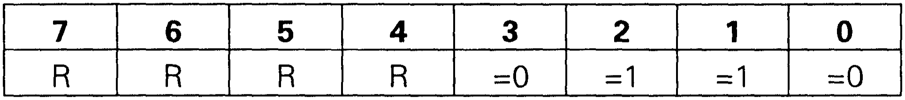

#### Extended Sequencer Register 9 (SR9)

| Access | Address |
| --- | --- |
| Read/Write | 3C5H, Index 09H |
| Power-On Default | 00H |

**Bits 6–0 — Reserved**

**Bit 7 — MMIO-ONLY — Memory-mapped I/O register access only**

0 = When MMIO is enabled, both programmed I/O and memory-mapped I/O register accesses are allowed
1 = When MMIO is enabled, only memory-mapped I/O register accesses are allowed

#### External Bus Request Control Register (SRA)

| Access | Address |
| --- | --- |
| Read/Write | 3C5H, Index 0AH |
| Power-On Default | 00H |

| Bits | Field |
| --- | --- |
| 7 | 2MCLK |
| 6 | P50 SEL |
| 5 | PD-NTRI |
| 4–0 | PVALUE |

**Bits 4–0 — PVALUE**

The integer equivalent of the binary value in this field is the number of 2-MCLK units a secondary memory controller is allowed to retain control of the memory bus before the Trio32/Trio64 drops its bus grant. See Section 7.5 for a detailed explanation.

**Bit 5 — PD-NTRI — PD[63:0] not tri-stated (PD[31:0] for Trio32)**

0 = PD[63:0] tri-stated
1 = PD[63:0] not tri-stated

The default value of 0 reduces power consumption. The pins are enabled for output only as needed. Note that output pads for PD[63:24] also latch the most recent output state.

**Bit 6 — P50 SEL — Pin 50 Function Select (Trio64 only)**

0 = If bit 2 of CR36 is set to 1 to indicate fast page memory, pin 50 outputs a signal equivalent to OE0
1 = If bit 2 of CR36 is set to 1 to indicate fast page memory, pin 50 outputs RAS1

This bit must be set to 1 for 4-MByte fast page mode memory configurations. This bit has no function if bit 2 of CR36 is cleared to 0 to indicate EDO memory.

**Bit 7 — 2MCLK — 2 MCLK CPU writes to memory**

0 = 3 MCLK memory writes
1 = 2 MCLK memory writes

Setting this bit to 1 improves performance for systems using an MCLK less than 57 MHz. For MCLK frequencies between 55 and 57 MHz, bit 7 of SR15 should also be set to 1 if linear addressing is being used.

#### Miscellaneous Extended Sequencer Register (SRB)

| Access | Address |
| --- | --- |
| Read/Write | 3C5H, Index 0BH |
| Power-On Default | 00H |

| Bits | Field |
| --- | --- |
| 7–4 | ALT COLOR MODE |
| 3 | 24 BPP (Trio32 only) |
| 2 | Reserved |
| 1 | VAFC VCLKI |
| 0 | DOT = VCLKI |

**Bit 0 — DOT = VCLKI — Dot clock = VCLKI**

0 = Use internal dot clock
1 = Use VCLKI input for all internal dot clock functions

This bit is used for S3 test purposes only.

**Bit 1 — VAFC VCLKI — Use VCLKI input with VAFC**

0 = Pixel data from pass-through feature connector latched by incoming VCLK
1 = Pixel data from VAFC latched by VCLKI input

**Bit 2 — Reserved**

**Bit 3 — 24 BPP (Trio32 only)**

0 = 24 bits/pixel (Mode 12) disabled
1 = 24 bits/pixel (Mode 12) enabled

In addition, bits 7-4 of this register must be programmed to 0111b and bits 7-4 of CR67 must be programmed to 0000b to enable 24 bits/pixel operation for the Trio32.

**Bits 7–4 — ALT COLOR MODE — Color Mode for feature connector input**

0000 = Mode 0: 8-bit color, 1 pixel/VCLK
0001 = Mode 8: 8-bit color, 2 pixels/VCLK
0011 = Mode 9: 15-bit color, 1 pixel/VCLK
0101 = Mode 10: 16-bit color, 1 pixel/VCLK
0111 = Mode 12: 640x480x24-bit color (packed), 1 pixel/3 DCLKs (Trio32 only)
1101 = Mode 13: 24-bit color, 1 pixel/VCLK

All other mode values are reserved. Setting mode 0001 (clock doubled mode) also requires that either bit 4 or bit 6 of SR15 be set to 1 and that bit 7 of SR18 be set to 1.

#### Extended Sequencer Register (EX_SR_D) (SRD)

| Access | Address |
| --- | --- |
| Read/Write | 3C5H, Index 0DH |
| Power-On Default | 00H |

This register provides feature connector control and also provides independent control of the HSYNC and VSYNC signals, therefore supporting the VESA DPMS (Display Power Management Control) standard.

| Bits | Field |
| --- | --- |
| 7–6 | VSY-CTL |
| 5–4 | HSY-CTL |
| 3–1 | Reserved |
| 0 | EN-FEAT |

**Bit 0 — EN-FEAT — Enable Feature Connector**

0 = ENFEAT (pin 151) is high. VCLK, HSYNC and VSYNC are outputs. Pin 155 (BGNT/BLANK) functions as BGNT.
1 = ENFEAT (pin 151) is low. Pin 155 (BGNT/BLANK) functions as BLANK. The direction of VCLK is controlled by EVCLK and the direction of BLANK, HSYNC and VSYNC is controlled by ESYNC. In both cases, assertion (low) specifies an input and a logic high specifies an output.

This bit is set to 1 to drive pin 151 with a logic 0. This enables the feature connector buffers required when the Trio64 memory configuration is 2 MBytes or larger. It also controls the ESYNC and EVCLK functions as explained above for both the Trio32 and Trio64.

**Bits 3–1 — Reserved**

**Bits 5–4 — HSY-CTL — HSYNC Control**

00 = Normal operation
01 = HSYNC = 0
10 = HSYNC = 1
11 = Reserved

**Bits 7–6 — VSY-CTL — VSYNC Control**

00 = Normal operation
01 = VSYNC = 0
10 = VSYNC = 1
11 = Reserved

#### CLK Value Low Register (SR10)

| Access | Address |
| --- | --- |
| Read/Write | 3C5H, Index 10H |
| Power-On Default | See description below. |

The power-on default value for this register in conjunction with the power-on default value for SR11 generate an MCLK value of 45 MHz. All other MCLK values must be specified by programming of SR10 and SR11. Loading of a new value is enabled by either bit 0 or bit 5 of SR15.

**Bits 4–0 — PLL N-DIVIDER VALUE**

These bits contain the binary equivalent of the integer (1-31) divider used to scale the input to the MCLK PLL. See Section 9 for a detailed explanation.

**Bits 6–5 — PLL R VALUE**

These bits contain the binary equivalent of the integer (1, 2, 4, 8) range value used to scale the output of the MCLK PLL. See Section 9 for a detailed explanation.

**Bit 7 — Reserved**

#### MCLK Value High Register (SR11)

| Access | Address |
| --- | --- |
| Read/Write | 3C5H, Index 11H |
| Power-On Default | See description below. |

The power-on default value for this register in conjunction with the power-on default value for SR10 generate an MCLK value of 45 MHz. All other MCLK values must be specified by programming of SR10 and SR11. Loading of a new value is enabled by either bit 0 or bit 5 of SR15.

| Bits | Field |
| --- | --- |
| 7 | Reserved |
| 6–0 | PLL M-DIVIDER VALUE |

**Bits 6–0 — PLL M-DIVIDER VALUE**

These bits contain the binary equivalent of the integer (1-127) divider used in the feedback loop of the MCLK PLL. See Section 9 for a detailed explanation.

**Bit 7 — Reserved**

#### DCLK Value Low Register (SR12)

| Access | Address |
| --- | --- |
| Read/Write | 3C5H, Index 12H |
| Power-On Default | See description below. |

The power-on default value for this register in conjunction with the power-on default value for SR13 generate a DCLK value of 25.175 MHz. The default value is automatically placed in this register when bits 3-2 of 3C2H are programmed to 00b. If bits 3-2 of CR2H are programmed to 01b, the appropriate PLL R and PLL N values for a 28.322 MHz DCLK will automatically be placed in this register. All other DCLK values must be specified by programming of SR12 and SR13. Loading of a new value is enabled by either bit 1 or bit 5 of SR15 and by setting bits 3-2 of 3C2H to 11b.

**Bits 4–0 — N-DIVIDER VALUE**

These bits contain the binary equivalent of the integer (1-31) divider used to scale the input to the DCLK PLL. See Section 9 for a detailed explanation.

**Bits 6–5 — PLL R VALUE**

These bits contain the binary equivalent of the integer (1, 2, 4, 8) range value used to scale the output of the DCLK PLL. See Section 9 for a detailed explanation.

**Bit 7 — Reserved**

#### DCLK Value High Register (SR13)

| Access | Address |
| --- | --- |
| Read/Write | 3C5H, Index 13H |
| Power-On Default | See description below. |

The power-on default value for this register in conjunction with the power-on default value for SR12 generate a DCLK value of 25.175 MHz. The default value is automatically placed in this register when bits 3-2 of 3C2H are programmed to 00b. If bits 3-2 of CR2H are programmed to 01b, the appropriate PLL M value for a 28.322 MHz DCLK will automatically be placed in this register. All other DCLK values must be specified by programming of SR12 and SR13. Loading of a new value is enabled by either bit 1 or bit 5 of SR15 and by setting bits 3-2 of 3C2H to 11b.

**Bits 6–0 — PLL M-DIVIDER VALUE**

These bits contain the binary equivalent of the integer (1-127) divider used in the feedback loop of the DCLK PLL. See Section 9 for a detailed explanation.

**Bit 7 — Reserved**

#### CLKSYN Control 1 Register (SR14)

| Access | Address |
| --- | --- |
| Read/Write | 3C5H, Index 14H |
| Power-On Default | 00H |

| Bits | Field |
| --- | --- |
| 7 | EXT DCLK |
| 6 | EXT MCLK |
| 5 | P146 SEL |
| 4 | CLR CNT |
| 3 | M TEST |
| 2 | EN CNT |
| 1 | MPLL PD |
| 0 | DPLL PD |

**Bit 0 — DPLL PD — Power down DCLK PLL**

0 = DCLK PLL powered
1 = DCLK PLL powered down

This bit is used for S3 test purposes only.

**Bit 1 — MPLL PD — Power down MCLK PLL**

0 = MCLK PLL powered
1 = MCLK PLL powered down

This bit is used for S3 test purposes only.

**Bit 2 — EN CNT — Enable clock synthesizer counters**

0 = Clock synthesizer counters disabled
1 = Clock synthesizer counters enabled

This bit is used for S3 test purposes only.

**Bit 3 — M TEST — MCLK Test**

0 = Test DCLK
1 = Test MCLK

This bit is used for S3 test purposes only.

**Bit 4 — CLR CNT — Clear clock synthesizer counters**

0 = No effect
1 = Clear the clock synthesizer counters

This bit is used for S3 test purposes only.

**Bit 5 — P146 SEL — Pin 146 function select**

0 = Pin 146 functions as STRD
1 = Pin 146 is tri-stated

Setting this bit to 1 allows pin 146 to act as an input. This is enabled by setting bit 6 of this register to 1.

**Bit 6 — EXT MCLK — External MCLK Select**

0 = MCLK provided by internal PLL
1 = MCLK is input on pin 146

An external MCLK is only used for S3 test purposes.

**Bit 7 — EXT DCLK — External DCLK Select**

0 = DCLK provided by internal PLL
1 = DCLK is input on pin 156. PD11 must also be strapped low on power-on reset.

An external DCLK is only used for S3 test purposes.

#### CLKSYN Control 2 Register (SR15)

| Access | Address |
| --- | --- |
| Read/Write | 3C5H, Index 15H |
| Power-On Default | 00H |

| Bits | Field |
| --- | --- |
| 7 | 2 CYC MWR |
| 6 | DCLK INV |
| 5 | CLK LOAD |
| 4 | DCLK/2 |
| 3 | VCLK OUT |
| 2 | MCLK OUT |
| 1 | DFRQ EN |
| 0 | MFRQ EN |

**Bit 0 — MFRQ EN — Enable new MCLK frequency load**

0 = Register bit clear
1 = Load new MCLK frequency

When new MCLK PLL values are programmed, this bit can be set to 1 to load these values in the PLL. The loading may be delayed a small but variable amount of time. This bit should be cleared to 0 after loading to prevent repeated loading. Alternately, use bit 5 of this register to produce an immediate load.

**Bit 1 — DFRQ EN — Enable new DCLK frequency load**

0 = Register bit clear
1 = Load new DCLK frequency

When new DCLK PLL values are programmed, this bit can be set to 1 to load these values in the PLL. Bits 3-2 of 3C2H must also be set to 11b if they are not already at this value. The loading may be delayed a small but variable amount of time. This bit should be programmed to 1 at power-up to allow loading of the VGA DCLK value and then left at this setting. Use bit 5 of this register to produce an immediate load.

**Bit 2 — MCLK OUT — Output internally generated MCLK**

0 = Pin 147 acts as the STWR strobe
1 = Pin 147 outputs the internally generated MCLK

This is used only for testing.

**Bit 3 — VCLK OUT — VCLK direction determined by EVCLK**

0 = Pin 148 outputs the internally generated VCLK regardless of the state of EVCLK
1 = VCLK direction is determined by the EVCLK signal

**Bit 4 — DCLK/2 — Divide DCLK by 2**

0 = DCLK unchanged
1 = Divide DCLK by 2

Either this bit or bit 6 of this register must be set to 1 for clock doubled RAMDAC operation (mode 0001).

**Bit 5 — CLK LOAD — MCLK, DCLK load**

0 = Clock loading is controlled by bits 0 and 1 of this register
1 = Load MCLK and DCLK PLL values immediately

To produce an immediate MCLK and DCLK load, program this bit to 1 and then to 0. Bits 3-2 of 3C2H must also then be programmed to 11b to load the DCLK values if they are not already programmed to this value. This register must never be left set to 1.

**Bit 6 — DCLK INV — Invert DCLK**

0 = DCLK unchanged
1 = Invert DCLK

Either this bit or bit 4 of this register must be set to 1 for clock doubled RAMDAC operation (mode 0001).

**Bit 7 — 2 CYC MWR — Enable 2 cycle memory write**

0 = 3 MCLK memory write
1 = 2 MCLK memory write

Setting this bit to 1 bypasses the VGA logic for linear addressing when bit 7 of SRA is set to 1. This can allow 2 MCLK operation for MCLK frequencies between 55 and 57 MHz.

#### CLKSYN Test High Register (SR16)

| Access | Address |
| --- | --- |
| Read/Write | 3C5H, Index 16H |
| Power-On Default | 00H |

This register is reserved for S3 testing of the internal clock synthesizer.

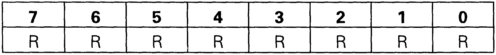

#### CLKSYN Test Low Register (SR17)

| Access | Address |
| --- | --- |
| Read Only | 3C5H, Index 17H |
| Power-On Default | 00H |

This register is reserved for S3 testing of the internal clock synthesizer.

#### RAMDAC/CLKSYN Control Register (SR18)

| Access | Address |
| --- | --- |
| Read/Write | 3C5H, Index 18H |
| Power-On Default | 00H |

| Bits | Field |
| --- | --- |
| 7 | CLKx2 |
| 6 | LUT WR |
| 5 | DAC PD |
| 4 | TST BLUE |
| 3 | TST GRN |
| 2 | TST RED |
| 1 | TST RST |
| 0 | TST EN |

**Bit 0 — TST EN — Enable test counter**

0 = RAMDAC test counter disabled
1 = RAMDAC test counter enabled

This bit is used for S3 test purposes only.

**Bit 1 — TST RST — Reset test counter**

0 = No effect
1 = Reset the RAMDAC test counter

This bit is used for S3 test purposes only.

**Bit 2 — TST RED — Test red data**

0 = No effect
1 = Place red data on internal data bus

This bit is used for S3 test purposes only.

**Bit 3 — TST GRN — Test green data**

0 = No effect
1 = Place green data on internal data bus

This bit is used for S3 test purposes only.

**Bit 4 — TST BLUE — Test blue data**

0 = No effect
1 = Place blue data on internal data bus

This bit is used for S3 test purposes only.

**Bit 5 — DAC PD — RAMDAC power-down**

0 = RAMDAC powered
1 = RAMDAC powered-down

When the RAMDAC is powered down, the RAMDAC memory retains its data.

**Bit 6 — LUT WR — LUT write cycle control**

0 = 2 DCLK LUT write cycle (default)
1 = 1 DCLK LUT write cycle

**Bit 7 — CLKx2 — Enable clock doubled mode**

0 = RAMDAC clock doubled mode (0001) disabled
1 = RAMDAC clock doubled mode (0001) enabled

This bit must be set to 1 when mode 0001 is specified in bits 7-4 of CR67 or SRC. Either bit 4 or bit 6 of SR15 must also be set to 1.

### 14.3 CRT Controller Registers

The CRT controller registers are located at two locations in I/O address space. These registers are accessed by first writing to the index register of the CRT controller and then accessing the data register. The index register is located at I/O address 3?4H and the CRT Controller Data register is at 3?5H. Which address is used (3BX or 3DX) depends on bit 0 of the Miscellaneous Output register at 3C2H.

#### CRT Controller Index Register (CRTC_ADR) (CRX)

| Access | Address |
| --- | --- |
| Read/Write | 3?4H |
| Power-On Default | 00H |

This register is loaded with a binary value that indexes the CRT controller register where data is to be accessed. This value is referred to as the "Index Number" of the CR register (CR00-18). This register is also used as an index to the S3 VGA registers, the System Control Registers and the System Extension registers.

| Bits | Field |
| --- | --- |
| 7–0 | CRTC ADDRESS |

**Bits 7–0 — CRTC ADDRESS — CRTC Register Index**

A binary value indexing the register where data is to be accessed.

#### CRT Controller Data Register (CRTC_DATA) (CRT)

| Access | Address |
| --- | --- |
| Read/Write | 3?5H |
| Power-On Default | Undefined |

This register is the data port for the CRT controller register indexed by the CRT Controller Address register.

**Bits 7–0 — CRTC DATA — CRTC Register Data**

Data to the CRT controller register indexed by the CRT controller address index.

#### Horizontal Total Register (H_TOTAL) (CR0)

| Access | Address |
| --- | --- |
| Read/Write | 3?5H, Index 00H |
| Power-On Default | Undefined |

This register defines the number of character clocks from HSYNC going active to the next HSYNC going active. In other words, it is the total time required for both the displayed and non-displayed portions of a singe scan line. Bit 8 of this value is bit 0 of CR5D.

| Bits | Field |
| --- | --- |
| 7–0 | HORIZONTAL TOTAL |

**Bits 7–0 — HORIZONTAL TOTAL**

9-bit Value = (number of character clocks in one scan line) - 5. This register contains the least significant 8 bits of this value.

#### Horizontal Display End Register (H_D_END) (CR1)

| Access | Address |
| --- | --- |
| Read/Write | 3?5H, Index 01H |
| Power-On Default | Undefined |

This register defines the number of character clocks for one line of the active display. Bit 8 of this value is bit 1 of CR5D.

| Bits | Field |
| --- | --- |
| 7–0 | HORIZONTAL DISPLAY END |

**Bits 7–0 — HORIZONTAL DISPLAY END**

9-bit Value = (number of character clocks of active display) - 1. This register contains the least significant 8 bits of this value.

#### Start Horizontal Blank Register (S_H_BLNK) (CR2)

| Access | Address |
| --- | --- |
| Read/Write | 3?5H, Index 02H |
| Power-On Default | Undefined |

This register specifies the value of the character clock counter at which the BLANK signal is asserted. Bit 8 of this value is bit 2 of CR5D.

| Bits | Field |
| --- | --- |
| 7–0 | START HORIZONTAL BLANK |

**Bits 7–0 — START HORIZONTAL BLANK**

9-bit Value = character clock value at which horizontal blanking begins. This register contains the least significant 8 bits of this value.

#### End Horizontal Blank Register (E_H_BLNK) (CR3)

| Access | Address |
| --- | --- |
| Read/Write | 3?5H, Index 03H |
| Power-On Default | Undefined |

This register determines the pulse width of the BLANK signal and the display enable skew.

| Bits | Field |
| --- | --- |
| 7 | Reserved |
| 6–5 | DSP-SKW |
| 4–0 | END HORIZONTAL BLANK |

**Bits 4–0 — END HORIZONTAL BLANK**

6-bit Value = least significant 6 bits of the character clock counter value at which time horizontal blanking ends. To obtain this value, add the desired BLANK pulse width in character clocks to the Start Horizontal Blank value, which is also in character clocks. The 5 least significant bits of this sum are programmed into this field. The sixth bit is programmed into bit 7 of CR5. This allows a maximum pulse width of 63 character clocks. This pulse width can be extended by 64 DCLKs via bit 3 of CR5D.

**Bits 6–5 — DSP-SKW — Display Skew**

These two bits determine the amount of display enable skew. Display enable skew control provides sufficient time for the CRT Controller to access the display buffer to obtain a character and attribute code, access the character generator font, and then go through the Horizontal Pixel Panning register in the Attribute Controller. Each access requires the display enable signal to be skewed one character clock unit so the video output is synchronous with the HSYNC and VSYNC Signals. The bit values and amount of skew are shown in the following table:

00 = Zero character clock skew
01 = One character clock skew
10 = Two character clock skew
11 = Three character clock skew

**Bit 7 — Reserved**

#### Start Horizontal Sync Position Register (S_H_SY_P) (CR4)

| Access | Address |
| --- | --- |
| Read/Write | 3?5H, Index 04H |
| Power-On Default | Undefined |

This register is used to adjust the screen center horizontally and to specify the character position at which HSYNC becomes active. Bit 8 of this value is bit 4 of CR5D.

**Bits 7–0 — START HORIZONTAL SYNC POSITION**

9-bit Value = character clock counter value at which HSYNC becomes active. This register contains the least significant 8 bits of this value.

#### End Horizontal Sync Position Register (E_H_SY_P) (CR5)

| Access | Address |
| --- | --- |
| Read/Write | 3?5H, Index 05H |
| Power-On Default | Undefined |

This register specifies when the HSYNC signal becomes inactive and the horizontal skew. The HSYNC pulse defined by this register can be extended by 32 DCLKs via bit 5 of CR5D.

| Bits | Field |
| --- | --- |
| 7 | EHB 5 |
| 6–5 | HOR-SKW |
| 4–0 | END HORIZONTAL SYNC POS |

**Bits 4–0 — END HORIZONTAL SYNC POS**

5-bit Value = 5 least significant bits of the character clock counter value at which time HSYNC becomes inactive. To obtain this value, add the desired HSYNC pulse width in character clocks to the Start Horizontal Sync Position value, also in character clocks. The 5 least significant bits of this sum are programmed into this field. This allows a maximum HSYNC pulse width of 31 character clocks. This pulse width can be extended by 32 DCLKs via bit 5 of CR5D.

**Bits 6–5 — HOR-SKW — Horizontal Skew**

These bits control the skew of the HSYNC signal. A binary 00 equals no HSYNC delay. For some modes, it is necessary to provide an HSYNC signal that takes up the entire blanking interval. Some internal timings are generated by the falling edge of the HSYNC signal. To guarantee the signals are latched properly, HSYNC is asserted before the end of the display enable signal, and then skewed several character clock times to provide the proper screen centering.

00 = Zero character clock skew
01 = One character clock skew
10 = Two character clock skew
11 = Three character clock skew

**Bit 7 — EHB 5 — End Horizontal Blanking bit 5**

#### Vertical Total Register (V_TOTAL) (CR6)

| Access | Address |
| --- | --- |
| Read/Write | 3?5H, Index 06H |
| Power-On Default | Undefined |

This register specifies the number of scan lines from one VSYNC active to the next VSYNC active. The scan line counter resets to 0 at this point. Bit 8 is bit 0 of CR7. Bit 9 is bit 5 of CR7. Bit 10 is bit 0 of CR5E.

**Bits 7–0 — VERTICAL TOTAL**

11-bit Value = (number of scan lines from VSYNC active to the next VSYNC active) - 2. This register contains the least significant 8 bits of this value.

#### CRTC Overflow Register (OVFL_REG) (CR7)

| Access | Address |
| --- | --- |
| Read/Write | 3?5H, Index 07H |
| Power-On Default | Undefined |

| Bits | Field |
| --- | --- |
| 7 | Bit 9 of the Vertical Retrace Start register (CR10) |
| 6 | Bit 9 of the Vertical Display End register (CR12) |
| 5 | Bit 9 of the Vertical Total register (CR6) |
| 4 | Bit 8 of the Line Compare register (CR18) |
| 3 | Bit 8 of the Start Vertical Blank register (CR15) |
| 2 | Bit 8 of the Vertical Retrace Start register (CR10) |
| 1 | Bit 8 of the Vertical Display End register (CR12) |
| 0 | Bit 8 of the Vertical Total register (CR6) |

This register provides extension bits for fields in other registers.

**Bit 0 — Bit 8 of the Vertical Total register (CR6)**

**Bit 1 — Bit 8 of the Vertical Display End register (CR12)**

**Bit 2 — Bit 8 of the Vertical Retrace Start register (CR10)**

**Bit 3 — Bit 8 of the Start Vertical Blank register (CR15)**

**Bit 4 — Bit 8 of the Line Compare register (CR18)**

**Bit 5 — Bit 9 of the Vertical Total register (CR6)**

**Bit 6 — Bit 9 of the Vertical Display End register (CR12)**

**Bit 7 — Bit 9 of the Vertical Retrace Start register (CR10)**

#### Preset Row Scan Register (P_R_SCAN) (CR8)

| Access | Address |
| --- | --- |
| Read/Write | 3?5H, Index 08H |
| Power-On Default | Undefined |

This register is used for the pixel scrolling and panning, and text formatting and vertical scrolling.

| Bits | Field |
| --- | --- |
| 7 | Reserved = 0 |
| 6–5 | BYTE-PAN |
| 4–0 | PRE-SET ROW SCAN COUNT |

**Bits 4–0 — PRE-SET ROW SCAN COUNT**

Value = starting row within a character cell for the first character row displayed after vertical retrace. This allows a partial character row to be displayed at the top of the display and is used for scrolling.

**Bits 6–5 — BYTE-PAN**

Value = number of bytes to pan. The number of pixels to pan is specified in AR13.

**Bit 7 — Reserved = 0**

#### Maximum Scan Line Register (MAX_S_LN) (CR9)

| Access | Address |
| --- | --- |
| Read/Write | 3?5H, Index 09H |
| Power-On Default | Undefined |

This register specifies the number of scan lines per character row and provides one scanning control bit and two overflow bits.

| Bits | Field |
| --- | --- |
| 7 | DBL SCN |
| 6 | LCM 9 |
| 5 | SVB 9 |
| 4–0 | MAX SCAN LINE |

**Bits 4–0 — MAX SCAN LINE**

Value = (number of scan lines per character row) - 1

**Bit 5 — SVB 9 — Bit 9 of the Start Vertical Blank Register (CR15)**

**Bit 6 — LCM 9 — Bit 9 of the Line Compare Register (CR18)**

**Bit 7 — DBL SCN**

0 = Normal operation
1 = Enables double scanning operation. Each line is displayed twice by repeating the row scan counter and video memory address. Vertical parameters in the CRT controller are not affected.

#### Cursor Start Scan Line Register (CSSL) (CRA)

| Access | Address |
| --- | --- |
| Read/Write | 3?5H, Index 0AH |
| Power-On Default | Undefined |

The cursor start register defines the row scan of a character line where the cursor begins.

| Bits | Field |
| --- | --- |
| 7–6 | Reserved = 0 |
| 5 | CSR OFF |
| 4–0 | CSR |

**Bits 4–0 — CSR — Cursor Start Scan Line**

Value = (starting cursor row within the character cell) - 1. When the cursor start register is programmed with a value greater than the cursor end register, no cursor is generated.

**Bit 5 — CSR OFF**

0 = Turns on the text cursor
1 = Turns off the text cursor

**Bits 7–6 — Reserved = 0**

#### Cursor End Scan Line Register (CESL) (CRB)

| Access | Address |
| --- | --- |
| Read/Write | 3?5H, Index 0BH |
| Power-On Default | Undefined |

This register defines the row scan of a character line where the cursor ends.

| Bits | Field |
| --- | --- |
| 7 | Reserved = 0 |
| 6–5 | CSR-SKW |
| 4–0 | CURSOR END SCAN LINE |

**Bits 4–0 — CURSOR END SCAN LINE**

Value = ending scan line number within the character cell for the text cursor. If the value of the cursor start scan line is greater than the value of cursor end line, then no cursor is generated.

**Bits 6–5 — CSR-SKW — Cursor Skew**

These bits control the delay skew of the cursor signal. Cursor skew delays the text cursor by the selected number of clocks. For example, a skew of 1 moves the cursor right one character position on the screen.

00 = Zero character clock skew
01 = One character clock skew
10 = Two character clock skew
11 = Three character clock skew

**Bit 7 — Reserved = 0**

#### Start Address High Register (STA(H)) (CRC)

| Access | Address |
| --- | --- |
| Read/Write | 3?5H, Index 0CH |
| Power-On Default | Undefined |

20-bit Value = the first address after a vertical retrace at which the display on the screen begins on each screen refresh. These along with bits 3-0 of CR69 are the high order start address bits.

#### Start Address Low Register (STA(L)) (CRD)

| Access | Address |
| --- | --- |
| Read/Write | 3?5H, Index 0DH |
| Power-On Default | Undefined |

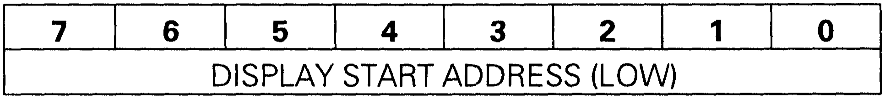

Start address (low) contains the 8 low order bits of the address.

#### Cursor Location Address High Register (CLA(H)) (CRE)

| Access | Address |
| --- | --- |
| Read/Write | 3?5H, Index 0EH |
| Power-On Default | Undefined |

20-bit Value = the cursor location address of the video memory where the text cursor is active. This register along with bits 3-0 of CR69 are the high order bits of the address.

#### Cursor Location Address Low Register (CLA(L)) (CRF)

| Access | Address |
| --- | --- |
| Read/Write | 3?5H, Index 0FH |
| Power-On Default | Undefined |

Cursor location address (low) contains the 8 low order bits of the address.

#### Vertical Retrace Start Register (VRS) (CR10)

| Access | Address |
| --- | --- |
| Read/Write | 3?5H, Index 10H |
| Power-On Default | Undefined |

| Bits | Field |
| --- | --- |
| 7–0 | VERTICAL RETRACE START |

**Bits 7–0 — VERTICAL RETRACE START**

11-bit Value = number of scan lines at which VSYNC becomes active. These are the low-order 8 bits. Bit 8 is bit 2 of CR7. Bit 9 is bit 7 of CR7. Bit 10 is bit 4 of CR5E.

#### Vertical Retrace End Register (VRE) (CR11)

| Access | Address |
| --- | --- |
| Read/Write | 3?5H, Index 11H |
| Power-On Default | 0xH |

This register controls the vertical interrupt and CR0–7.

| Bits | Field |
| --- | --- |
| 7 | LOCK R0-7 |
| 6 | REF 3/5 |
| 5 | DIS VINT |
| 4 | CLR VINT |
| 3–0 | VERTICAL RETRACE END |

**Bits 3–0 — VERTICAL RETRACE END**

Value = least significant 4 bits of the scan line counter value at which VSYNC goes inactive. To obtain this value, add the desired VSYNC pulse width in scan line units to the CR10 value, also in scan line units. The 4 least significant bits of this sum are programmed into this field. This allows a maximum VSYNC pulse width of 15 scan line units.

**Bit 4 — CLR VINT — Clear Vertical Retrace Interrupt**

0 = Vertical retrace interrupt cleared
1 = The flip-flop is able to catch the next interrupt request

At the end of active vertical display time, a flip-flop is set for a vertical interrupt. The output of this flip-flop goes to the system interrupt controller. The CPU has to reset this flip-flop by writing a logical 0 to this bit while in the interrupt process, then set the bit to 1 to allow the flip-flop to catch the next interrupt request. Do not change the other bits in this register. This bit is cleared to 0 by the BIOS during a mode set, a reset, or power-on.

**Bit 5 — DIS VINT — Disable Vertical Interrupt**

0 = Vertical retrace interrupt enabled
1 = Vertical interrupt disabled. This bit is cleared to 0 by the BIOS during a mode set, a reset, or power-on

**Bit 6 — REF 3/5 — Refresh Cycle Select**

0 = Three DRAM refresh cycles generated per horizontal line
1 = Five DRAM refresh cycles generated per horizontal line. Selecting five refresh cycles allows use of the VGA chip with slow sweep rate displays (15.75 KHz).

This bit is cleared to 0 by the BIOS during a mode set, a reset, or power-on. This setting can be overridden via bits 1-0 of CR3A

**Bit 7 — LOCK R0-7 — Lock Writes to CRT Controller Registers**

0 = Writing to all CRT Controller registers enabled
1 = Writing to all bits of the CRT Controller registers CR0–CR7 except bit 4 of CR7 (LCM8) disabled. This bit is set to 1 by the BIOS during a mode set, a reset or power-on

#### Vertical Display End Register (VDE) (CR12)

| Access | Address |
| --- | --- |
| Read/Write | 3?5H, Index 12H |
| Power-On Default | Undefined |

The vertical display enable end register defines 8 bits of the 10-bit address of the scan line where the display on the screen ends. Bit 8 and Bit 9 are bits 1 and 6 of CR7. Bit 10 is bit 1 of CR5E.

| Bits | Field |
| --- | --- |
| 7–0 | VERTICAL DISPLAY END |

**Bits 7–0 — VERTICAL DISPLAY END**

11-bit Value = (number of scan lines of active display) - 1. This register contains the least significant 8 bits of this value.

#### Offset Register (SCREEN-OFFSET) (CR13)

| Access | Address |
| --- | --- |
| Read/Write | 3?5H, Index 13H |
| Power-On Default | Undefined |

This register specifies the logical line width of the screen and is sometimes called the screen pitch. The starting memory address for the next display row is larger than the current row by two, four or eight times this amount. Bits 5-4 of CR51 are extension bits 9–8 of this register. If these bits are 00b, bit 2 of CR43 is extension bit 8 of this register.

| Bits | Field |
| --- | --- |
| 7–0 | LOGICAL SCREEN WIDTH |

**Bits 7–0 — LOGICAL SCREEN WIDTH**

10-bit Value = quantity that is multiplied by 2 (word mode), 4 (doubleword mode) or 8 (quadword mode) to specify the difference between the starting byte addresses of two consecutive scan lines. This register contains the least significant 8 bits of this value. The addressing mode is specified by bit 6 of CR14 and bit 3 of CR17. Setting bit 3 of CR31 to 1 forces doubleword mode.

#### Underline Location Register (ULL) (CR14)

| Access | Address |
| --- | --- |
| Read/Write | 3?5H, Index 14H |
| Power-On Default | Undefined |

This register specifies the horizontal row scan position of underline and display buffer addressing modes.

| Bits | Field |
| --- | --- |
| 7 | Reserved = 0 |
| 6 | DBLWD MODE |
| 5 | CNT BY4 |
| 4–0 | UNDER LINE LOCATION |

**Bits 4–0 — UNDER LINE LOCATION**

5-bit Value = (scan line count of a character row on which an underline occurs) -1

**Bit 5 — CNT BY4 — Select Count by 4 Mode**

0 = The memory address counter depends on bit 3 of CR17 (count by 2)
1 = The memory address counter is incremented every four character clocks

The CNT BY4 bit is used when double word addresses are used.

**Bit 6 — DBLWD MODE — Select Doubleword Mode**

0 = The memory addresses are byte or word addresses
1 = The memory addresses are doubleword addresses

**Bit 7 — Reserved = 0**

#### Start Vertical Blank Register (SVB) (CR15)

| Access | Address |
| --- | --- |
| Read/Write | 3?5H, Index 15H |
| Power-On Default | Undefined |

This register specifies the scan line at which the vertical blanking period begins. Bit 8 is bit 3 of CR7. Bit 9 is bit 5 of CR9. Bit 10 is bit 2 of CR5E.

| Bits | Field |
| --- | --- |
| 7–0 | START VERTICAL BLANK |

**Bits 7–0 — START VERTICAL BLANK**

11-bit value = (scan line count at which BLANK becomes active) - 1. This register contains the least significant 8 bits of this value.

#### End Vertical Blank Register (EVB) (CR16)

| Access | Address |
| --- | --- |
| Read/Write | 3?5H, Index 16H |
| Power-On Default | Undefined |

This register specifies the scan line count value when the vertical blank period ends.

| Bits | Field |
| --- | --- |
| 7–0 | END VERTICAL BLANK |

**Bits 7–0 — END VERTICAL BLANK**

Value = least significant 8 bits of the scan line counter value at which vertical blanking ends. To obtain this value, add the desired width of the vertical blanking pulse in scan lines to [(value in the Start Vertical Blank register)-1], also in scan lines. The 8 least significant bits of this sum are programmed into this field. This allows a maximum vertical blanking pulse of 63 scan line units.

#### CRTC Mode Control Register (CRT_MD) (CR17)

| Access | Address |
| --- | --- |
| Read/Write | 3?5H, Index 17H |
| Power-On Default | 00H |

This register is a multifunction control register, with each bit defining a different specification.

| Bits | Field |
| --- | --- |
| 7 | RST |
| 6 | BYTE MODE |
| 5 | ADW 16K |
| 4 | Reserved = 0 |
| 3 | CNT BY2 |
| 2 | VT X2 |
| 1 | 4BK HGC |
| 0 | 2BK CGA |

**Bit 0 — 2BK CGA — Select Bank 2 Mode for CGA Emulation**

0 = Row scan counter bit 0 is substituted for memory address bit 13 during active display time
1 = Memory address bit 13 appears on the memory address output bit 13 signal of the CRT controller

This bit allows memory mapping compatibility with the IBM CGA graphics mode.

**Bit 1 — 4BK HGC — Select Bank 4 Mode for HGA Emulation**

0 = Row scan counter bit 1 is substituted for memory address bit 14 during active display time
1 = Memory address bit 14 appears on the memory address output bit 14 signal of the CRT controller

The combination of this bit and bit 0 of this register allows compatibility with Hercules HGC graphics memory mapping.

**Bit 2 — VT X2 — Select Vertical Total Double Mode**

0 = Horizontal retrace clock selected
1 = Horizontal retrace clock divided by two selected

This bit selects horizontal retrace clock or horizontal retrace clock divided by two as the clock that controls the vertical timing counter. If the vertical retrace counter is clocked with the horizontal retrace clock divided by 2, then the vertical resolution is double.

**Bit 3 — CNT BY2 — Select Word Mode**

0 = Memory address counter is clocked with the character clock input, and byte mode addressing for the video memory is selected
1 = Memory address counter is clocked by the character clock input divided by 2, and word mode addressing for the video memory is selected

**Bit 4 — Reserved = 0**

**Bit 5 — ADW 16K — Address Wrap**

0 = When word mode is selected by bit 6 of this register, memory address counter bit 13 appears on the memory address output bit 0 signal of the CRT controller and the video memory address wraps around at 16 KBytes
1 = When word mode is selected by bit 6 of this register, memory address counter bit 15 appears on the memory address output bit 0 signal of the CRT controller

This bit is useful in implementing IBM CGA mode.

**Bit 6 — BYTE MODE — Select Byte Addressing Mode**

0 = Word mode shifts all memory address counter bits down one bit, and the most significant bit of the counter appears on the least significant bit of the memory address output
1 = Byte address mode

**Bit 7 — RST — Hardware Reset**

0 = Vertical and horizontal retrace pulses always inactive
1 = Vertical and horizontal retrace pulses enabled

This bit does not reset any other registers or outputs.

#### Line Compare Register (LCM) (CR18)

| Access | Address |
| --- | --- |
| Read/Write | 3?5H, Index 18H |
| Power-On Default | Undefined |

This register is used to implement a split screen function. When the scan line counter value is equal to the content of this register, the memory address counter is cleared to 0. The linear address counter then sequentially addresses the display buffer starting at address 0. Each subsequent row address is determined by the addition of the Offset (CR13) register content. Bit 8 is bit 4 of CR7. Bit 9 is bit 6 of CR9. Bit 10 is bit 6 of CR5E.

| Bits | Field |
| --- | --- |
| 7–0 | LINE COMPARE POSITION |

**Bits 7–0 — LINE COMPARE POSITION**

11-bit Value = number of scan lines at which the screen is split into screen A and screen B. This register contains the least significant 8 bits of this value.

#### CPU Latch Data Register (GCCL) (CR22)

| Access | Address |
| --- | --- |
| Read Only | 3?5H, Index 22H |
| Power-On Default | Undefined |

This register is used to read the CPU latch in the Graphics Controller.

**Bits 7–0 — GRAPHICS CONTROLLER CPU LATCH — N**

Bits 1-0 of GR4 select the latch number N (3-0) of the CPU Latch.

#### Attribute Index Register (ATC_F/I) (CR24)

| Access | Address |
| --- | --- |
| Read Only | 3?5H, Index 24H, 26H |
| Power-On Default | Undefined |

This register is used to read the value of the Attribute Controller Index register and its associated internal address flip-flop (AFF). It can be read at either index 24H or 26H.

**Bits 4–0 — ATTRIBUTE CONTROLLER INDEX**

This value is the Attribute Controller Index Data at I/O port 3C0H.

**Bit 5 — ENV — Enable Video Display**

This is the setting of bit 5 of 3C0H, indicating video display enabled status (1 = enabled).

**Bit 6 — Reserved = 0**

**Bit 7 — AFF**

Inverted Internal Address flip-flop

### 14.4 GRAPHICS CONTROLLER REGISTERS

The graphics controller registers are located at a two byte I/O address space. These registers are accessed by first writing an index to the Graphics Address register (at 3CEH) and then accessing the Data register (at 3CFH).

#### Graphics Controller Index Register (GRC_ADR)

| Access | Address |
| --- | --- |
| Read/Write | 3CEH |
| Power-On Default | Undefined |

This register is loaded with a binary index value that determines which graphics controller register will be accessed. This value is referred to as the "Index Number" of the GR register (GR0–6).

**Bits 3–0 — GR CONT ADDRESS — Graphics Controller Register Index**

A binary value indexing the register where data is to be accessed.

**Bits 7–4 — Reserved = 0**

#### Graphics Controller Data Register (GRC_DATA)

| Access | Address |
| --- | --- |
| Read/Write | 3CFH |
| Power-On Default | Undefined |

This register is the data port for the graphics controller register indexed by the Graphics Controller Index register.

| Bits | Field |
| --- | --- |
| 7–0 | GRAPHICS CONTROLLER DATA |

**Bits 7–0 — GRAPHICS CONTROLLER DATA**

Data to the Graphics Controller register indexed by the graphics controller address.

#### Set/Reset Data Register (SET/RST_DT) (GR0)

| Access | Address |
| --- | --- |
| Read/Write | 3CFH, Index 00H |
| Power-On Default | Undefined |

This register represents the value written to all 8 bits of the respective memory plane when the CPU executes a memory write in write modes 0 and 3.

**Bits 3–0 — SET/RESET DATA**

These bits become the color value for CPU memory write operations. In write mode 0, the set/reset data can be enabled on the corresponding bit of the Enable Set/Reset Data register. In write mode 3, there is no effect on the Enable Set/Reset Data register.

**Bits 7–4 — Reserved = 0**

#### Enable Set/Reset Data Register (EN_S/R_DT) (GR1)

| Access | Address |
| --- | --- |
| Read/Write | 3CFH, Index 01H |
| Power-On Default | Undefined |

These bits enable the set/reset data, and affect write mode 0.

**Bits 3–0 — ENB SET/RST DATA**

When each bit is a logical 1, the respective memory plane is written with the value of the Set/Reset Data register. A logical 0 disables the set/reset data in a plane, and that plane is written with the value of CPU write data.

**Bits 7–4 — Reserved = 0**

#### Color Compare Register (COLOR-CMP) (GR2)

| Access | Address |
| --- | --- |
| Read/Write | 3CFH, Index 02H |
| Power-On Default | Undefined |

These bits represent a 4-bit color value to be compared. In read mode 1, the CPU executes a memory read, the read data is compared with this value and returns the results. This register works in conjunction with the Color Don't Care register.

**Bits 3–0 — COLOR COMPARE DATA**

This value becomes the reference color used to compare each pixel. Each of the 8-bit positions of the read data are compared across four planes and a logical 1 is returned in each bit position for which the colors match.

**Bits 7–4 — Reserved = 0**

#### Raster Operation/Rotate Count Register (WT_ROP/RTC) (GR3)

| Access | Address |
| --- | --- |
| Read/Write | 3CFH, Index 03H |
| Power-On Default | Undefined |

This register selects a raster operation function and indicates the number of bits the CPU data will be rotated (right) on the video memory write operation.

| Bits | Field |
| --- | --- |
| 7–5 | Reserved = 0 |
| 4–3 | RST-OP |
| 2–0 | ROTATE-COUNT |

**Bits 2–0 — ROTATE-COUNT**

These bits define a binary encoded value of the number of positions to right-rotate data during a CPU memory write. To write non-rotated data, the CPU must preset a count of 0.

**Bits 4–3 — RST-OP — Select Raster Operation**

The data written to memory can operate logically with the data already in the processor latches. This function is not available in write mode 1. The logical functions are defined as follows:

00 = No operation
01 = Logical AND with latched data
10 = Logical OR with latched data
11 = Logical XOR with latched data

The logical function specified by this register is applied to data being written to memory while in modes 0, 2 and 3.

**Bits 7–5 — Reserved = 0**

#### Read Plane Select Register (RD_PL_SL) (GR4)

| Access | Address |
| --- | --- |
| Read/Write | 3CFH, Index 04H |
| Power-On Default | Undefined |

The contents of this register represent the memory plane from which the CPU reads data in read mode 0. This register has no effect on the color compare read mode (read mode 1). In odd/even mode, bit 0 is ignored. Four memory planes are selected as follows:

**Bits 1–0 — RD-PL-SL — Read Plane Select**

The memory plane is selected as follows:

00 = Plane 0
01 = Plane 1
10 = Plane 2
11 = Plane 3

**Bits 7–2 — Reserved = 0**

#### Graphics Controller Mode Register (GRP_MODE) (GR5)

| Access | Address |
| --- | --- |
| Read/Write | 3CFH, Index 05H |
| Power-On Default | Undefined |

| Bits | Field |
| --- | --- |
| 7 | Reserved = 0 |
| 6 | SHF-MODE |
| 5 | SHF-MODE |
| 4 | O/E MAP |
| 3 | RD CMP |
| 2 | Reserved = 0 |
| 1–0 | WRT-MD |

This register controls the mode of the Graphics Controller as follows:

**Bits 1–0 — WRT-MD — Select Write Mode**

These bits select the CPU write mode into video memory. The function of each mode is defined as follows:

00 = Write Mode 0. Each of four video memory planes is written with the CPU data rotated by the number of counts in the rotate register. If the Set/Reset register is enabled for any of four planes, the corresponding plane is written with the data stored in the set/reset register. Raster operations and bit mask registers are effective

01 = Write Mode 1. Each of four video memory planes is written with the data in the processor latches. These latches are loaded during previous CPU read operations. Raster operation, rotate count, set/reset data, enable set/reset data and bit mask registers are not effective

10 = Write Mode 2. Memory planes 0-3 are filled with 8 bits of the value of CPU write data bits 0-3, respectively. For example, if write data bit 0 is a 1, eight 1s are written to memory plane 0. The data on the CPU data bus is treated as the color value. The Bit Mask register is effective as the Mask register. A logical 1 in the Bit Mask register sets the corresponding pixel in the addressed byte to the color specified on the data bus. A logical 0 in the Bit Mask register sets the corresponding pixel in the addressed byte to the corresponding pixel in the processor latches. The Set/Reset, Enable Set/Reset and Rotate Count registers are ignored

11 = Write Mode 3. Each of four video memory planes is written with 8 bits of the color value contained in the set/reset register for that plane. The Enable Set/Reset register is not effective. Rotated CPU write data is ANDed with the bit mask register to form an 8-bit value that performs the same function as the Bit Mask register in write modes 0 and 2. This write mode can be used to fill an area with a single color and pattern

**Bit 2 — Reserved = 0**

**Bit 3 — RD CMP — Enable Read Compare**

0 = The CPU reads data from the video memory planes. The plane is selected by the Read Plane Select register. This is called read mode 0
1 = The CPU reads the results of the logical comparison between the data in four video memory planes selected by the contents of the Color Don't Care register and the contents of the Color Compare register. The result is a 1 for a match and 0 for a mismatch on each pixel. This is called read mode 1

**Bit 4 — O/E MAP — Select Odd/Even Addressing**

0 = Standard addressing.
1 = Odd/even addressing mode selected. Even CPU addresses access plane 0 and 2, while odd CPU addresses access plane 1 and 3. This option is useful for emulating the CGA compatible mode. The value of this bit should be the inverted value programmed in bit 2 of the Sequencer Memory Mode register (SR4). This bit affects reading of display memory by the CPU

**Bit 5 — SHF-MODE — Select Odd/Even Shift Mode**

0 = Normal shift mode
1 = The video shift registers in the graphics section are directed to format the serial data stream with even-numbered bits from both planes on the even-numbered planes and odd-numbered bits from both planes on the odd planes

**Bit 6 — SHF-MODE — Select 256 Color Shift Mode**

0 = Bit 5 in this register controls operation of the video shift registers
1 = The shift registers are loaded in a manner that supports the 256 color mode

**Bit 7 — Reserved = 0**

#### Memory Map Mode Control Register (MISC_GM) (GR6)

| Access | Address |
| --- | --- |
| Read/Write | 3CFH, Index 06H |
| Power-On Default | Undefined |

This register controls the video memory addressing.

| Bits | Field |
| --- | --- |
| 7–4 | Reserved = 0 |
| 3–2 | MEM-MAP |
| 1 | CHN O/E |
| 0 | TXT/GR |

**Bit 0 — TXT/GR — Select Text/Graphics Mode**

0 = Text mode display addressing selected
1 = Graphics mode display addressing selected. When set to graphics mode, the character generator address latches are disabled

**Bit 1 — CHN O/E — Chain Odd/Even Planes**

0 = A0 address bit unchanged
1 = CPU address bit A0 is replaced by a higher order address bit. The content of A0 determines which memory plane is to be addressed. A0 = 0 selects planes 0 and 2, and A0 = 1 selects planes 1 and 3. This mode can be used to double the address space into video memory

**Bits 3–2 — MEM-MAP — Memory Map Mode**

These bits control the address mapping of video memory into the CPU address space. The bit functions are defined below.

00 = A0000H to BFFFFH (128 KBytes)
01 = A0000H to AFFFFH (64 KBytes)
10 = B0000H to B7FFFH (32 KBytes)
11 = B8000H to BFFFFH (32 KBytes)

**Bits 7–4 — Reserved = 0**

#### Color Don't Care Register (CMP_DNTC) (GR7)

| Access | Address |
| --- | --- |
| Read/Write | 3CFH, Index 07H |
| Power-On Default | Undefined |

This register is effective in read mode 1, and controls whether the corresponding bit of the Color Compare Register is to be ignored or used for color comparison.

**Bits 3–0 — COMPARE PLANE SEL — Compare Plane Select**

0 = The corresponding color plane becomes a don't care plane when the CPU read from the video memory is performed in read mode 1
1 = The corresponding color plane is used for color comparison with the data in the Color Compare register

**Bits 7–4 — Reserved = 0**

#### Bit Mask Register (BIT_MASK) (GR8)

| Access | Address |
| --- | --- |
| Read/Write | 3CFH, Index 08H |
| Power-On Default | Undefined |

Any bit programmed to 0 in this register will cause the corresponding bit in each of four memory planes to be immune to change. The data written into memory in this case is the data which was read in the previous cycle, and was stored in the processor latches. Any bit programmed to 1 allows unimpeded writes to the corresponding bits in the plane.

| Bits | Field |
| --- | --- |
| 7–0 | BIT MASK |

**Bits 7–0 — BIT MASK**

A logical 0 means the corresponding bit of each plane in memory is set to the corresponding bit in the processor latches. A logical 1 means the corresponding bit of each plane in memory is set as specified by other conditions.

### 14.5 ATTRIBUTE CONTROLLER REGISTERS

The attribute controller registers are located at the same byte I/O address for writing address and data. An internal address flip-flop (AFF) controls the selection of either the attribute index or data registers. To initialize the address flip-flop (AFF), an I/O read is issued at address 3BAH or 3DAH. This presets the address flip-flop to select the index register. After the index register has been loaded by an I/O write to address 3C0H, AFF toggles and the next I/O write loads the data register. Every I/O write to address 3C0H toggles this address flip-flop. However, it does not toggle for I/O reads at address 3C0H or 3C1H. The Attribute Controller Index register is read at 3C0H, and the Attribute Controller Data register is read at address 3C1H.

#### Attribute Controller Index Register (ATR_AD)

| Access | Address |
| --- | --- |
| Read/Write | 3C0H |
| Power-On Default | Undefined |

This register is loaded with a binary index value that determines which attribute controller register will be accessed. This value is referred to as the "Index Number" of the AR register (AR0–14).

| Bits | Field |
| --- | --- |
| 7–6 | Reserved |
| 5 | ENB PLT |
| 4–0 | ATTRIBUTE ADDRESS |

**Bits 4–0 — ATTRIBUTE ADDRESS**

A binary value that points to the attribute controller register where data is to be written.

**Bit 5 — ENB PLT — Enable Video Display**

0 = Video display access to the palette registers disabled. The Attribute Controller register can be accessed by the CPU
1 = Display video using the palette registers enabled (normal display operation). The palette registers (AR0-ARF) cannot be accessed by the CPU

This bit is effective only in 8-bit PA mode (CR67_4 = 0).

**Bits 7–6 — Reserved**

#### Attribute Controller Data Register (ATR_DATA)

| Access | Address |
| --- | --- |
| Read/Write | R: 3C1H/W: 3C0H |
| Power-On Default | Undefined |

This register is the data port for the attribute controller register indexed by the Attribute Controller Index register.

**Bits 7–0 — ATTRIBUTE DATA**

Data to the attribute controller register indexed by the attribute controller address.

#### Palette Registers (PLT_REG) (AR00-0F)

| Access | Address |
| --- | --- |
| Read/Write | 3C1H/3C0H, Index 00H-0FH |
| Power-On Default | Undefined |

These are 16, 6-bit registers pointed to by the index and color code. They allow a dynamic mapping between the text attribute or graphics color input and the display color on the CRT screen.

| Bits | Field |
| --- | --- |
| 7–6 | Reserved = 0 |
| 5–0 | PALETTE COLOR |

**Bits 5–0 — PALETTE COLOR**

The six bit display color, bits 5-0 are output as SR, SG/I, SB/V, R, G and B, respectively.

**Bits 7–6 — Reserved = 0**

#### Attribute Mode Control Register (ATR_MODE) (AR10)

| Access | Address |
| --- | --- |
| Read/Write | 3C1H/3C0H, Index 10H |
| Power-On Default | 00H |

The contents of this register controls the attribute mode of the display function.

| Bits | Field |
| --- | --- |
| 7 | SEL V54 |
| 6 | 256 CLR |
| 5 | TOP PAN |
| 4 | Reserved = 0 |
| 3 | ENB BLNK |
| 2 | ENB LGC |
| 1 | MONO ATRB |
| 0 | TX/GR |

**Bit 0 — TX/GR — Select Graphics Mode**

0 = Selects text attribute control mode
1 = Selects graphics control mode

**Bit 1 — MONO ATRB — Select Monochrome Attributes**

0 = Selects color display text attributes
1 = Selects monochrome display text attributes

**Bit 2 — ENB LGC — Enable Line Graphics**

0 = The ninth dot of a text character (bit 0 of SR1 = 0) is the same as the background
1 = Special line graphics character codes enabled

When this bit is set to 1, it forces the ninth dot of a line graphics character to be identical to the eighth dot of the character. The line graphics character codes are C0H through DFH. For other characters, the ninth dot is the same as the background.

**Bit 3 — ENB BLNK — Enable Blinking**

0 = Selects the background intensity for the text attribute input
1 = Selects blink attribute in text modes

This bit must also be set to 1 for blinking graphics modes. The blinking counter is operated by the vertical retrace counter (VRTC) input. It divides the VRTC input by 32. The blinking rates are ON for 16 VRTC clocks and OFF for 16 VRTC clocks. In the graphics mode, when blink is activated, the most significant color bit (bit 3) for each dot is inverted alternately, thus allowing two different colors to be displayed for 16 VRTC clocks each.

When the cursor is displayed in the text mode, it is blinked at a rate of ON for 8 VRTC clocks and OFF for 8 VRTC clocks (period by 16 frames). The displayed characters are independently blinked at the rate of 32 frames as above.

**Bit 4 — Reserved = 0**

**Bit 5 — TOP PAN — Top Panning Enable**

0 = Line compare has no effect on the output of the pixel panning register
1 = Forces the output of the pixel panning register to 0 after matching line compare until VSYNC occurs in the CRT controller. At the top of screen the output of the Pixel Panning register returns to its programmed value. This bit allows a top portion of a split screen to be panned.

**Bit 6 — 256 CLR — Select 256 Color Mode**

0 = 4 bits of video (translated to 6 bits by the palette) are output every internal dot-clock cycle
1 = Two 4-bit sets of video data are assembled to generate 8-bit video data at half the frequency of the internal dot-clock

**Bit 7 — SEL V54 — Select V[5:4]**

0 = In VGA mode, bits 5-4 of video output are generated by the attribute palette registers. Bits 7-6 of video output are always generated by bits 3-2 of AR14
1 = Bits 5-4 of video output are generated by bits 1-0 of AR14

#### Border Color Register (BDR_CLR) (AR11)

| Access | Address |
| --- | --- |
| Read/Write | 3C1H/3C0H, Index 11H |
| Power-On Default | 00H |

| Bits | Field |
| --- | --- |
| 7–0 | BORDER COLOR |

**Bits 7–0 — BORDER COLOR**

This 8-bit register determines the border color displayed on the CRT screen. The border is an area around the screen display area.

This register is only effective in 8-bit PA modes (CR67_4 = 0). See also CR33_5.

#### Color Plane Enable Register (DISP_PLN) (AR12)

| Access | Address |
| --- | --- |
| Read/Write | 3C1H/3C0H, Index 12H |
| Power-On Default | 00H |

This register enables the respective video memory color plane 3-0 and selects video color outputs to be read back in the display status.

| Bits | Field |
| --- | --- |
| 7–6 | Reserved = 0 |
| 5–4 | VDT-SEL |
| 3–0 | DISPLAY PLANE ENBL |

**Bits 3–0 — DISPLAY PLANE ENBL**

A 0 in any of these bits forces the corresponding color plane bit to 0 before accessing the internal palette. A 1 in any of these bits enables the data on the corresponding color plane.

**Bits 5–4 — VDT-SEL — Video Test Select**

These bits select two of the eight bit color outputs to be available in the Input Status 1 register. The output color combinations available on the status bits are as follows:

| D STS MUX |  | STS 1 |  |
| --- | --- | --- | --- |
| Bit 5 | Bit 4 | Bit 5 | Bit 4 |
| 0 | 0 | Video 2 | Video 0 |
| 0 | 1 | Video 5 | Video 4 |
| 1 | 0 | Video 3 | Video 1 |
| 1 | 1 | Video 7 | Video 6 |

**Bits 7–6 — Reserved = 0**

#### Horizontal Pixel Panning Register (H_PX_PAN) (AR13)

| Access | Address |
| --- | --- |
| Read/Write | 3C1H/3C0H, Index 13H |
| Power-On Default | 00H |

This register specifies the number of pixels to shift the display data horizontally to the left. Pixel panning is available in both text and graphics modes. It is not available with Enhanced mode memory mappings (CR31_3 = 1).

**Bits 3–0 — NUMBER OF PAN SHIFT**

This register selects the number of pixels to shift the display data horizontally to the left. In the 9 pixels/character text mode, the output can be shifted a maximum shift of 8 pixels. In the 8 pixels/character text mode and all graphics modes, except 256 color mode, a maximum shift of 7 pixels is possible. In the 256 color mode, bit 0 of this register must be 0 resulting in only 4 panning positions per display byte. The panning is controlled as follows:

|  | Number of pixels shifted in |  |  |
| --- | --- | --- | --- |
| Bits 3–0 | 9 pixel/char. | 8 pixel/char. | 256 color mode |
| 0000 | 1 | 0 | 0 |
| 0001 | 2 | 1 | – |
| 0010 | 3 | 2 | 1 |
| 0011 | 4 | 3 | – |
| 0100 | 5 | 4 | 2 |
| 0101 | 6 | 5 | – |
| 0110 | 7 | 6 | 3 |
| 0111 | 8 | 7 | – |
| 1000 | 0 | – | – |

**Bits 7–4 — Reserved = 0**

#### Pixel Padding Register (PX_PADD) (AR14)

| Access | Address |
| --- | --- |
| Read/Write | 3C1H/3C0H, Index 14H |
| Power-On Default | 00H |

This register specifies the high-order bits of video output when pixel padding is enabled and disabled in the 256 color mode.

| Bits | Field |
| --- | --- |
| 7–4 | Reserved = 0 |
| 3–2 | PIXEL PADDING V7, V6 |
| 1–0 | PIXEL PADDING V5, V4 |

**Bits 1–0 — PIXEL PADDING V5, V4**

These bits are enabled with a logical 1 of bit 7 of AR10, and can be used in place of the V5 and V4 bits from the Palette registers to form the 8-bit digital color value output.

**Bits 3–2 — PIXEL PADDING V7, V6**

In all modes except 256 color mode, these bits are the two high-order bits of the 8-bit digital color value output.

**Bits 7–4 — Reserved = 0**

### 14.6 SETUP REGISTERS

This section describes the Video Subsystem Setup registers on the system board.

The I/O functions of the system board use POS information during the setup procedure. The I/O controllers on the system board are treated as a single device. Although the VGA is a part of the system board, POS treats it as a separate device. The Setup Enable register is used to place the system board or the Video Subsystem into setup. The Setup Enable register is read/write at I/O address 46E8H. The bit definitions are provided below.

#### Setup Option Select Register (SETUP_MD)

| Access | Address |
| --- | --- |
| Read/Write | 102H |
| Power-On Default | 00H |

**Bit 0 — SLP MODE — Disable Sleep Mode**

When in setup mode (I/O address 46E8H, bit 4 = 1), the Trio32/Trio64 responds to a single option select byte at I/O address 102H and treats this bit as the Video Subsystem sleep bit.

0 = Trio32/Trio64 does not respond to commands, addresses, or data on the data bus. If the Trio32/Trio64 was set up and is generating video output when this bit is cleared to 0, the output is still generated
1 = Trio32/Trio64 responds to commands, addresses, or data on the data bus

The Trio32/Trio64 responds only to address 102H when in the setup mode. No other addresses are valid at that time. The Trio32/Trio64 ignores address 102H when in the enabled mode (I/O address 46E8H, bit 4 = 0), and decodes normal I/O and memory addresses.

If bit 2 of CR65 is set to 1, 3C3H is the address used for setup instead of 46E8H.

**Bits 7–1 — Reserved**

#### Video Subsystem Enable Register (SETUP_MD)

| Access | Address |
| --- | --- |
| Write Only | 46E8H |
| Power-On Default | 00H |

**Bits 2–0 — Reserved**

**Bit 3 — AD DEC — Trio32/Trio64 Address Decoding**

0 = Video I/O and memory address decoding are disabled
1 = Video I/O and memory address decoders are enabled

**Bit 4 — EN SUP — Enable Trio32/Trio64 Setup**

0 = The Trio32/Trio64 is in operational mode
1 = The Trio32/Trio64 is placed in setup mode

If bit 2 of CR65 is set to 1, 3C3H is the address used for setup instead of 46E8H.

**Bits 7–5 — Reserved**

### 14.7 RAMDAC REGISTERS

All of the RAMDAC registers described in this section are physically located inside the Trio32/Trio64.

#### DAC Mask Register (DAC_AD_MK)

| Access | Address |
| --- | --- |
| Read/Write | 3C6H |
| Power-On Default | Undefined |

This register is the pixel read mask register to select pixel video output. The CPU can access this register at any time.

| Bits | Field |
| --- | --- |
| 7–0 | DAC ADDRESS MASK |

**Bits 7–0 — DAC ADDRESS MASK**

The contents of this register are bit-wise logically ANDed with the pixel select video output (PA[7:0]). This register is initialized to FFH by the BIOS during a video mode set.

#### DAC Read Index Register (DAC_RD_AD)

| Access | Address |
| --- | --- |
| Write Only | 3C7H |
| Power-On Default | Undefined |

This register contains the pointer to one of 256 palette data registers and is used when reading the color palette.

| Bits | Field |
| --- | --- |
| 7–0 | DAC READ ADDRESS |

**Bits 7–0 — DAC READ ADDRESS**

Each time the color code is written to this register, it identifies that a read sequence will occur. A read sequence consists of three successive byte reads from the RAMDAC data register at I/O address 3C9H. The least significant 6 bits of each byte taken from the RAMDAC data register contain the corresponding color value, and the most significant 2 bits contain zeros. The order is red byte first, then green, and finally blue. The sequence of events for a read cycle is:

1. Write the color code to this register (RAMDAC Read Index) at address 3C7H.
2. The contents of the location in the color look-up table pointed to by the color code are transferred to the RAMDAC data register at address 3C9H.
3. Three bytes are read back from the RAMDAC data register.
4. The contents of this register auto-increment by one.
5. Go to step 2.

The effects of writing to the RAMDAC data register during a three-byte read cycle or reading from the RAMDAC data register during a 3-byte write cycle (i.e., interrupting the sequence) are undefined and may change the look-up table contents.

#### DAC Status Register (DAC_STS)

| Access | Address |
| --- | --- |
| Read Only | 3C7H |
| Power-On Default | Undefined |

| Bits | Field |
| --- | --- |
| 7–2 | Reserved = 0 |
| 1–0 | DAC-STS |

**Bits 1–0 — DAC-STS — RAMDAC Cycle Status**

The last executing cycle was:

00 = Write Palette cycle
11 = Read Palette cycle

Reads from the RAMDAC Write Index at address 3C8H or the DAC status register at address 3C7H do not interfere with read or write cycles and may take place at any time.

**Bits 7–2 — Reserved = 0**

#### DAC Write Index Register (DAC_WR_AD)

| Access | Address |
| --- | --- |
| Read/Write | 3C8H |
| Power-On Default | Undefined |

**Bits 7–0 — DAC WRITE ADDRESS/GIP READ DATA**

This register contains the pointer to one of 256 palette data registers and is used during a palette load. Each time the color code is written to this register, it identifies that a write sequence will occur. A write sequence consists of three successive byte writes to the DAC data register at I/O address 3C9H. The least significant 6 bits of each byte are concatenated to form the value placed in the 18-bit data register. The order is red byte first, then green, and finally blue. Once the third byte has been written, the value in the data register is written to the location pointed to by the color code. The sequence of events for a write cycle is:

1. Write the color code to this register (DAC Write Index) at address 3C8H.
2. Three bytes are written to the DAC Data register at address 3C9H.
3. The contents of the DAC data register are transferred to the location in the color look-up table pointed to by the color code.
4. The DAC Write Index register auto-increments by 1.
5. Go to step 2.

If bit 2 of the Extended RAMDAC Control register (CR55) is set to 1 to enable the General I/O Port read function, a read of 3C8H retrieves data from an external input buffer. The data is transmitted via GD[7:0] to AD[7:0] for a PCI bus configuration and directly to SD[7:0] for a VL-Bus configuration.

#### RAMDAC Data Register (DAC_DATA)

| Access | Address |
| --- | --- |
| Read/Write | 3C9H |
| Power-On Default | Undefined |

This register is a data port to read or write the contents of the location in the color look-up table pointed to by the DAC Read Index or the DAC Write Index registers.

| Bits | Field |
| --- | --- |
| 7–0 | DAC READ/WRITE DATA |

**Bits 7–0 — DAC READ/WRITE DATA**

To prevent "snow flicker" on the screen, an application reading data from or writing data to the DAC Data register should ensure that the BLANK input to the RAMDAC is asserted. This can be accomplished either by restricting data transfers to retrace intervals, checking bit 3 of the Input Status 1 register (3?AH) to determine when retrace is occurring, or by using the screen-off bit in the Clocking Mode register of the sequencer (bit 5 of SR1).

## Section 15: S3 VGA Register Descriptions

The Trio32/Trio64 has additional registers to extend the functions beyond VGA. These registers are located in CRT Controller address space at locations not used by the IBM® VGA. All of these registers are read/write protected at power-up by hardware reset. In order to read/write these registers, the Register Lock 1 register (CR38) must be loaded with a changed key pattern (see the register description). The registers will remain unlocked until the key pattern is reset by altering a significant bit.

In the following register descriptions, 'R' stands for reserved (write = 0, read = undefined). See Appendix A for a table listing each register in this section and its page number.

#### Device ID High Register (CR2D)

| Access | Address |
| --- | --- |
| Read Only | 3?5H, Index 2DH |
| Power-On Default | 88H |

This register should contain the same value as the upper byte of the PCI Device ID (Index 00H) register.

| Bits | Field |
| --- | --- |
| 7–0 | CHIP ID HIGH |

**Bits 7–0 — CHIP ID HIGH**

#### Device ID Low Register (CR2E)

| Access | Address |
| --- | --- |
| Read Only | 3?5H, Index 2EH |
| Power-On Default | 10H (Trio32), 11H (Trio64) |

This register allows software to identify whether a Trio32 or Trio64 is present.

| Bits | Field |
| --- | --- |
| 7–0 | CHIP ID LOW |

**Bits 7–0 — CHIP ID LOW**

10H for Trio32 or 11H for Trio64

#### Revision Register (CR2F)

| Access | Address |
| --- | --- |
| Read Only | 3?5H, Index 2FH |
| Power-On Default | See description. |

| Bits | Field |
| --- | --- |
| 7–0 | REVISION LEVEL |

**Bits 7–0 — REVISION LEVEL**

#### Chip ID/REV Register (CHIP_ID/REV) (CR30)

| Access | Address |
| --- | --- |
| Read Only | 3?5H, Index 30H |
| Power-On Default | E1H |

When the software detects E1H in the upper nibble of this register, it should then use CR2D, CR2E and CR2F for chip ID information.

| Bits | Field |
| --- | --- |
| 7–0 | CHIP ID AND REVISION STATUS |

**Bits 7–0 — CHIP ID AND REVISION STATUS**

#### Memory Configuration Register (MEM_CNFG) (CR31)

| Access | Address |
| --- | --- |
| Read/Write | 3?5H, Index 31H |
| Power-On Default | 00H |

| Bits | Field |
| --- | --- |
| 7 | Reserved |
| 6 | HST DFF |
| 5–4 | OLD-DSAD 17, 16 |
| 3 | ENH MAP |
| 2 | VGA 16B |
| 1 | SCRN 2.PG |
| 0 | CPUA BASE |

**Bit 0 — CPUA BASE — Enable Base Address Offset**

0 = Address offset bits 3-0 of CR35 and bits 3-2 of CR51 or the new address offset bits (5-0 of CR6A) are disabled
1 = Address offset bits 3-0 CR35 and bits 3-2 of CR51 or the new address offset bits (5-0 of CR6A) are enabled for specifying the 64K page of display memory. Bits 5-0 of CR6A are used if this field contains a non-zero value. This allows access to up to 4 MBytes of display memory through a 64K window. (2 MBytes for the Trio32)

**Bit 1 — SCRN 2.PG — Enable Two-Page Screen Image**

0 = Normal Mode
1 = Enable 2K x 1K x 4 map image screen for 1024 x 768 or 800 x 600 screen resolution, or 2K x 512 x 8 map image screen for 640 x 480 screen resolution

**Bit 2 — VGA 16B — Enable VGA 16-bit Memory Bus Width**

0 = 8-bit memory bus operation
1 = Enable 16-bit bus VGA memory read/writes

This is useful in VGA text modes when VGA graphics controller functions are typically not used.

**Bit 3 — ENH MAP — Use Enhanced Mode Memory Mapping**

0 = Force IBM VGA mapping for memory accesses
1 = Force Enhanced Mode mappings

Setting this bit to 1 overrides the settings of bit 6 of CR14 and bit 3 of CR17 and causes the use of doubleword memory addressing mode. Also, the function of bits 3-2 of GR6 is overridden with a fixed 64K map at A0000H.

**Bits 5–4 — OLD-DSAD 17, 16 — Old Display Start Address Bits 17–16**

Bits 17-16 of start address (CRC, CRD) and cursor location (CRE, CRF). Bits 1-0 of the Extended System Control 2 register (CR51) are bits 19-18 of the address and enable access to up to 4 MBytes of display memory. If a value is programmed into bits 3-0 of the Extended System Control 3 register (CR69), this value becomes the upper 4 bits of the display start base address and bits 5-4 of CR31 and bits 1-0 of CR51 are ignored. The Trio32 only supports 2 MBytes, so the upper bit is not used.

**Bit 6 — HST DFF — Enable High Speed Text Display Font Fetch Mode**

0 = Normal font access mode
1 = Enable high speed text display

Setting this bit to 1 is only required for DCLK rates greater than 40 MHz. See bit 5 of CR3A.

**Bit 7 — Reserved**

#### Backward Compatibility 1 Register (BKWD_1) (CR32)

| Access | Address |
| --- | --- |
| Read/Write | 3?5H, Index 32H |
| Power-On Default | 00H |

**Bits 3–0 — Reserved**

**Bit 4 — INT EN — Interrupt Enable**

0 = All interrupt generation disabled
1 = Interrupt generation enabled

**Bit 5 — Reserved**

**Bit 6 — VGA FXPG — Use Standard VGA Memory Wrapping**

0 = Memory accesses extending past a 256K boundary do not wrap
1 = Memory accesses extending past a 256K boundary wrap at the boundary

The standard 256K VGA memory page always ends on a natural 256K boundary and accesses beyond this boundary will wrap. If the starting address is moved via bits 4-0 of CR69 (or bits 5-4 of CR31 and bits 1-0 of CR51), the 256K page may not end on a 256K boundary and accesses past the boundary will not wrap. This is the case when this bit is cleared to 0. For standard VGA compatibility when the page base address is moved, this bit is set to 1 to cause wrapping at a 256K boundary.

**Bit 7 — Reserved**

#### Backward Compatibility 2 Register (BKWD_2) (CR33)

| Access | Address |
| --- | --- |
| Read/Write | 3?5H, Index 33H |
| Power-On Default | 00H |

| Bits | Field |
| --- | --- |
| 7 | Reserved |
| 6 | LOCK PLTW |
| 5 | BDR SEL |
| 4 | LOCK DACW |
| 3 | VCLK = DCLK |
| 2 | Reserved |
| 1 | DIS VDE |
| 0 | Reserved |

**Bit 0 — Reserved**

**Bit 1 — DIS VDE — Disable Vertical Display End Extension Bits Write Protection**

0 = VDE protection enabled
1 = Disables the write protect setting of the bit 7 of CR11 on bits 1 and 6 of CR7

**Bit 2 — Reserved**

**Bit 3 — VCLK = DCLK — VCLK is Internal DCLK**

0 = VCLK is the external VCLK (pass-through feature connector clock input enabled), or is divided by 2 for 4 bits/pixel modes (see bit 6 of AR10 or bit 4 of CR3A) or is the internal DCLK (if neither of the first two cases apply)
1 = VCLK is the internal DCLK

**Bit 4 — LOCK DACW — Lock RAMDAC Writes**

0 = Enable writes to RAMDAC registers
1 = Disable writes to RAMDAC registers

**Bit 5 — BDR SEL — Blank/Border Select**

0 = BLANK active time is defined by CR2 and CR3
1 = BLANK is active during entire display inactive period (no border)

**Bit 6 — LOCK PLTW — Lock Palette/Border Color Registers**

0 = Unlock Palette/Border Color registers
1 = Lock Palette/Border Color registers

**Bit 7 — Reserved**

#### Backward Compatibility 3 Register (BKWD_3) (CR34)

| Access | Address |
| --- | --- |
| Read/Write | 3?5H, Index 34H |
| Power-On Default | 00H |

| Bits | Field |
| --- | --- |
| 7–5 | Reserved |
| 4 | ENB SFF |
| 3 | Reserved |
| 2 | PCI RET |
| 1 | PCI ABT |
| 0 | PCI SNP |

**Bit 0 — PCI SNP — PCI DAC snoop method**

0 = Handling of PCI master aborts and retries during DAC cycles controlled by bits 1 and 2 of this register
1 = PCI master aborts and retries are not handled during DAC cycles

**Bit 1 — PCI ABT — PCI master aborts during DAC cycles**

0 = PCI master aborts handled during DAC cycles
1 = PCI master aborts not handled during DAC cycles

Bit 0 of this register must be cleared to 0 for this bit to be effective.

**Bit 2 — PCI RET — PCI retries during DAC cycles**

0 = PCI retries handled during DAC cycles
1 = PCI retries not handled during DAC cycles

Bit 0 of this register must be cleared to 0 for this bit to be effective.

**Bit 3 — Reserved**

**Bit 4 — ENB SFF — Enable Start Display FIFO Fetch Register**

0 = Start Display FIFO Fetch register (CR3B) disabled
1 = Start Display FIFO Fetch register (CR3B) enabled

**Bits 7–5 — Reserved**

#### CRT Register Lock Register (CRTR_LOCK) (CR35)

| Access | Address |
| --- | --- |
| Read/Write | 3?5H, Index 35H |
| Power-On Default | 00H |

| Bits | Field |
| --- | --- |
| 7–6 | Reserved |
| 5 | LOCK HTMG |
| 4 | LOCK VTMG |
| 3–0 | OLD-CPU-BASE-ADDRESS |

**Bits 3–0 — OLD-CPU-BASE-ADDRESS**

CPU Base Address bits 17-14. These four bits define the CPU address base in 64 KByte units of display memory. These bits are added with CPU address bit 17 (MSB of video memory addressing) to bit 14 for display buffer accesses.

Bits 3-2 of the Extended System Control 2 register (CR51) are bits 19-18 of the address and enable access to up to 4 MBytes of display memory. If a value is programmed into bits 5-0 of the Extended System Control 4 register (CR6A), this value becomes the upper 6 bits of the CPU base address and bits 3-0 of CR35 and bits 3-2 of CR51 are ignored. The Trio32 only supports 2 MBytes, so the upper bit is not used.

**Bit 4 — LOCK VTMG — Lock Vertical Timing Registers**

0 = Vertical timing registers are unlocked
1 = The following vertical timing registers are locked:

CR6
CR7 (bits 7,5,3,2,0)
CR9 (bit 5)
CR10
CR11 (bits 3-0)
CR15
CR16

CR6, CR7 registers are also locked by bit 7 of the Vertical Retrace End register (CR11).

**Bit 5 — LOCK HTMG — Lock Horizontal Timing Registers**

0 = Horizontal timing registers are unlocked
1 = The following horizontal timing registers are locked:

CR00
CR1
CR2
CR3
CR4
CR5
CR17 (bit 2)

All these registers (except bit 2 of CR17) are also locked by bit 7 of the Vertical Retrace End register (CR11).

**Bits 7–6 — Reserved**

#### Configuration 1 Register (CONFG_REG1) (CR36)

| Access | Address |
| --- | --- |
| Read/Write* | 3?5H, Indices 36H |
| Power-On Default | Depends on Strapping |

\* Bits 1-0 are read only. The other bits can be written only after 0A5H is written to CR39.

This register samples the reset state from PD bus pins [7:0]. Other configuration strapping bits are found in CR37 and CR68.

| PD Bits | CR36 Bits | Value | Function |
| --- | --- | --- | --- |
| | **System Bus Select** | | |
| 1–0 | 1–0 | 00 | Reserved |
| | | 01 | VESA local bus |
| | | 10 | PCI local bus |
| | | 11 | Reserved |
| | **Memory Page Mode Select** | | |
| 3–2 | 3–2 | 00 | Reserved |
| | | 01 | Reserved |
| | | 10 | Extended Data Out (EDO) Mode |
| | | 11 | Fast Page Mode |
| | **Enable Video BIOS Accesses (VL-Bus)** | | |
| 4 | 4 | 0 | Disable video BIOS accesses |
| | | 1 | Enable video BIOS accesses |
| | **Display Memory Size** | | |
| 7–5 | 7–5 | 000 | 4 MBytes (Trio64 only) |
| | | 001 | Reserved |
| | | 010 | Reserved |
| | | 011 | Reserved |
| | | 100 | 2 MBytes |
| | | 101 | Reserved |
| | | 110 | 1 MByte |
| | | 111 | 0.5 MByte (Trio32 only) |

#### Configuration 2 Register (CONFG_REG2) (CR37)

| Access | Address |
| --- | --- |
| Read/Write* | 3?5H, Indices 37H |
| Power-On Default | Depends on Strapping |

\* These bits can be written only after 0A5H is written to CR39.

This register samples the reset state from PD bus pins [15:7]. Other configuration strapping bits are found in CR36 and CR68.

| PD Bits | CR37 Bits | Value | Function |
| --- | --- | --- | --- |
| | **Enable Trio32/Trio64 (VL-Bus)** | | |
| 8 | 0 | 0 | Disable Trio32/Trio64 except for video BIOS accesses |
| | | 1 | Enable Trio32/Trio64 |
| | **Test Mode** | | |
| 9 | 1 | 0 | Test mode enabled (all outputs tri-stated) |
| | | 1 | Test mode disabled (normal operation) |
| | **Video BIOS ROM Size (VL-Bus)** | | |
| 10 | 2 | 0 | 64-KByte video BIOS ROM |
| | | 1 | 32-KByte video BIOS ROM |
| | **Clock Select** | | |
| 11 | 3 | 0 | Use external DCLK on XIN pin and external MCLK on STRD pin (test purposes only) |
| | | 1 | Use internal DCLK, MCLK |
| | **RAMDAC Write Snooping (VL-Bus)** | | |
| 12 | 4 | 0 | Disable LOC.A/SRDY for RAMDAC writes |
| | | 1 | Enable LOC.A/SRDY for RAMDAC writes |
| | **Monitor Type Identification** | | |
| 15–13 | 7–5 | | The S3 BIOS uses these three bits to determine monitor information. |

#### Register Lock 1 Register (REG_LOCK1) (CR38)

| Access | Address |
| --- | --- |
| Read/Write | 3?5H, Index 38H |
| Power-On Default | 00H |

Loading 01xx10xx (e.g., 48H) into this register unlocks the S3 VGA register set for read/writes. (x = don't care)

#### Register Lock 2 Register (REG_LOCK2) (CR39)

| Access | Address |
| --- | --- |
| Read/Write | 3?5H, Index 39H |
| Power-On Default | 00H |

Loading 101xxxxx (e.g., A0H) unlocks the system control and system extension registers for reading/writing (x = don't care). Loading A5H allows bits 7-2 of CR36, bits 7-0 of CR37 and bits 7-0 of CR68 to be written.

#### Miscellaneous 1 Register (MISC_1) (CR3A)

| Access | Address |
| --- | --- |
| Read/Write | 3?5H, Index 3AH |
| Power-On Default | 00H |

| Bits | Field |
| --- | --- |
| 7 | PCIRB DISA |
| 6 | Reserved |
| 5 | HST DFW |
| 4 | ENH 256 |
| 3 | TOP MEM |
| 2 | ENS RFC |
| 1–0 | REF-CNT |

**Bits 1–0 — REF-CNT — Alternate Refresh Count Control**

00 = Refresh Count 0
01 = Refresh Count 1
10 = Refresh Count 2
11 = Refresh Count 3

If enabled by setting bit 2 of this register to 1, these bits override the refresh count in bit 6 of CR11 and specify the number of refresh cycles per horizontal line.

**Bit 2 — ENS RFC — Enable Alternate Refresh Count Control**

0 = Alternate refresh count control (bits 1-0) is disabled
1 = Alternate refresh count control (bits 1-0) is enabled

**Bit 3 — TOP MEM — Enable Top of Memory Access**

0 = Top of memory access disabled
1 = Simultaneous VGA text and Enhanced modes are enabled. CPU and CRTC accesses are then directed to the top 32- or 64-KByte area of display memory depending on whether address bit 13 is 0 or 1 respectively.

**Bit 4 — ENH 256 — Enable 8 Bits/Pixel or Greater Color Enhanced Mode**

0 = Attribute controller shift registers configured for 4-bit modes
1 = Attribute controller shift register configured for 8-, 16- and 24/32-bit color Enhanced modes

**Bit 5 — HST DFW — Enable High Speed Text Font Writing**

0 = Disable high speed text font writing
1 = Enable high speed text font writing

Setting this bit to 1 is only required for DCLK rates greater than 40 MHz. See bit 6 of CR31.

**Bit 6 — Reserved**

**Bit 7 — PCIRB DISA — PCI Read Bursts Disabled**

0 = PCI read burst cycles enabled
1 = PCI read burst cycles disabled

Note: Bit 7 of CR66 must be set to 1 before this bit is set to 1.

#### Start Display FIFO Register (DT_EX-POS) (CR3B)

| Access | Address |
| --- | --- |
| Read/Write | 3?5H, Index 3BH |
| Power-On Default | 00H |

This value must lie in the horizontal blanking period and is typically 5 less than the value programmed in CR0. This parameter helps to ensure that adequate time is available during horizontal blanking for activities such as RAM refresh that require control of the display memory. Bit 9 of this value is bit 6 of CR5D. This register must be enabled by setting bit 4 of CR34 to 1.

| Bits | Field |
| --- | --- |
| 7–0 | START DISPLAY FIFO FETCH |

**Bits 7–0 — START DISPLAY FIFO FETCH**

9-bit Value = the time in character clocks from the active display start until the restart of fetching of FIFO data after the start of horizontal blanking. This register contains the low-order 8 bits of this value.

#### Interlace Retrace Start Register (IL_RTSTART) (CR3C)

| Access | Address |
| --- | --- |
| Read/Write | 3?5H, Index 3CH |
| Power-On Default | 00H |

This value allows determination of the even/odd row active display starting positions when operating in an interlaced mode. This register is enabled by bit 5 of CR42.

**Bits 7–0 — INTERLACE RETRACE START POSITION**

Value = offset in terms of character clocks for Interlaced mode start/end in even/odd frames.

## Section 16: System Control Register Descriptions

System Control registers are configuration registers, mode control registers, and hardware graphics cursor control registers. They are positioned in the same indexed register space as VGA S3 registers. All of these registers are read/write protected at power-up by hardware reset. In order to read/write these registers, the Register Lock 2 register (CR39) must be loaded with a key pattern (see the register description). The registers will remain unlocked until the key pattern is reset by changing a significant bit.

In the following register descriptions, 'R' stands for reserved (write = 0, read = undefined). See Appendix A for a table listing each of the registers in this section and its page number.

#### System Configuration Register (SYS_CNFG) (CR40)

| Access | Address |
| --- | --- |
| Read/Write | 3?5H, Index 40H |
| Power-On Default | 30H |

| Bits | Field |
| --- | --- |
| 7–6 | Reserved = 00b |
| 5 | Reserved = 1 (Default) |
| 4 | RDY CTL |
| 3–1 | Reserved |
| 0 | EN ENH |

**Bit 0 — EN ENH — Enable Enhanced Register Access**

0 = Enhanced register access disabled
1 = Enhanced register (x2E8H) access enabled

**Bits 3–1 — Reserved**

**Bit 4 — RDY CTL — Ready Control (VL-Bus only)**

0 = Minimum 0 wait state delay from SADS asserted to assertion of SRDY. Address latching occurs during the T1 cycle.
1 = Minimum 1 wait state delay from SADS asserted to assertion of SRDY (Default)

With this setting, bit 3 of CR58 determines when the address is latched.

**Bit 5 — Reserved = 1 (Default)**

**Bits 7–6 — Reserved = 00b**

#### BIOS Flag Register (BIOS_FLAG) (CR41)

| Access | Address |
| --- | --- |
| Read/Write | 3?5H, Index 41H |
| Power-On Default | 00H |

**Bits 7–0 — BIOS-FLAG-REGISTER-1**

Used by the video BIOS.

#### Mode Control Register (MODE_CTL) (CR42)

| Access | Address |
| --- | --- |
| Read/Write | 3?5H, Index 42H |
| Power-On Default | 00H |

**Bits 4–0 — Reserved**

**Bit 5 — INTL MODE — Interlaced Mode**

0 = Noninterlaced
1 = Interlaced

This bit enables the function of CR3C.

**Bits 7–6 — Reserved**

#### Extended Mode Register (EXT_MODE) (CR43)

| Access | Address |
| --- | --- |
| Read/Write | 3?5H, Index 43H |
| Power-On Default | 00H |

**Bits 1–0 — Reserved**

**Bit 2 — OLD LSW8 — Logical Screen Width Bit 8**

This is an extension of the Offset (Screen Width) register (CR13). This is disabled if bits 5–4 of the Extended System Control 2 register (CR51) are not 00b.

**Bits 6–3 — Reserved**

**Bit 7 — HCTR X2 — Horizontal Counter Double Mode**

0 = Disable horizontal counter double mode
1 = Enable horizontal counter double mode (horizontal CRT parameters are doubled)

#### Hardware Graphics Cursor Mode Register (HGC_MODE) (CR45)

| Access | Address |
| --- | --- |
| Read/Write | 3?5H, Index 45H |
| Power-On Default | 00H |

| Bits | Field |
| --- | --- |
| 7–5 | Reserved |
| 4 | HWGC 1280 |
| 3–1 | Reserved |
| 0 | HWGC ENB |

**Bit 0 — HWGC ENB — Hardware Graphics Cursor Enable**

0 = Hardware graphics cursor disabled in any mode
1 = Hardware graphics cursor enabled in Enhanced mode

**Bits 3–1 — Reserved**

**Bit 4 — HWGC 1280 — Hardware Cursor Right Storage**

0 = Function disabled
1 = For 4 bits/pixel, the last 256 bytes in each 1-KByte line of the hardware cursor start address become the hardware graphics cursor storage area. For 8 bits/pixel, the last 512 bytes in each 2-KByte line of the hardware cursor start address become the hardware graphics cursor storage area. In either case, bits 1–0 of CR4D must be 11b.

**Bits 7–5 — Reserved**

#### Hardware Graphics Cursor Origin-X Registers (HWGC_ORGX(H)(L)) (CR46, CR47)

| Access | Address |
| --- | --- |
| Read/Write | 3?5H, Index 46H, 47H |
| Power-On Default | 0000H |

The high order three bits are written into CR46 and the low order byte is written into CR47.

**Bits 10–0 — HWGC ORG X (H)(L) — X-Coordinate of Cursor Left Side**

**Bits 15–11 — Reserved**

#### Hardware Graphics Cursor Origin-Y Registers (HWGC_ORGY(H)(L)) (CR48, CR49)

| Access | Address |
| --- | --- |
| Read/Write | 3?5H, Index 48H, 49H |
| Power-On Default | Undefined |

The high order three bits are written into CR48 and the low order byte is written into CR49.

**Bits 10–0 — HWGC ORG Y (H)(L) — Y-Coordinate of Cursor Upper Line**

The cursor X, Y position is registered upon writing HWGC ORG Y (H).

**Bits 15–11 — Reserved**

#### Hardware Graphics Cursor Foreground Color Stack Register (HWGC_FGSTK) (CR4A)

| Access | Address |
| --- | --- |
| Read/Write | 3?5H, Index 4AH |
| Power-On Default | Undefined |

**Bits 7–0 — TRUE COLOR FOREGROUND STACK (0–2)**

Three foreground color registers are stacked at this address. The stack pointer (common with CR4B) is reset to 0 by reading the Hardware Graphics Cursor Mode register (CR45). Each write to this register (CR4A) increments the stack pointer by 1, so three writes provide 24 bits of true color information.

#### Hardware Graphics Cursor Background Color Stack Register (HWGC_BGSTK) (CR4B)

| Access | Address |
| --- | --- |
| Read/Write | 3?5H, Index 4BH |
| Power-On Default | Undefined |

**Bits 7–0 — TRUE COLOR BACKGROUND STACK (0–2)**

Three background color registers are stacked at this address. The stack pointer (common with CR4A) is reset to 0 by reading the Hardware Graphics Cursor Mode register (CR45). Each write to this register (CR4B) increments the stack pointer by 1, so three writes provide 24 bits of true color information.

#### Hardware Graphics Cursor Storage Start Address Registers (HWGC_STA(H)(L)) (CR4C, CR4D)

| Access | Address |
| --- | --- |
| Read/Write | 3?5H, Index 4CH, 4DH |
| Power-On Default | Undefined |

The high order four bits are written into CR4C and the low order byte is written into CR4D.

**Bits 11–0 — HWGC STA(H)(L) — Hardware Graphics Cursor Storage Start Address**

**Bits 15–12 — Reserved**

#### Hardware Graphics Cursor Pattern Display Start X-PXL-Position Register (HWGC_DX) (CR4E)

| Access | Address |
| --- | --- |
| Read/Write | 3?5H, Index 4EH |
| Power-On Default | Undefined |

**Bits 5–0 — HWGC PAT DISP START X-POS — HWGC Pattern Display Start-X Pixel Position**

This value is the offset (in pixels) from the left side of the 64x64 cursor pixel pattern from which the cursor is displayed. This allows a partial cursor to be displayed at the left border of the display.

**Bits 7–6 — Reserved**

#### Hardware Graphics Cursor Pattern Disp Start Y-PXL-Position Register (HWGC_DY) (CR4F)

| Access | Address |
| --- | --- |
| Read/Write | 3?5H, Index 4FH |
| Power-On Default | Undefined |

**Bits 5–0 — HWGC PAT DISP START Y-POS — HWGC Pattern Display Start-Y Pixel Position**

This value is the offset (in pixels) from the top of the 64x64 cursor pixel pattern from which the cursor is displayed. This allows a partial cursor to be displayed at the top of the display.

**Bits 7–6 — Reserved**

## Section 17: System Extension Register Descriptions

These registers provide extended system and memory control, external sync control and addressing window control. They are enabled in the same way as the System Control registers via the Register Lock 2 register (CR39).

In the following register descriptions, 'R' stands for reserved (write = 0, read = undefined). See Appendix A for a table listing each of the registers in this section and its page number.

#### Extended System Cont 1 Register (EX_SCTL_1) (CR50)

| Access | Address |
| --- | --- |
| Read/Write | 3?5H, Index 50H |
| Power-On Default | 00H |

| Bits | Field |
| --- | --- |
| 7–6 | GE-SCR-W |
| 5–4 | PXL-LNGH |
| 3 | Reserved |
| 2 | ENB BREQ |
| 1 | Reserved |
| 0 | Extension bit 2 of the screen width definition |

**Bit 0 — Extension bit 2 of the screen width definition**

See bits 7–6 below.

**Bit 1 — Reserved**

**Bit 2 — ENB BREQ — Enable BREQ Function**

0 = BREQ, BGNT functions disabled
1 = BREQ, BGNT functions enabled

**Bit 3 — Reserved**

**Bits 5–4 — PXL-LNGH — Pixel Length Select**

00 = 1 byte (Default). This corresponds to a pixel length of 4 or 8 bits/pixel in bit 7 of the Subsystem Status register (42E8H)
01 = 2 bytes. 16 bits/pixel
10 = Reserved
11 = 4 bytes. 32 bits/pixel

These bits select the pixel length for Enhanced mode command execution through the Graphics Engine.

**Bits 7–6 — GE-SCR-W — Graphics Engine Command Screen Pixel Width**

Bit 0 of this register is the most significant bit of this definition.

000 = 1024 (or 2048 if bit 1 of CR31 = 1) (Default)
001 = 640
010 = 800 (or 1600x1200x4 if bit 2 of 4AE8H = 1)
011 = 1280
100 = 1152
101 = Reserved
110 = 1600
111 = Reserved

#### Extended System Control 2 Register (EX_SCTL_2) (CR51)

| Access | Address |
| --- | --- |
| Read/Write | 3?5H, Index 51H |
| Power-On Default | 00H |

**Bits 1–0 — OLD-DSAD — Old Display Start Address Bits 19–18**

These are extension bits of Memory Configuration register (CR31) bits 5–4 (Display Start Base Address). If the upper 4 display start address bits are programmed into bits 3–0 of CR69, these bits and bits 5–4 of CR31 are ignored. The Trio32 only supports 2 MBytes of memory, so the upper bit is not used.

**Bits 3–2 — OLD-CBAD — Old CPU Base Address Bits 19–18**

These are extension bits of CRT Register Lock register (CR35) bits 3–0 (CPU Base Address). They becomes bits 19–18 of the CPU base address, enabling access to up to 4 MBytes of display memory. If the upper 6 CPU base address bits are programmed into bits 5–0 of CR6A, these bits and bits 3–0 of CR35 are ignored. The Trio32 only supports 2 MBytes of memory, so the upper bit is not used.

**Bits 5–4 — LOG-SCR-W — Logical Screen Width Bits 9–8**

These are two extension bits of the Offset register (CR13). If the value of these bits is not 00b, bit 2 of the Extended Mode register (CR43) is disabled.

**Bits 7–6 — Reserved**

#### Extended BIOS Flag 1 Register (EXT_BBFLG1) (CR52)

| Access | Address |
| --- | --- |
| Read/Write | 3?5H, Index 52H |
| Power-On Default | 00H |

**Bits 7–0 — EXT-BIOS-FLAG-REGISTER-1**

See the S3 video BIOS documentation for the coding of this register. Note that this coding is different from that used with previous S3 accelerators.

#### Extended Memory Control 1 Register (EX_MCTL_1) (CR53)

| Access | Address |
| --- | --- |
| Read/Write | 3?5H, Index 53H |
| Power-On Default | 00H |

| Bits | Field |
| --- | --- |
| 7 | Reserved |
| 6 | SWP NBL |
| 5 | Reserved |
| 4 | ENB MMIO |
| 3–1 | Reserved |
| 0 | ENB WPB |

**Bit 0 — ENB WPB — Enable Write Per Bit**

0 = Disable write per bit for all memory banks
1 = Enable write per bit for all memory banks

**Bits 3–1 — Reserved**

**Bit 4 — ENB MMIO — Enable MMIO Access**

0 = Disable (Default)
1 = Enable Memory-Mapped I/O

Refer to the MMIO explanation in Section 13 for more information.

**Bit 5 — Reserved**

**Bit 6 — SWP NBL — Swap Nibbles**

0 = No nibble swap
1 = Swap nibbles in each byte of a linear memory address read or write operation

**Bit 7 — Reserved**

#### Extended Memory Control 2 Register (EX_MCTL_2) (CR54)

| Access | Address |
| --- | --- |
| Read/Write | 3?5H, Index 54H |
| Power-On Default | 00H |

**Bits 2–0 — Reserved**

**Bits 7–3 — M PARAMETER**

5-bit Value = (number of 8-byte memory access cycles available for purposes other than filling the display FIFO) – 1. This parameter should be maximized within the constraint that a display FIFO underrun is not allowed. See Section 7.4, Display Memory Access Control, for more information.

#### Extended RAMDAC Control Register (EX_DAC_CT) (CR55)

| Access | Address |
| --- | --- |
| Read/Write | 3?5H, Index 55H |
| Power-On Default | 00H |

| Bits | Field |
| --- | --- |
| 7 | TOFF VCLK |
| 6–5 | Reserved |
| 4 | MS/X11 |
| 3 | Reserved |
| 2 | ENB GIR |
| 1–0 | Reserved |

**Bits 1–0 — Reserved**

**Bit 2 — ENB GIR — Enable General Input Port Read**

0 = RAMDAC reads enabled
1 = General Input Port read enabled

When this bit is set to 1, the STRD strobe for reading General Input Port data is generated when 3C8H is read. The data is transmitted via GD[7:0] to AD[7:0] for PCI configurations and directly to SD[7:0] for VL-Bus configurations.

**Bit 3 — Reserved**

**Bit 4 — MS/X11 — Hardware Cursor MS/X11 Mode**

0 = MS-Windows mode (Default)
1 = X11-Windows mode

This bit select the type of decoding used for the 64x64x2 storage array of the hardware graphics cursor. See the Programming the Hardware Cursor section for a description of the decoding.

**Bits 6–5 — Reserved**

**Bit 7 — TOFF VCLK — Tri-State Off VCLK Output**

0 = Normal operation
1 = VCLK output is tri-stated off

#### External Sync Control 1 Register (EX_SYNC_1) (CR56)

| Access | Address |
| --- | --- |
| Read/Write | 3?5H, Index 56H |
| Power-On Default | 00H |

| Bits | Field |
| --- | --- |
| 7–5 | Reserved |
| 4 | PRST ODDF |
| 3 | ESYN R/V |
| 2 | DIS VSYN |
| 1 | DIS HSYN |
| 0 | RMT ON |

**Bit 0 — RMT ON — Remote Mode Operation**

0 = Remote Mode operation off
1 = Remote Mode operation on. The VSYNC pin becomes the input for genlocking.

**Bit 1 — DIS HSYN — Tri-state off HSYNC**

0 = HSYNC output buffer tri-stated on
1 = HSYNC output buffer tri-stated off

**Bit 2 — DIS VSYN — Tri-state off VSYNC**

0 = VSYNC output buffer tri-stated on
1 = VSYNC output buffer tri-stated off

**Bit 3 — ESYN R/V — External Sync Vertical Counter Reset Select**

0 = Horizontal/Vertical counter reset sync (Default)
1 = Vertical counter-only reset sync with genlocking

If bit 0 (Remote Mode) is set to 1, the falling edge of the VSYNC input signal resets the vertical counter (every other frame in the interlaced mode) or both the horizontal and vertical counters.

**Bit 4 — PRST ODDF — Preset Frame Select (-EVEN/ODD)**

0 = Start with the Even Frame after a V-counter reset (Default)
1 = Start with the Odd Frame after a V-counter reset

This bit is effective only when bit 3 = 1 with remote mode on (bit 0 = 1).

**Bits 7–5 — Reserved**

#### External Sync Control 2 Register (EX_SYNC_2) (CR57)

| Access | Address |
| --- | --- |
| Read/Write | 3?5H, Index 57H |
| Power-On Default | 00H |

**Bits 7–0 — VSYN-RESET-ADJUST**

This specifies the vertical delay line number of the V-counter reset from the falling edge of VSYNC. The set value must be not equal zero in Remote mode (bit 0 of CR56 set to 1).

#### Linear Address Window Control Register (LAW_CTL) (CR58)

| Access | Address |
| --- | --- |
| Read/Write | 3?5H, Index 58H |
| Power-On Default | 00H |

| Bits | Field |
| --- | --- |
| 7 | RAS PRE |
| 6–5 | Reserved |
| 4 | ENB LA |
| 3 | LAT DEL |
| 2 | Reserved |
| 1–0 | LAW-SIZE |

**Bits 1–0 — LAW-SIZE — Linear Address Window Size**

00 = 64 KBytes (Default)
01 = 1 MByte
10 = 2 MBytes
11 = 4 MBytes (Trio64 only - not a valid setting for the Trio32)

**Bit 2 — Reserved**

**Bit 3 — LAT DEL — Address Latch Delay Control (VL-Bus only)**

0 = Address latching is delayed one clock (T2 cycle)
1 = Address latching occurs in the T1 cycle

This bit is effective only when one decode wait state is selected by setting bit 4 of CR40 to 1.

**Bit 4 — ENB LA — Enable Linear Addressing**

0 = Disable linear addressing (Default)
1 = Enable linear addressing

Enabling linear addressing disables access to the A000H–AFFFH region unless banking is enabled via bit 0 of CR31, the window size is set to 64K via bits 1–0 of this register and A000H is specified as the base in CR59–5A.

**Bits 6–5 — Reserved**

**Bit 7 — RAS PRE — RAS Pre-charge Time Adjust**

0 = RAS pre-charge (high) time is defined by bit 3 of CR68
1 = RAS pre-charge (high) time is decreased by 0.5 MCLKs over that specified by bit 3 of CR68 and the corresponding RAS low time (bit 2 of CR68) is increased by 0.5 MCLKs. This leaves the total cycle time unchanged.

#### Linear Address Window Position Registers (LAW_POS(X)) (CR59–5A)

| Access | Address |
| --- | --- |
| Read/Write | 3?5H, Index 59H-5AH |
| Power-On Default | 0000H |

CR59 contains the upper byte (15–8) and CR5A contains the lower byte (7–0). These registers specify the Linear Address Window Position in 32-bit CPU address space. The Linear Address Window resides on a 64KB, 1MB, 2MB or 4MB (Trio64 only) memory boundary (size-aligned boundary). Some LSBs of this register (illustrated by "xx..xx" in the following table) are ignored because of the size-aligned boundary scheme.

| LAW Size | 31–25 | 24 | 23 | 22 | 21 | 20 | 19 | 18 | 17 | 16 |
| --- | --- | --- | --- | --- | --- | --- | --- | --- | --- | --- |
| 64KB | 31–25 | 24 | 23 | 22 | 21 | 20 | 19 | 18 | 17 | 16 |
| 1MB | 31–25 | 24 | 23 | 22 | 21 | 20 | xx | xx | xx | xx |
| 2MB | 31–25 | 24 | 23 | 22 | 21 | xx | xx | xx | xx | xx |
| 4MB | 31–25 | 24 | 23 | 22 | xx | xx | xx | xx | xx | xx |

**Bits 15–0 — LINEAR-ADDRESS-WINDOW-POSITION — LA Window Position Bits 31–16**

16-bit Value = the linear address window position in 32-bit CPU address space. Bits 31–23 are common with bits 31–23 of the base address programmed into the PCI Base Address 0 register at address 10H–12H. Writes to these bits in either register will also be written to the other. In general, the bits should be programmed via the PCI configuration register. Writes to CR59 and CR5A should be read-modify-writes that do not change bits 31–23.

If a 64K window is specified and bit 0 of CR31 is set to 1, bits 5–0 of CR6A specify the 64K page of display memory to be accessed through a 64K window located at the address specified in these registers.

#### General Output Port Register (GOUT_PORT) (CR5C)

| Access | Address |
| --- | --- |
| Read/Write | 3?5H, Index 5CH |
| Power-On Default | 00H |

**Bits 7–0 — GENERAL-OUT-PORT**

These bits are user definable. For a PCI configuration, they are driven onto GD[7:0] when written. For a VL-Bus configuration, they are driven onto SD[15:8] when written. Writing to this register automatically generates the external buffer strobe STWR.

#### Extended Horizontal Overflow Register (EXT_H_OVF) (CR5D)

| Access | Address |
| --- | --- |
| Read/Write | 3?5H, Index 5DH |
| Power-On Default | 00H |

**Bit 0 — HT 8 — Horizontal Total (CR0) Bit 8**

**Bit 1 — HDE 8 — Horizontal Display End (CR1) Bit 8**

**Bit 2 — SHB 8 — Start Horizontal Blank (CR2) Bit 8**

**Bit 3 — EHB+64 — End Horizontal Blank (CR3) + 64**

0 = BLANK pulse unaffected
1 = BLANK pulse extended by 64 DCLKs

**Bit 4 — SHS 8 — Start Horizontal Sync Position (CR4) Bit 8**

**Bit 5 — EHS+32 — End Horizontal Sync (CR5) + 32**

0 = HSYNC pulse unaffected
1 = HSYNC pulse extended by 32 DCLKs

**Bit 6 — SFF 8 — Start FIFO Fetch (CR3B) Bit 8**

**Bit 7 — BGT 8 — Bus-Grant Terminate Position (CR5F) Bit 8**

#### Extended Vertical Overflow Register (EXT_V_OVF) (CR5E)

| Access | Address |
| --- | --- |
| Read/Write | 3?5H, Index 5EH |
| Power-On Default | 00H |

| Bits | Field |
| --- | --- |
| 7 | Reserved |
| 6 | LCM 10 |
| 5 | Reserved |
| 4 | VRS 10 |
| 3 | Reserved |
| 2 | SVB 10 |
| 1 | VDE 10 |
| 0 | VT 10 |

**Bit 0 — VT 10 — Vertical Total (CR6) Bit 10**

**Bit 1 — VDE 10 — Vertical Display End (CR12) Bit 10**

**Bit 2 — SVB 10 — Start Vertical Blank (CR15) Bit 10**

**Bit 3 — Reserved**

**Bit 4 — VRS 10 — Vertical Retrace Start (CR10) Bit 10**

**Bit 5 — Reserved**

**Bit 6 — LCM 10 — Line Compare Position (CR18) Bit 10**

**Bit 7 — Reserved**

#### Extended Memory Control 3 Register (EXT-MCTL-3) (CR60)

| Access | Address |
| --- | --- |
| Read/Write | 3?5H, Index 60H |
| Power-On Default | 00H |

**Bits 7–0 — N(DISP-FETCH-PAGE) — N Parameter**

Value = (number of 4-byte (Trio32 or 1 MByte Trio64 configuration) or 8-byte (2 or 4 MBytes of memory for the Trio64) units written to the display FIFO before memory access is allowed to other requestors) – 1. See Section 7.4, Display Memory Access Control, for more information.

#### External Sync Control 3 Register (EX-SYNC-3) (CR63)

| Access | Address |
| --- | --- |
| Read/Write | 3?5H, Index 63H |
| Power-On Default | 00H |

**Bits 3–0 — HSYNC-RESET-ADJST — HSYNC Reset Adjust**

This value specifies the number of character clocks the HSYNC reset in the slave is delayed from the falling edge of the VSYNC input from the master during genlocking. Remote mode (bit 0 of CR56 set to 1) must be enabled for this field to take effect.

**Bits 7–4 — CHAR-CLK-RST-DELAY — Character clock reset delay**

This specifies the number of DCLKs to delay the resetting of the character clock at the end of the scan line. This is used to sync the master and slave character clocks during genlocking. Remote mode (bit 0 of CR56 set to 1) must be enabled for this field to take effect.

#### Extended Miscellaneous Control Register (EXT-MISC-CTL) (CR65)

| Access | Address |
| --- | --- |
| Read/Write | 3?5H, Index 65H |
| Power-On Default | 00H |

| Bits | Field |
| --- | --- |
| 7–5 | Reserved |
| 4–3 | DLK BLANK |
| 2 | ENB 3C3 |
| 1–0 | Reserved |

**Bits 1–0 — Reserved**

**Bit 2 — ENB 3C3 — Enable 3C3H for Video Subsystem Setup**

0 = 46E8H is the address for video subsystem setup
1 = 3C3H is the address for video subsystem setup

This bit allows the CPU to initialize a second video card.

**Bits 4–3 — DLK BLANK — Delay BLANK by DCLK (Trio32 only)**

00 = No delay of BLANK
01 = Delay BLANK for 1 DCLK
10 = Delay BLANK for 2 DCLKs (required for color mode 12)
11 = Delay BLANK for 3 DCLKs

**Bits 7–5 — Reserved**

#### Extended Miscellaneous Control 1 Register (EXT-MISC-1) (CR66)

| Access | Address |
| --- | --- |
| Read/Write | 3?5H, Index 66H |
| Power-On Default | 00H |

**Bits 5–0 — Reserved**

**Bit 6 — TOFF PADT — Tri-State Off Pixel Address Bus**

0 = Normal operation
1 = PA[15:0] are set to tri-state off

**Bit 7 — PCI DE — PCI bus disconnect enable**

0 = PCI bus disconnect disabled
1 = PCI bus disconnect enabled

Setting this bit to 1 allows PCI burst cycles to be interrupted if AD[1:0] ≠ 00b or if the address during the burst goes outside the address ranges supported by the Trio32/Trio64.

#### Extended Miscellaneous Control 2 Register (EXT-MISC-2) (CR67)

| Access | Address |
| --- | --- |
| Read/Write | 3?5H, Index 67H |
| Power-On Default | 00H |

| Bits | Field |
| --- | --- |
| 7–4 | COLOR MODE |
| 3–1 | Reserved |
| 0 | VCLK PHS |

**Bit 0 — VCLK PHS — VCLK Phase With Respect to DCLK**

0 = VCLK is 180° out of phase with DCLK (inverted)
1 = VCLK is in phase with DCLK

**Bits 3–1 — Reserved**

**Bits 7–4 — COLOR MODE — RAMDAC Color Mode**

0000 = Mode 0: 8-bit color, 1 pixel/VCLK
0001 = Mode 8: 8-bit color, 2 pixels/VCLK
0011 = Mode 9: 15-bit color, 1 pixel/VCLK
0101 = Mode 10: 16-bit color, 1 pixel/VCLK
0111 = Mode 12: 640x480x24-bit color (packed), 1 pixel/3 DCLKs (Trio32 only)
1101 = Mode 13: 24-bit color, 1 pixel/VCLK

All other mode values are reserved.

#### Configuration 3 Register (CNFG-REG-3) (CR68)

| Access | Address |
| --- | --- |
| Read/Write | 3?5H, Index 68H |
| Power-On Default | Depends on Strapping |

This is the third byte (along with CR36 and CR37) of the power-on strapping bits. PD[23:16] are sampled on power-on reset and their states are written to bits 7–0 of this register. A5H must be written to CR39 to provide read/write access to this register.

| Bits | Field |
| --- | --- |
| 7 | UP ADD |
| 6–4 | MON-INF |
| 3 | RAS-PCG |
| 2 | RAS-LOW |
| 1–0 | CAS,OE Stretch Time, WE delay |

**Bits 1–0 — CAS,OE Stretch Time, WE delay**

00 = approximately 6.5 ns stretch (nominal), 2 units WE delay
01 = approximately 5 ns stretch (nominal), 1 unit WE delay
10 = approximately 3.5 ns stretch (nominal), no WE delay
11 = no stretch or delay

This parameter adjusts the timing for the rising edges of the CAS and OE signals and both falling and rising edges of WE. This allows stretching of the signal active time for CAS and OE and delaying the entire WE signal to allow more time for valid pixel data to be available. The delay time shown above is an approximation. It is affected by both process and signal loading and must be measured for each design.

**Bit 2 — RAS-LOW — RAS Low Timing Select**

0 = 4.5 MCLKs
1 = 3.5 MCLKs

This parameter specifies the length of the RAS active time for a single row/column access. RAS may be held low longer to accommodate additional page mode accesses to the same row.

**Bit 3 — RAS-PCG — RAS Precharge Timing Select**

0 = 3.5 MCLKs
1 = 2.5 MCLKs

When RAS goes high to end a memory cycle, this parameter specifies the minimum period it must be held high before beginning another memory access cycle.

**Bits 6–4 — MON-INF — Monitor Information**

The S3 BIOS uses these bits for monitor information.

**Bit 7 — UP ADD — Upper Address Decode/Memory Data Bus Size**

0 = All 32 bits of the system address bus are decoded (VL-Bus); Trio64 memory data bus is 32 bits.
1 = SAUP input is decode of upper address lines (VL-Bus); Trio64 memory data bus is 32 bits (1 MByte of memory) or 64 bits (2 or more MBytes of memory).

#### Extended System Control 3 Register (EXT-SCTL-3) (CR69)

| Access | Address |
| --- | --- |
| Read/Write | 3?5H, Index 69H |
| Power-On Default | 00H |

**Bits 3–0 — DISPLAY-START-ADDRESS**

This field contains the upper 4 bits (19–16) of the display start address, allowing addressing of up to 4 MBytes of display memory. When a non-zero value is programmed in this field, bits 5–4 of CR31 and 1–0 of CR51 (the old display start address bits) are ignored. The Trio32 only supports 2 MBytes of memory, so the upper bit is not used.

**Bits 7–4 — Reserved**

#### Extended System Control 4 Register (EXT-SCTL-4) (CR6A)

| Access | Address |
| --- | --- |
| Read/Write | 3?5H, Index 6AH |
| Power-On Default | 00H |

| Bits | Field |
| --- | --- |
| 7–6 | Reserved |
| 5–0 | CPU-BASE-ADDRESS |

**Bits 5–0 — CPU-BASE-ADDRESS**

This field contains the upper 6 bits (19–14) of the CPU base address, allowing accessing of up to 4 MBytes of display memory via 64K pages. When a non-zero value is programmed in this field, bits 3–0 of CR35 and 3–2 of CR51 (the old CPU base address bits) are ignored. Bit 0 of CR31 must be set to 1 to enable this field. If linear addressing is enabled and a 64 KByte window is specified, these bits specify the 64K page to be accessed at the base address specified in CR59 and CR5A. Otherwise, the base address is normally at A000H. The Trio32 only supports 2 MBytes of memory, so the upper bit must always be 0.

**Bits 7–6 — Reserved**

#### Extended BIOS Flag 3 Register (EBIOS-FLG3) (CR6B)

| Access | Address |
| --- | --- |
| Read/Write | 3?5H, Index 6BH |
| Power-On Default | 00H |

**Bits 7–0 — EXT-BIOS-FLAG-REGISTER-3**

This register is reserved for use by the S3 BIOS.

#### Extended BIOS Flag 4 Register (EBIOS-FLG4) (CR6C)

| Access | Address |
| --- | --- |
| Read/Write | 3?5H, Index 6CH |
| Power-On Default | 00H |

**Bits 7–0 — EXT-BIOS-FLAG-REGISTER-4**

This register is reserved for use by the S3 BIOS.

## Section 18: Enhanced Commands Register Descriptions

These registers support the Vision864 Enhanced drawing commands. Access to these registers is enabled via bit 0 of the System Configuration register (CR40).

In the following register descriptions, 'R' stands for reserved (write = 0, read = undefined). See Appendix A for a table listing each of the registers in this section and its page number.

#### Subsystem Status Register (SUBSYS_STAT)

| Access | Address |
| --- | --- |
| Read Only | 42E8H |
| Power-On Default | 0000H |

This read-only register provides information on interrupt status, monitor I.D. and the number of bits per pixel. See the Subsystem Control (42E8H, Write Only) register for details on enabling and clearing interrupts.

| Bits | Field |
| --- | --- |
| 15–8 | Reserved |
| 7 | PXL LNG |
| 6–4 | Reserved |
| 3 | FIFO EMP |
| 2 | FIFO OVF |
| 1 | GE BSY |
| 0 | VSY INT |

**Bit 0 — VSY INT — Vertical Sync Interrupt Status**

0 = No interrupt

1 = Interrupt generated if enabled

**Bit 1 — GE BSY — Graphics Engine Busy Interrupt Status**

0 = No interrupt

1 = Interrupt generated if enabled

**Bit 2 — FIFO OVF — Command FIFO Overflow Interrupt Status**

0 = No interrupt

1 = Interrupt generated if enabled

**Bit 3 — FIFO EMP — Command FIFO Empty Interrupt Status**

0 = No interrupt

1 = Interrupt generated if enabled

**Bits 6–4 — Reserved**

**Bit 7 — PXL LNG — Pixel Length (# of bit planes)**

0 = 4-bit

1 = 8-bit

This reflects the number of bit planes when bits 5–4 of the Extended System Control 1 register (CR50) are 00b.

**Bits 15–8 — Reserved**

#### Subsystem Control Register (SUBSYS_CNTL)

| Access | Address |
| --- | --- |
| Write Only | 42E8H |
| Power-On Default | 0000H |

This register allows each of several interrupt sources to be enabled or disabled. Interrupt status (Subsystem Status (42E8H, Read Only) can be cleared. This register also controls the software reset of the graphics engine.

| Bits | Field |
| --- | --- |
| 15–14 | GE-RST |
| 13–12 | Reserved |
| 11 | FIFO-ENB EMP |
| 10 | FIFO-ENB OVF |
| 9 | GE BSY |
| 8 | VSY ENB |
| 7–4 | Reserved |
| 3 | FIFO CLE |
| 2 | FIFO CLO |
| 1 | GEB CLR |
| 0 | VSY CLR |

**Bit 0 — VSY CLR — Clear Vertical Sync Interrupt Status**

0 = No change

1 = Clear

**Bit 1 — GEB CLR — Clear Graphics Engine Busy Interrupt Status**

0 = No change

1 = Clear

**Bit 2 — FIFO CLO — Clear Command FIFO Overflow Interrupt Status**

0 = No change

1 = Clear

**Bit 3 — FIFO CLE — Clear Command FIFO Empty Interrupt Status**

0 = No change

1 = Clear

**Bits 7–4 — Reserved**

**Bit 8 — VSY ENB — Vertical Sync Interrupt Enable**

0 = Disable

1 = Enable

**Bit 9 — GE BSY — Graphics Engine Busy Interrupt Enable**

0 = Disable

1 = Enable

**Bit 10 — FIFO-ENB OVF — Command FIFO Overflow Interrupt Enable**

0 = Disable

1 = Enable

**Bit 11 — FIFO-ENB EMP — Command FIFO Empty Interrupt Enable**

0 = Disable

1 = Enable

**Bits 13–12 — Reserved**

**Bits 15–14 — GE-RST — Graphics Engine Software Reset**

00 = No change

01 = Graphics Engine enabled

10 = Reset

11 = Reserved

#### Advanced Function Control Register (ADVFUNC_CNTL)

| Access | Address |
| --- | --- |
| Read/Write | 4AE8H |
| Power-On Default | 0000H |

This register enables or disables the enhanced display functions.

| Bits | Field |
| --- | --- |
| 15–6 | Reserved |
| 5 | MIO |
| 4 | LA |
| 3 | Reserved |
| 2 | ENH PL |
| 1 | Reserved |
| 0 | ENB EHFC |

**Bit 0 — ENB EHFC — Enable Enhanced Functions**

0 = Enable VGA and VESA planar (4 bits/pixel) modes

1 = Enable all other modes (Enhanced and VESA non-planar)

**Bit 1 — Reserved**

**Bit 2 — ENH PL — Enhanced modes pixel length**

0 = 8 or more bits/pixel enhanced modes

1 = 4 bits/pixel enhanced modes

Bits 5–4 of CR50 are used to differentiate between 8-, 16- and 32-bit pixel lengths.

**Bit 3 — Reserved**

**Bit 4 — LA — Enable Linear Addressing**

0 = Disable linear addressing

1 = Enable linear addressing

This bit is ORed with bit 4 of CR58 and is equivalent to it.

**Bit 5 — MIO — Enable Memory Mapped I/O (MMIO)**

0 = Disable MMIO

1 = Enable MMIO

This bit is ORed with bit 4 of CR53 and is equivalent to it.

**Bits 15–6 — Reserved**

#### Current Y-Position Register (CUR_Y)

| Access | Address |
| --- | --- |
| Read/Write | 82E8H |
| Power-On Default | Undefined |

For line draws (solid, textured, short stroke or polyline), rectangle draws and image transfers, writing to this register defines the vertical screen coordinate at which the first pixel will be drawn. For polygons or trapezoids, this is the starting pixel vertical position for the first of two edges to be drawn. For BitBLTs, this is the vertical coordinate for the upper left hand corner of the destination. For PatBLTs, this is the vertical coordinate of the upper left hand corner of the off-screen pattern. Reading this register produces the current vertical drawing coordinate.

**Bits 11–0 — CURRENT Y-POSITION**

**Bits 15–12 — Reserved**

#### Current Y-Position 2 Register (CUR_Y2) (Trio64 Only)

| Access | Address |
| --- | --- |
| Read/Write | 82EAH |
| Power-On Default | Undefined |

For polygons or trapezoids, this is the starting pixel vertical position for the second of two edges to be drawn. Reading this register produces the current vertical drawing coordinate for the second edge being drawn.

**Bits 11–0 — CURRENT Y-POSITION 2**

**Bits 15–12 — Reserved**

#### Current X-Position Register (CUR_X)

| Access | Address |
| --- | --- |
| Read/Write | 86E8H |
| Power-On Default | Undefined |

For line draws (solid, textured, short stroke or polyline), rectangle draws and image transfers, writing to this register defines the horizontal screen coordinate at which the first pixel will be drawn. For polygons or trapezoids, this is the starting pixel horizontal position for the first of two edges to be drawn. For BitBLTs, this is the horizontal coordinate for the upper left hand corner of the destination. For PatBLTs, this is the horizontal coordinate of the upper left hand corner of the off-screen pattern. Reading this register produces the current horizontal drawing coordinate.

**Bits 11–0 — CURRENT X-POSITION**

**Bits 15–12 — Reserved**

#### Current X-Position 2 Register (CUR_X2) (Trio64 Only)

| Access | Address |
| --- | --- |
| Read/Write | 86EAH |
| Power-On Default | Undefined |

For polygons or trapezoids, this is the starting pixel horizontal position for the second of two edges to be drawn. Reading this register produces the current horizontal drawing coordinate for the second edge being drawn.

**Bits 11–0 — CURRENT X-POSITION 2**

**Bits 15–12 — Reserved**

#### Destination Y-Position/Axial Step Constant Register (DESTY_AXSTP)

| Access | Address |
| --- | --- |
| Read/Write | 8AE8H |
| Power-On Default | Undefined |

For BitBLTs and PatBLTs, this register defines the vertical position for the top of the destination rectangle. For solid and textured line draws, this is axial step constant used in the definition of the line. For polylines, this is the ending vertical position for each line segment. For polygons and 4-point trapezoids, this is the ending vertical position for the first of two edges to be drawn. For Bresenham parameter trapezoids, this is the axial step constant for the first of two edges to be drawn.

**Bits 11–0 — DESTINATION Y-POSITION**

**Bits 15–12 — Reserved**

Axial Step Constant = 2 * (min(|dx|,|dy|)) In other words, when drawing a line from point A to point B, determine the change in the X coordinate from A to B and the change in the Y coordinate from A to B. Take the smaller of the two changes and multiply its absolute value by 2.

**Bits 13–0 — LINE PARAMETER AXIAL STEP CONSTANT**

**Bits 15–14 — Reserved**

#### Y-Coordinate 2/Axial Step Constant 2 Register (Y2_AXSTP2) (Trio64 Only)

| Access | Address |
| --- | --- |
| Read/Write | 8AEAH |
| Power-On Default | Undefined |

For polygons and 4-point trapezoids, this is the ending vertical position for the second of two edges to be drawn. For Bresenham parameter trapezoids, this is the axial step constant for the second of two edges to be drawn.

**Bits 11–0 — Y-COORDINATE 2**

**Bits 15–12 — Reserved**

Axial Step Constant = 2 * (min(|dx|,|dy|)) In other words, when drawing a line from point A to point B, determine the change in the X coordinate from A to B and the change in the Y coordinate from A to B. Take the smaller of the two changes and multiply its absolute value by 2.

**Bits 13–0 — LINE PARAMETER AXIAL STEP CONSTANT 2**

**Bits 15–14 — Reserved**

#### Destination X-Position/Diagonal Step Constant Register (DESTX_DIASTP)

| Access | Address |
| --- | --- |
| Read/Write | 8EE8H |
| Power-On Default | Undefined |

For BitBLTs and PatBLTs, this register defines the horizontal position for the left side of the destination rectangle. For solid and textured line draws, this is diagonal step constant used in the definition of the line. For polylines, this is the ending horizontal position for each line segment. For polygons and 4-point trapezoids, this is the ending horizontal position for the first of two edges to be drawn. For Bresenham parameter trapezoids, this is the diagonal step constant for the first of two edges to be drawn.

**Bits 11–0 — DESTINATION X-POSITION**

**Bits 15–12 — Reserved**

Diagonal Step Constant = 2 * [min(|dx|,|dy|) - max(|dx|,|dy|)]. See the Destination Y-Position/Axial Step Constant (8AE8H) register for an explanation of the terms used in this equation.

**Bits 13–0 — LINE PARAMETER DIAGONAL STEP CONSTANT**

**Bits 15–14 — Reserved**

#### X-Coordinate 2 Register (X2) (Trio64 Only)

| Access | Address |
| --- | --- |
| Read/Write | 8EEAH |
| Power-On Default | Undefined |

For polygons and 4-point trapezoids, this is the ending horizontal position for the second of two edges to be drawn. For Bresenham parameter trapezoids, this is the diagonal step constant for the second of two edges to be drawn.

**Bits 11–0 — X-COORDINATE 2**

**Bits 15–12 — Reserved**

#### Line Error Term Register (ERR_TERM)

| Access | Address |
| --- | --- |
| Read/Write | 92E8H |
| Power-On Default | Undefined |

This register specifies the initial error term for solid and textured line draws. For Bresenham parameter trapezoids, this is the error term for the first of two edges to be drawn.

Error Term = 2 * min(|dx|,|dy|) - max(|dx|,|dy|) - 1 if the starting X < the ending X

Error Term = 2 * min(|dx|,|dy|) - max(|dx|,|dy|) if the starting X ≥ the ending X

See the Destination Y-Position/Axial Step Constant (8AE8H) register for an explanation of the terms used in these equations.

**Bits 13–0 — LINE PARAMETER/ERROR TERM**

**Bits 15–14 — Reserved**

#### Line Error Term 2 Register (ERR_TERM2) (Trio64 Only)

| Access | Address |
| --- | --- |
| Read/Write | 92EAH |
| Power-On Default | Undefined |

For Bresenham parameter trapezoids, this is the error term for the second of two edges to be drawn.

Error Term = 2 * min(|dx|,|dy|) - max(|dx|,|dy|) - 1 if the starting X < the ending X

Error Term = 2 * min(|dx|,|dy|) - max(|dx|,|dy|) if the starting X ≥ the ending X

See the Destination Y-Position/Axial Step Constant (8AE8H) register for an explanation of the terms used in these equations.

**Bits 13–0 — ERROR TERM 2**

**Bits 15–14 — Reserved**

#### Major Axis Pixel Count Register (MAJ_AXIS_PCNT)

| Access | Address |
| --- | --- |
| Read/Write | 96E8H |
| Power-On Default | Undefined |

This register specifies the length (in pixels) of the major (longest) axis for solid and textured lines and the width for rectangles, image transfers, BitBLTs and PatBLTs. For Bresenham parameter trapezoids, this is the major axis length for the first of two edges to be drawn.

**Bits 11–0 — RECTANGLE WIDTH/LINE PARAMETER MAX**

The value is the number of pixels along the major axis - 1.

**Bits 15–12 — Reserved**

#### Major Axis Pixel Count 2 Register (MAJ_AXIS_PCNT2) (Trio64 Only)

| Access | Address |
| --- | --- |
| Read/Write | 96EAH |
| Power-On Default | Undefined |

For Bresenham parameter trapezoids, this is the major axis length for the second of two edges to be drawn.

**Bits 11–0 — LINE PARAMETER MAX 2**

The value is the number of pixels along the major axis - 1.

**Bits 15–12 — Reserved**

#### Graphics Processor Status Register (GP_STAT)

| Access | Address |
| --- | --- |
| Read Only | 9AE8H |
| Power-On Default | Undefined |

**Bits 7–0 — FIFO-STATUS**

In the following table for the Trio32, the leftmost column represents the value of FIFO status bit 1 (register bit 7). Each column to the right represents the value of the next higher FIFO status bit. A value of 0 read from any particular status bit position guarantees at least as many open FIFO slots as the number of that status bit. For example, if a 0 is read from status bit 6 (register bit 2), there are at least 6 open FIFO slots. See Bits 15–11 for a table for the Trio64.

00000000 = 8 FIFO slots available

00000001 = 7 FIFO slots available

00000011 = 6 FIFO slots available

00000111 = 5 FIFO slots available

00001111 = 4 FIFO slots available

00011111 = 3 FIFO slots available

00111111 = 2 FIFO slots available

01111111 = 1 FIFO slots available

11111111 = 0 FIFO slots available

**Bit 8 — Reserved**

**Bit 9 — HDW BSY — Hardware (Graphics Engine) Busy**

0 = not busy

1 = busy - graphics command is executing

**Bit 10 — AE — All FIFO Slots Empty**

0 = At least one FIFO slot is occupied

1 = All FIFO slots empty

**Bits 15–11 — FIFO-STATUS**

These are the upper 5 bits of the FIFO status for the Trio64. See bits 7–0 for the interpretation. The following table applies only to the Trio64.

0000000000000 = 13 FIFO slots available

0000000000001 = 12 FIFO slots available

0000000000011 = 11 FIFO slots available

0000000000111 = 10 FIFO slots available

0000000001111 = 9 FIFO slots available

0000000011111 = 8 FIFO slots available

0000000111111 = 7 FIFO slots available

0000001111111 = 6 FIFO slots available

0000011111111 = 5 FIFO slots available

0000111111111 = 4 FIFO slots available

0001111111111 = 3 FIFO slots available

0011111111111 = 2 FIFO slots available

0111111111111 = 1 FIFO slots available

1111111111111 = 0 FIFO slots available

#### Drawing Command Register (CMD)

| Access | Address |
| --- | --- |
| Write Only | 9AE8H |
| Power-On Default | Undefined |

This register specifies the drawing command and a number of associated control parameters.

| Bits | Field |
| --- | --- |
| 15–13 | CMD-TYPE |
| 12 | BYTE SWP |
| 11 | CMD 3 |
| 10–9 | BUS SIZE |
| 8 | WAIT YES |
| 7–5 | DRWG-DIR |
| 4 | DRAW YES |
| 3 | DIR TYP |
| 2 | LAST POF |
| 1 | PX MD |
| 0 | This bit must always be programmed to 1. |

**Bit 0 — This bit must always be programmed to 1.**

**Bit 1 — PX MD — Select Across the Plane Pixel Mode**

0 = Single pixel transferred at a time

1 = Multiple pixels transferred at a time (across the plane mode)

**Bit 2 — LAST POF — Last Pixel Off**

0 = Last pixel of line or vector draw will be drawn

1 = Last pixel of line or vector draw will not be drawn

**Bit 3 — DIR TYP — Select Radial Direction Type**

0 = x-y (axial)

1 = Radial

**Bit 4 — DRAW YES — Draw Pixel**

0 = Move the current position only - don't draw

1 = Draw pixel(s)

**Bits 7–5 — DRWG-DIR — Select Drawing Direction**

In the following table, radial drawing angle is measured counterclockwise from the X axis. For axial line draws, the line is drawn from left to right or a +X and from right to left for a -X, down for a +Y and up for a -Y. X or Y maj specifies the longest axis.

| 7–5 | Radial (bit 3 = 1) | x-y (Axial - bit 3 = 0) |
| --- | --- | --- |
| 000 | 0° | -Y,X maj,-X |
| 001 | 45° | -Y,X maj,+X |
| 010 | 90° | -Y,Y maj,-X |
| 011 | 135° | -Y,Y maj,+X |
| 100 | 180° | +Y,X maj,-X |
| 101 | 225° | +Y,X maj,+X |
| 110 | 270° | +Y,Y maj,-X |
| 111 | 315° | +Y,Y maj,+X |

**Bit 8 — WAIT YES — Wait for CPU Data**

0 = Use Graphics Engine-based data

1 = Wait for data to be transferred to or from the CPU through the E2E8H port

**Bits 10–9 — BUS SIZE — Select image write (E2E8H, E2EAH) bus transfer width**

00 = 8 bits

01 = 16 bits

10 = 32 bits. All doubleword bits beyond the image rectangle width are discarded. Each line starts with a fresh doubleword. The current drawing position ends up one pixel below the lower left hand corner of the image rectangle.

11 = 32 bits. (Trio32 8, 16 and 32 bits/pixel modes only) This setting applies only to image transfers across the plane (each bit transferred is converted to a pixel). Only bits from the end of the line width to the next byte boundary are discarded. Data for the next line begins with the next byte. The current drawing position ends up one pixel to the right of the top right corner of the image rectangle.

This parameter applies only to writing data through the Pixel Data Transfer (E2E8H, E2EAH) registers (programmed I/O or memory-mapped I/O).

**Bit 11 — CMD 3 — Bit 3 of the command type. See Bits 15–13.**

**Bit 12 — BYTE SWP — Enable Byte Swap**

0 = High byte first, low byte second

1 = Low byte first, high byte second

**Bits 15–13 — CMD-TYPE — Select Command Type**

Note: Bit 3 of the command type (the left or most significant) is bit 11 of this register.

0000 = NOP. This is used to set up short stroke vector drawing without writing a pixel.

0001 = Draw Line. If bit 3 of this register is cleared to 0, the axial step constant, diagonal step constant and error term are used to draw the line. If bit 3 is set to 1, the line will be drawn at the angle specified by bits 7–5 and with a length in pixels as specified by the Major Axis Pixel Count (96E8H) register.

0010 = Rectangle Fill. The position, width and height of a rectangle are defined. The rectangle is filled with a solid color.

0011 = Polygon Fill Solid. (Trio64 only) The starting and ending coordinates for 2 lines of an n-sided polygon (n = 3 or more) are defined. Only the ending coordinates are required for subsequent commands required to complete the polygon. The polygon is filled with a single color.

0100 = 4-point Trapezoid Fill Solid. (Trio64 only) This is a special case of the polygon fill solid command, with the top and bottom edges required to be horizontal.

0101 = Bresenham Parameter Trapezoidal Fill Solid. (Trio64 only) The starting positions and Bresenham parameters (axial and diagonal step constants and error terms) are defined for two lines that form the sides of a trapezoid. The top and bottom lines must be horizontal. The trapezoid is filled with a single color.

0110 = BitBLT. A rectangle of defined location, width and height is moved to another defined location in display memory.

0111 = PatBLT. An 8x8 pixel patterned rectangle of defined location is transferred repeatedly to a destination rectangle of defined location, width and height. The pattern copy is always aligned to an 8 pixel boundary and transfers continue until the pattern is tiled into the entire destination rectangle. The starting X coordinate of the source pattern rectangle should always be on an 8 pixel boundary.

1001 = Polyline/2-Point Line. (Trio64 only) The starting and ending coordinates for a line segment are defined. For subsequent polyline (connected) segments, only the ending point need be programmed. If only a single segment is drawn, this is called a 2-point line operation.

1101 = Bresenham Parameter Trapezoidal Fill Pattern. (Trio64 only) Same as the Bresenham Parameter Trapezoidal Fill Solid except that the trapezoid is filled with an 8x8 pixel pattern whose location is specified in the Pattern Y (EAE8H) and Pattern X (EAEAH) registers.

1100 = 4-point Trapezoidal Fill Pattern. (Trio64 only) Same as the 4-point Trapezoidal Fill Solid except that the trapezoid is filled with an 8x8 pixel pattern whose location is specified in the Pattern Y (EAE8H) and Pattern X (EAEAH) registers.

1011 = Polygon Fill Pattern. (Trio64 only) Same as the Polygon Fill Solid except that the polygon is filled with an 8x8 pixel pattern whose location is specified in the Pattern Y (EAE8H) and Pattern X (EAEAH) registers.

#### Drawing Command 2 Register (CMD2) (Trio64 Only)

| Access | Address |
| --- | --- |
| Write Only | 9AEAH |
| Power-On Default | Undefined |

For Bresenham parameter trapezoid fills, this register defines the drawing direction for the second edge to be drawn. The drawing direction for the first edge is specified in bits 7–5 of 9AE8H.

**Bits 4–0 — Reserved**

**Bits 7–5 — DRWG-DIR 2 — Select Drawing Direction 2**

In the following table, the line is drawn from left to right or a +X and from right to left for a -X, down for a +Y and up for a -Y. X or Y maj specifies the longest axis. Axial drawing is specified in bit 3 of 9AE8H.

| 7–5 | x-y (Axial - bit 3 = 0) |
| --- | --- |
| 000 | -Y,X maj,-X |
| 001 | -Y,X maj,+X |
| 010 | -Y,Y maj,-X |
| 011 | -Y,Y maj,+X |
| 100 | +Y,X maj,-X |
| 101 | +Y,X maj,+X |
| 110 | +Y,Y maj,-X |
| 111 | +Y,Y maj,+X |

**Bits 15–8 — Reserved**

#### Short Stroke Vector Transfer Register (SHORT_STROKE)

| Access | Address |
| --- | --- |
| Write Only | 9EE8H |
| Power-On Default | Undefined |

This register defines two short stroke vectors. These are drawn one at a time based on the setting of the BYTE SWAP bit (bit 12) in the Command (9AE8H) register.

| Bits | Field |
| --- | --- |
| 15–8 | These bits duplicate bits 7–0 to define the second short stroke vector. |
| 7–5 | DRWG-DIR |
| 4 | DRW-MV |
| 3–0 | PIXEL-LENGTH |

**Bits 3–0 — PIXEL-LENGTH**

Value = # pixels - 1

**Bit 4 — DRW-MV — Draw Pixel**

0 = Move current position only - don't draw

1 = Draw pixel

**Bits 7–5 — DRWG-DIR — Select Drawing Direction (measured counterclockwise from the X axis)**

000 = 0°

001 = 45°

010 = 90°

011 = 135°

100 = 180°

101 = 225°

110 = 270°

111 = 315°

**Bits 15–8 — These bits duplicate bits 7–0 to define the second short stroke vector.**

#### Background Color Register (BKGD_COLOR)

| Access | Address |
| --- | --- |
| Read/Write | A2E8H |
| Power-On Default | Undefined |

See the Enhanced Mode Bitmap Accessing Through the Graphics Engine section in the Functional Description for a detailed explanation of how and when this color value is used when writing a pixel to display memory.

**Bits 31–0 — BACKGROUND COLOR**

If bit 9 of BEE8_EH is set to 1 for programmed I/O (not MMIO), this becomes a 32-bit register. If bit 9 of BEE8_EH is cleared to 0, this is two 16-bit registers. In 32 bpp mode with 16-bit registers, the upper and lower doublewords are read or written sequentially, depending on the state of the RSF flag (bit 4 of BEE8H, Index EH). If RSF = 0, the lower 16 bits are accessed. If RSF = 1, the upper 16 bits are accessed. The RSF flag toggles automatically when a doubleword is read or written.

#### Foreground Color Register (FRGD_COLOR)

| Access | Address |
| --- | --- |
| Read/Write | A6E8H |
| Power-On Default | Undefined |

See the Enhanced Mode Bitmap Accessing Through the Graphics Engine section in the Functional Description for a detailed explanation of how and when this color value is used when writing a pixel to display memory.

**Bits 31–0 — FOREGROUND COLOR**

If bit 9 of BEE8_EH is set to 1 for programmed I/O (not MMIO), this becomes a 32-bit register. If bit 9 of BEE8_EH is cleared to 0, this is two 16-bit registers. In 32 bpp mode with 16-bit registers, the upper and lower doublewords are read or written sequentially, depending on the state of the RSF flag (bit 4 of BEE8H, Index EH). If RSF = 0, the lower 16 bits are accessed. If RSF = 1, the upper 16 bits are accessed. The RSF flag toggles automatically when a doubleword is read or written.

#### Bitplane Write Mask Register (WRT_MASK)

| Access | Address |
| --- | --- |
| Read/Write | AAE8H |
| Power-On Default | Undefined |

**Bits 31–0 — BIT-PLANE WRITE MASK**

If bit i = 0, bitplane i is not updated

If bit i = 1, bitplane i is updated

Bits 31–0 control planes 31–0 respectively. If bit 9 of BEE8_EH is set to 1 for programmed I/O (not MMIO), this becomes a 32-bit register. If bit 9 of BEE8_EH is cleared to 0, this is two 16-bit registers. In 32 bpp mode with 16-bit registers, the upper and lower doublewords are read or written sequentially, depending on the state of the RSF flag (bit 4 of BEE8H, Index EH). If RSF = 0, the lower 16 bits are accessed. If RSF = 1, the upper 16 bits are accessed. The RSF flag toggles automatically when a doubleword is read or written.

#### Bitplane Read Mask Register (RD_MASK)

| Access | Address |
| --- | --- |
| Read/Write | AEE8H |
| Power-On Default | Undefined |

**Bits 31–0 — BIT-PLANE READ MASK**

If bit i = 0, bitplane i is not used as a data source

If bit i = 1, bitplane i is used as a data source

Bit-plane read mask for BitBLT and image transfer functions. Bits 31–0 control planes 31–0 respectively. If bit 9 of BEE8_EH is set to 1 for programmed I/O (not MMIO), this becomes a 32-bit register. If bit 9 of BEE8_EH is cleared to 0, this is two 16-bit registers. In 32 bpp mode with 16-bit registers, the upper and lower doublewords are read or written sequentially, depending on the state of the RSF flag (bit 4 of BEE8H, Index EH). If RSF = 0, the lower 16 bits are accessed. If RSF = 1, the upper 16 bits are accessed. The RSF flag toggles automatically when a doubleword is read or written.

#### Color Compare Register (COLOR_CMP)

| Access | Address |
| --- | --- |
| Read/Write | B2E8H |
| Power-On Default | Undefined |

This register contains the color value that is compared against the current bitmap color if the color compare option is turned on by setting bit 8 of the Pixel Control (BEE8H, Index 0EH) to 1. Bit 7 of the Pixel Control register determines whether a match or a non-match results in a pixel update.

| Bits | Field |
| --- | --- |
| 31–0 | COMPARISON COLOR WITH SOURCE |

**Bits 31–0 — COMPARISON COLOR WITH SOURCE**

If bit 9 of BEE8_EH is set to 1 for programmed I/O (not MMIO), this becomes a 32-bit register. If bit 9 of BEE8_EH is cleared to 0, this is two 16-bit registers. In 32 bpp mode with 16-bit registers, the upper and lower doublewords are read or written sequentially, depending on the state of the RSF flag (bit 4 of BEE8H, Index EH). If RSF = 0, the lower 16 bits are accessed. If RSF = 1, the upper 16 bits are accessed. The RSF flag toggles automatically when a doubleword is read or written.

#### Background and Foreground Mix Registers (BKGD_MIX, FRGD_MIX)

| Access | Address |
| --- | --- |
| Read/Write | B6E8H (Background), BAE8H (Foreground) |
| Power-On Default | Undefined |

See the Enhanced Mode Bitmap Accessing Through the Graphics Engine section in the Functional Description for a detailed explanation of how and when these registers are used when writing a pixel to display memory.

| Bits | Field |
| --- | --- |
| 15–7 | Reserved |
| 6–5 | CLR-SRC |
| 4 | Reserved |
| 3–0 | MIX-TYPE |

**Bits 3–0 — MIX-TYPE — Select Mix Type**

In the general case, a new color is defined. A logical operation such as AND or OR is then performed between it and the current bitmap color. If the bitplane to be written is enabled, the result of this logical "mix" is written to the bitmap as the new pixel color. The following table shows the mix types available (! = logical NOT).

| MIX-TYPE | Result | MIX-TYPE | Result |
| --- | --- | --- | --- |
| 0000 | !current | 1000 | !current OR !new |
| 0001 | logical zero | 1001 | current OR !new |
| 0010 | logical one | 1010 | !current OR new |
| 0011 | leave current as is | 1011 | current OR new |
| 0100 | !new | 1100 | current AND new |
| 0101 | current XOR new | 1101 | !current AND new |
| 0110 | !(current XOR new) | 1110 | current AND !new |
| 0111 | new | 1111 | !current AND !new |

**Bit 4 — Reserved**

**Bits 6–5 — CLR-SRC — Select Color Source**

00 = Background color (the register is the color source)

01 = Foreground color (the register is the color source)

10 = CPU data (the CPU is the color source)

11 = Display memory (the display memory is the color source)

**Bits 15–7 — Reserved**

#### Read Register Data Register (RD_REG_DT)

| Access | Address |
| --- | --- |
| Read Only | BEE8H |
| Power-On Default | Undefined |

A read of this register produces a read of the register specified by bits 2–0 of the Read Register Select (BEE8H, Index 0FH) register. Each read of BEE8H causes the read index (bits 2–0 of BEE8H, Index 0FH) to increment by one. Registers BEE8H, Indices 0H to 0EH, 9AE8H, 42E8H and 46E8H can thus be rapidly read by successive reads from BEE8H.

Note: Writes to the BEE8H registers (except the read index register, Index 0FH) are pipelined. Therefore, to correctly read back a write to one of these registers, issue a NOP drawing command (a write to 9AE8H with bits 15–13 programmed to 000b) immediately after the BEE8H register write. Next, write the desired register index to BEE8H, Index 0FH and read the data from BEE8H.

The BEE8H registers are written directly by writing to BEE8H with the appropriate register index in bits 15–12.

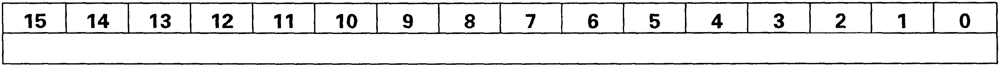

#### Minor Axis Pixel Count Register (MIN_AXIS_PCNT)

| Access | Address |
| --- | --- |
| Write Only | BEE8H, Index 0H |
| Power-On Default | Undefined |

This register specifies the height for rectangles, image transfers, BitBLTs and PatBLTs.

**Bits 11–0 — RECTANGLE HEIGHT**

Value = (number of pixels in the height of the rectangle) - 1

**Bits 15–12 — INDEX = 0H**

#### Top Scissors (SCISSORS_T)

| Access | Address |
| --- | --- |
| Write Only | BEE8H, Index 1H |
| Power-On Default | Undefined |

This register specifies the top of the clipping rectangle. It is the lowest Y value that will be drawn.

**Bits 11–0 — CLIPPING TOP LIMIT**

**Bits 15–12 — INDEX = 1H**

#### Left Scissors (SCISSORS_L)

| Access | Address |
| --- | --- |
| Write Only | BEE8H, Index 2H |
| Power-On Default | Undefined |

This register specifies the left side of the clipping rectangle. It is the lowest X value that will be drawn.

**Bits 11–0 — CLIPPING LEFT LIMIT**

**Bits 15–12 — INDEX = 2H**

#### Bottom Scissors (SCISSORS_B)

| Access | Address |
| --- | --- |
| Write Only | BEE8H, Index 3H |
| Power-On Default | Undefined |

This register specifies the bottom of the clipping rectangle. It is the highest Y value that will be drawn.

**Bits 11–0 — CLIPPING BOTTOM LIMIT**

**Bits 15–12 — INDEX = 3H**

#### Right Scissors (SCISSORS_R)

| Access | Address |
| --- | --- |
| Write Only | BEE8H, Index 4H |
| Power-On Default | Undefined |

This register specifies the right side of the clipping rectangle. It is the highest X value that will be drawn.

**Bits 11–0 — CLIPPING RIGHT LIMIT**

**Bits 15–12 — INDEX = 4H**

#### Pixel Control Register (PIX_CNTL)

| Access | Address |
| --- | --- |
| Write Only | BEE8H, Index 0AH |
| Power-On Default | Undefined |

See Bitmap Access Through the Graphics Engine in the Enhanced Mode Programming section for an explanation of how and when bits 7–6 of this register are used when writing a pixel to display memory.

| Bits | Field |
| --- | --- |
| 15–12 | INDEX = 0AH |
| 11–8 | Reserved |
| 7–6 | DT-EX-SRC |
| 5–0 | Reserved |

**Bits 5–0 — Reserved**

**Bits 7–6 — DT-EX-SRC — Select Mix Register**

00 = Foreground Mix register is always selected

01 = Reserved

10 = CPU data determines Mix register selected

11 = Display memory current value determines Mix register selected

**Bits 11–8 — Reserved**

**Bits 15–12 — INDEX = 0AH**

#### Multifunction Control Miscellaneous 2 Register (MULT_MISC2)

| Access | Address |
| --- | --- |
| Write Only | BEE8H, Index 0DH |
| Power-On Default | D000H |

**Bits 2–0 — DST-BASE — Destination Base Address**

000 = First destination memory address is in the 1st MByte of display memory

001 = First destination memory address is in the 2nd MByte of display memory

010 = First destination memory address is in the 3rd MByte of display memory

011 = First destination memory address is in the 4th MByte of display memory

This field supersedes bits 1–0 of BEE8H, Index E if any of these 3 bits are set to 1. The 3- and 4-MByte settings apply only to the Trio64.

**Bit 3 — Reserved**

**Bits 6–4 — SRC-BASE — Source Base Address**

000 = First source memory address is in the 1st MByte of display memory

001 = First source memory address is in the 2nd MByte of display memory

010 = First source memory address is in the 3rd MByte of display memory

011 = First source memory address is in the 4th MByte of display memory

This field supersedes bits 3–2 of BEE8H, Index E if any of these three bits are set to 1. The 3- and 4-MByte settings apply only to the Trio64.

**Bits 11–7 — Reserved**

**Bits 15–12 — INDEX = 0DH**

#### Multifunction Control Miscellaneous Register (MULT_MISC)

| Access | Address |
| --- | --- |
| Write Only | BEE8H, Index 0EH |
| Power-On Default | E000H |

| Bits | Field |
| --- | --- |
| 15–12 | INDEX = 0EH |
| 11–10 | Reserved = 0 |
| 9 | CMR 32B |
| 8 | ENB CMP |
| 7 | SRC NE |
| 6 | SLW RMW |
| 5 | EXT CLIP |
| 4 | RSF |
| 3–2 | SRC-BA 21 20 |
| 1–0 | DEST-BA 21 20 |

**Bits 1–0 — DEST-BA 21 20 — Destination Base Address Bits 21–20**

00 = First destination memory address is in the 1st MByte of display memory

01 = First destination memory address is in the 2nd MByte of display memory

10 = First destination memory address is in the 3rd MByte of display memory

11 = First destination memory address is in the 4th MByte of display memory

This field is superseded by bits 2–0 of BEE8H, Index D if any of the BEE8H Index D bits is set to 1. The 3- and 4-MByte settings apply only to the Trio64.

**Bits 3–2 — SRC-BA 21 20 — Source Base Address Bits 21–20**

00 = First source memory address is in the 1st MByte of display memory

01 = First source memory address is in the 2nd MByte of display memory

10 = First source memory address is in the 3rd MByte of display memory

11 = First source memory address is in the 4th MByte of display memory

This field is superseded by bits 6–4 of BEE8H Index D if any of the BEE8H Index D bits is set to 1. The 3- and 4-MByte settings apply only to the Trio64.

**Bit 4 — RSF — Select Upper Word in 32 Bits/Pixel Mode**

0 = Selects lower 16 bits for accesses to 32-bit registers in 32 bpp mode

1 = Selects upper 16 bits for accesses to 32-bit registers in 32 bpp mode

**Bit 5 — EXT CLIP — Enable External Clipping**

0 = Only pixels inside the clipping rectangle are drawn

1 = Only pixels outside the clipping rectangle are drawn

**Bit 6 — SLW RMW — Select Slow Read/Modify/Write Cycle**

0 = Fast Read/Modify/Write Cycle

1 = Slow Read/Modify/Write Cycle

When the Graphics Engines does a raster operation involving current screen data, it must do a read/modify/write cycle. For a fast cycle, the read, modify and write each take one MCLK. For a slow cycle, a wait state is inserted so that the entire process requires 4 MCLKs.

**Bit 7 — SRC NE — Don't Update Bitmap if Source Not Equal to Color Compare Color**

0 = Don't update current bitmap if the Color Compare (B2E8) register value is equal to the color value of the source bitmap

1 = Don't update current bitmap if the Color Compare (B2E8) register value is not equal to the color value of the source bitmap

This bit is only active if bit 8 of this register is set to 1.

**Bit 8 — ENB CMP — Enable Color Compare**

0 = Disable color comparison

1 = Enable color comparison

**Bit 9 — CMR 32B — Select 32-Bit Command Registers**

0 = Command registers (A2E8H, A6E8H, AAE8H, AEE8H, B2E8H) are 16-bit

1 = Command registers (A2E8H, A6E8H, AAE8H, AEE8H, B2E8H) are 32-bit. Byte and word accesses cannot be made.

This bit applies to programmed I/O accesses only and is a don't care for MMIO accesses.

**Bits 11–10 — Reserved = 0**

**Bits 15–12 — INDEX = 0EH**

#### Read Register Select Register (READ_SEL)

| Access | Address |
| --- | --- |
| Write Only | BEE8H, Index 0FH |
| Power-On Default | Undefined |

**Bits 2–0 — READ-REG-SEL — Read Register Select**

When BEE8H is read, the value returned is determined by this read register index according to the following:

0000 = BEE8H, Index 0H

0001 = BEE8H, Index 1H

0010 = BEE8H, Index 2H

0011 = BEE8H, Index 3H

0100 = BEE8H, Index 4H

0101 = BEE8H, Index 0AH

0110 = BEE8H, Index 0EH

0111 = 9AE8H (Bits 15–13 of the read data are forced to 0)

1000 = 42E8H (Bits 15–12 of the read data are forced to 0)

1001 = 46E8H

1010 = BEE8H, Index 0DH

The read register index increments by one with each reading of BEE8H.

**Bits 11–4 — Reserved**

**Bits 15–12 — INDEX = 0FH**

#### Pixel Data Transfer Register (PIX_TRANS)

| Access | Address |
| --- | --- |
| Write Only | E2E8H |
| Power-On Default | Undefined |

All data from the CPU to the Graphics Engine must pass through this register.

**Bits 15–0 — IMAGE WRITE DATA**

#### Pixel Data Transfer Extension Register (PIX_TRANS_EXT)

| Access | Address |
| --- | --- |
| Write Only | E2EAH |
| Power-On Default | Undefined |

This register is an extension of E2E8H for 32-bit operations.

**Bits 15–0 — IMAGE WRITE DATA**

#### Pattern Y (PAT_Y) (Trio64 Only)

| Access | Address |
| --- | --- |
| Read/Write | EAE8H |
| Power-On Default | Undefined |

This register defines the vertical coordinate top edge of an 8x8 pixel pattern programmed into off-screen memory. This is used with the Bresenham parameter trapezoidal fill pattern, trapezoidal 4-point trapezoid fill pattern and the polygon fill pattern command types.

**Bits 11–0 — PATTERN Y**

**Bits 15–12 — Reserved**

#### Pattern X (PAT_X) (Trio64 Only)

| Access | Address |
| --- | --- |
| Read/Write | EAEAH |
| Power-On Default | Undefined |

This register defines the horizontal coordinate of the left side of an 8x8 pixel pattern programmed into off-screen memory. This is used with the Bresenham parameter trapezoidal fill pattern, trapezoidal 4-point trapezoid fill pattern and the polygon fill pattern command types.

**Bits 11–0 — PATTERN X**

**Bits 15–12 — Reserved**

## Section 19: PCI Register Descriptions

The PCI specification defines a configuration register space. These registers allow device relocation, device independent system address map construction and automatic configurations. The Trio32/Trio64 provides a subset of these registers, which are described below.

The configuration register space occupies 256 bytes. When a configuration read or write command is issued, the AD[7:0] lines contain the address of the register in this space to be accessed. The Trio32/Trio64 supports or returns 0 for the first 64 bytes of this space.

In the following register descriptions, 'R' stands for reserved (write = 0, read = undefined). See Appendix A for a table listing each of the registers in this section and its page number.

#### Vendor ID (00H)

| Access | Address |
| --- | --- |
| Read Only | 00H |
| Power-On Default | 5333H |

This read-only register identifies the device manufacturer.

**Bits 15–0 — Vendor ID**

This is hardwired to 5333H to identify S3 Incorporated.

#### Device ID (02H)

| Access | Address |
| --- | --- |
| Read Only | 02H |
| Power-On Default | 8811H |

This read-only register contains the same value for either a Trio32 or Trio64. This allows the same BIOS to be used with either chip. The type of chip used is determined from the CR2E register.

**Bits 15–0 — Device ID**

#### Command (04H)

| Access | Address |
| --- | --- |
| Read/Write | 04H |
| Power-On Default | 0000H |

This register controls which types of PCI cycles the Trio32/Trio64 can generate and respond to.

| Bits | Field |
| --- | --- |
| 15–6 | Reserved |
| 5 | DAC SNP |
| 4–2 | Reserved |
| 1 | MEM |
| 0 | I/O |

**Bit 0 — I/O — Enable Response to I/O Accesses**

0 = Response to I/O space accesses is disabled
1 = Response to I/O space accesses enabled

**Bit 1 — MEM — Enable Response to Memory Accesses**

0 = Response to memory space accesses is disabled
1 = Response to memory space accesses enabled

**Bits 4–2 — Reserved**

**Bit 5 — DAC SNP — RAMDAC Register Access Snooping**

0 = Trio32/Trio64 claims and responds to all RAMDAC register access cycles
1 = Trio32/Trio64 performs RAMDAC register writes but does not claim the PCI cycle. RAMDAC register read accesses are performed by the Trio32/Trio64.

**Bits 15–6 — Reserved**

#### Status (06H)

| Access | Address |
| --- | --- |
| Read/Write | 06H |
| Power-On Default | 0200H |

**Bits 8–0 — Reserved**

**Bits 10–9 — DEVSEL — Device Select Timing**

01 = Medium DEVSEL timing. (hardwired)

**Bits 15–11 — Reserved**

#### Class Code (08H)

| Access | Address |
| --- | --- |
| Read Only | 08H |
| Power-On Default | 30000H |

This register is hardwired to 3000000H to specify that the Trio32/Trio64 are VGA-compatible display controllers.

| Bits | Field |
| --- | --- |
| 31–24 | BASE CLASS CODE |
| 23–16 | SUB-CLASS |
| 15–8 | PROGRAMMING INTERFACE |
| 7–0 | REVISION ID |

#### Base Address 0 (10H)

| Access | Address |
| --- | --- |
| Read/Write | 12H (high) 10H (low) |
| Power-On Default | 0000 0000H |

This is a 32-bit register in PCI configuration space that provides for address relocation. The Trio32/Trio64 maps the upper 9 bits of the register to the Linear Address Window Position registers CR59-CR5A. Bit 23 maps to bit 7 of CR5A and bits [31:24] map to bits 7–0 of CR59. Consequently, these bits map to system address bits [31:23].

| Bits | Field |
| --- | --- |
| 31–23 | BASE ADDRESS 0 |
| 22–4 | Reserved |
| 3 | PREF |
| 2–1 | TYPE |
| 0 | MSI |

**Bit 0 — MSI — Memory Space Indicator**

0 = Base registers map into memory space (hardwired)

**Bits 2–1 — TYPE — Type of Address Relocation**

00 = Locate anywhere in 32-bit address space (hardwired)

**Bit 3 — PREF — Prefetchable**

0 = Does not meet the prefetchable requirements (hardwired)

**Bits 22–4 — Reserved**

**Bits 31–23 — BASE ADDRESS 0**

See the description for the Linear Address Window Position registers (CR59, CR5A). Writes to CR59 and CR5A will also update this field.

#### BIOS ROM Base Address (30H)

| Access | Address |
| --- | --- |
| Read/Write | 32H (high) 30H (low) |
| Power-On Default | 000C 0000H |

This is a 32-bit register in PCI configuration space that provides for video BIOS ROM address relocation.

**Bit 0 — ADE — Address Decode Enable**

0 = Accesses to the BIOS ROM address space defined in this register are disabled
1 = Accesses to the BIOS ROM address space defined in this register are enabled

**Bits 15–1 — Reserved**

**Bits 31–16 — BIOS ROM BASE ADDRESS**

These are the upper 16 bits of the BIOS ROM address.

#### Interrupt Line (3CH)

| Access | Address |
| --- | --- |
| Read/Write | 3CH |
| Power-On Default | 00H |

This register contains interrupt line routing information written by the POST program during power-on initialization.

**Bits 7–0 — INTERRUPT LINE**

#### Interrupt Pin (3DH)

| Access | Address |
| --- | --- |
| Read Only | 3DH |
| Power-On Default | 01H |

This register is hardwired to a value of 1 to specify that INTA is the interrupt pin used.

**Bits 7–0 — INTERRUPT PIN**

## Appendix A: Register Reference

This Appendix contains tables listing all the registers in each of categories corresponding to Sections 14-19 of this data book.

VGA  
S3VGA  
System Control  
System Extension  
Enhanced Commands  
PCI Configuration Space

Within each table, registers are listed in order of increasing addresses/indices. Name, address, register bit descriptions with read/write status and the page number of the detailed register description are provided for each register. All addresses and indices are hexadecimal values.

### A.1 VGA Registers

? = B for monochrome, D for color.

**Table A-1. VGA Registers**

| Address | Index | Bit(s) | R/W | Register Name / Bit Description | Page |
| --- | --- | --- | --- | --- | --- |
| **General or External Registers** |  |  |  |  |  |
| 3C2 |  |  |  | **Miscellaneous Output** | 14-1 |
|  |  | 0 | W | Color emulation. Address based at 3Dx |  |
|  |  | 1 | W | Enable CPU access of video memory |  |
|  |  | 3–2 | W | Video DCLK select |  |
|  |  | 4 | W | Reserved |  |
|  |  | 5 | W | Select the high 64K page of memory |  |
|  |  | 6 | W | Make HSYNC an active low signal |  |
|  |  | 7 | W | Make VSYNC an active low signal |  |
| 3CC |  |  |  | **Miscellaneous Output** | 14-1 |
|  |  | 0 | R | Color emulation. Address based at 3Dx |  |
|  |  | 1 | R | Enable CPU access of video memory |  |
|  |  | 3–2 | R | Video DCLK select |  |
|  |  | 4 | R | Reserved |  |
|  |  | 5 | R | Select the high 64K page of memory |  |
|  |  | 6 | R | Make HSYNC an active low signal |  |
|  |  | 7 | R | Make VSYNC an active low signal |  |
| 3?A |  |  |  | **Feature Control** | 14-2 |
|  |  | 2–0 | W | Reserved |  |
|  |  | 3 | W | VSYNC is ORed with the internal display enable signal |  |
|  |  | 7–4 | W | Reserved |  |
| 3CA |  |  |  | **Feature Control** | 14-2 |
|  |  | 2–0 | R | Reserved |  |
|  |  | 3 | R | VSYNC is ORed with the internal display enable signal |  |
|  |  | 7–4 | R | Reserved |  |
| 3C2 |  |  |  | **Input Status 0** | 14-3 |
|  |  | 3–0 | R | Reserved |  |
|  |  | 4 | R | The internal SENSE signal is a logical 1 |  |
|  |  | 6–5 | R | Reserved |  |
|  |  | 7 | R | Vertical retrace interrupt to the CPU is pending |  |

**Table A-1. VGA Registers (Continued)**

| Address | Index | Bit(s) | R/W | Register Name / Bit Description | Page |
| --- | --- | --- | --- | --- | --- |
| 3?A |  |  |  | **Input Status 1** | 14-3 |
|  |  | 0 | R | The display is not in active display mode |  |
|  |  | 1 | R | Reserved |  |
|  |  | 2 | R | Reserved = 1 |  |
|  |  | 3 | R | Vertical retrace period is active |  |
|  |  | 5–4 | R | Feedback of two color outputs for test purposes |  |
|  |  | 7–6 | R | Reserved |  |
| **Sequencer Registers** |  |  |  |  |  |
| 3C4 |  |  |  | **Sequencer Index** | 14-4 |
|  |  | 4–0 | R/W | Index to the sequencer register to be accessed |  |
|  |  | 7–5 | R/W | Reserved |  |
| 3C5 |  |  |  | **Sequencer Data** | 14-5 |
|  |  | 7–0 | R/W | Data to or from the sequencer register accessed |  |
| 3C5 | 00 |  |  | **Reset (SR0)** | 14-5 |
|  |  | 0 | R/W | Asynchronous reset (not functional for the Trio32/Trio64) |  |
|  |  | 1 | R/W | Synchronous reset (not functional for the Trio32/Trio64) |  |
|  |  | 7–2 | R/W | Reserved |  |
| 3C5 | 01 |  |  | **Clocking Mode (SR1)** | 14-6 |
|  |  | 0 | R/W | Character clocks are 8 dots wide |  |
|  |  | 1 | R/W | Reserved |  |
|  |  | 2 | R/W | Load the video serializers every second character clock |  |
|  |  | 3 | R/W | The internal character clock is 1/2 the DCLK frequency |  |
|  |  | 4 | R/W | Load the video serializers every fourth character clock |  |
|  |  | 5 | R/W | Screen is turned off |  |
| 3C5 | 02 |  |  | **Enable Write Plane (SR2)** | 14-6 |
|  |  | 3–0 | R/W | Enables a CPU write to the corresponding color plane |  |
|  |  | 7–4 | R/W | Reserved |  |
| 3C5 | 03 |  |  | **Character Font Select (SR3)** | 14-7 |
|  |  | 4,1–0 | R/W | Select Font B |  |
|  |  | 5,3–2 | R/W | Select Font A |  |
|  |  | 7–6 | R/W | Reserved |  |
| 3C5 | 04 |  |  | **Memory Mode Control (SR4)** | 14-8 |
|  |  | 0 | R/W | Reserved |  |
|  |  | 1 | R/W | Memory access to 256K allowed (required for VGA) |  |
|  |  | 2 | R/W | Sequential addressing for CPU video memory accesses |  |
|  |  | 3 | R/W | Module 4 addressing for CPU video memory accesses |  |
|  |  | 7–4 | R/W | Reserved |  |

**Table A-1. VGA Registers (Continued)**

| Address | Index | Bit(s) | R/W | Register Name / Bit Description | Page |
| --- | --- | --- | --- | --- | --- |
| 3C5 | 08 |  |  | **Unlock Extended Sequencer (SR8)** | 14-9 |
|  |  | 7–0 | R/W | Load xxxx0110b to unlock SR9-SR18 |  |
| 3C5 | 09 |  |  | **Extended Sequencer Register 9** | 14-9 |
|  |  | 6–0 | R/W | Reserved |  |
|  |  | 7 | R/W | Memory-mapped I/O only (no PIO) |  |
| 3C5 | 0A |  |  | **External Bus Request Control (SRA)** | 14-9 |
|  |  | 4–0 | R/W | P value |  |
|  |  | 5 | R/W | PD[63:0] not tri-stated (PD[31:0] for Trio32) |  |
|  |  | 6 | R/W | Pin 50 is RAS1 if CR36 2 is 1 (EDO memory) (Trio64 only) |  |
|  |  | 7 | R/W | 2 MCLK memory writes |  |
| 3C5 | 0B |  |  | **Miscellaneous Extended Sequencer (SRB)** | 14-10 |
|  |  | 0 | R/W | Use VCLK1 for internal dot clock functions (test only) |  |
|  |  | 1 | R/W | Pixel data from VAFC latched by VCLK1 |  |
|  |  | 3–2 | R/W | Reserved |  |
|  |  | 7–4 | R/W | Specify color mode for feature connector input |  |
| 3C5 | 0D |  |  | **Extended Sequencer (SRD)** | 14-11 |
|  |  | 0 | R/W | Enable feature connector operation |  |
|  |  | 3–1 | R/W | Reserved |  |
|  |  | 5–4 | R/W | HSYNC control for Green PC requirements |  |
|  |  | 7–6 | R/W | VSYNC control for Green PC requirements |  |
| 3C5 | 10 |  |  | **MCLK Value Low (SR10)** | 14-12 |
|  |  | 4–0 | R/W | MCLK N-divider value |  |
|  |  | 6–5 | R/W | MCLK R value |  |
|  |  | 7 | R/W | Reserved |  |
| 3C5 | 11 |  |  | **MCLK Value High (SR11)** | 14-12 |
|  |  | 6–0 | R/W | MCLK M-divider value |  |
|  |  | 7 | R/W | Reserved |  |
| 3C5 | 12 |  |  | **DCLK Value Low (SR12)** | 14-13 |
|  |  | 4–0 | R/W | DCLK N-divider value |  |
|  |  | 6–5 | R/W | DCLK R value |  |
|  |  | 7 | R/W | Reserved |  |
| 3C5 | 13 |  |  | **DCLK Value High (SR13)** | 14-13 |
|  |  | 6–0 | R/W | DCLK M-divider value |  |
|  |  | 7 | R/W | Reserved |  |

**Table A-1. VGA Registers (Continued)**

| Address | Index | Bit(s) | R/W | Register Name / Bit Description | Page |
| --- | --- | --- | --- | --- | --- |
| 3C5 | 14 |  |  | **CLKSYN Control 1 (SR14)** | 14-14 |
|  |  | 0 | R/W | DCLK PLL powered down (test only) |  |
|  |  | 1 | R/W | MCLK PLL powered down (test only) |  |
|  |  | 3 | R/W | Test MCLK (test only) |  |
|  |  | 4 | R/W | Clear clock synthesizer counters (test only) |  |
|  |  | 5 | R/W | Pin 146 tri-stated |  |
|  |  | 6 | R/W | MCLK is input on pin 146 (test only) |  |
|  |  | 7 | R/W | DCLK is input on pin 156 (test only) |  |
| 3C5 | 15 |  |  | **CLKSYN Control 2 (SR15)** | 14-15 |
|  |  | 0 | R/W | Load new MCLK frequency |  |
|  |  | 1 | R/W | Load new DCLK frequency |  |
|  |  | 2 | R/W | MCLK output on pin 147 (test only) |  |
|  |  | 3 | R/W | VCLK direction determined by EVCLK |  |
|  |  | 4 | R/W | Divide DCLK by 2 |  |
|  |  | 5 | R/W | Load MCLK and DCLK PLL values immediately |  |
|  |  | 6 | R/W | Invert DCLK |  |
|  |  | 7 | R/W | Enable 2 MCLK memory writes |  |
| 3C5 | 16 |  |  | **CLKSYN Test High (SR16)** | 14-16 |
|  |  | 7–0 | R/W | Reserved |  |
| 3C5 | 17 |  |  | **CLKSYN Test High (SR17)** | 14-17 |
|  |  | 7–0 | R/W | Reserved |  |
| 3C5 | 18 |  |  | **RAMDAC/CLKSYN Control (SR18)** | 14-17 |
|  |  | 0 | R/W | RAMDAC test counter enabled (test only) |  |
|  |  | 1 | R/W | Reset RAMDAC test counter |  |
|  |  | 2 | R/W | Place red data on internal data bus (test only) |  |
|  |  | 3 | R/W | Place green data on internal data bus (test only) |  |
|  |  | 4 | R/W | Place blue data on internal data bus (test only) |  |
|  |  | 5 | R/W | Power-down RAMDAC |  |
|  |  | 6 | R/W | Select 1 cycle LUT write |  |
|  |  | 7 | R/W | RAMDAC clock doubled mode enabled |  |
| **CRT Controller Registers** |  |  |  |  |  |
| 3?4 |  |  |  | **CRT Controller Index** | 14-19 |
|  |  | 7–0 | R/W | Index to the CRTC register to be accessed |  |
| 3?5 |  |  |  | **CRT Controller Data** | 14-19 |
|  |  | 7–0 | R/W | Data to or from the CRTC register accessed |  |
| 3?5 | 00 |  |  | **Horizontal Total (CR0)** | 14-20 |
|  |  | 7–0 | R/W | Number of characters in a line - 5 |  |
| 3?5 | 01 |  |  | **Horizontal Display End (CR1)** | 14-20 |
|  |  | 7–0 | R/W | One less than the total number of displayed characters |  |

**Table A-1. VGA Registers (Continued)**

| Address | Index | Bit(s) | R/W | Register Name / Bit Description | Page |
| --- | --- | --- | --- | --- | --- |
| 3?5 | 02 |  |  | **Start Horizontal Blank (CR2)** | 14-21 |
|  |  | 7–0 | R/W | Character count where horizontal blanking starts |  |
| 3?5 | 03 |  |  | **End Horizontal Blank (CR3)** | 14-21 |
|  |  | 4–0 | R/W | End position of horizontal blanking |  |
|  |  | 6–5 | R/W | Display enable skew in character clocks |  |
|  |  | 7 | R/W | Reserved |  |
| 3?5 | 04 |  |  | **Start Horizontal Sync Position (CR4)** | 14-22 |
|  |  | 7–0 | R/W | Character count where HSYNC goes active |  |
| 3?5 | 05 |  |  | **End Horizontal Sync Position (CR5)** | 14-22 |
|  |  | 4–0 | R/W | Position where HSYNC goes inactive |  |
|  |  | 6–5 | R/W | Horizontal retrace end delay in character clocks |  |
|  |  | 7 | R/W | End horizontal blanking bit 5 |  |
| 3?5 | 06 |  |  | **Vertical Total (CR6)** | 14-23 |
|  |  | 7–0 | R/W | Number of lines - 2 |  |
| 3?5 | 07 |  |  | **CRTC Overflow (CR7)** | 14-23 |
|  |  | 0 | R/W | Vertical total bit 8 |  |
|  |  | 1 | R/W | Vertical display end bit 8 |  |
|  |  | 2 | R/W | Vertical retrace start bit 8 |  |
|  |  | 3 | R/W | Start vertical blank bit 8 |  |
|  |  | 4 | R/W | Line compare bit 8 |  |
|  |  | 5 | R/W | Vertical total bit 9 |  |
|  |  | 6 | R/W | Vertical display end bit 9 |  |
|  |  | 7 | R/W | Vertical retrace start bit 9 |  |
| 3?5 | 08 |  |  | **Preset Row Scan (CR8)** | 14-24 |
|  |  | 4–0 | R/W | Line where first character row begins |  |
|  |  | 6–5 | R/W | Number of bytes to pan horizontally |  |
|  |  | 7 | R/W | Reserved |  |
| 3?5 | 09 |  |  | **Maximum Scan Line (CR9)** | 14-24 |
|  |  | 4–0 | R/W | Character height in scan lines - 1 |  |
|  |  | 5 | R/W | Start vertical blank bit 9 |  |
|  |  | 6 | R/W | Line compare bit 9 |  |
|  |  | 7 | R/W | Double scanning (repeat each line) enabled |  |
| 3?5 | 0A |  |  | **Cursor Start Scan Line (CRA)** | 14-25 |
|  |  | 4–0 | R/W | Cursor starting line within the character cell |  |
|  |  | 5 | R/W | Turns off the cursor |  |
|  |  | 7–6 | R/W | Reserved |  |

**Table A-1. VGA Registers (Continued)**

| Address | Index | Bit(s) | R/W | Register Name / Bit Description | Page |
| --- | --- | --- | --- | --- | --- |
| 3?5 | 0B |  |  | **Cursor End Scan Line (CRB)** | 14-25 |
|  |  | 4–0 | R/W | Cursor ending line within the character cell |  |
|  |  | 6–5 | R/W | Cursor skew to right in characters |  |
|  |  | 7 | R/W | Reserved |  |
| 3?5 | 0C |  |  | **Start Address High (CRC)** | 14-26 |
|  |  | 7–0 | R/W | Bits 15–8 of the display start address |  |
| 3?5 | 0D |  |  | **Start Address Low (CRD)** | 14-26 |
|  |  | 7–0 | R/W | Bits 7–0 of the display start address |  |
| 3?5 | 0E |  |  | **Cursor Location Address High (& Hardware Cursor Foreground Color in Enhanced Mode) (CRE)** | 14-26 |
|  |  | 7–0 | R/W | Bits 15–8 of the cursor location start address |  |
| 3?5 | 0F |  |  | **Cursor Location Address Low (& Hardware Cursor Background Color in Enhanced Mode) (CRF)** | 14-26 |
|  |  | 7–0 | R/W | Bits 7–0 of the cursor location start address |  |
| 3?5 | 10 |  |  | **Vertical Retrace Start (CR10)** | 14-27 |
|  |  | 7–0 | R/W | Vertical retrace start in scan lines |  |
| 3?5 | 11 |  |  | **Vertical Retrace End (CR11)** | 14-27 |
|  |  | 3–0 | R/W | Vertical retrace end in scan lines |  |
|  |  | 4 | R/W | Clear the vertical retrace interrupt flip-flop |  |
|  |  | 5 | R/W | Disable vertical interrupts |  |
|  |  | 6 | R/W | Five RAM refresh cycles per horizontal line |  |
|  |  | 7 | R/W | Lock writes to CR0-CR7 |  |
| 3?5 | 12 |  |  | **Vertical Display End (CR12)** | 14-28 |
|  |  | 7–0 | R/W | Number of scan lines of active video |  |
| 3?5 | 13 |  |  | **Offset (CR13)** | 14-28 |
|  |  | 7–0 | R/W | Memory start address jump from one scan line to the next |  |
| 3?5 | 14 |  |  | **Underline Location (CR14)** | 14-29 |
|  |  | 4–0 | R/W | Horizontal scan line where underline occurs |  |
|  |  | 5 | R/W | Memory address counter increment is 4 character clocks |  |
|  |  | 6 | R/W | Memory accessed as doublewords |  |
|  |  | 7 | R/W | Reserved |  |
| 3?5 | 15 |  |  | **Start Vertical Blank (CR15)** | 14-29 |
|  |  | 7–0 | R/W | Horizontal scan line where vertical blanking starts |  |
| 3?5 | 16 |  |  | **End Vertical Blank (CR16)** | 14-30 |
|  |  | 7–0 | R/W | Horizontal scan line where vertical blanking ends |  |

**Table A-1. VGA Registers (Continued)**

| Address | Index | Bit(s) | R/W | Register Name / Bit Description | Page |
| --- | --- | --- | --- | --- | --- |
| 3?5 | 17 |  |  | **CRTC Mode Control (CR17)** | 14-30 |
|  |  | 0 | R/W | Enable bank 2 mode for CGA emulation |  |
|  |  | 1 | R/W | Enable bank 4 mode for CGA emulation |  |
|  |  | 2 | R/W | Use horizontal retrace clock divided by 2 |  |
|  |  | 3 | R/W | Enable count by 2 mode |  |
|  |  | 4 | R/W | Reserved |  |
|  |  | 5 | R/W | Enable CGA mode address wrap |  |
|  |  | 6 | R/W | Use byte address mode |  |
|  |  | 7 | R/W | Horizontal and vertical retrace signals enabled |  |
| 3?5 | 18 |  |  | **Line Compare (CR18)** | 14-32 |
|  |  | 7–0 | R/W | Line at which memory address counter cleared to 0 |  |
| 3?5 | 22 |  |  | **CPU latch Data (CR22)** | 14-32 |
|  |  | 7–0 | R | Value in the CPU latch in the graphics controller |  |
| 3?5 | 24,26 |  |  | **Attribute Controller Flag/Index** | 14-33 |
|  |  | 5–0 | R | Value of the attribute controller index data at 3C0H |  |
|  |  | 6 | R | Reserved |  |
|  |  | 7 | R | State of inverted internal address flip-flop |  |
| **Graphics Controller Registers** |  |  |  |  |  |
| 3CE |  |  |  | **Graphics Controller Index** | 14-34 |
|  |  | 3–0 | R/W | Index to the graphics controller register to be accessed |  |
|  |  | 7–4 | R/W | Reserved |  |
| 3CF |  |  |  | **Graphics Controller Data** | 14-34 |
|  |  | 7–0 | R/W | Data to or from the graphics controller register accessed |  |
| 3CF | 00 |  |  | **Set/Reset (GR0)** | 14-35 |
|  |  | 3–0 | R/W | Color value for CPU memory writes |  |
|  |  | 7–4 | R/W | Reserved |  |
| 3CF | 01 |  |  | **Enable Set/Reset (GR1)** | 14-35 |
|  |  | 3–0 | R/W | Enable planes for writing GR0 data |  |
|  |  | 7–4 | R/W | Reserved |  |
| 3CF | 02 |  |  | **Color Compare (GR2)** | 14-36 |
|  |  | 3–0 | R/W | Reference color for color compare operations |  |
|  |  | 7–4 | R/W | Reserved |  |
| 3CF | 03 |  |  | **Raster Operation/Rotate Counter (GR3)** | 14-36 |
|  |  | 2–0 | R/W | Number of right rotate positions for a CPU memory write |  |
|  |  | 4–3 | R/W | Select raster operation (logical function) |  |
|  |  | 7–5 | R/W | Reserved |  |
| 3CF | 04 |  |  | **Read Plane Select (GR4)** | 14-37 |
|  |  | 1–0 | R/W | Select planes for reading |  |
|  |  | 7–2 | R/W | Reserved |  |

**Table A-1. VGA Registers (Continued)**

| Address | Index | Bit(s) | R/W | Register Name / Bit Description | Page |
| --- | --- | --- | --- | --- | --- |
| 3CF | 05 |  |  | **Graphics Controller Mode (GR5)** | 14-38 |
|  |  | 1–0 | R/W | Select write mode |  |
|  |  | 2 | R/W | Reserved |  |
|  |  | 3 | R/W | Enable read compare operation |  |
|  |  | 4 | R/W | Select odd/even addressing |  |
|  |  | 5 | R/W | Select odd/even shift mode |  |
|  |  | 6 | R/W | Select 256 color shift mode |  |
|  |  | 7 | R/W | Reserved |  |
| 3CF | 06 |  |  | **Memory Map Mode Control (GR6)** | 14-39 |
|  |  | 0 | R/W | Select graphics mode memory addressing |  |
|  |  | 1 | R/W | Chain odd/even planes |  |
|  |  | 3–2 | R/W | Select memory mapping |  |
|  |  | 7–4 | R/W | Reserved |  |
| 3CF | 07 |  |  | **Color Don't Care (GR7)** | 14-40 |
|  |  | 3–0 | R/W | Select color plane used for color comparison |  |
|  |  | 7–4 | R/W | Reserved |  |
| 3CF | 08 |  |  | **Bit Mask (GR8)** | 14-40 |
|  |  | 7–0 | R/W | Each bit is a mask for the corresponding memory plane bit |  |
| **Attribute Registers** |  |  |  |  |  |
| 3C0 |  |  |  | **Attribute Controller Index** | 14-41 |
|  |  | 4–0 | R/W | Index to the attribute controller register to be accessed |  |
|  |  | 5 | R/W | Enable video display |  |
|  |  | 7–6 | R/W | Reserved |  |
| 3C1/0 |  |  |  | **Attribute Controller Data** | 14-42 |
|  |  | 7–0 | R/W | Data to or from the attribute controller register accessed |  |
| 3C1/0 | 00-0F |  |  | **Palette Register (AR0-ARF)** | 14-42 |
|  |  | 5–0 | R/W | Color value |  |
|  |  | 7–6 | R/W | Reserved |  |
| 3C1/0 | 10 |  |  | **Attribute Mode Control (AR10)** | 14-43 |
|  |  | 0 | R/W | Select graphics mode |  |
|  |  | 1 | R/W | Select monochrome display |  |
|  |  | 2 | R/W | Enable line graphics characters |  |
|  |  | 3 | R/W | Enable blinking |  |
|  |  | 4 | R/W | Reserved |  |
|  |  | 5 | R/W | Enable top panning |  |
|  |  | 6 | R/W | Select 256 color mode |  |
|  |  | 7 | R/W | Bits 5–4 of video output come from AR14_1-0 |  |
| 3C1/0 | 11 |  |  | **Border Color (AR11)** | 14-44 |
|  |  | 7–0 | R/W | Border color value |  |

**Table A-1. VGA Registers (Continued)**

| Address | Index | Bit(s) | R/W | Register Name / Bit Description | Page |
| --- | --- | --- | --- | --- | --- |
| 3C1/0 | 12 |  |  | **Color Plane Enable (AR12)** | 14-44 |
|  |  | 3–0 | R/W | Display plane enable |  |
|  |  | 5–4 | R/W | Select inputs to bits 5–4 of 3?AH |  |
|  |  | 7–6 | R/W | Reserved |  |
| 3C1/0 | 13 |  |  | **Horizontal Pixel Panning (AR13)** | 14-45 |
|  |  | 3–0 | R/W | Number of pixels to shift the display to the left |  |
|  |  | 7–4 | R/W | Reserved |  |
| 3C1/0 | 14 |  |  | **Pixel Padding (AR14)** | 14-46 |
|  |  | 1–0 | R/W | Bits 5–4 of the video output if AR10 7 = 1 |  |
|  |  | 3–2 | R/W | Bits 7–6 of the video output |  |
|  |  | 7–4 | R/W | Reserved |  |
| **Setup Registers** |  |  |  |  |  |
| 102 |  |  |  | **Setup Option Select** | 14-47 |
|  |  | 0 | R/W | Chip responds to commands, addresses and data |  |
|  |  | 7–1 | R/W | Reserved |  |
| 46E8 |  |  |  | **Video Subsystem Enable** | 14-48 |
|  |  | 2–0 | W | Reserved |  |
|  |  | 3 | W | Enable video I/O and memory address decoding |  |
|  |  | 4 | W | Put chip in setup mode |  |
|  |  | 7–5 | W | Reserved |  |
| **RAMDAC Registers** |  |  |  |  |  |
| 3C6 |  |  |  | **DAC Mask** | 14-49 |
|  |  | 7–0 | R/W | Pixel read mask |  |
| 3C7 |  |  |  | **DAC Read Index** | 14-49 |
|  |  | 7–0 | W | Index to palette register to be read |  |
| 3C7 |  |  |  | **DAC Status** | 14-50 |
|  |  | 1–0 | R | Shows whether previous DAC cycle was a read or write |  |
|  |  | 7–2 | R | Reserved |  |
| 3C8 |  |  |  | **DAC Write Index** | 14-50 |
|  |  | 7–0 | R/W | Index to palette register to be written or General Input Port read data |  |
| 3C9 |  |  |  | **DAC Data** | 14-51 |
|  |  | 7–0 | R/W | Data from register pointed to by DAC Read or Write Index |  |

### A.2 S3 VGA Registers

The Trio32/Trio64 has additional registers described in Table A-2 that are located in CRT Controller address space at locations not used by IBM. All of these registers are read/write protected at power-up by hardware reset. In order to read/write these registers, the Register Lock 1 register (CR38) must be loaded with a binary unlock key pattern (see the register description). The registers will remain unlocked until the key pattern is reset. ? = B for monochrome, D for color.

**Table A-2. S3 VGA Registers**

| Address | Index | Bit(s) | R/W | Register Name / Bit Description | Page |
| --- | --- | --- | --- | --- | --- |
| 3?5 | 2D |  |  | **Device ID High (CR2D)** | 15-1 |
|  |  | 7–0 | R | High byte of device ID (88H) |  |
| 3?5 | 2E |  |  | **Device ID Low (CR2E)** | 15-1 |
|  |  | 7–0 | R | Low byte of device ID (10H-Trio32, 11H-Trio64) |  |
| 3?5 | 2F |  |  | **Revision (CR2F)** | 15-2 |
|  |  | 7–0 | R | Revision level |  |
| 3?5 | 30 |  |  | **Chip ID/Rev (CR30)** | 15-2 |
|  |  | 3–0 | R | Chip Identification - EH identifies Trio32/Trio64 |  |
|  |  | 7–4 | R | Chip revision status (stepping) - See CR2F |  |
| 3?5 | 31 |  |  | **Memory Configuration (CR31)** | 15-2 |
|  |  | 0 | R/W | Enable base address offset (CR6A 6-0) |  |
|  |  | 1 | R/W | Enable two-page screen image |  |
|  |  | 2 | R/W | Enable VGA 16-Bit Memory Bus Width |  |
|  |  | 3 | R/W | Use Enhanced mode memory mapping |  |
|  |  | 5–4 | R/W | Old display start address bits 17–16 (see CR69 3-0) |  |
|  |  | 6 | R/W | Enable high speed text display font fetch mode |  |
|  |  | 7 | R/W | Reserved |  |
| 3?5 | 32 |  |  | **Backward Compatibility 1 (CR32)** | 15-3 |
|  |  | 3–0 | R/W | Reserved |  |
|  |  | 4 | R/W | Enable interrupt generation |  |
|  |  | 5 | R/W | Reserved |  |
|  |  | 6 | R/W | Use standard VGA memory wrapping at 256K boundary |  |
|  |  | 7 | R/W | Reserved |  |
| 3?5 | 33 |  |  | **Backward Compatibility 2 (CR33)** | 15-4 |
|  |  | 0 | R/W | Reserved |  |
|  |  | 1 | R/W | Disable write protection provided by CR11 7 on CR7 1,6 |  |
|  |  | 2 | R/W | Reserved |  |
|  |  | 3 | R/W | VCLK is internal DCLK |  |
|  |  | 4 | R/W | Disable writes to RAMDAC registers (3C6H-3C9H) |  |
|  |  | 5 | R/W | BLANK signal active during entire non-active video period |  |
|  |  | 6 | R/W | Disable writes to Palette/Overscan registers (AR0-ARF) |  |
|  |  | 7 | R/W | Reserved |  |

**Table A-2. S3 VGA Registers (Continued)**

| Address | Index | Bit(s) | R/W | Register Name / Bit Description | Page |
| --- | --- | --- | --- | --- | --- |
| 3?5 | 34 |  |  | **Backward Compatibility 3 (CR34)** | 15-5 |
|  |  | 0 | R/W | PCI DAC snoop method select |  |
|  |  | 1 | R/W | Disable PCI master abort handling during DAC snoop |  |
|  |  | 2 | R/W | Disable PCI retry handling during DAC snoop |  |
|  |  | 3 | R/W | Reserved |  |
|  |  | 4 | R/W | Enable Display Start FIFO Fetch register (CR3B) |  |
|  |  | 7–5 | R/W | Reserved |  |
| 3?5 | 35 |  |  | **CRT Register Lock (CR35)** | 15-6 |
|  |  | 3–0 | R/W | Old CPU base address (see CR6A 6-0) |  |
|  |  | 4 | R/W | Lock Vertical Timing registers |  |
|  |  | 5 | R/W | Lock Horizontal Timing registers |  |
|  |  | 7–6 | R/W | Reserved |  |
| 3?5 | 36 |  |  | **Configuration 1 (CR36)** | 15-7 |
|  |  | 1–0 | R | Select System bus (PCI or VL-Bus) |  |
|  |  | 3–2 | R/W | Select Memory page mode (fast page or EDO) |  |
|  |  | 4 | R/W | Enable BIOS ROM accesses (VL-Bus) |  |
|  |  | 7–5 | R/W | Define display memory size |  |
| 3?5 | 37 |  |  | **Configuration 2 (CR37)** | 15-7 |
|  |  | 0 | R/W | Enable Trio32/64 operation (VL-Bus) |  |
|  |  | 1 | R/W | Disable test mode (outputs tri-stated) |  |
|  |  | 2 | R/W | Select 32K or 64K BIOS ROM size (VL-Bus) |  |
|  |  | 3 | R/W | Use internal MCLK, DCLK |  |
|  |  | 4 | R/W | Define RAMDAC write snooping (VL-Bus) |  |
|  |  | 7–5 | R/W | Specify monitor information |  |
| 3?5 | 38 |  |  | **Register Lock 1 (CR38)** | 15-9 |
|  |  | 7–0 | R/W | Unlock S3 VGA registers (CR30-CR3C) |  |
| 3?5 | 39 |  |  | **Register Lock 2 (CR39)** | 15-9 |
|  |  | 7–0 | R/W | Unlock System Control, System Extension and Strapping registers (CR40-CR4F, CR50-CR6D) |  |
| 3?5 | 3A |  |  | **Miscellaneous 1 (CR3A)** | 15-10 |
|  |  | 1–0 | R/W | Select alternate refresh count per horizontal line |  |
|  |  | 2 | R/W | Enable alternate refresh count (CR3A 1-0) |  |
|  |  | 3 | R/W | Enable simultaneous VGA text and Enhanced modes |  |
|  |  | 4 | R/W | Enable 8-, 16- or 24/32-bit color Enhanced modes |  |
|  |  | 5 | R/W | Enable high speed text font writing |  |
|  |  | 6 | R/W | Reserved |  |
|  |  | 7 | R/W | Disable PCI bus read burst cycles |  |

**Table A-2. S3 VGA Registers (Continued)**

| Address | Index | Bit(s) | R/W | Register Name / Bit Description | Page |
| --- | --- | --- | --- | --- | --- |
| 3?5 | 3B |  |  | **Start Display FIFO Fetch (CR3B)** | 15-11 |
|  |  | 7–0 | R/W | Specify start of display FIFO fetches for screen refreshing |  |
| 3?5 | 3C |  |  | **Interlace Retrace Start (CR3C)** | 15-11 |
|  |  | 7–0 | R/W | Specify interlaced mode retrace start position |  |

### A.3 System Control Registers

System Control registers are configuration registers, mode control registers, and hardware graphics cursor control registers. They are positioned in the same indexed register space as VGA S3 registers. All of these registers are read/write protected at power-up by hardware reset. In order to read/write these registers, the Register Lock 2 register (CR39) must be loaded with a binary unlock key pattern (see the register description). The registers will remain unlocked until the key pattern is reset. ? = B for monochrome, D for color.

The following table summarizes the System Control registers.

**Table A-3. System Control Registers**

| Address | Index | Bit(s) | R/W | Register Name / Bit Description | Page |
| --- | --- | --- | --- | --- | --- |
| 3?5 | 40 |  |  | **System Configuration (CR40)** | 16-1 |
|  |  | 0 | R/W | Enable Enhanced mode register access |  |
|  |  | 3–1 | R/W | Reserved |  |
|  |  | 4 | R/W | Ready (Wait State) Control (VL-Bus) |  |
|  |  | 5 | R/W | Reserved = 1 |  |
|  |  | 7–6 | R/W | Reserved |  |
| 3?5 | 41 |  |  | **BIOS Flag (CR41)** | 16-2 |
|  |  | 7–0 | R/W | Used by the video BIOS |  |
| 3?5 | 42 |  |  | **Mode Control (CR42)** | 16-2 |
|  |  | 4–0 | R/W | Reserved |  |
|  |  | 5 | R/W | Select Interlaced mode |  |
|  |  | 6 | R/W | Reserved |  |

**Table A-3. System Control Registers (Continued)**

| Address | Index | Bit(s) | R/W | Register Name / Bit Description | Page |
| --- | --- | --- | --- | --- | --- |
| 3?5 | 43 |  |  | **Extended Mode (CR43)** | 16-2 |
|  |  | 1–0 | R/W | Reserved |  |
|  |  | 2 | R/W | Old logical screen width bit 8 |  |
|  |  | 6–3 | R/W | Reserved |  |
|  |  | 7 | R/W | Enable horizontal counter double mode |  |
| 3?5 | 45 |  |  | **Hardware Graphics Cursor Mode (CR45)** | 16-3 |
|  |  | 0 | R/W | Enable hardware graphics cursor |  |
|  |  | 3–1 | R/W | Reserved |  |
|  |  | 4 | R/W | Set up space at right of bit map for hardware cursor |  |
|  |  | 7–5 | R/W | Reserved |  |
| 3?5 | 46-47 |  |  | **Hardware Graphics Cursor Origin-X (CR46-CR47)** | 16-3 |
|  |  | 10–0 | R/W | X-coordinate of the hardware cursor left side |  |
|  |  | 15–11 | R/W | Reserved |  |
| 3?5 | 48-49 |  |  | **Hardware Graphics Cursor Origin-Y (CR48-CR49)** | 16-4 |
|  |  | 10–0 | R/W | Y-coordinate of the hardware cursor upper line |  |
|  |  | 15–11 | R/W | Reserved |  |
| 3?5 | 4A |  |  | **Hardware Graphics Cursor Foreground Stack (CR4A)** | 16-4 |
|  |  | 7–0 | R/W | Hardware cursor foreground color (3 registers) |  |
| 3?5 | 4B |  |  | **Hardware Graphics Cursor Background Stack (CR4B)** | 16-4 |
|  |  | 7–0 | R/W | Hardware cursor background color (3 registers) |  |
| 3?5 | 4C-4D |  |  | **Hardware Graphics Cursor Start Address (CR4C-CR4D)** | 16-5 |
|  |  | 12–0 | R/W | Hardware cursor start address |  |
|  |  | 15–13 | R/W | Reserved |  |
| 3?5 | 4E |  |  | **Hardware Graphics Cursor Pattern Display Start X-Pixel Position (CR4E)** | 16-5 |
|  |  | 5–0 | R/W | Hardware cursor display start x-coordinate |  |
|  |  | 7–6 | R/W | Reserved |  |
| 3?5 | 4F |  |  | **Hardware Graphics Cursor Pattern Display Start Y-Pixel Position (CR4F)** | 16-5 |
|  |  | 5–0 | R/W | Hardware cursor display start y-coordinate |  |
|  |  | 7–6 | R/W | Reserved |  |

### A.4 System Extension Registers

These registers provide extended system and memory control, external sync control and addressing window control. They are enabled in the same way as the System Control registers via the Register Lock 2 register (CR39). ? = B for monochrome, D for color.

**Table A-4. System Extension Registers**

| Address | Index | Bit(s) | R/W | Register Name / Bit Description | Page |
| --- | --- | --- | --- | --- | --- |
| 3?5 | 50 |  |  | **Extended System Cont 1 (CR50)** | 17-1 |
|  |  | 0 | R/W | Most significant bit of screen width definition (see bits 7–6) |  |
|  |  | 1 | R/W | Reserved |  |
|  |  | 2 | R/W | Enable shared frame buffer memory bus arbitration |  |
|  |  | 3 | R/W | Reserved |  |
|  |  | 5–4 | R/W | Pixel length select |  |
|  |  | 7–6 | R/W | With bit 0, screen width definition |  |
| 3?5 | 51 |  |  | **Extended System Cont 2 (CR51)** | 17-2 |
|  |  | 1–0 | R/W | Old display start address bits 19-18 |  |
|  |  | 3–2 | R/W | Old CPU base address bits 19-18 |  |
|  |  | 5–4 | R/W | Logical screen width bits 9-8 |  |
|  |  | 7–6 | R/W | Reserved |  |
| 3?5 | 52 |  |  | **Extended BIOS Flag 1 (CR52)** | 17-3 |
|  |  | 7–0 | R/W | Used by the video BIOS |  |
| 3?5 | 53 |  |  | **Extended Memory Cont 1 (CR53)** | 17-3 |
|  |  | 0 | R/W | Enable write per bit |  |
|  |  | 3–1 | R/W | Reserved |  |
|  |  | 4 | R/W | Enable memory-mapped I/O access |  |
|  |  | 5 | R/W | Reserved |  |
|  |  | 6 | R/W | Enable nibble swap |  |
|  |  | 7 | R/W | Reserved |  |
| 3?5 | 54 |  |  | **Extended Memory Cont 2 (CR54)** | 17-4 |
|  |  | 2–0 | R/W | Reserved |  |
|  |  | 7–3 | R/W | Specify M parameter for display FIFO control |  |
| 3?5 | 55 |  |  | **Extended DAC Control (CR55)** | 17-4 |
|  |  | 1–0 | R/W | Reserved |  |
|  |  | 2 | R/W | Enable General Input Port read |  |
|  |  | 3 | R/W | Reserved |  |
|  |  | 4 | R/W | Enable X-11 windows hardware cursor mode |  |
|  |  | 6–5 | R/W | Reserved |  |
|  |  | 7 | R/W | VCLK output pin is tri-stated |  |
| 3?5 | 56 |  |  | **External Sync Cont 1 (CR56)** | 17-5 |
|  |  | 0 | R/W | Enable remote mode operation (genlocking) |  |
|  |  | 1 | R/W | HSYNC output buffer tri-stated |  |

**Table A-4. System Extension Registers (Continued)**

| Address | Index | Bit(s) | R/W | Register Name / Bit Description | Page |
| --- | --- | --- | --- | --- | --- |
| 3?5 | 56 |  |  | **External Sync Cont 1 (CR56)** | 17-5 |
|  |  | 2 | R/W | VSYNC output buffer tri-stated |  |
|  |  | 3 | R/W | Select vertical counter-only reset sync with genlocking |  |
|  |  | 4 | R/W | Select odd frame after a vertical counter reset |  |
|  |  | 7–5 | R/W | Reserved |  |
| 3?5 | 57 |  |  | **External Sync Cont 2 (CR57)** | 17-6 |
|  |  | 7–0 | R/W | Vertical reset adjustment from VSYNC falling (genlocking) |  |
| 3?5 | 58 |  |  | **Linear Address Window Control (CR58)** | 17-6 |
|  |  | 1–0 | R/W | Linear addressing window size |  |
|  |  | 2 | R/W | Reserved |  |
|  |  | 3 | R/W | Address latch timing control (VL-Bus) |  |
|  |  | 4 | R/W | Enable linear addressing |  |
|  |  | 6–5 | R/W | Reserved |  |
|  |  | 7 | R/W | RAS precharge time increased |  |
| 3?5 | 59-5A |  |  | **Linear Address Window Position (CR59-5A)** | 17-7 |
|  |  | 15–0 | R/W | Linear addressing window position bits 31-16 |  |
| 3?5 | 5C |  |  | **General Out Port (CR5C)** | 17-8 |
|  |  | 7–0 | R/W | General Output Port |  |
| 3?5 | 5D |  |  | **Extended Horizontal Overflow (CR5D)** | 17-8 |
|  |  | 0 | R/W | Horizontal total bit 8 (CR0) |  |
|  |  | 1 | R/W | Horizontal display end bit 8 (CR1) |  |
|  |  | 2 | R/W | Start horizontal blank bit 8 (CR2) |  |
|  |  | 3 | R/W | BLANK pulse extended by 64 DCLKs |  |
|  |  | 4 | R/W | Start horizontal sync position bit 8 (CR4) |  |
|  |  | 5 | R/W | HSYNC pulse extended by 32 DCLKs |  |
|  |  | 6 | R/W | Start FIFO Fetch bit 8 (CR3B) |  |
|  |  | 7 | R/W | Bus grant terminate position bit 8 (CR5F) |  |
| 3?5 | 5E |  |  | **Extended Vertical Overflow (CR5E)** | 17-9 |
|  |  | 0 | R/W | Vertical total bit 10 (CR6) |  |
|  |  | 1 | R/W | Vertical display end bit 10 (CR12) |  |
|  |  | 2 | R/W | Start vertical blank bit 10 (CR15) |  |
|  |  | 3 | R/W | Reserved |  |
|  |  | 4 | R/W | Vertical retrace start bit 10 (CR10) |  |
|  |  | 5 | R/W | Reserved |  |
|  |  | 6 | R/W | Line compare position bit 10 (CR18) |  |
|  |  | 7 | R/W | Reserved |  |

**Table A-4. System Extension Registers (Continued)**

| Address | Index | Bit(s) | R/W | Register Name / Bit Description | Page |
| --- | --- | --- | --- | --- | --- |
| 3?5 | 60 |  |  | **Extended Memory Control 3 (CR60)** | 17-9 |
|  |  | 7–0 | R/W | Specify N parameter for display FIFO control |  |
| 3?5 | 63 |  |  | **External Sync Delay Adjust High (CR63)** | 17-10 |
|  |  | 3–0 | R/W | HSYNC reset adjustment (genlocking) |  |
|  |  | 7–4 | R/W | Character clock reset delay (genlocking) |  |
| 3?5 | 65 |  |  | **Extended Miscellaneous Control (CR65)** | 17-10 |
|  |  | 1–0 | R/W | Reserved |  |
|  |  | 2 | R/W | Enable 3C3H port for video subsystem setup |  |
|  |  | 4–3 | R/W | Delay BLANK by DCLK (Trio32 only) |  |
|  |  | 7–5 | R/W | Reserved |  |
| 3?5 | 66 |  |  | **Extended Miscellaneous Control 1 (CR66)** | 17-11 |
|  |  | 5–0 | R/W | Reserved |  |
|  |  | 6 | R/W | PA[15:0] are tri-stated off |  |
|  |  | 7 | R/W | Enable PCI bus disconnect |  |
| 3?5 | 67 |  |  | **Extended Miscellaneous Control 2 (CR67)** | 17-11 |
|  |  | 0 | R/W | VCLK is in phase with DCLK |  |
|  |  | 3–1 | R/W | Reserved |  |
|  |  | 7–4 | R/W | Select RAMDAC color mode |  |
| 3?5 | 68 |  |  | **Configuration 3 (CR68)** | 17-12 |
|  |  | 1–0 | R/W | CAS, WE and OE stretch time selection |  |
|  |  | 2 | R/W | RAS low timing select |  |
|  |  | 3 | R/W | RAS precharge timing select |  |
|  |  | 6–4 | R/W | Monitor information |  |
|  |  | 7 | R/W | SAUP decode used. Trio64 memory data bus is 32 bits |  |
| 3?5 | 69 |  |  | **Extended System Control 3 (CR69)** | 17-13 |
|  |  | 3–0 | R/W | Display start address bits 19-16 |  |
|  |  | 7–4 | R/W | Reserved |  |
| 3?5 | 6A |  |  | **Extended System Control 4 (CR6A)** | 17-13 |
|  |  | 5–0 | R/W | CPU base address bits 19-14 |  |
|  |  | 7–6 | R/W | Reserved |  |
| 3?5 | 6B |  |  | **Extended BIOS Flag 3 (CR6B)** | 17-14 |
|  |  | 7–0 | R/W | Used by the video BIOS |  |
| 3?5 | 6C |  |  | **Extended BIOS Flag 4 (CR6C)** | 17-14 |
|  |  | 7–0 | R/W | Used by the video BIOS |  |

### A.5 Enhanced Commands Registers

This section lists the registers which support the Trio32/Trio64 enhanced drawing functions. All of these registers are byte or word-addressed and are enabled only if bit 0 of the System Configuration register (CR40) is set to 1.

**Table A-5. Enhanced Commands Registers**

| Address | Bit(s) | R/W | Register Name / Bit Description | Page |
| --- | --- | --- | --- | --- |
| 42E8 |  |  | **Subsystem Status** | 18-1 |
|  | 0 | R | Vertical sync interrupt status |  |
|  | 1 | R | Graphics Engine busy interrupt status |  |
|  | 2 | R | Command FIFO overflow interrupt status |  |
|  | 3 | R | Command FIFO empty interrupt status |  |
|  | 6–4 | R | Reserved |  |
|  | 7 | R | 4 or 8 bit planes |  |
|  | 15–8 | R | Reserved |  |
| 42E8 |  |  | **Subsystem Control** | 18-2 |
|  | 0 | W | Clear vertical sync interrupt status |  |
|  | 1 | W | Clear Graphics Engine busy interrupt status |  |
|  | 2 | W | Clear Command FIFO overflow interrupt status |  |
|  | 3 | W | Clear Command FIFO empty interrupt status |  |
|  | 7–4 | W | Reserved |  |
|  | 8 | W | Vertical sync interrupt enabled |  |
|  | 9 | W | Graphics Engine busy interrupt enabled |  |
|  | 10 | W | Command FIFO overflow interrupt enabled |  |
|  | 11 | W | Command FIFO empty interrupt enabled |  |
|  | 13–12 | W | Reserved |  |
|  | 15–14 | W | Graphics Engine software reset selection |  |
| 4AE8 |  |  | **Advanced Function Control** | 18-3 |
|  | 0 | R/W | Enable Enhanced mode functions |  |
|  | 1 | R/W | Reserved |  |
|  | 2 | R/W | Specify 4 bits/pixel Enhanced mode |  |
|  | 3 | R/W | Reserved |  |
|  | 4 | R/W | Enable linear addressing |  |
|  | 5 | R/W | Enable memory-mapped I/O |  |
|  | 15–6 | R/W | Reserved |  |
| 82E8 |  |  | **Current Y-Position** | 18-4 |
|  | 11–0 | R/W | Pixel vertical screen coordinate |  |
|  | 15–12 | R/W | Reserved |  |
| 82EA |  |  | **Current Y-Position 2 (Trio64 only)** | 18-4 |
|  | 11–0 | R/W | Second pixel vertical screen coordinate |  |
|  | 15–12 | R/W | Reserved |  |

**Table A-5. Enhanced Commands Registers (Continued)**

| Address | Bit(s) | R/W | Register Name / Bit Description | Page |
| --- | --- | --- | --- | --- |
| 86E8 |  |  | **Current X-Position** | 18-5 |
|  | 11–0 | R/W | Pixel horizontal screen coordinate |  |
|  | 15–12 | R/W | Reserved |  |
| 86EA |  |  | **Current X-Position 2 (Trio64 only)** | 18-5 |
|  | 11–0 | R/W | Second pixel horizontal screen coordinate |  |
|  | 15–12 | R/W | Reserved |  |
| 8AE8 |  |  | **Destination Y Position/Axial Step Constant** | 18-6 |
|  | 11–0/13–0 | R/W | Specifies ending vertical coordinate or axial step constant for a number of drawing commands |  |
|  | 15–12 | R/W | Reserved (Bits 15–14 for step constant) |  |
| 8AEA |  |  | **Y Coordinate 2/Axial Step Constant 2 (Trio64 only)** | 18-6 |
|  | 11–0/13–0 | R/W | Second specification of ending vertical coordinate or axial step constant for a number of drawing commands |  |
|  | 15–12 | R/W | Reserved (Bits 15–14 for step constant) |  |
| 8EE8 |  |  | **Destination X Position/Diagonal Step Constant** | 18-7 |
|  | 11–0/13–0 | R/W | Specifies ending horizontal coordinate or diagonal step constant for a number of drawing commands |  |
|  | 15–12 | R/W | Reserved (Bits 15–14 for step constant) |  |
| 8EEA |  |  | **X Coordinate 2 (Trio64 Only)** | 18-8 |
|  | 11–0 | R/W | Additional X coordinate for multipoint drawing commands |  |
|  | 15–12 | R/W | Reserved (Bits 15–14 for step constant) |  |
| 92E8 |  |  | **Line Error Term** | 18-8 |
|  | 13–0 | R/W | Error term for line draws |  |
|  | 15–14 | R/W | Reserved |  |
| 92EA |  |  | **Line Error Term 2 (Trio64 only)** | 18-9 |
|  | 13–0 | R/W | Error term for Bresenham parameter trapezoid fills |  |
|  | 15–14 | R/W | Reserved |  |
| 96E8 |  |  | **Major Axis Pixel Count** | 18-9 |
|  | 11–0 | R/W | Length of the longest axis (pixels - 1) |  |
|  | 15–12 | R/W | Reserved |  |
| 96EA |  |  | **Major Axis Pixel Count 2 (Trio64 only)** | 18-10 |
|  | 11–0 | R/W | Additional long axis specification for some drawing commands |  |
|  | 15–12 | R/W | Reserved |  |
| 9AE8 |  |  | **Graphics Processor Status** | 18-10 |
|  | 7–0 | R | Low 8 bits of field showing FIFO slots available (see bits 15–11) |  |
|  | 8 | R | Reserved |  |
|  | 9 | R | Graphics Engine busy |  |
|  | 10 | R | All FIFO slots empty |  |
|  | 15–11 | R | High 5 bits of FIFO status (see bits 7–0) |  |

**Table A-5. Enhanced Commands Registers (Continued)**

| Address | Bit(s) | R/W | Register Name / Bit Description | Page |
| --- | --- | --- | --- | --- |
| 9AE8 |  |  | **Drawing Command** | 18-11 |
|  | 0 | W | Must be programmed to 1 |  |
|  | 1 | W | Select across the plane pixel mode |  |
|  | 2 | W | Last pixel will not be drawn |  |
|  | 3 | W | Select radial drawing direction |  |
|  | 4 | W | Draw pixels |  |
|  | 7–5 | W | Select drawing direction |  |
|  | 8 | W | Wait for CPU data |  |
|  | 10–9 | W | Select system bus size |  |
|  | 11 | W | Reserved |  |
|  | 12 | W | Enable byte swap |  |
|  | 15–13 | W | Select command type |  |
| 9AEA |  |  | **Drawing Command 2 (Trio64 only)** | 18-14 |
|  | 4–0 | W | Reserved |  |
|  | 7–5 | W | Drawing direction for Bresenham parameter trapezoid fills |  |
|  | 15–8 | W | Reserved |  |
| 9EE8 |  |  | **Short Stroke Vector Transfer** | 18-15 |
|  | 3–0 | W | Length of vector 1 (pixels - 1) |  |
|  | 4 | W | Draw pixels |  |
|  | 7–5 | W | Select drawing direction |  |
|  | 15–8 | W | Duplicate of bits 7–0 to define second short stroke vector |  |
| A2E8 |  |  | **Background Color** | 18-16 |
|  | 31–0 | R/W | Background color value |  |
| A6E8 |  |  | **Foreground Color** | 18-16 |
|  | 31–0 | R/W | Foreground Color value |  |
| AAE8 |  |  | **Bitplane Write Mask** | 18-17 |
|  | 31–0 | R/W | Each bit enables updating of corresponding bit plane |  |
| AEE8 |  |  | **Bitplane Read Mask** | 18-17 |
|  | 31–0 | R/W | Each bit enables reading of corresponding bit plane |  |
| B2E8 |  |  | **Color Compare** | 18-18 |
|  | 31–0 | R/W | Color value to be compared with current bitmap color |  |
| B6E8 |  |  | **Background Mix** | 18-18 |
|  | 3–0 | R/W | Select mix type |  |
|  | 4 | R/W | Reserved |  |
|  | 6–5 | R/W | Select color source |  |
|  | 15–7 | R/W | Reserved |  |

**Table A-5. Enhanced Commands Registers (Continued)**

| Address | Bit(s) | R/W | Register Name / Bit Description | Page |
| --- | --- | --- | --- | --- |
| BAE8 |  |  | **Foreground Mix** | 18-18 |
|  | 3–0 | R/W | Select mix type |  |
|  | 4 | R/W | Reserved |  |
|  | 6–5 | R/W | Select color source |  |
|  | 15–7 | R/W | Reserved |  |
| BEE8 |  |  | **Read Register Data** | 18-19 |
|  | 15–0 | R | Data from register selected by bits 2-0 of BEE8H_E |  |
| BEE8 |  |  | **Minor Axis Pixel Count** | 18-20 |
|  | 11–0 | W | Rectangle height (pixels - 1) |  |
|  | 15–12 | W | Reserved |  |
| BEE8 |  |  | **Top Scissors** | 18-20 |
|  | 11–0 | W | Top side of the clipping rectangle |  |
|  | 15–12 | W | Reserved |  |
| BEE8 |  |  | **Left Scissors** | 18-20 |
|  | 11–0 | W | Left side of the clipping rectangle |  |
|  | 15–12 | W | Reserved |  |
| BEE8 |  |  | **Bottom Scissors** | 18-21 |
|  | 11–0 | W | Bottom side of the clipping rectangle |  |
|  | 15–12 | W | Reserved |  |
| BEE8 |  |  | **Right Scissors** | 18-21 |
|  | 11–0 | W | Right side of the clipping rectangle |  |
|  | 15–12 | W | Reserved |  |
| BEE8 |  |  | **Pixel Control** | 18-21 |
|  | 5–0 | W | Reserved |  |
|  | 7–6 | W | Select mix register |  |
|  | 11–8 | W | Reserved |  |
|  | 15–12 | W | 0AH (index) |  |
| BEE8 |  |  | **Multifunction Control Miscellaneous 2** | 18-22 |
|  | 2–0 | W | Destination base address location in memory |  |
|  | 3 | W | Reserved |  |
|  | 6–4 | W | Source base address location in memory |  |
|  | 11–7 | W | Reserved |  |
|  | 15–12 | W | 0DH (index) |  |

**Table A-5. Enhanced Commands Registers (Continued)**

| Address | Bit(s) | R/W | Register Name / Bit Description | Page |
| --- | --- | --- | --- | --- |
| BEE8 |  |  | **Multifunction Control Miscellaneous** | 18-23 |
|  | 1–0 | W | Destination base address bits 21-20 |  |
|  | 3–2 | W | Source base address bits 21-20 |  |
|  | 4 | W | Select upper word for 32-bit register accesses |  |
|  | 5 | W | Only pixels outside the clipping rectangle are drawn |  |
|  | 6 | W | Select slow read/modify/write cycle |  |
|  | 7 | W | Don't update bitmap if source is not equal to color compare color |  |
|  | 8 | W | Enable color comparison |  |
|  | 9 | W | Select 32-bit command registers |  |
|  | 11–10 | W | Reserved |  |
|  | 15–12 | W | 0EH (index) |  |
| BEE8 |  |  | **Read Register Select** | 18-24 |
|  | 2–0 | W | Select register to be read |  |
|  | 11–4 | W | Reserved |  |
|  | 15–12 | W | 0FH (index) |  |
| E2E8 |  |  | **Pixel Data Transfer** | 18-11 |
|  | 15–0 | W | Data transfer register (CPU to Graphic Engine) - low word |  |
| E2EA |  |  | **Pixel Data Transfer Extension** | 18-25 |
|  | 15–0 | W | Data transfer register (CPU to Graphic Engine) - high word |  |
| EAE8 |  |  | **Pattern Y (Trio64 only)** | 18-25 |
|  | 11–0 | R/W | Vertical pattern for pattern fills |  |
|  | 15–12 | R/W | Reserved |  |
| EAEA |  |  | **Pattern X (Trio64 only)** | 18-26 |
|  | 11–0 | R/W | Horizontal pattern for pattern fills |  |
|  | 15–12 | R/W | Reserved |  |

### A.6 PCI Configuration Space Registers

When a PCI configuration read or write command is issued, AD[7:0] contain the address of the register in the configuration space to be accessed.

**Table A-6. PCI Configuration Space Registers**

| Address | Bit(s) | R/W | Register Name / Bit Description | Page |
| --- | --- | --- | --- | --- |
| 00 |  |  | **Vendor ID** | 19-1 |
|  | 15–0 | R | Hardwired to 5333H |  |
| 02 |  |  | **Device ID** | 19-2 |
|  | 15–0 | R | Hardwired to 8811H |  |
| 04 |  |  | **Command** | 19-2 |
|  | 0 | R/W | Response to I/O space accesses enabled |  |
|  | 1 | R/W | Response to memory space accesses enabled |  |
|  | 4–2 | R/W | Reserved |  |
|  | 5 | R/W | Enable DAC snooping |  |
|  | 15–6 | R/W | Reserved |  |
| 06 |  |  | **Status** | 19-3 |
|  | 8–0 | R/W | Reserved |  |
|  | 10–9 | R/W | Hardwired to select medium device select timing |  |
|  | 15–11 | R/W | Reserved |  |
| 08 |  |  | **Class Code** | 19-3 |
|  | 31–0 | R | Hardwired to indicate VGA-compatible display controller |  |
| 10 |  |  | **Base Address 0** | 19-4 |
|  | 0 | R/W | Hardwired to indicate base registers map into memory space |  |
|  | 2–1 | R/W | Hardwired to allow mapping anywhere in 32-bit address space |  |
|  | 3 | R/W | Hardwired to indicate does not meet prefetchable requirements |  |
|  | 22–4 | R/W | Reserved |  |
|  | 31–23 | R/W | Base address 0 |  |
| 30 |  |  | **BIOS Base Address** | 19-5 |
|  | 0 | R/W | Enable access to BIOS ROM address space |  |
|  | 15–1 | R/W | Reserved |  |
|  | 31–16 | R/W | Upper 16 bits of BIOS ROM address |  |
| 3C |  |  | **Interrupt Line** | 19-5 |
|  | 7–0 | R/W | Interrupt line routing information |  |
| 3D |  |  | **Interrupt Pin** | 19-6 |
|  | 7–0 | R | Hardwired to specify use of INTA |  |

## Index

| Term | Sub-entry | Page |
| --- | --- | --- |
| 2 point line drawing |  | 13-23 |
| 32 bits/pixel operation |  | 18-23 |
| 32-bit PD bus operation |  | 5-3, 7-1 |

### A

| Term | Sub-entry | Page |
| --- | --- | --- |
| address latch delay |  | 17-6 |
| axial step constant |  | 13-9 |
| axial step constant |  | 18-6 |
| axial step constant 2 |  | 18-6 |

### B

| Term | Sub-entry | Page |
| --- | --- | --- |
| background color |  | 18-16 |
| background/foreground mix |  | 13-2, 13-4, 13-9 - 13-14, 13-16 - 13-22, 18-18 |
| BGNT |  | 7-9 |
| BIOS |  |  |
|  | See video BIOS |  |
| BitBLT across the plane |  | 13-18 |
| BitBLT through the plane |  | 13-17 |
| bits/pixel |  |  |
|  | See color depth |  |
| BLANK |  |  |
|  | direction control | 3-10 |
| blank/border select |  | 15-4 |
| BREQ |  | 7-9, 17-1 |
| byte mode addressing |  | 14-31 |
| byte swap |  | 18-12 |

### C

| Term | Sub-entry | Page |
| --- | --- | --- |
| CAS |  |  |
|  | stretch time | 7-5, 17-12 |
| character clock |  |  |
|  | dot clocks per | 14-6 |
| chip ID |  | 11-4, 15-1 - 15-2 |
| chip wakeup |  | 11-1 |
| clipping |  | 13-7, 18-20 - 18-21, 18-23 |
| clock generator |  |  |
|  | DC specifications | 4-1 |
|  | frequency synthesis | 9-1 |
|  | new DCLK PLL load | 14-15 |
|  | new MCLK and DCLK PLL load | 14-16 |
|  | new MCLK PLL load | 14-15 |
| color compare |  | 13-2, 13-7, 18-18, 18-23 |
|  | VGA | 14-36, 14-40 |
| color depth (bpp) |  | 17-1, 18-2 - 18-3 |
| color mode select |  | 14-11 |
| configuration space |  | 6-1 |
| configuration strapping |  | 15-7 |
|  | at reset | 5-1, 5-3 |
|  | unlocking access to registers | 15-9 |
| CPU base address |  |  |
|  | enable | 15-2 |
|  | specify | 17-13 |
| current X position |  | 18-4 - 18-5 |
| current X position 2 |  | 18-5 |
| current Y position |  | 18-4 |
| cursor |  |  |
|  | end | 14-25 |
|  | location address | 14-26 |
|  | start | 14-25 |
| cursor location address |  | 14-26 |

### D

| Term | Sub-entry | Page |
| --- | --- | --- |
| DCLK |  |  |
|  | control | 9-3 |
|  | halving | 14-6, 14-16 |
|  | invert | 14-16 |
|  | inverted | 15-4 |
|  | loading new frequency | 9-2, 14-15 - 14-16 |
|  | programming | 9-2, 14-13 |
| destination base address |  | 18-22 |
| destination X position |  | 18-7 |
| destination Y position |  | 18-6 |
| DEVSEL timing |  | 6-1 |
| diagonal step constant |  | 13-9, 18-7 |
| diagonal step constant 2 |  | 18-8 |
| display active status |  | 14-3 |
| display FIFO fetch |  |  |
|  | enable | 15-5 |
|  | specify start position | 15-11 |
| display memory |  |  |
|  | 2 MCLK writes | 14-10, 14-16 |
|  | access control | 7-8 |
|  | bus width select | 17-13 |
|  | chip count limitation | 7-1 |
|  | configurations | 7-1 |
|  | functional timing | 7-5 - 7-6 |
|  | refresh | 7-3 |
|  | refresh cycle control | 7-3, 14-28 |
|  | size specification | 5-1, 15-7 |
| display pitch |  | 14-28 |
| display start address |  | 17-13 |
| doubleword mode addressing |  | 14-28 - 14-29, 15-3 |
| drawing command 2 |  | 18-14 |
| drawing commands |  | 13-9 - 13-22, 18-11 |
| drawing direction |  | 18-12 |

### E

| Term | Sub-entry | Page |
| --- | --- | --- |
| EDO memory |  | 7-1 - 7-2, 15-7 |
|  | 2 MByte limit | 7-3 |
| enable |  |  |
|  | Enhanced mode | 18-3 |
|  | feature connector | 14-11 |
|  | genlocking | 17-5 |
|  | hardware graphics cursor | 16-3 |
|  | linear addressing | 17-6, 18-3 |
|  | memory mapped I/O | 17-3, 18-4 |
|  | shared frame buffer function | 17-1 |
|  | Trio32/Trio64 | 14-47 - 14-48, 15-8 |
|  | write per bit | 17-3 |
| end horizontal blank |  | 14-21 |
| end horizontal sync position |  | 14-22 |
| end vertical blank |  | 14-30 |
| ENFEAT |  | 14-11 |
| Enhanced mode |  |  |
|  | axial step constant | 18-6 |
|  | axial step constant 2 | 18-6 |
|  | background color | 18-16 |
|  | background/foreground mix | 18-18 |
|  | clipping | 18-20 - 18-21, 18-23 |
|  | color compare | 18-18, 18-23 |
|  | color depth | 17-1, 18-2 - 18-3 |
|  | command types | 18-13 |
|  | current X position | 18-5 |
|  | current X position 2 | 18-5 |
|  | current Y position | 18-4 |
| ESYNC |  | 10-7, 14-11 |
| EVCLK |  | 10-10, 14-11, 14-15 |
| EVIDEO |  | 10-7 |
| extended data out (EDO) memory |  | 7-1, 15-7 |

### F

| Term | Sub-entry | Page |
| --- | --- | --- |
| fast page mode memory |  | 7-1 - 7-2, 14-10, 15-7 |
| feature connector |  |  |
|  | AC timing | 4-6 |
|  | display memory considerations | 7-1 |
|  | enable | 3-10, 10-7, 14-11 |
|  | interfaces | 10-7 |
|  | pass-through | 10-7 |
|  | VAFC | 10-7 |
| FIFO status |  | 18-10 - 18-11 |
| font selection |  | 14-7 |
| foreground color |  | 18-16 |
| frame buffer |  |  |
|  | See also display memory |  |
|  | shared | 7-9 |

### G

| Term | Sub-entry | Page |
| --- | --- | --- |
| General Data bus |  |  |
|  | BIOS ROM interface | 10-2 |
| general input port |  | 14-50 |
|  | description | 10-4 |
|  | enable | 10-4, 17-4 |
|  | functional timing | 10-4 |
| general output port |  | 17-8 |
|  | description | 10-4 |
| genlocking |  |  |
|  | character clock reset delay | 17-10 |
|  | enable | 17-5 |
|  | functional description | 10-10 |
|  | H/V counter resets | 17-6, 17-10 |
| Graphics Engine |  |  |
|  | accessing bitmap through | 13-2, 13-4 |
|  | busy status | 18-11 |
|  | enable | 18-3 |
|  | software reset | 18-3 |
| green PC |  |  |
|  | HSYNC/VSYNC control | 10-4, 14-11 |

### H

| Term | Sub-entry | Page |
| --- | --- | --- |
| hardware graphics cursor |  |  |
|  | background color | 16-4 |
|  | enable | 16-3 |
|  | foreground color | 16-4 |
|  | pattern display x origin | 16-5 |
|  | pattern display y origin | 16-5 |
|  | programming | 13-31 - 13-32 |
|  | setup | 11-8 |
|  | storage start address | 16-5 |
|  | Windows/X-Windows modes | 13-31, 17-4 |
|  | x origin | 16-3 |
|  | y origin | 16-4 |
| high speed text display |  | 15-3 |
| high speed text font writing |  | 15-10 |
| horizontal blank |  |  |
|  | end | 14-21 |
|  | start | 14-21 |
| horizontal display end |  | 14-20 |
| horizontal sync |  |  |
|  | control for power management | 14-11 |
|  | polarity | 14-2 |
| horizontal sync position |  |  |
|  | end | 14-22 |
|  | start | 14-22 |
| horizontal total |  | 14-20 |
| HSYNC |  |  |
|  | direction | 10-7 |
|  | direction control | 3-10 |

### I

| Term | Sub-entry | Page |
| --- | --- | --- |
| ID, chip |  | 15-1 - 15-2 |
| image transfer across the plane |  | 13-15 |
| image transfer through the plane |  | 13-13 |
| initialization |  | 5-1 |
| interlaced operation |  | 15-11, 16-2 |
| interrupt |  |  |
|  | enable | 10-12, 15-4 |
|  | FIFO empty interrupt enable | 18-3 |
|  | FIFO empty interrupt status | 18-1 |
|  | FIFO overflow interrupt enable | 18-3 |
|  | FIFO overflow interrupt status | 18-1 |
|  | generation | 10-11 |
|  | generation explained | 10-12 |
|  | Graphics Engine busy interrupt status | 18-1 |
|  | Graphics Engine interrupt enable | 18-2 |
|  | vertical retrace interrupt clear | 14-27 |
|  | vertical retrace interrupt enable | 14-27, 18-1 - 18-2 |
|  | vertical retrace interrupt status | 14-3 |

### L

| Term | Sub-entry | Page |
| --- | --- | --- |
| line compare |  | 14-32 |
| line error term |  | 13-9, 18-8 |
| line error term 2 |  | 18-9 |
| linear addressing |  |  |
|  | enable | 13-1, 17-6, 18-3 |
|  | explained | 13-1 |
|  | window position | 6-5, 17-7, 19-4 |
|  | window size | 17-6 |
| locking register access |  |  |
|  | See unlocking |  |
| LUT write cycle control |  | 14-18 |

### M

| Term | Sub-entry | Page |
| --- | --- | --- |
| M parameter |  | 7-8 - 7-9, 17-4 |
|  | See also PLL m parameter |  |
| major axis pixel count |  | 18-9 |
| major axis pixel count 2 |  | 18-10 |
| maximum scan line |  | 14-24 |
| MCLK |  |  |
|  | external output | 14-15 |
|  | loading new frequency | 9-3, 14-15 - 14-16 |
|  | programming | 9-3, 14-12 |
| mechanical dimensions |  | 2-1 |
| memory |  |  |
|  | See also display memory |  |
| memory mapped I/O |  |  |
|  | described | 13-4 |
|  | enable | 17-3, 18-4 |
|  | MMIO only select | 14-9 |
|  | packed registers | 13-5 |
| memory mapping |  |  |
|  | Enhanced/VGA modes | 15-3 |
| minor axis pixel count |  | 18-20 |
| MMIO |  |  |
|  | See memory mapped I/O |  |
| monitor identification |  | 15-8 |
| monitor information |  | 5-1 |

### N

| Term | Sub-entry | Page |
| --- | --- | --- |
| N parameter |  | 7-8 - 7-9, 17-9 |
|  | See also PLL n parameter |  |
| nibble swap |  | 17-3 |

### O

| Term | Sub-entry | Page |
| --- | --- | --- |
| OE |  |  |
|  | control | 3-9, 7-2 |
|  | stretch time | 7-5, 17-12 |
| offset |  | 14-28 |

### P

| Term | Sub-entry | Page |
| --- | --- | --- |
| P parameter |  | 7-9 - 7-10, 14-9 |
| packed registers for MMIO |  | 13-5 |
| palette registers |  | 14-42 |
|  | lock access | 15-5 |
| panning |  | 14-24, 14-43, 14-45 |
| parity |  | 6-1 |
| pass-through feature connector |  | 10-7 |
| PatBLT |  |  |
|  | See pattern fill |  |
| pattern fill |  | 18-13 |
| pattern fill across the plane |  | 13-21 |
| pattern fill through the plane |  | 13-20 |
| pattern X |  | 18-26 |
| pattern Y |  | 18-25 |
| PCI Bus |  |  |
|  | BIOS ROM access enable | 19-5 |
|  | BIOS ROM base address | 19-5 |
|  | configuration | 6-1 |
|  | configuration space | 6-1 |
|  | cycles | 6-1 |
|  | device I.D. | 6-1 |
|  | DEVSEL timing | 6-1 |
|  | disable read bursts | 15-10 |
|  | disconnection | 6-1 |
|  | enable disconnect | 17-11 |
|  | enable I/O accesses | 19-2 |
|  | enable memory accesses | 19-2 |
|  | interface | 6-1 |
|  | linear addressing base address | 19-4 |
|  | master abort handling during DAC cycles | 8-4, 15-5 |
|  | parity | 6-1 |
|  | retry handling during DAC cycles | 8-4, 15-5 |
|  | vendor I.D. | 6-1 |
| pin 50 function select |  | 14-10 |
| pin descriptions |  | 3-6 - 3-12 |
| pin list |  |  |
|  | alphabetical | 3-13 - 3-15 |
|  | numerical | 3-16 - 3-20 |
| pinout |  |  |
|  | PCI Bus | 3-4 |
|  | Trio32 PCI bus | 3-2 |
|  | Trio32 VL-Bus | 3-3 |
|  | Trio64 PCI bus | 3-4 |
|  | Trio64 VL-Bus | 3-5 |
| pitch |  | 14-28 |
| PLL M parameter |  | 9-1, 14-12 - 14-13 |
| PLL N parameter |  | 9-1, 14-12 - 14-13 |
| PLL R parameter |  | 9-1, 14-12 - 14-13 |
| polygon fill pattern |  | 13-26 |
| polygon fill solid |  | 13-24 |
| polyline |  | 13-23 |
| power management |  |  |
|  | HSYNC control | 10-4, 14-11 |
|  | VSYNC control | 10-4, 14-12 |
| programming |  | 13-6 |
| programming examples |  |  |
|  | 2-point line | 13-23 |
|  | 4-point trapezoid fill pattern | 13-28 |
|  | 4-point trapezoid fill solid | 13-27 |
|  | BitBLT across the plane | 13-18 |
|  | BitBLT through the plane | 13-17 |
|  | Bresenham parameter trapezoid fill pattern | 13-30 |
|  | Bresenham parameter trapezoid fill solid | 13-29 |
|  | hardware cursor | 13-31 |
|  | image transfer across the plane | 13-15 |
|  | image transfer through the plane | 13-13 |
|  | pattern fill across the plane | 13-21 |
|  | pattern fill through the plane | 13-20 |
|  | polygon fill pattern | 13-26 |
|  | polygon fill solid | 13-24 |
|  | polyline | 13-23 |
|  | rectangle fill solid | 13-12 |
|  | short stroke vectors | 13-22 |
|  | solid line | 13-9 |
|  | textured line | 13-10 |
| protected mode |  | 13-1 |

### Q

| Term | Sub-entry | Page |
| --- | --- | --- |
| quadword mode addressing |  | 14-28 |

### R

| Term | Sub-entry | Page |
| --- | --- | --- |
| R parameter |  |  |
|  | See PLL R parameter |  |
| RAMDAC |  |  |
|  | AC specifications | 4-2 |
|  | access | 14-49 - 14-51 |
|  | accessing | 8-4 |
|  | bus snooping | 8-4 |
|  | clock doubled operation | 8-2, 14-18 |
|  | color mode select | 17-12 |
|  | color modes | 8-1 - 8-2 |
|  | DC characteristics | 4-1 |
|  | DC specifications | 4-1 |
|  | disable LOCA/SRDY | 15-8 |
|  | lock writes | 15-4 |
|  | LUT write cycle control | 14-18 |
|  | PCI bus snooping | 15-5 |
|  | power down | 14-18 |
|  | sense generation | 8-4 |
| RAS |  |  |
|  | low time select | 7-5, 17-12 |
|  | precharge time select | 7-5 |
| RAS1 function |  | 3-9, 7-3 |
| RDYIN |  | 6-6 - 6-8 |
| read mask |  | 13-4, 18-17 |
| read/modify/write |  | 18-23 |
| real mode |  | 13-1 |
| rectangle fill solid drawing |  | 13-12 |
| refresh, DRAM |  | 7-3, 7-8, 14-28, 15-10 |
| remote mode |  |  |
|  | See genlocking |  |
| reset |  |  |
|  | Graphics Engine | 18-3 |
|  | system | 5-1 |
| resolutions supported |  | 1-3 |
| revision status |  | 15-1 - 15-2 |
| row scan count |  | 14-24 |

### S

| Term | Sub-entry | Page |
| --- | --- | --- |
| SAUP |  | 3-6, 5-3, 6-5, 17-13 |
| screen off |  | 14-6 |
| screen width |  | 17-2 |
| SENSE |  |  |
|  | status of internal signal | 14-3 |
| setup |  |  |
|  | enable 3C3H | 17-10 |
|  | Enhanced mode | 11-6 |
|  | hardware graphics cursor | 11-8 |
|  | Trio32/Trio64 | 14-48 |
|  | VGA modes | 11-4 |
| shared frame buffer |  | 7-9 |
|  | enable | 17-1 |
| short stroke vector |  | 13-22, 18-15 |
| solid line drawing |  | 13-9 |
| source base address |  | 18-22 |
| SRDY |  |  |
|  | delay assertion | 16-1 |
|  | generation | 6-6 |
| start address |  | 14-26 |
| start horizontal blank |  | 14-21 |
| start horizontal sync position |  | 14-22 |
| start vertical blank |  | 14-29 |
| stepping information |  | 15-1 - 15-2 |
| strapping, configuration |  | 5-1 |
| STWR |  |  |
|  | function select | 14-15 |
|  | operation | 10-4 |
| super VGA support |  | 12-2 |

### T

| Term | Sub-entry | Page |
| --- | --- | --- |
| test load, AC |  | 4-2 |
| test mode |  | 5-1, 15-8 |
| textured line drawing |  | 13-10 |
| trapezoid 4-point fill pattern |  | 13-28 |
| trapezoid 4-point fill solid |  | 13-27 |
| trapezoid Bresenham parameter fill pattern |  | 13-30 |
| trapezoid Bresenham parameter fill solid |  | 13-29 |
| tri-state off |  |  |
|  | HSYNC | 17-5 |
|  | PA[15:0] | 17-11 |
|  | PD lines | 14-9 |
|  | VCLK | 17-5 |
|  | VSYNC | 17-5 |
| Trio32 |  |  |
|  | PCI bus pinout | 3-2 |
|  | VL-Bus pinout | 3-3 |
| Trio64 |  |  |
|  | PCI bus pinout | 3-4 |
|  | VL-Bus pinout | 3-5 |
| two page screen |  | 15-2 |

### U

| Term | Sub-entry | Page |
| --- | --- | --- |
| underline location |  | 14-29 |
| unlocking |  |  |
|  | configuration strapping registers | 15-9 |
|  | Enhanced registers | 16-1 |
|  | extended sequencer registers | 14-9 |
|  | pseudocode for | 11-2 |
|  | S3 VGA registers | 15-9 |
|  | system control/extension registers | 15-9 |

### V

| Term | Sub-entry | Page |
| --- | --- | --- |
| VAFC feature connector |  | 10-7 |
| VCLK |  |  |
|  | direction | 10-10, 14-15 |
|  | inversion of DCLK | 15-4 |
|  | phase with respect to DCLK | 17-11 |
| VCLKI |  | 3-10, 14-10 |
| vertical blank |  |  |
|  | end | 14-30 |
|  | start | 14-29 |
| vertical display end |  | 14-28 |
| vertical retrace |  |  |
|  | enable interrupt | 14-27 |
|  | end | 14-27 |
|  | start | 14-27 |
| vertical sync |  |  |
|  | active status | 14-3 |
|  | control for power management | 14-12 |
|  | polarity | 14-2 |
| vertical total |  | 14-23 |
| VGA compatibility |  | 12-1, 14-1 |
| VGA graphics mode select |  | 14-43 |
| VGA memory bus width |  | 15-3 |
| VGA memory mapping |  | 15-3 - 15-4 |
| VGA setup |  | 11-4 |
| video BIOS |  |  |
|  | access enable (PCI) | 10-1, 19-5 |
|  | base address (PCI) | 10-2, 19-5 |
|  | enable access | 10-1, 15-7 |
|  | read functional timing | 10-2 |
|  | ROM interface | 10-1 |
|  | size selection | 10-2, 15-8 |
| video display enable |  | 14-41 |
| VL-Bus |  |  |
|  | address latch delay | 6-7 - 6-8, 17-6 |
|  | cycles | 6-6 |
|  | delay assertion of SRDY | 6-6, 6-8, 16-1 |
|  | disable LOCA/SRDY | 15-8 |
|  | enable video BIOS access | 15-7 |
|  | interface | 6-5 |
|  | RDYIN | 6-7 - 6-8 |
|  | RDYIN input | 6-6 |
|  | SRDY generation | 6-6 |
|  | write latching delay | 6-6 |
| VLKLI |  | 14-10 |
| VSYNC |  |  |
|  | direction | 10-7 |
|  | direction control | 3-10 |

### W

| Term | Sub-entry | Page |
| --- | --- | --- |
| wait state control |  | 16-1 |
| wakeup |  | 11-1 |
| WE |  |  |
|  | delay time | 7-5, 17-12 |
| word mode addressing |  | 14-28, 14-31 |
| write mask |  | 13-2, 13-7, 18-17 |
| write per bit |  | 17-3 |

### X

| Term | Sub-entry | Page |
| --- | --- | --- |
| X-Windows |  | 13-31, 17-4 |

S3 Incorporated, 2770 San Tomas Expressway, Santa Clara, CA 95051-0968 Tel: 408-980-5400, Fax: 408-980-5444

Printed in USA

DB014-B

S3 Incorporated
2770 San Tomas Expwy.
Santa Clara, CA 95051-0968
Tel: (408) 980-5400
Fax: (408) 980-5444

Printed in U.S.A. on recycled paper

DB014-B

---

## List of Figures

50 figures were extracted from the scan. The page column gives the PDF page of the
source document.

| Figure | Title | PDF page | Image |
| --- | --- | --- | --- |
| 1-1 | PCI Bus System Block Diagram | 12 | [view](img/s3-trio-fig1-1-pci-bus-system-block-diagram.png) |
| 2-1 | 208-pin PQFP Mechanical Dimensions | 15 | [view](img/s3-trio-fig2-1-208-pin-pqfp-mechanical-dimensions.png) |
| 3-1 | Trio32 PCI Bus Configuration Pinout | 17 | [view](img/s3-trio-fig3-1-trio32-pci-bus-configuration-pinout.png) |
| 3-2 | Trio32 VL-Bus Configuration Pinout | 18 | [view](img/s3-trio-fig3-2-trio32-vl-bus-configuration-pinout.png) |
| 3-3 | Trio64 PCI Bus Configuration Pinout | 19 | [view](img/s3-trio-fig3-3-trio64-pci-bus-configuration-pinout.png) |
| 3-4 | Trio64 VL-Bus Configuration Pinout | 20 | [view](img/s3-trio-fig3-4-trio64-vl-bus-configuration-pinout.png) |
| 4-1 | Clock Waveform Timing | 38 | [view](img/s3-trio-fig4-1-clock-waveform-timing.png) |
| 4-2 | Input Timing | 39 | [view](img/s3-trio-fig4-2-input-timing.png) |
| 4-3 | Output Timing | 40 | [view](img/s3-trio-fig4-3-output-timing.png) |
| 4-4 | Reset Timing | 42 | [view](img/s3-trio-fig4-4-reset-timing.png) |
| 6-1 | Basic PCI Read Cycle | 49 | [view](img/s3-trio-fig6-1-basic-pci-read-cycle.png) |
| 6-2 | Basic PCI Write Cycle | 49 | [view](img/s3-trio-fig6-2-basic-pci-write-cycle.png) |
| 6-3 | PCI Disconnect Example A | 50 | [view](img/s3-trio-fig6-3-pci-disconnect-example-a.png) |
| 6-4 | PCI Disconnect Example B | 50 | [view](img/s3-trio-fig6-4-pci-disconnect-example-b.png) |
| 6-5 | PCI Configuration Write Cycle | 51 | [view](img/s3-trio-fig6-5-pci-configuration-write-cycle.png) |
| 6-6 | PCI Configuration Read Cycle | 51 | [view](img/s3-trio-fig6-6-pci-configuration-read-cycle.png) |
| 6-7 | Read Parity Operation | 52 | [view](img/s3-trio-fig6-7-read-parity-operation.png) |
| 6-8 | VL-Bus Read Cycle | 54 | [view](img/s3-trio-fig6-8-vl-bus-read-cycle.png) |
| 6-9 | 1 Wait-state VL-Bus Write Cycle | 55 | [view](img/s3-trio-fig6-9-1-wait-state-vl-bus-write-cycle.png) |
| 7-1 | 1-MByte Trio32/64 - 2 MByte Trio32 Memory | 57 | [view](img/s3-trio-fig7-1-1-mbyte-trio32-64-2-mbyte-trio32-memory.png) |
| 7-2 | 2-MByte Trio64 DRAM Configuration | 58 | [view](img/s3-trio-fig7-2-2-mbyte-trio64-dram-configuration.png) |
| 7-3 | 4-MByte Trio64 FP DRAM Configuration | 59 | [view](img/s3-trio-fig7-3-4-mbyte-trio64-fp-dram-configuration.png) |
| 7-4 | Fast Page Mode Read Cycle | 60 | [view](img/s3-trio-fig7-4-fast-page-mode-read-cycle.png) |
| 7-5 | Fast Page Mode Write Cycle | 61 | [view](img/s3-trio-fig7-5-fast-page-mode-write-cycle.png) |
| 7-6 | EDO Mode Read Cycle | 62 | [view](img/s3-trio-fig7-6-edo-mode-read-cycle.png) |
| 7-7 | Display Memory Access Sources | 63 | [view](img/s3-trio-fig7-7-display-memory-access-sources.png) |
| 7-8 | Shared Frame Buffer Protocol Timing | 65 | [view](img/s3-trio-fig7-8-shared-frame-buffer-protocol-timing.png) |
| 8-1 | Internal RAMDAC Block Diagram | 68 | [view](img/s3-trio-fig8-1-internal-ramdac-block-diagram.png) |
| 8-2 | 8 Bits/Pixel Internal PA Bus Coding | 69 | [view](img/s3-trio-fig8-2-8-bits-pixel-internal-pa-bus-coding.png) |
| 8-3 | 15 Bits/Pixel Internal PA Bus Coding | 70 | [view](img/s3-trio-fig8-3-15-bits-pixellnternal-pa-bus-coding.png) |
| 8-4 | 16 Bits/Pixel Internal PA Bus Coding | 70 | [view](img/s3-trio-fig8-4-16-bits-pixellnternal-pa-bus-coding.png) |
| 8-5 | 24 Bits/Pixel Internal PA Bus Coding | 70 | [view](img/s3-trio-fig8-5-24-bits-pixellnternal-pa-bus-coding.png) |
| 9-1 | PLL Block Diagram | 73 | [view](img/s3-trio-fig9-1-pll-block-diagram.png) |
| 10-1 | BIOS ROM PCI Configuration Interface | 76 | [view](img/s3-trio-fig10-1-bios-rom-pci-configuration-interface.png) |
| 10-2 | BIOS ROM VL-Bus Configuration Interface | 77 | [view](img/s3-trio-fig10-2-bios-rom-vl-bus-configuration-interface.png) |
| 10-3 | BIOS ROM Read Functional Timing - PCI | 78 | [view](img/s3-trio-fig10-3-bios-rom-read-functional-timing-pci.png) |
| 10-4 | General I/O Port Interfaces (PCI) | 79 | [view](img/s3-trio-fig10-4-general-1-0-port-interfaces-pci.png) |
| 10-5 | General I/O Port Interfaces (VL-Bus) | 80 | [view](img/s3-trio-fig10-5-general-1-0-port-interfaces-vl-busl.png) |
| 10-6 | General Input Port Timing (PCI) | 80 | [view](img/s3-trio-fig10-6-general-input-port-timing-pci.png) |
| 10-7 | General Input Port Timing (VL-Bus) | 81 | [view](img/s3-trio-fig10-7-general-input-port-timing-vl-bus.png) |
| 10-8 | General Output Port Timing (PCI) | 81 | [view](img/s3-trio-fig10-8-general-output-port-timing-pci.png) |
| 10-9 | General Output Port Timing (VL-Bus) | 82 | [view](img/s3-trio-fig10-9-general-output-port-timing-vl-bus.png) |
| 10-10 | VAFC Implementation (32-bit PD Bus) | 83 | [view](img/s3-trio-fig10-10-vafc-implementation-32-bit-po-bus.png) |
| 10-11 | VAFC Implementation (64-bit PD Bus) | 83 | [view](img/s3-trio-fig10-11-vafc-implementation-64-bit-po-bus.png) |
| 10-12 | Pass-Thru Feature Connector (32-bit PD) | 84 | [view](img/s3-trio-fig10-12-pass-thru-feature-connector-32-bit-po.png) |
| 10-13 | Pass-Thru Feature Connector (64-bit PD) | 84 | [view](img/s3-trio-fig10-13-pass-thru-feature-connector-64-bit-po.png) |
| 10-14 | Genlocking Master Sync Timing | 85 | [view](img/s3-trio-fig10-14-genlocking-master-sync-timing.png) |
| 10-15 | Genlocking Timing Adjustments | 86 | [view](img/s3-trio-fig10-15-genlocking-timing-adjustments.png) |
| 13-1 | Pixel Update Flowchart | 100 | [view](img/s3-trio-fig13-1-pixel-update-flowchart.png) |
| 13-2 | Polygon Example Drawing Steps | 121 | [view](img/s3-trio-fig13-2-polygon-example-drawing-steps.png) |
