# YMF262

## FM Operator Type L3 (OPL3)

*Yamaha Corporation — YMF262 Catalog No. 4MF262A6 — November 1994*

> **Source:** [`yamaha_ymf262.pdf`](yamaha_ymf262.pdf).
> All figures, diagrams and package drawings have been extracted from the original PDF at
> high resolution into the [`img/`](img/) directory.

---

## Contents

- [Overview](#overview)
- [Features](#features)
- [Block Diagram](#block-diagram)
- [Pin Out Diagram](#pin-out-diagram)
- [Pin Configuration](#pin-configuration)
- [Functions](#functions)
  - [1. Master Clock](#1-master-clock)
  - [2. CPU Interface](#2-cpu-interface)
  - [3. DAC Interface](#3-dac-interface)
    - [Example 1](#example-1)
    - [Example 2](#example-2)
- [Register Map](#register-map)
- [FM Signal Source Organization](#fm-signal-source-organization)
- [Registers](#registers)
  - [(1) Description](#1-description)
    - [TIMER 1](#timer-1)
    - [TIMER 2](#timer-2)
    - [RST](#rst)
    - [MT1](#mt1)
    - [MT2](#mt2)
    - [ST1](#st1)
    - [ST2](#st2)
    - [NTS](#nts)
    - [AM](#am)
    - [VIB](#vib)
    - [EGT](#egt)
    - [KSR](#ksr)
    - [MULT](#mult)
    - [KSL](#ksl)
    - [TL](#tl)
    - [AR](#ar)
    - [DR](#dr)
    - [SL](#sl)
    - [RR](#rr)
    - [FNUM](#fnum)
    - [KON](#kon)
    - [BLOCK](#block)
    - [DAM](#dam)
    - [DVB](#dvb)
    - [RYT](#ryt)
    - [BD, SD, TOM, TC, HH](#bd-sd-tom-tc-hh)
    - [FB](#fb)
    - [NEW](#new)
    - [CNT](#cnt)
    - [WS](#ws)
    - [CHA, CHB, CHC, CHD](#cha-chb-chc-chd)
    - [CONNECTION SEL](#connection-sel)
  - [(2) Status](#2-status)
- [Electrical Characteristics](#electrical-characteristics)
  - [1. Absolute Maximum Ratings](#1-absolute-maximum-ratings)
  - [2. Recommended Operating Conditions](#2-recommended-operating-conditions)
  - [3. DC Characteristics](#3-dc-characteristics)
  - [4. AC Characteristics](#4-ac-characteristics)
  - [5. Timing Diagram](#5-timing-diagram)
- [Dimensions](#dimensions)
  - [YMF262-M](#ymf262-m)
  - [YMF262-S](#ymf262-s)
- [Notice](#notice)

---

## Overview

The YMF262 (OPL3) was developed as a sound source LSI for computer and game equipment.
The YMF262 contains an FM sound source which may be controlled by software. In addition, five
different rhythm sounds (bass drum, snare drum, tom tom, top cymbal and hi hat cymbal) are available.
The YMF262 is register compatible with the YM3812 (OPL2), with twice the number of signal
sources, four new operator modes, selectable waveform and 4 channel output.

## Features

- Registers are compatible with YM3812 (OPL2) FM sound source.
- Up to six sounds can be used as four-operator melody sounds for variety.
- 18 simultaneous melody sounds, or 15 melody sounds with five rhythm sounds (with two operators).
- Six four-operator melody sounds and six two-operator melody sounds, or six four-operator melody
  sounds, three two-operator melody sounds and five rhythm sounds (with four operators).
- Eight selectable waveforms.
- 4-channel sound output.
- YMF262 compatible DAC (YAC512) is available.
- LFO for vibrato and tremolo effects.
- Two programmable timers.
- Shorter register access time compared with YM3812.
- 5V single supply silicon gate CMOS process.
- 24 Pin SOP Package (YMF262-M), 48 Pin SQFP Package (YMF262-S).

OPL™ is a trade mark of YAMAHA Corporation which represents a full register compatibility with
YAMAHA YM3812 (OPL2).

---

## Block Diagram

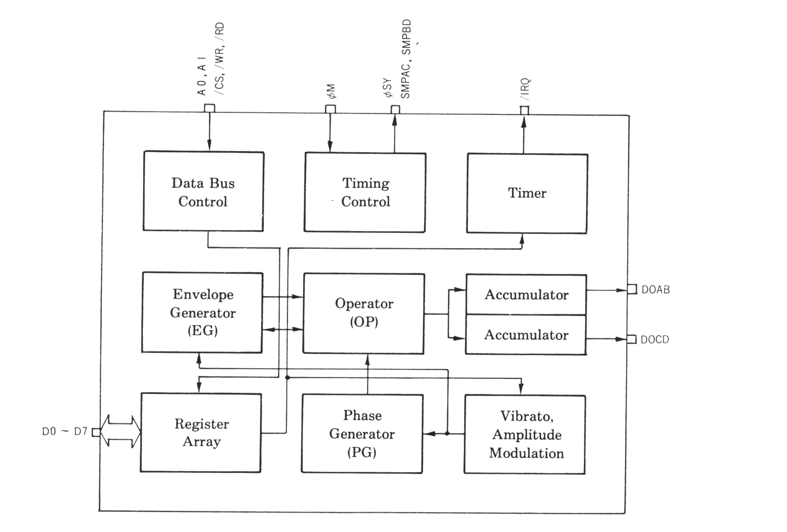

## Pin Out Diagram

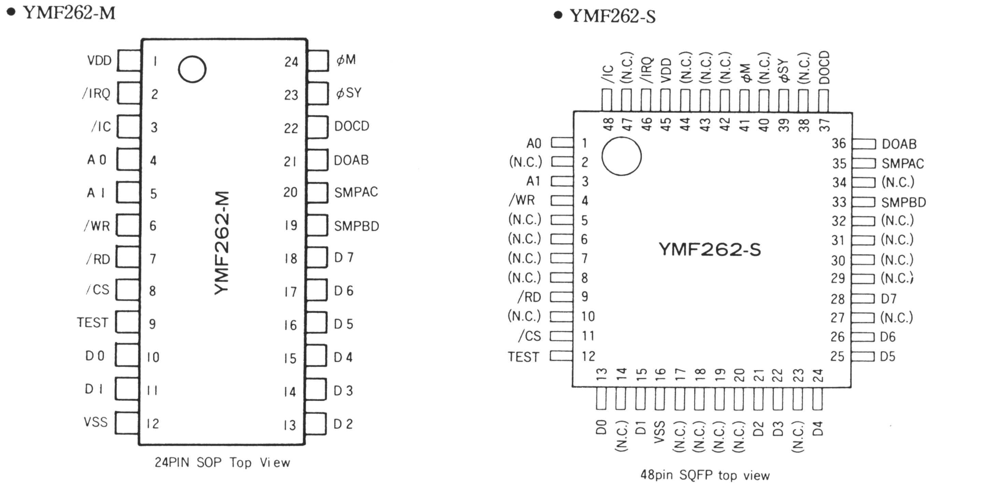

## Pin Configuration

| No. 24SOP | No. 48SQFP | I/O | Pin name | Function |
|---|---|---|---|---|
| 1 | 45 | - | VDD | +5V supply |
| 2 | 46 | OD | /IRQ | Timer interrupt request |
| 3 | 48 | I+ | /IC | Initial clear |
| 4 | 1 | I | A0 | CPU interface — Address select input |
| 5 | 3 | I | A1 | CPU interface — Address select input |
| 6 | 4 | I | /WR | CPU interface — Write enable input |
| 7 | 9 | I | /RD | CPU interface — Read enable input |
| 8 | 11 | I+ | /CS | CPU interface — Chip select input |
| 9 | 12 | O | TEST | LSI test pin (normally NC) |
| 10 | 13 | I/O | D0 | CPU interface — Data bus (LSB) |
| 11 | 15 | I/O | D1 | CPU interface — Data bus |
| 12 | 16 | - | VSS | Ground |
| 13 | 21 | I/O | D2 | CPU interface — Data bus |
| 14 | 22 | I/O | D3 | CPU interface — Data bus |
| 15 | 24 | I/O | D4 | CPU interface — Data bus |
| 16 | 25 | I/O | D5 | CPU interface — Data bus |
| 17 | 26 | I/O | D6 | CPU interface — Data bus |
| 18 | 28 | I/O | D7 | CPU interface — Data bus (MSB) |
| 19 | 33 | O | SMPBD | DAC interface — B and D channel sample/hold |
| 20 | 35 | O | SMPAC | DAC interface — A and C channel sample/hold |
| 21 | 36 | O | DOAB | DAC interface — A and B channel serial data output |
| 22 | 37 | O | DOCD | DAC interface — C and D channel serial data output |
| 23 | 39 | O | φSY | DAC interface — Data latch signal |
| 24 | 41 | I | φM | Master clock input (14.32 MHz) |

Note: OD is open drain output pin.
I+ is pull up input pin.

---

## Functions

### 1. Master Clock

**φM**

All operations in the LSI are controlled by the 14.32 MHz master clock signal applied to the φM pin.

### 2. CPU Interface

**/CS, /RD, /WR, A0, A1, D0–D7**

Sound generation is controlled by writing data in these registers. Writing data to a register or
reading the status from a register is accomplished through an 8 bit parallel CPU interface signal.
D0–D7 are a bidirectional data bus, and /CS, /RD, /WR, A0, and A1 are data bus control signals.

The data bus is controlled as follows:

| /CS | /RD | /WR | A0 | A1 | CPU Access Mode |
|---|---|---|---|---|---|
| H | X | X | X | X | Inactive mode |
| L | H | L | L | L/H | Address write mode |
| L | H | L | H | X | Data write mode |
| L | L | H | L | L | Status read mode |

X: Don't care

Note: Operation in states other than those listed above is not guaranteed.

**(a) Inactive mode**

When /CS = 'H', the data bus D0–D7 are in a high impedance state.

**(b) Address write mode**

This mode is used to specify the write address. For register array 0, A1 = 'L'. For register array
1, A1 = 'H'. The address of the data should be output on the data bus. After this cycle, data
may be written in data write mode after a minimum of 32 master clock cycles.

**(c) Data write mode**

Write data at the address specified previously. The data to be written should be output on the
data bus. A wait of at least 32 master clock cycles is required before the next address write
or data write.

**(d) Status read mode**

Read the status of the LSI. The status is output on the data bus.

### 3. DAC Interface

**DOAB, DOCD, φSY, SMPAC, SMPBD**

YMF262 generates 4 channel sounds, which are output from DOAB and DOCD. Data streams of
A and B channel are output from pin DOAB and data streams of C and D channel are output
from pin DOCD. These sound data are transmitted as 16-bit offset serial binary data stream.
These data streams are designed as input to the YAC512 D/A converter. The YMF262's sampling
frequency is 49.7 kHz. As part of the YMF262/YAC512 interface, the YMF262 outputs three timing
signals (φSY, SMPBD, SMPAC). Fig 1 shows these timing. In this case, please take care
that the assignment of YAC512 audio output channel is changed according to connection of sample/hold
signal (See Example).

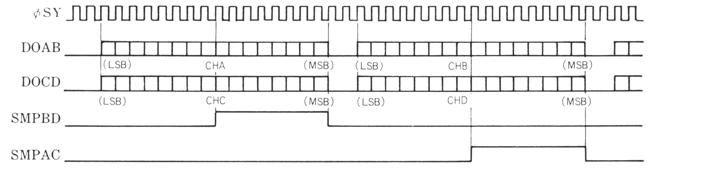

*Fig 1 — YMF262/YAC512 serial data timing.*

#### Example 1

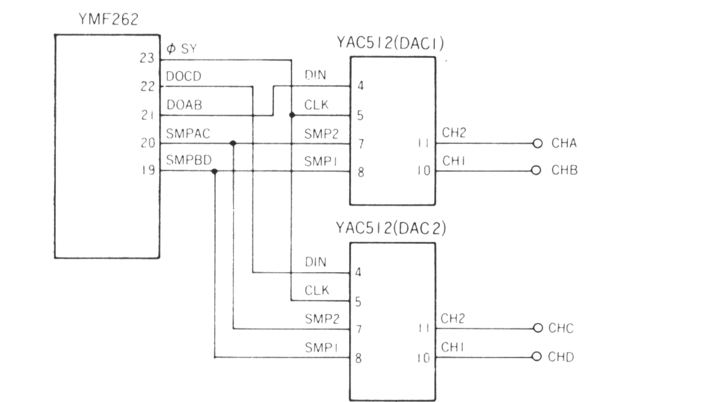

Matrix table of YMF262 register and YAC512 output channel:

| YMF262 channel | DOAB (DAC 1) CH1 | DOAB (DAC 1) CH2 | DOCD (DAC 2) CH1 | DOCD (DAC 2) CH2 |
|---|---|---|---|---|
| CHA | | ○ | | |
| CHB | ○ | | | |
| CHC | | | | ○ |
| CHD | | | ○ | |

#### Example 2

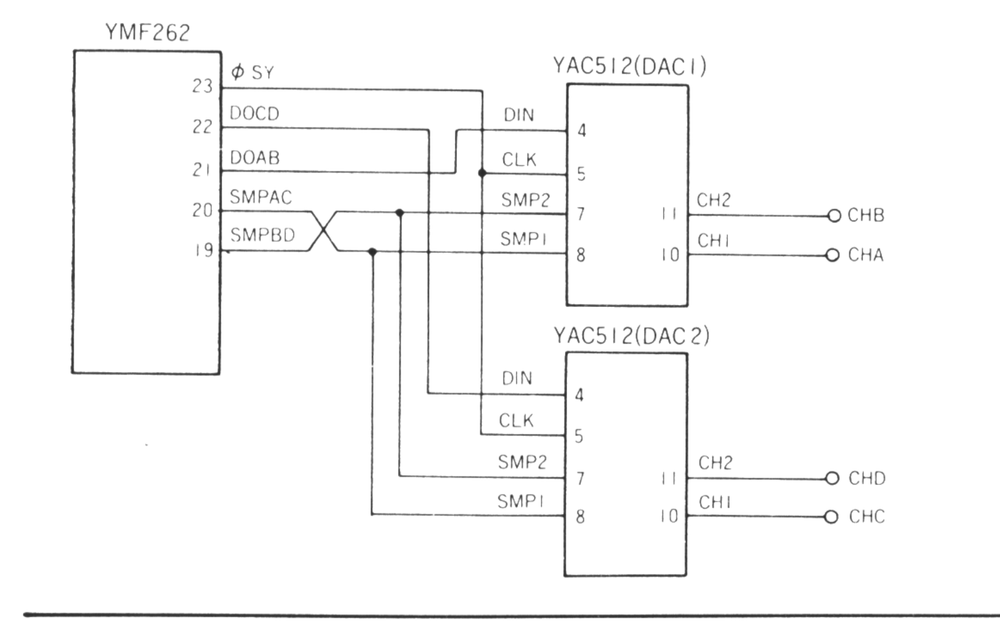

Matrix table of YMF262 register and YAC512 output channel:

| YMF262 channel | DOAB (DAC 1) CH1 | DOAB (DAC 1) CH2 | DOCD (DAC 2) CH1 | DOCD (DAC 2) CH2 |
|---|---|---|---|---|
| CHA | ○ | | | |
| CHB | | ○ | | |
| CHC | | | ○ | |
| CHD | | | | ○ |

---

## Register Map

The register map is split below into register array 0 (A1 = 'L') and register array 1 (A1 = 'H').
Blank cells are unused bits.

### Register Array 0 (A1 = 'L')

| Address | D7 | D6 | D5 | D4 | D3 | D2 | D1 | D0 |
|---|---|---|---|---|---|---|---|---|
| $01 | LSI TEST (D7–D0) | | | | | | | |
| $02 | TIMER 1 (D7–D0) | | | | | | | |
| $03 | TIMER 2 (D7–D0) | | | | | | | |
| $04 | RST | MT1 | MT2 | | | | ST2 | ST1 |
| $05 | | | | | | | | |
| $08 | | NTS | | | | | | |
| $20–$35 | AM | VIB | EGT | KSR | MULT (D3–D0) | | | |
| $40–$55 | KSL (D7–D6) | | TL (D5–D0) | | | | | |
| $60–$75 | AR (D7–D4) | | | | DR (D3–D0) | | | |
| $80–$95 | SL (D7–D4) | | | | RR (D3–D0) | | | |
| $A0–$A8 | F NUMBER(L) (D7–D0) | | | | | | | |
| $B0–$B8 | | | KON | BLOCK (D4–D2) | | | FNUM(H) (D1–D0) | |
| $BD | DAM | DVB | RYT | BD | SD | TOM | TC | HH |
| $C0–$C8 | CHD | CHC | CHB | CHA | FB (D3–D1) | | | CNT |
| $E0–$F5 | | | | | | | WS (D1–D0) | |

### Register Array 1 (A1 = 'H')

| Address | D7 | D6 | D5 | D4 | D3 | D2 | D1 | D0 |
|---|---|---|---|---|---|---|---|---|
| $01 | LSI TEST (D7–D0) | | | | | | | |
| $02 | | | | | | | | |
| $03 | | | | | | | | |
| $04 | | | CONNECTION SEL (D5–D0) | | | | | |
| $05 | | | | | | | | NEW |
| $08 | | | | | | | | |
| $20–$35 | AM | VIB | EGT | KSR | MULT (D3–D0) | | | |
| $40–$55 | KSL (D7–D6) | | TL (D5–D0) | | | | | |
| $60–$75 | AR (D7–D4) | | | | DR (D3–D0) | | | |
| $80–$95 | SL (D7–D4) | | | | RR (D3–D0) | | | |
| $A0–$A8 | F NUMBER(L) (D7–D0) | | | | | | | |
| $B0–$B8 | | | KON | BLOCK (D4–D2) | | | FNUM(H) (D1–D0) | |
| $BD | | | | | | | | |
| $C0–$C8 | CHD | CHC | CHB | CHA | FB (D3–D1) | | | CNT |
| $E0–$F5 | | | | | | | | WS (D1–D0) |

Note: All registers are cleared at reset.

---

## FM Signal Source Organization

Addresses in the following tables are hexadecimal.

### Register Array 0 — Channels 1–9 (A1 = 'L')

| Signal / register | 1 | 2 | 3 | 4 | 5 | 6 | 7 | 8 | 9 |
|---|---|---|---|---|---|---|---|---|---|
| Channel signal (two-operator) | 1 | 2 | 3 | 4 | 5 | 6 | 7 RYT | 8 RYT | 9 RYT |
| Channel signal (four-operator) | 1 | 2 | 3 | 1 | 2 | 3 | | | |
| Slot 1 signal | 1 | 2 | 3 | 7 | 8 | 9 | 13 | 14 | 15 |
| Slot 2 signal | 4 | 5 | 6 | 10 | 11 | 12 | 16 | 17 | 18 |
| Register settings for slot 1 | 20 40 60 80 E0 | 21 41 61 81 E1 | 22 42 62 82 E2 | 28 48 68 88 E8 | 29 49 69 89 E9 | 2A 4A 6A 8A EA | 30 50 70 90 F0 | 31 51 71 91 F1 | 32 52 72 92 F2 |
| Register settings for slot 2 | 23 43 63 83 E3 | 24 44 64 84 E4 | 25 45 65 85 E5 | 2B 4B 6B 8B EB | 2C 4C 6C 8C EC | 2D 4D 6D 8D ED | 33 53 73 93 F3 | 34 54 74 94 F4 | 35 55 75 95 F5 |
| Register settings for channel (two-operator) | A0 B0 C0 | A1 B1 C1 | A2 B2 C2 | A3 B3 C3 | A4 B4 C4 | A5 B5 C5 | A6 B6 C6 | A7 B7 C7 | A8 B8 C8 |
| Register settings for channel (four-operator) | A0 B0 C0 | A1 B1 C1 | A2 B2 C2 | C3 | C4 | C5 | | | |

### Register Array 1 — Channels 10–18 (A1 = 'H')

| Signal / register | 10 | 11 | 12 | 13 | 14 | 15 | 16 | 17 | 18 |
|---|---|---|---|---|---|---|---|---|---|
| Channel signal (two-operator) | 10 | 11 | 12 | 13 | 14 | 15 | 16 | 17 | 18 |
| Channel signal (four-operator) | 4 | 5 | 6 | 4 | 5 | 6 | | | |
| Slot 1 signal | 19 | 20 | 21 | 25 | 26 | 27 | 31 | 32 | 33 |
| Slot 2 signal | 22 | 23 | 24 | 28 | 29 | 30 | 34 | 35 | 36 |
| Register settings for slot 1 | 20 40 60 80 E0 | 21 41 61 81 E1 | 22 42 62 82 E2 | 28 48 68 88 E8 | 29 49 69 89 E9 | 2A 4A 6A 8A EA | 30 50 70 90 F0 | 31 51 71 91 F1 | 32 52 72 92 F2 |
| Register settings for slot 2 | 23 43 63 83 E3 | 24 44 64 84 E4 | 25 45 65 85 E5 | 2B 4B 6B 8B EB | 2C 4C 6C 8C EC | 2D 4D 6D 8D ED | 33 53 73 93 F3 | 34 54 74 94 F4 | 35 55 75 95 F5 |
| Register settings for channel (two-operator) | A0 B0 C0 | A1 B1 C1 | A2 B2 C2 | A3 B3 C3 | A4 B4 C4 | A5 B5 C5 | A6 B6 C6 | A7 B7 C7 | A8 B8 C8 |
| Register settings for channel (four-operator) | A0 B0 C0 | A1 B1 C1 | A2 B2 C2 | C3 | C4 | C5 | | | |

---

## Registers

### (1) Description

#### TIMER 1

**TIMER 1: Timer 1 preset value**

Timer 1 is an 8 bit preset counter. This counter is every 80µs, and /IRQ is generated when the
counter overflows. TIMER 1 is the preset value. When overflow occurs, this value is automatically
re-loaded into the counter. The time until /IRQ is generated (tov) is calculated as
follows:

tov[ms] = (255 − N1) × 0.08

N1 = D7·27 + D6·26 + D5·25 + D4·24 + D3·23 + D2·22 + D1·2 + D0

#### TIMER 2

**TIMER 2: Timer 2 preset value**

Timer 2 is an 8 bit preset counter. This counter is every 320µs, and /IRQ is generated when the
counter overflows. TIMER 2 is the preset value. When overflow occurs, this value is automatically
re-loaded into the counter. The time until /IRQ is generated (tov) is calculated as
follows:

tov[ms] = (255 − N1) × 0.32

N1 = D7·27 + D6·26 + D5·25 + D4·24 + D3·23 + D2·22 + D1·2 + D0

#### RST

**RST (IRQ RESET): /IRQ reset**

Reset the /IRQ signal generated by timers 1 and 2. RST = '1' sets /IRQ = 'H'.

#### MT1

**MT1 (MASK TIMER1): Timer 1 mask**

If MT1 = '1', /IRQ is not generated when timer 1 overflows.

#### MT2

**MT2 (MASK TIMER2): Timer 2 mask**

If MT2 = '1', /IRQ is not generated when timer 2 overflows.

#### ST1

**ST1 (START TIMER1): Timer 1 control**

When ST1 = '1', timer 1 loads the preset value and starts counting. If ST1 = '0', timer 1 is stopped.

#### ST2

**ST2 (START TIMER2): Timer 2 control**

When ST2 = '1', timer 2 loads the preset value and starts counting. If ST2 = '0', timer 2 is stopped.

#### NTS

**NTS (NOTE SEL): Keyboard split selection**

Selects the keyboard split method to determine the key scale number.

When NTS = 0:

| BLOCK Data | F-NUMBER MSB | F-NUMBER 2nd | Key scale No. |
|---|---|---|---|
| 0 | * | 0 | 0 |
| 0 | * | 1 | 1 |
| 1 | * | 0 | 2 |
| 1 | * | 1 | 3 |
| 2 | * | 0 | 4 |
| 2 | * | 1 | 5 |
| 3 | * | 0 | 6 |
| 3 | * | 1 | 7 |
| 4 | * | 0 | 8 |
| 4 | * | 1 | 9 |
| 5 | * | 0 | 10 |
| 5 | * | 1 | 11 |
| 6 | * | 0 | 12 |
| 6 | * | 1 | 13 |
| 7 | * | 0 | 14 |
| 7 | * | 1 | 15 |

When NTS = 1:

| BLOCK Data | F-NUMBER MSB | F-NUMBER 2nd | Key scale No. |
|---|---|---|---|
| 0 | 0 | * | 0 |
| 0 | 1 | * | 1 |
| 1 | 0 | * | 2 |
| 1 | 1 | * | 3 |
| 2 | 0 | * | 4 |
| 2 | 1 | * | 5 |
| 3 | 0 | * | 6 |
| 3 | 1 | * | 7 |
| 4 | 0 | * | 8 |
| 4 | 1 | * | 9 |
| 5 | 0 | * | 10 |
| 5 | 1 | * | 11 |
| 6 | 0 | * | 12 |
| 6 | 1 | * | 13 |
| 7 | 0 | * | 14 |
| 7 | 1 | * | 15 |

\*: Don't care

#### AM

**AM (AMPLITUDE MODULATION): Tremolo on/off**

Turns tremolo on for the corresponding slot when AM = '1'. The repetition rate is 3.7 Hz, and
the depth is controlled by DAM.

#### VIB

**VIB (VIBRATO): Vibrato on/off**

Turns vibrato on for the corresponding slot when VIB = '1'. The repetition rate is 6.1 Hz and
the depth is controlled by DVB.

#### EGT

**EGT (ENVELOPE TYPE): Select sustain/decay**

EGT = '1' selects sustained sound, and maintains the SUSTAIN LEVEL while KON is 1.
EGT = '0' selects decay, and the RELEASE RATE takes effect even if KON is maintained at 1.

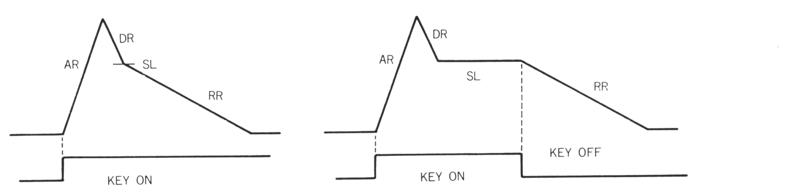

#### KSR

**KSR (KEY SCALE RATE): Select key scale RATE**

With normal musical instruments, the attack/decay rate becomes faster as the pitch increases.
The key scale RATE controls simulation of this effect. An offset is added to the individual
ATTACK, DECAY and RELEASE rates as follows:

Actual rate = Rate value × 4 + Rof

If rate value = 0, actual rate = 0.

Rof is set as follows depending on the KSR setting:

| Key scale No. | 0 | 1 | 2 | 3 | 4 | 5 | 6 | 7 | 8 | 9 | 10 | 11 | 12 | 13 | 14 | 15 |
|---|---|---|---|---|---|---|---|---|---|---|---|---|---|---|---|---|
| Rof, KSR = 0 | 0 | 0 | 0 | 0 | 1 | 1 | 1 | 1 | 2 | 2 | 2 | 2 | 3 | 3 | 3 | 3 |
| Rof, KSR = 1 | 0 | 1 | 2 | 3 | 4 | 5 | 6 | 7 | 8 | 9 | 10 | 11 | 12 | 13 | 14 | 15 |

#### MULT

**MULT (MULTIPLE): Frequency data multiplier**

Sets the multiplier for the frequency data specified by BLOCK and F-NUMBER. This multiplier
is applied to the FM carrier and modulation frequencies.

| MULT | 0 | 1 | 2 | 3 | 4 | 5 | 6 | 7 | 8 | 9 | A | B | C | D | E | F |
|---|---|---|---|---|---|---|---|---|---|---|---|---|---|---|---|---|
| Multiplier | 1/2 | 1 | 2 | 3 | 4 | 5 | 6 | 7 | 8 | 9 | 10 | 10 | 12 | 12 | 15 | 15 |

#### KSL

**KSL (KEY SCALE LEVEL): Key scale level selection**

With musical instruments, volume decreases as pitch increases. LEVEL key scale values are
used to simulate this effect:

| KSL | 0 | 2 | 1 | 3 |
|---|---|---|---|---|
| Attenuation | 0 | 1.5dB/oct | 3dB/oct | 6dB/oct |

#### TL

**TL (TOTAL LEVEL): Modulation, volume setting**

Attenuation is performed according to the envelope generator output. The modulation or
volume is controlled.

Attenuation = 24·D5 + 12·D4 + 6·D3 + 3·D2 + 1.5·D1 + 0.75·D0 (dB)

#### AR

**AR (ATTACK RATE): Attack rate setting**

Attack rate = 23·D7 + 22·D6 + 2·D5 + D4

#### DR

**DR (DECAY RATE): Decay rate setting**

Decay rate = 23·D3 + 22·D2 + 2·D1 + D0

#### SL

**SL (SUSTAIN LEVEL): Sustained level setting**

Sustain level = 24·D7 + 12·D6 + 6·D5 + 3·D4

When D7 = D6 = D5 = D4 = 1, level = 93dB

#### RR

**RR (RELEASE RATE): Release rate setting**

Release rate = 23·D3 + 22·D2 + 2·D1 + D0

#### FNUM

**FNUM (F-NUMBER): Scale data within the octave**

Gives pitch data along with BLOCK data.

F-NUMBER = f·219 / fs / 2(BLOCK−1)

(f: frequency; fs: sampling frequency; fs = fM/288)

#### KON

**KON (KEY-ON): Sound generation ON/OFF**

If KON = '1', the channel generates sound.

#### BLOCK

**BLOCK: Octave data**

Generates octave data with F-NUMBER data.

#### DAM

**DAM (AMPLITUDE MODULATION DEPTH): Select amplitude modulation depth**

When DAM = '1', 4.8dB. When DAM = '0', 1dB.

#### DVB

**DVB (VIBRATO DEPTH): Select vibrato depth**

When DVB = '1', 14 percent. When DVB = '0', 7 percent.

#### RYT

**RYT (RHYTHM MODE): Select rhythm sound mode**

Channels 7–9 are used for rhythm sounds when RYT = '1'.

#### BD, SD, TOM, TC, HH

**BD (BASS DRUM), SD (SNARE DRUM), TOM (TOM TOM), TC (TOP CYMBAL), HH (HI-HAT): ON/OFF**

Sound output on/off switch for each sound. When any of these is set to 1, the corresponding
sound is generated.

| Rhythm Sound | Slot Used |
|---|---|
| BASS DRUM | 13, 16 |
| SNARE DRUM | 17 |
| TOM TOM | 15 |
| TOP CYMBAL | 18 |
| HI-HAT | 14 |

#### FB

**FB (FEED BACK): Modulation depth for slot 1 FM feed back**

| FB | 0 | 1 | 2 | 3 | 4 | 5 | 6 | 7 |
|---|---|---|---|---|---|---|---|---|
| Modulation | 0 | π/16 | π/8 | π/4 | π/2 | π | 2π | 4π |

#### NEW

**NEW: OPL3/OPL2 Operation selection**

If NEW = '1', OPL3 operation is selected and data is written when A1 = 'H'. To use OPL3 functions,
write NEW = '1' during initialization.

#### CNT

**CNT (CONNECTION): Operator connection**

Two-operator mode uses the following connection:

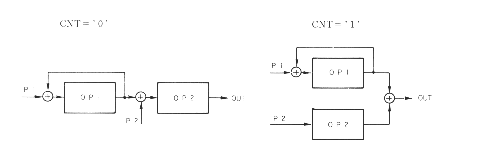

In four-operator mode, both CNT bits are used to specify the connection:

| Channel No. (four-operator) | 1 | 2 | 3 | 4 | 5 | 6 |
|---|---|---|---|---|---|---|
| CNT Address | C0, C3 | C1, C4 | C2, C5 | C0, C3 | C1, C4 | C2, C5 |
| A1 | 'L' | 'L' | 'L' | 'H' | 'H' | 'H' |

The connection is as follows:

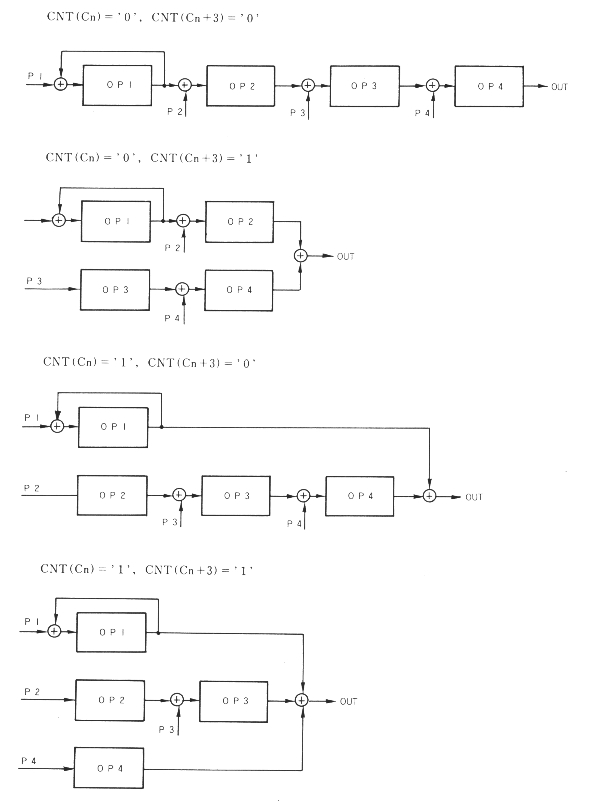

#### WS

**WS (WAVE SELECT): Select waveform**

Select the waveform used for carrier and modulation.

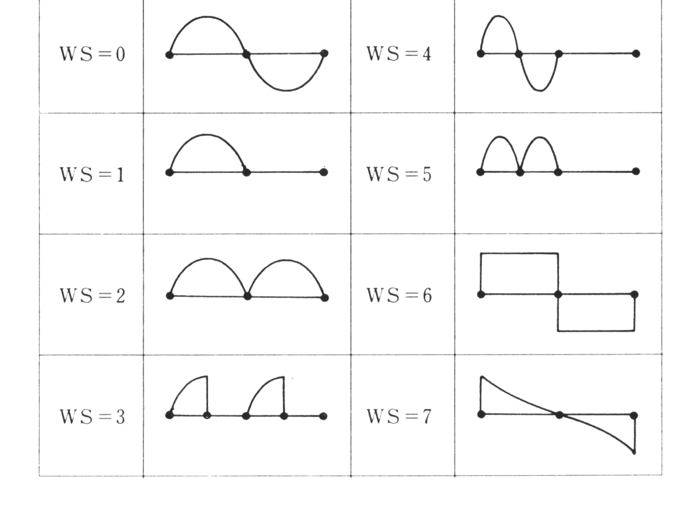

#### CHA, CHB, CHC, CHD

**CHA (CHANNEL A), CHB (CHANNEL B), CHC (CHANNEL C), CHD (CHANNEL D): Select output**

When any of these bits is set to 1, data is output to the corresponding channel. CHA and
CHB are output from the DOAB pin, and CHC and CHD are output from the DOCD pin.

#### CONNECTION SEL

**CONNECTION SEL: Four-operator mode**

| CONNECTION SEL | D5 | D4 | D3 | D2 | D1 | D0 |
|---|---|---|---|---|---|---|
| Four-operator channel | 6 | 5 | 4 | 3 | 2 | 1 |
| Two-operator channels used | 12, 15 | 11, 14 | 10, 13 | 3, 6 | 2, 5 | 1, 4 |

### (2) Status

| Bit | D7 | D6 | D5 | D4 | D3 | D2 | D1 | D0 |
|---|---|---|---|---|---|---|---|---|
| Status | IRQ | FT1 | FT2 | | | | | |

**FT1 (FLAG TIMER1): Timer 1 overflow flag**

This flag is set to 1 when timer 1 overflow occurs.
This flag is not reset unless RST is written.

**FT2 (FLAG TIMER2): Timer 2 overflow flag**

This flag is set to 1 when timer 2 overflow occurs.
This flag is not reset unless RST is written.

**IRQ (INTERRUPT REQUEST): Interrupt request**

Set to 1 if FT1 or FT2 is set. This flag is not reset unless RST is written.

---

## Electrical Characteristics

### 1. Absolute Maximum Ratings

| Item | Symbol | Rating | Unit |
|---|---|---|---|
| Power supply voltage | VDD | −0.3 – 7.0 | V |
| Input voltage | VI | −0.3 – VDD+0.5 | V |
| Operating temperature | Top | 0 – 70 | °C |
| Storage temperature | Tstg | −50 – 125 | °C |

### 2. Recommended Operating Conditions

| Item | Symbol | Minimum | Typical | Maximum | Unit |
|---|---|---|---|---|---|
| Power supply voltage | VDD | 4.75 | 5.00 | 5.25 | V |
| Operating temperature | Top | 0 | 25 | 70 | °C |

### 3. DC Characteristics

(Conditions: Ta = 0 – 70°C, VDD = 5.0 ± 0.25 V)

| Item | Symbol | Conditions | Min. | Typ. | Max. | Unit |
|---|---|---|---|---|---|---|
| Power consumption | PD | VDD = 5.0V fM = 14.32MHz | | | 50 | mW |
| Input high level voltage 1 | VIH1 | Note 1 | 2.2 | | | V |
| Input low level voltage 1 | VIL1 | Note 1 | | | 0.8 | V |
| Input high level voltage 2 | VIH2 | Note 2 | 3.5 | | | V |
| Input low level voltage 2 | VIL2 | Note 2 | | | 1.0 | V |
| Input leakage current | ILI | VI = 0 – 5V, Note 3 | −10 | | 10 | µA |
| Input capacity | CI | | | | 10 | pF |
| Output high level voltage | VOH | IOH = −80µA | VDD − 1.0 | | | V |
| Output low level voltage | VOL | IOL = 2.0mA | | | 0.4 | V |
| Output capacity | CO | | | | 10 | pF |
| Output leakage current | ILO | VI = 0 – 5V, Note 4 | −10 | | 10 | µA |
| Pull up resistance | RU | | 80 | | 400 | kΩ |

Note)

**Note 1:** Applied to /WR, /RD, /CS, A0, A1, D0 – D7 (when used as input pins)

**Note 2:** Applied to φM, /IC

**Note 3:** Applied to φM, /WR, /RD, A0, A1, D0 – D7 (when used as input pins)

**Note 4:** When D0 – D7 are in high impedance

### 4. AC Characteristics

(Conditions: Ta = 0 – 70°C, VDD = 5.0 ± 0.25 V)

| Item | Symbol | Figure | Min. | Typ. | Max. | Unit |
|---|---|---|---|---|---|---|
| Master clock frequency | fM | Fig A-1 | 10 | 14.32 | 16 | MHz |
| Master clock duty | D | | 40 | 50 | 60 | % |
| Reset pulse width | tICW | Fig A-2 | 400/fM | | | s |
| Address setup time | tAS | Fig A-3, 4 | 10 | | | ns |
| Address hold time | tAH | Fig A-3, 4 | 10 | | | ns |
| Chip select write width | tCSW | Fig A-3 | 100 | | | ns |
| Chip select read width | tCSR | Fig A-4 | 150 | | | ns |
| Write pulse width | tWW | Fig A-3 | 100 | | | ns |
| Write data setup time | tWDS | Fig A-3 | 10 | | | ns |
| Write data hold time | tWDH | Fig A-3 | 20 | | | ns |
| Read pulse width | tRW | Fig A-4 | 150 | | | ns |
| Read data access time | tACC | Fig A-4 | | | 150 | ns |
| Read data hold time | tRDH | Fig A-4 | 10 | | | ns |

\*1: Master clock cycle

### 5. Timing Diagram

#### (1) Input Clock Timing

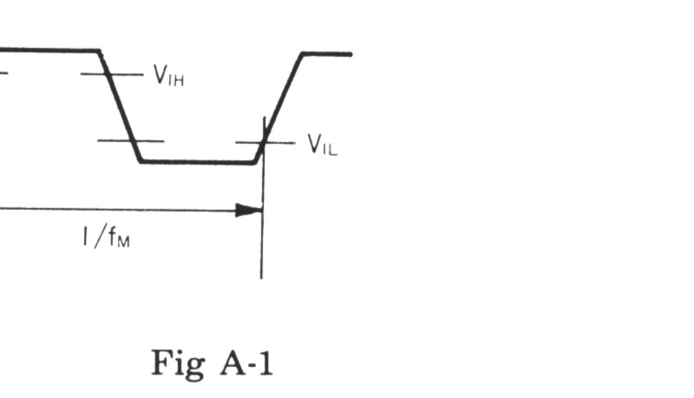

*Fig A-1 — Input clock timing.*

#### (2) Reset Pulse

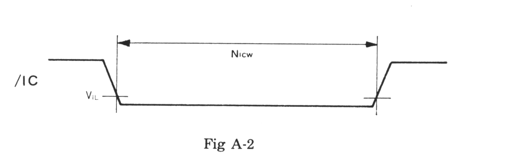

*Fig A-2 — Reset pulse.*

#### (3) Address/Data Write Timing

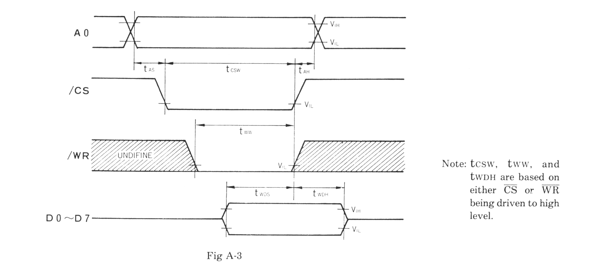

*Fig A-3 — Address/data write timing.*

Note: tCSW, tWW, and tWDH are based on either /CS or /WR being
driven to high level.

#### (4) Status Read Timing

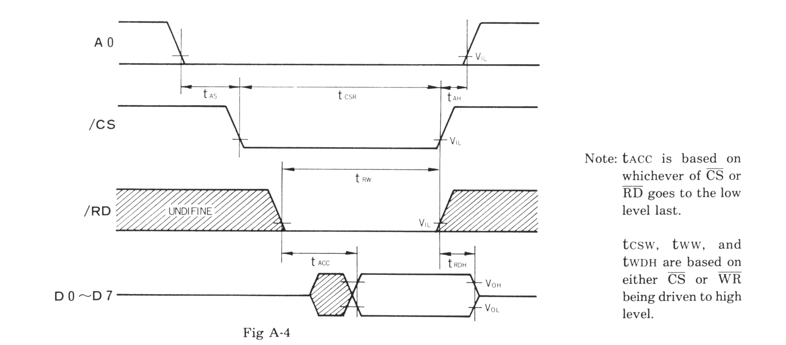

*Fig A-4 — Status read timing.*

Note: tACC is based on whichever of /CS or /RD goes to the low level last.

tCSW, tWW, and tWDH are based on either /CS or /WR being driven to
high level.

---

## Dimensions

### YMF262-M

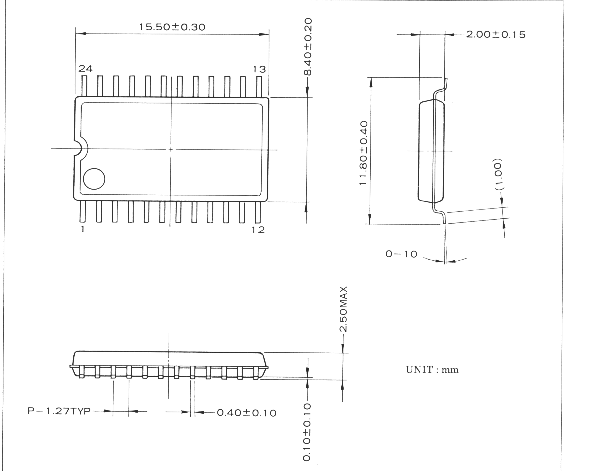

*24-pin SOP (YMF262-M). Unit: mm.*

### YMF262-S

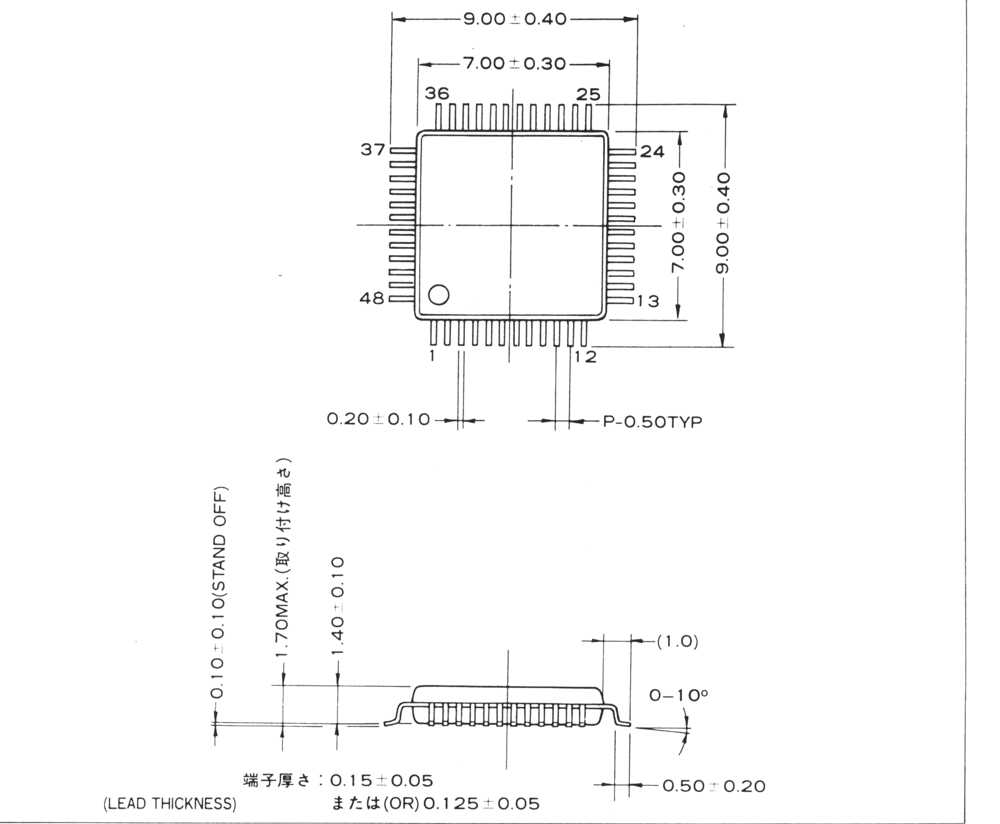

*48-pin SQFP (YMF262-S). Unit: mm.*

---

## Notice

The specifications of this product are subject to improvement changes without prior notice.

YAMAHA CORPORATION

Address inquiries to:
Semi-conductor Sales Department

- **Head Office:** 203, Matsunokijima, Toyooka-mura, Iwata-gun, Shizuoka-ken, 438-01
  - Electronic Equipment business section
  - Tel. 0539-62-4918  Fax. 0539-62-5054
- **Tokyo Office:** 2-17-11, Takanawa, Minato-ku, Tokyo, 108
  - Tel. 03-5488-5431  Fax. 03-5488-5088
- **Osaka Office:** 3-12-9, Minami Senba, Chuo-ku, Osaka City, Osaka, 542
  - Shinsaibashi Plaza Bldg. 4F
  - Tel. 06-252-7980  Fax. 06-252-5615
- **U.S.A. Office:** YAMAHA Systems Technology
  - 100 Century Center Court, San Jose, CA 95112
  - Tel. 408-467-2300  Fax. 408-437-8791

COPYING PROHIBITED © 1988 YAMAHA CORPORATION 0.3K 9204 Printed in Japan
